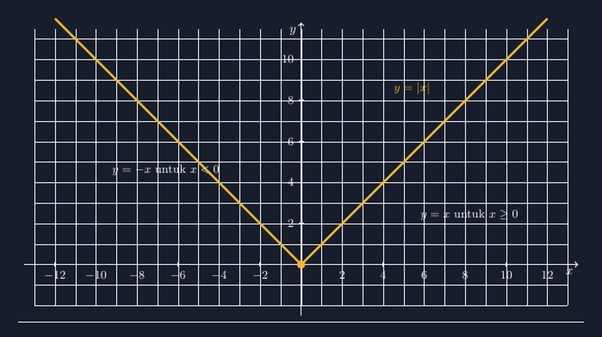

+++
title = "Menggambar Grafik Fungsi Mutlak dengan TikZ: Kakimu yang Harus Sama Panjang"
date = 2026-11-25T20:30:00+07:00
draft = false
authors = ["Gunanto"]
description = "Grafik y = |x| sering digambar asal jadi huruf V yang miring. Dengan TikZ, kemiringan kakinya bisa dihitung dan dibuktikan sama."
featuredImage = "featured-image.png"
tags = ["tikz", "fungsi mutlak", "grafik fungsi", "media pembelajaran"]
categories = ["Matematika"]
math = true
+++

Kemarin saya mengajar fungsi mutlak ke kelas IX. Di papan tulis, saya gambar huruf V besar, lalu tanya: "Kalau titik tikusnya ini, kakinya sama panjang nggak?" Semua mengangguk. Tapi ketika saya minta mereka menggambar sendiri di buku, dari sepuluh anak, tujuh menggambar V yang kiri sempit dan kanan lebar — atau sebaliknya. Grafik fungsi mutlak itu memang bentuknya V, tapi V-nya punya aturan: keduanya simetris terhadap sumbu vertikal, dan kemiringannya harus konsisten dengan nilai koefisien di dalam tanda mutlak.

<!--more-->

Masalahnya klasik: menggambar grafik dengan tangan itu susah presisinya. Apalagi kalau soalnya $y = |2x|$ versus $y = |x|$, di mana perbedaannya cuma di seberapa "curam" kakinya. Kalau gambar kita tidak jujur, siswa justru belajar dari gambar yang salah. Akhirnya saya membiasakan diri menggambar grafik penting dengan TikZ, supaya yang tampil di slide dan lembar kerja benar-benar bisa dipertanggungjawabkan.

## Definisinya dulu, gambar kemudian

Fungsi mutlak didefinisikan sebagai:

$$|x| = \begin{cases} x, & x \ge 0 \\ -x, & x < 0 \end{cases}$$

Definisi ini yang harus terbaca di gambar. Kakinya bukan "dua garis asal miring", tapi dua garis dengan persamaan berbeda: $y = x$ untuk $x \ge 0$, dan $y = -x$ untuk $x < 0$. Karena $x$ dan $-x$ selalu bernilai sama untuk setiap pasangan titik yang berlawanan tanda, otomatis kaki kiri dan kanan saling mencerminkan terhadap sumbu-$y$. Itulah sebabnya grafiknya harus terlihat simetris — bukan karena kita menginginkannya simetris, tapi karena definisinya memang begitu.



## Kode TikZ yang jujur pada kemiringan

Bagian kuncinya sederhana: saya tidak menggambar "huruf V", tapi menggambar dua segmen garis dengan koordinat yang benar-benar dihitung.

```latex
\draw[aksen,line width=1.6pt]
  (-12,12) -- (0,0) -- (12,12);
```

Titik $(0,0)$ adalah titik tikus. Titik $(12,12)$ dipilih karena memenuhi $y = x$; titik $(-12,12)$ memenuhi $y = -x$. Dengan begitu kedua kaki punya kemiringan yang persis sama besarnya — 1 dan $-1$, atau 45° dari sumbu horizontal. Kalau besok saya perlu menggambar $y = |2x|$, saya tinggal mengganti titiknya menjadi $(4,8)$ di kaki kanan dan $(-4,8)$ di kaki kiri, dan kemiringannya otomatis menjadi 2 tanpa saya menebak-nebak.

Hal yang sering terlewat: pada kanvas dengan `x=0.55cm, y=0.55cm`, satu unit di sumbu-$x$ dan sumbu-$y$ sama panjang di atas kertas. Kalau skala kedua sumbu berbeda (misalnya untuk memuat domain yang lebar), kemiringan 45° di kode tidak lagi tampak 45° di hasil cetak. Untuk grafik fungsi mutlak, saya sengaja menjaga skala agar tetap sama, supaya kesimetriannya kelihatan kesimetrian sungguhan.

Setelah itu tinggal mempercantik: grid tipis untuk membantu siswa membaca koordinat, label sumbu, dan penjelasan persamaan masing-masing kaki di dekat garisnya. Label $y = -x$ untuk $x < 0$ saya taruh di kiri atas, dan $y = x$ untuk $x \ge 0$ di kanan bawah — mengikuti arah kakinya masing-masing.

## Dua kesalahan yang dulu sering saya buat

Pertama, menggambar simetri secara "perkiraan". Dulu saya gambar dulu kaki kanan, lalu meniru kaki kirinya dengan mata. Hasilnya sering kali kaki kiri sedikit lebih landai, dan anak-anak yang jeli langsung protes: "Bu, kok nggak sama?" Mereka benar. Dengan koordinat yang dihitung, protes itu tidak pernah muncul lagi.

Kedua, label yang nempel di garis. Sekali label menempel pada garis yang digambar dengan `line width` tebal, bagian hurufnya tertutup. Sekarang saya biasakan memberi jarak: label diletakkan di ruang kosong grid, bukan persis di atas garis.

## Di kelas: membaca gambar, lalu membuktikan

Slide dengan gambar TikZ ini saya pakai sebagai pembuka, bukan pengganti latihan. Urutannya begini: siswa melihat gambar, saya tunjukkan titik-titik pada kedua kaki — misalnya $(2,2)$ dan $(-2,2)$ — lalu mereka diminta mencari pasangan lain. Dari situ mereka sendiri yang menemukan pola: nilai mutlaknya selalu sama, yang beda cuma tandanya. Baru setelah itu definisi sepotong-sepotung dituliskan, dan terasa seperti kesimpulan, bukan hafalan.

Ada satu momen yang saya suka. Seorang siswa bertanya, "Kalau titiknya digeser, misalnya $|x - 3|$, kakinya tetap sama panjang?" Jawabannya ya — hanya titik tikusnya yang pindah ke $(3,0)$, dan itulah bahan diskusi pertemuan berikutnya. Gambar yang jujur memang melahirkan pertanyaan yang baik.

Pertanyaan itu juga yang akhirnya mengantar kami ke variasi lain. Pekan berikutnya kami mencoba $y = 2|x|$: bentuknya tetap V, tapi kakinya jadi lebih curam karena setiap nilai mutlak dikalikan dua. Lalu $y = |x| + 1$, di mana seluruh V terangkat satu kotak ke atas tanpa berubah bentuk sama sekali. Dengan kode TikZ yang sudah terbukti, membuat semua variasi itu hanya soal mengubah beberapa angka di koordinat — dan setiap perubahan bisa langsung dibandingkan berdampingan di slide. Anak-anak tidak lagi menghafal "kalau dikali, jadi curam; kalau ditambah, naik" sebagai mantra, tapi melihat sendiri kenapa hal itu terjadi: koefisien mengubah kemiringan, konstanta mengangkat titik.

Yang menarik, pergeseran horizontal justru yang paling sering salah dibaca. Ketika kami menggambar $y = |x - 3|$, hampir separuh kelas menebak grafiknya bergeser ke kiri, karena "ada tandanya minus". Membuktikan lewat koordinat — titik $x = 5$ memberikan nilai 2, titik $x = 1$ juga memberikan nilai 2 — akhirnya meyakinkan mereka bahwa V-nya pindah ke kanan. Di sini saya bersyukur sudah menggambar semuanya dengan koordinat yang benar: kalau gambar kuncinya keliru, miskonsepsi justru kami perkuat bersama-sama di depan kelas.

> 📎 **Berkas TikZ lengkap:** [grafik-mutlak.tex](tex/grafik-mutlak.tex) — siap kompilasi (butuh paket `tikz`).

Untuk guru yang ingin mencoba: mulailah dari dua titik kakinya saja, cek bahwa keduanya benar-benar memenuhi definisi, lalu tambahkan grid dan label. Gambar yang bisa dipertanggungjawabkan itu tidak lebih sulit dari gambar yang asal jadi — hanya butuh kebiasaan menghitung sebelum menggambar, persis seperti yang kita tanamkan pada siswa.
