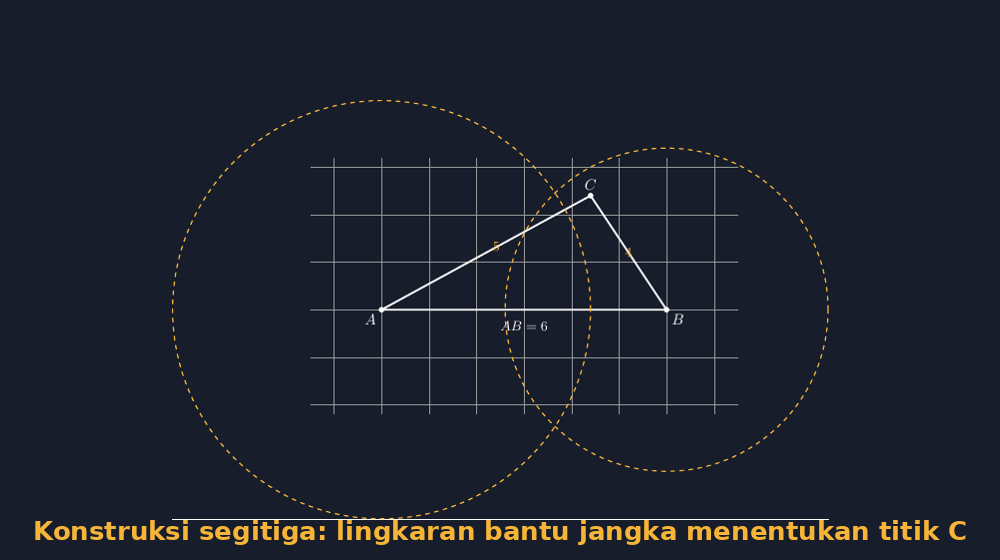

Ada satu jam pelajaran yang tahun ini saya nikmati lebih dari biasanya: konstruksi segitiga dengan jangka. Materinya terdengar kuno — bukankah sekarang semua bisa digambar di komputer? Tapi justru di situlah daya tariknya. Saya membawa jangka kayu besar yang bisa menempel di papan tulis, satu bungkus kapur, dan satu soal: *"Gambarlah segitiga ABC dengan AB = 6 cm, AC = 5 cm, dan BC = 4 cm."* Lalu saya diam dan menonton.

<!--more-->

## Lingkaran yang Sempat Dianggap Aneh

Yang saya perhatikan dari jam-jam konstruksi seperti ini bukan hasil segitiganya, tapi momen ketika siswa memahami kenapa kita menggambar lingkaran. Sebagian besar anak sudah tahu cara pakai jangka — mereka pernah memakainya untuk menandai lingkaran di buku gambar. Tapi menggambar *dua* lingkaran yang saling berpotongan, tanpa tahu dulu di mana titik ketiganya berada, itu rasanya aneh bagi mereka. Anak-anak menggambar lingkaran pertama dengan wajah ragu, seperti orang yang mengetik kata yang tidak yakin ejaannya.

Lalu ada yang berbisik, "Pak, lingkarannya dihapus nggak?" Pertanyaan itu sebenarnya pertanyaan filosofis yang bagus. Lingkaran bantu itu bukan bagian dari segitiga, tapi *dia yang menemukan segitiganya*. Menghapusnya terasa seperti menghapus proses berpikir. Kebiasaan saya sekarang: lingkaran bantu tidak dihapus, tapi digambar putus-putus, lebih tipis, supaya terlihat bahwa ia berkasta lebih rendah dari segitiganya — tapi tetap ada.



Gambar di atas adalah versi digital dari apa yang kami gambar di kelas: kaki jangka dipatok di $A$ dengan bukaan 5, jari-jari lingkaran pertama; lalu dipatok di $B$ dengan bukaan 4, jari-jari lingkaran kedua. Titik potong keduanya itulah $C$. Tidak ada langkah yang tidak dijelaskan oleh gambar itu sendiri — dan justru kejujuran itulah yang membuat saya akhirnya mengulang materi yang sama di TikZ.

## Kenapa TikZ, Padahal Sudah Ada Jangka?

Kalau konstruksi tangan sudah berjalan baik, mengapa saya repot-repot menggambarnya lagi dengan LaTeX? Jawabannya ada di satu pengalaman kecil. Beberapa tahun lalu saya menyalin soal konstruksi ke lembar latihan, dan saya menggambar ilustrasi jawabannya pakai aplikasi gambar biasa. Hasilnya kelihatan benar di layar — sampai seorang siswa yang teliti mengukur gambar di lembar soal itu dengan penggaris dan menemukan bahwa $AC$ yang saya tulis "5 cm" ternyata panjangnya 5,4 cm di kertas. Dia bertanya, "Pak, ini boleh diukur nggak?"

Saya tidak punya jawaban yang memuaskan hari itu. Gambar yang tidak dibangun dari angkanya sendiri selalu menyisakan celah seperti itu: kelihatan benar, tapi tidak *dijamin* benar. TikZ menutup celah itu, karena ia bekerja dengan cara yang sama seperti jangka. Titik-titiknya adalah koordinat, dan jaraknya adalah hitungan, bukan perkiraan mata. Lingkaran bantu di TikZ punya radius yang benar-benar sama dengan panjang sisi yang diminta soal — persis seperti bukaan jangka yang kita ukur dengan penggaris.

Inti kode untuk gambar di atas kira-kira begini:

```latex
\coordinate (A) at (-3,0);
\coordinate (B) at (3,0);
\draw[aksen,dashed,thick] (A) circle (4.4cm);
\draw[aksen,dashed,thick] (B) circle (3.4cm);
\coordinate (C) at (intersection of A--B and ...);
```

Saya sengaja menampilkan versi ringkasnya; berkas lengkap yang bisa langsung dikompilasi ada di tautan bawah tulisan ini. Yang menarik, di TikZ saya tidak harus menghitung titik potong lingkaran secara manual — koordinat $C$ bisa saya tetapkan langsung dari panjang sisi yang diinginkan, dan lingkaran bantunya saya gambar *untuk membuktikan* bahwa $C$ memang berjarak 5 dari $A$ dan 4 dari $B$. Urutan berpikirnya terbalik dari konstruksi tangan: di kertas, lingkaran *menemukan* titik; di TikZ, lingkaran *mengesahkan* titik. Dua arah yang berbeda menuju kesimpulan yang sama, dan saya mengajarkan keduanya.

## Waktu Saya Pakai yang Mana

Setelah beberapa kali mencoba, sekarang saya punya pembagian yang cukup jelas. Konstruksi jangka di kertas saya pakai saat konsepnya baru diperkenalkan. Rasanya tidak bisa digantikan: tangan yang memutar jangka, kapur yang meninggalkan jejak lengkung di papan, dan kegembiraan kecil ketika dua lingkaran ternyata berpotongan di titik yang "kebetulan" tepat. Ada rasa fisik dari aktivitas itu yang membuat konsep menempel.

TikZ saya pakai ketika gambar itu harus *bertahan*: lembar latihan, modul ajar, bank soal. Di tempat-tempat itu, gambar akan dilihat ratusan kali oleh orang yang tidak hadir saat saya mengajarnya, dan setiap pembaca berhak melihat gambar yang jujur pada angkanya. Juga saat soal butuh variasi — tinggal ganti panjang sisi di koordinatnya, dan semua lingkaran bantu menyesuaikan dengan sendirinya. Coba lakukan itu dengan jangka: satu soal baru berarti satu jam menggambar ulang.

## Siswa yang Bertanya tentang Tiga Kasus

Puncak jam pelajaran tahun ini datang dari seorang siswa yang biasanya paling diam. Setelah kami menyelesaikan konstruksi dengan tiga sisi diketahui, dia mengangkat tangan dan bertanya, "Pak, kalau lingkarannya tidak berpotongan, gimana?" Saya menahan diri untuk tidak langsung menjawab. Saya lempar balik ke kelas, dan diskusi yang muncul jauh lebih berharga daripada jawaban saya: anak-anak mulai mencoba bukaan jangka yang berbeda-beda, dan menemukan sendiri bahwa jika panjang dua sisi yang diketahui terlalu pendek dibanding sisi ketiga, lingkarannya tidak akan pernah bertemu. Mereka menemukan ketaksamaan segitiga dengan tangannya sendiri — sebelum saya menyebut namanya.

Momen seperti itu yang membuat saya tetap percaya pada kombinasi tua dan baru ini. Jangka mengajarkan tubuh: bahwa geometri adalah sesuatu yang bisa diputar, dibuka, dan diukur. TikZ mengajarkan kejujuran: bahwa setiap gambar seharusnya bisa dipertanggungjawabkan angkanya. Siswa yang pernah melakukan keduanya tidak hanya tahu *cara* menggambar segitiga — mereka tahu *kenapa* segitiga itu bisa ada. Dan menurut saya, itu inti dari semua pembelajaran matematika, bukan hanya bagian konstruksinya.

Kalau Bapak/Ibu ingin mencoba, mulailah dari yang paling sederhana: satu segitiga dengan tiga sisi diketahui, digambar dua kali — sekali dengan jangka di kertas, sekali dengan TikZ di layar. Bandingkan keduanya bersama siswa. Saya yakin pertanyaan-pertanyaan bagus akan muncul sendiri, seperti yang muncul dari siswa paling diam di kelas saya tahun ini.

> 📎 **Berkas TikZ lengkap:** [menggambar-segitiga-dengan-jangka-dan-tikz.tex](tex/menggambar-segitiga-dengan-jangka-dan-tikz.tex) — siap kompilasi (butuh paket `tikz`).
