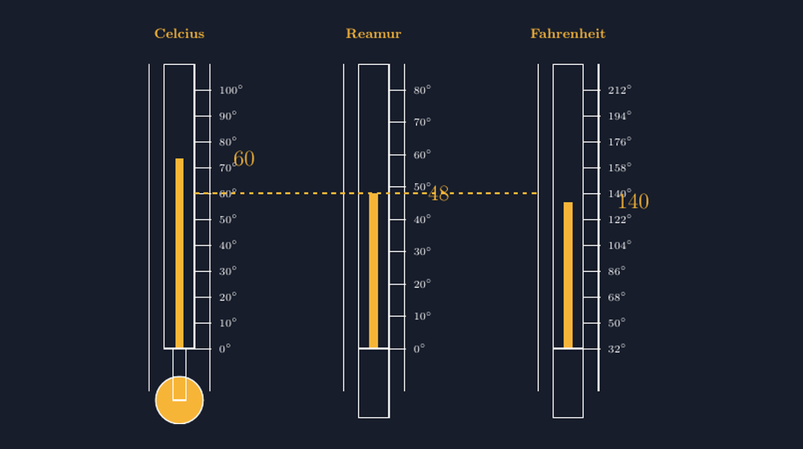

Materi konversi suhu mungkin terlihat sepele di mata kita. Tiga rumus, sedikit aljabar, selesai. Tetapi setiap tahun, di setiap kelas tujuh yang saya ajari, saya selalu menemukan wajah yang sama: murid yang menghafal $\frac{C}{5} = \frac{R}{4} = \frac{F-32}{9}$ tanpa pernah benar-benar tahu apa yang sedang mereka bandingkan. Bulan lalu ada Nia, murid yang selalu paling cepat mengangkat tangan, bertanya sambil menggaruk kepala, "Bu, kalau $F$ kok dikurangi dulu 32, yang Celcius dan Reamur nggak usah? Memangnya beda jalan?" Dan seperti biasa, pertanyaan paling sederhana itulah yang paling sulit dijawab dengan mulut saja.

<!--more-->

## Persoalan Tiga Rumus yang Diajarkan Terpisah

Kalau kita periksa buku paket, konversi suhu biasanya disajikan sebagai tabel rumus: Celcius ke Reamur, Celcius ke Fahrenheit, Celcius ke Kelvin, dan bolak-baliknya. Enam sampai sembilan kotak rumus. Murid yang rajin akan menghafal semuanya; murid yang tidak, akan menyalin rumus yang paling sering keluar di ulangan.

Persoalannya, ketika rumus dihafal tanpa gambar, murid kehilangan hal yang paling penting: bahwa Celcius, Reamur, dan Fahrenheit itu bukan tiga benda berbeda. Mereka adalah **garis suhu yang sama**, hanya dibaca dengan tiga skala pembagian yang berbeda. Analoginya seperti tiga orang menandai jarak yang sama dengan tiga satuan berbeda — kilometer, mil, dan kaki. Yang diukur tetap satu; yang berbeda hanya garis pembagian dan titik nolnya.

Dan di sinilah letak jebakan yang paling sering saya temui di lembar jawaban: murid lupa bahwa Fahrenheit punya titik nol yang berbeda. Air membeku di $0^\circ C$, tetapi di $32^\circ F$. Karena itu rumus Fahrenheit selalu punya "pencopotan" $-32$ sebelum perbandingannya. Kalau murid menghafal tanpa melihat gambar, pencopotan itu terasa seperti aturan arbitrer yang sialnya mudah terlupa.

## Ide: Tiga Termometer Sejajar di Satu Bidang

Ketika Nia bertanya, saya memutuskan untuk tidak menjawab langsung. Saya bilang, "Besok bawa keluarga termometer kita, kita gambar bareng." Malam itu saya menyiapkan gambar yang sekarang jadi favorit saya untuk materi ini: tiga termometer digambar berdampingan, dengan skala masing-masing di sisi kanannya, dan satu garis putus-putus yang menyelandaskan ketiga kolom air pada suhu yang sama.



Gambar seperti itu memang bisa dibuat dengan menggambar tangan di papan tulis. Tetapi menggambar tiga termometer yang proporsional dengan tangan itu melelahkan, dan yang lebih penting: mudah tidak konsisten. Kalau skala Celcius 10 derajatnya dua sentimeter, skala Reamur 10 derajatnya harus lebih pendek — persisnya satu per empat dari itu, karena 100 derajat Celcius sama dengan 80 derajat Reamur. Di papan tulis, konsistensi semacam itu langka. Di TikZ, konsistensi itu cuma soal memasang koefisien yang benar.

Inilah bagian yang paling saya suka dari TikZ untuk materi seperti ini: **gambar itu bukan ilustrasi, gambar adalah argumennya sendiri**. Kalau koefisien di kode salah, gambar langsung kelihatan berbohong — garis putus-putus tidak lagi menyelandaskan pada angka yang benar. Jadi setiap kali saya memakai gambar ini di kelas, saya bisa berkata kepada murid, "Gambar ini jujur. Kalau kalian tidak percaya, boleh diukur pakai penggaris."

## Kode yang Membuat Gambar Jujur

Inti dari gambar di atas adalah keputusan sederhana: semua termometer dibuat tinggi tabungnya sama di kanvas, lalu masing-masing skala ditempatkan dengan koefisien yang menyesuaikan lebar rentang suhunya. Untuk Celcius, rentang 0 sampai 100 derajat dipetakan ke tinggi tetap, misalnya:

```latex
% Celcius: 0C di y=1.0, 100C di y=7.0
\foreach \c in {0,10,...,100} {
  \pgfmathsetmacro{\y}{1.0 + 0.06*\c}
  \draw (1.05,\y) -- (1.45,\y);
  \node[anchor=west, font=\scriptsize] at (1.5,\y) {$\c^\circ$};
}
```

Angka $0.06$ di situ adalah kunci konsistensi: setiap satu derajat Celcius naik $0.06$ satuan kanvas. Untuk Reamur, rentangnya hanya 80 derajat pada tinggi yang sama, jadi koefisiennya $0.075$:

```latex
% Reamur: 0R di y=1.0, 80R di y=7.0
\foreach \r in {0,10,...,80} {
  \pgfmathsetmacro{\y}{1.0 + 0.075*\r}
  \draw (1.05,\y) -- (1.45,\y);
  \node[anchor=west, font=\scriptsize] at (1.5,\y) {$\r^\circ$};
}
```

Sementara Fahrenheit yang paling "bandel": rentangnya 180 derajat, dan tidak mulai dari nol, tetapi dari 32. Di sini koefisien dan pencopotan sama-sama masuk ke rumus kanvas:

```latex
% Fahrenheit: 32F di y=1.0, 212F di y=7.0
\foreach \f in {32,50,...,212} {
  \pgfmathsetmacro{\y}{1.0 + (\f-32)*(6.0/180.0)}
  \draw (1.05,\y) -- (1.45,\y);
  \node[anchor=west, font=\scriptsize] at (1.5,\y) {$\f^\circ$};
}
```

Perhatikan: bentuk $(\f-32)\cdot\frac{6}{180}$ di kode itu persis sama dengan bentuk $\frac{F-32}{9}$ di rumus konversi. Jadi ketika saya menampilkan kode ini di layar dan menunjukkan persamaannya dengan rumus di buku, murid bisa melihat sendiri bahwa rumus yang mereka hafal itu bukan mantra — dia adalah peta jalan untuk menempatkan garis skala pada kertas.

Garis putus-putus yang menyelandaskan ketiga termometer pun cuma satu baris di kode:

```latex
\draw[dashed, thick] (1.05,4.6) -- (9.0,4.6);
```

Tetapi satu baris itu yang melakukan seluruh pekerjaan konseptual. Ketika murid melihat garis itu memotong kolom Celcius tepat di bawah angka 60, kolom Reamur di bawah angka 48, dan kolom Fahrenheit di bawah angka 140, mereka tidak lagi perlu percaya kata saya bahwa $60^\circ C = 48^\circ R = 140^\circ F$. Mereka melihatnya. Dan kalau ada yang menghitung mundur dari garis itu — misalnya berapa derajat Celcius kalau Fahrenheit-nya 104 — gambar yang sama tetap bisa dipakai untuk memeriksa jawabannya.

## Cara Saya Memakainya di Kelas

Di kelas, gambar ini saya pakai dalam tiga tahap, dan ketiganya bertumpu pada garis putus-putus itu.

Pertama, saya menyelandaskan garisnya di suhu yang mudah: titik beku air. Garis putus-putus turun ke bawah, memotong Celcius di $0$, Reamur di $0$, dan Fahrenheit di $32$. Di sini murid langsung melihat bahwa dua skala "sependapat" dan satu skala "memandang lain" — dan dari situ kalimat kunci saya keluar secara alami: "Fahrenheit yang harus mencopot 32 dulu, karena nolnya tidak sepaham."

Kedua, garisnya saya naikkan ke titik didih air: $100^\circ C$, $80^\circ R$, $212^\circ F$. Di sini murid bisa menghitung sendiri lebar setiap rentang: dari 32 ke 212 ada 180 derajat Fahrenheit untuk 100 derajat Celcius. Perbandingan $\frac{180}{100}$ itulah yang nanti mereka kenal sebagai $\frac{9}{5}$. Kali ini rumusnya tidak saya berikan; dia muncul sendiri dari selisih dua garis.

Ketiga, barulah garisnya saya sandarkan di suhu sembarang — 60 derajat Celcius, misalnya, seperti pada gambar di atas — dan murid diminta menebak angka di kolom Reamur dan Fahrenheit sebelum saya nyatakan. Tebakan yang salah pun berguna, karena jawabannya bisa langsung diuji dengan mengukur jarak di gambar.

Yang menarik, di pertemuan berikutnya, murid mulai memakai gambar ini sendiri untuk berdebat. Ada kelompok yang menemukan bahwa untuk mengubah Fahrenheit ke Celcius, mereka cukup "mencopot 32, membagi 180, mengali 100" — persis $\frac{5}{9}(F-32)$ — tanpa pernah saya tulis rumus itu di papan. Ketika mereka menyadari bahwa yang mereka lakukan sama saja dengan membaca ulang garis putus-putus di gambar, ada rasa bangga yang tidak bisa saya beli dengan soal pilihan ganda.

## Mengapa Gambar Ini Layak Masuk Bank Soal

Sejak pertemuan itu, gambar tiga termometer ini masuk ke lembar latihan saya untuk materi suhu. Dan berbeda dari gambar-gambar hiasan, dia punya tiga keunggulan yang membuat saya betah.

Pertama, dia konsisten. Angka di gambar dan angka di kunci jawaban tidak mungkin berselisih, karena keduanya lahir dari kode yang sama. Kedua, dia bisa dimodifikasi dengan aman. Kalau saya ingin menyelandaskan garis di suhu lain — misalnya suhu kulkas, atau suhu badan yang biasanya $37^\circ C$ — saya cukup mengubah satu angka di kode, dan seluruh gambar menyesuaikan diri tanpa saya gambar ulang dari awal. Ketiga, dia bisa dipakai untuk soal terbuka. Murid bisa diminta menentukan sendiri di mana garis putus-putus harus diletakkan agar ketiga termometer menunjukkan angka yang mereka pilih, lalu memeriksa sendiri jawabannya dengan penggaris.

Tentang Nia, pertanyaannya malam itu akhirnya dijawab oleh gambar, bukan oleh saya. Ketika garis putus-putus turun ke titik beku dan dia melihat sendiri Fahrenheit berdiri di angka 32, dia berkata pelan, "Oh, jadi bukan beda jalan, cuma beda mulai hitungnya." Kalimat itu yang saya catat di jurnal mengajar saya — dan yang membuat saya yakin bahwa menghabiskan malam untuk menyunting koefisien di sebuah kode TikZ itu bukan kerjaan sampingan. Itu adalah bagian dari pekerjaan mengajar yang sebenarnya: mencari cara supaya rumus yang kelihatan sewenang-wenang jadi kelihatan masuk akal.

> 📎 **Berkas TikZ lengkap:** [menggambar-termometer-tiga-skala-tikz.tex](tex/menggambar-termometer-tiga-skala-tikz.tex) — siap kompilasi (butuh paket `tikz`).
