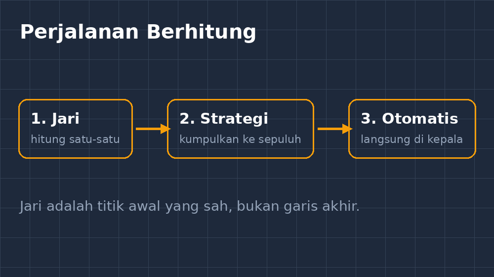
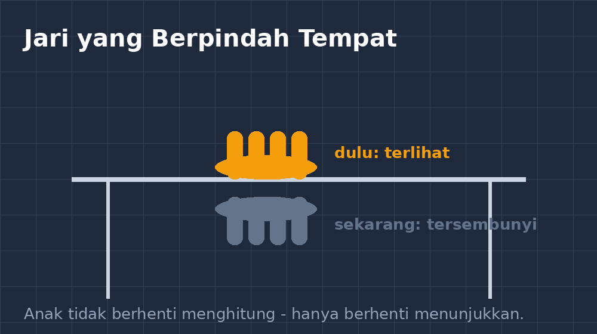
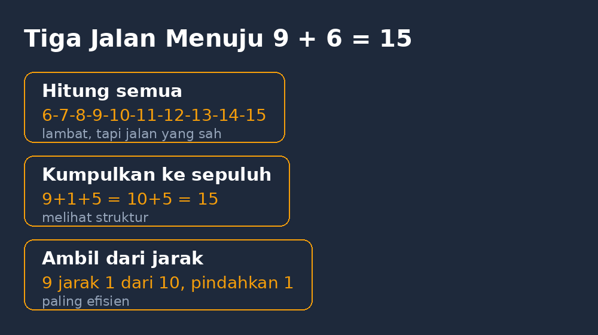

Di kelas tujuh, saya pernah menangkap seorang siswa — sebut saja Raka — menghitung dengan jari di bawah meja. Tangannya agak ke bawah, mata ke arah papan tulis, pura-pura dengar penjelasan. Waktu saya tanya $7 + 8$, dia jawab cepat: "Lima belas, Pak." Tapi saya sempat melihat jari telunjuk dan tengahnya bergerak diam-diam.

Saat saya senyum dan bilang, "Tenang, pakai jari boleh kok," dia malah bengong. Sepertinya dia menyangka akan dimarahi. Malah dia bilang pelan, "Adik saya kelas empat aja sudah tidak pakai jari, Pak."

Kalimat itu yang tinggal di kepala saya sampai sekarang. Dari mana anak-anak belajar bahwa menghitung dengan jari itu memalukan? Dari kami — orang dewasa yang sering melarang tanpa menjelaskan.

<!--more-->

## Jari adalah alat hitung pertama

Sebelum ada abacus, kertas, atau kalkulator, manusia menghitung dengan jari. Itu bukan kebetulan sejarah. Jari adalah manipulatif paling adil di dunia: semua siswa membawanya, tidak perlu anggaran sekolah, tidak bisa tertinggal di rumah.

Masalahnya, ada perbedaan besar antara *menghitung dengan jari* dan *berhenti mengembangkan cara berhitung di jari*. Yang pertama adalah titik awal yang wajar. Yang kedua itu yang perlu kita dampingi.

Ketika siswa kelas tujuh masih menghitung $7 + 8$ dari nol — satu, dua, tiga... sampai lima belas — itu tanda dia belum punya strategi lain. Bukan tanda dia bodoh. Justru di titik ini pekerjaan kita dimulai: menjembatani dari jari menuju strategi mental yang lebih efisien.

*Perjalanan berhitung: jari sebagai titik awal, bukan garis akhir.*

## Dari jari ke strategi: jembatan yang harus dibangun

Ada beberapa jembatan yang menurut pengalaman saya paling membantu. Semua bisa dilatih lewat permainan sederhana, tanpa alat mahal.

**Pertama, fakta dasar sampai otomatis.** $7 + 8$, $9 + 6$, $4 + 7$ — sepuluh jumlah ini seharusnya tersimpan seperti nama teman. Latihannya tidak harus soal lima puluh nomor. Lima menit sebelum bel (kebiasaan yang sudah saya ceritakan di tulisan lain) dengan kartu kecil sudah cukup, asalkan konsisten.

**Kedua, strategi "kumpulkan ke sepuluh".** Ini jembatan terpenting. Dari $8 + 5$, siswa diajak melihat bahwa $5$ bisa dipecah jadi $2 + 3$, sehingga:

$$8 + 5 = 8 + (2 + 3) = (8 + 2) + 3 = 10 + 3 = 13$$

Menariknya, strategi ini bisa *dibuat terlihat* di jari. Untuk $8 + 5$: buka delapan jari, tinggal dua lagi butuh untuk penuh satu tangan. Ambil dua dari lima, tinggal tiga. Jadi $10 + 3$. Yang tadinya hitung satu-satu berubah jadi melihat struktur. Jari tidak dihilangkan — jari diajak bicara tentang struktur bilangan.

**Ketiga, strategi "ambil dari jarak".** Untuk $9 + 6$: sembilan hanya jarak satu dari sepuluh, jadi pindahkan satu dari enam. $10 + 5 = 15$. Ini sama dengan strategi sebelumnya, tapi dilihat dari sisi lain. Siswa yang terbiasa melihat $9$ sebagai "$10$ kurang satu" akan lebih lancar nanti saat bertemu $99 + 47$ di aljabar.

## Kenapa justru di SMP?

Mungkin ada yang bertanya: bukan karena ini materi kelas rendah saja, kenapa dibahas di SMP?

Jawabannya justru di situ letak masalahnya. Di kelas satu dan dua SD, menghitung dengan jari masih "dimaafkan". Lalu secara diam-diam ada garis batas yang tidak pernah kita ucapkan: mulai kelas tiga, empat, lima — itu seharusnya sudah tidak pakai jari. Anak yang belum siap pindah strategi tidak berhenti menghitung; dia cuma berhenti *menunjukkan* bahwa dia menghitung. Jari pindah ke bawah meja.

*Anak tidak berhenti menghitung dengan jari. Jari hanya pindah ke tempat yang tidak terlihat.*

Di SMP, ini muncul sebagai kecepatan yang aneh. Siswa yang paham konsepnya malah kalah cepat dari yang hafal. Saat mengerjakan soal Pythagoras, yang tersangkut bukan rumusnya, tapi $13^2$ yang dihitung satu-satu lalu salah. Kemampuan berpikirnya tertutupi oleh beban berhitung yang belum selesai — dan dia sudah malu mengakuinya sejak SD.

Justru karena itu di SMP saya membahasnya terbuka. "Kalau Bapak kaget, kalian malah sembunyi. Kalau kita bahas tenang, kita bisa maju."

## Yang saya lakukan di kelas

Langkah praktisnya sederhana, dan tidak butuh aplikasi apa pun:

- **Normalisasi dulu.** Saya ceritakan sendiri di depan kelas bahwa saya dulu juga menghitung dengan jari, dan beberapa orang dewasa di bidang yang butuh hitung cepat tetap pakai teknik jari tertentu. Malu yang tidak dibicarakan tidak akan hilang sendiri.
- **Lalu geser, jangan larang.** Latihan hitung cepat lima menit dengan satu aturan: jawab boleh pakai cara apa pun, tapi setelah tiga pertemuan, jumlah $7 + 8$ harus muncul "tanpa jari". Tidak dihukum kalau belum — hanya dicatat sendiri oleh siswa di kartu kemajuannya, kapan strateginya mulai terasa otomatis.
- **Minta siswa menjelaskan strateginya.** Ini bagian favorit saya. Yang jawab $9 + 6$ cepat, saya tanya, "Kamu lihat apa di kepalamu?" Jawabannya beragam: "Sembilan kurang satu dari sepuluh, Bu," atau "Enam tambah enam dikurangi satu." Ketiak siswa saling mendengar strategi satu sama lain, mereka belajar bahwa ada banyak jalan, dan jari hanya salah satu dari jalan awal.

*Tiga jalan menuju $9 + 6$: semua jalan sah, yang membedakan hanya efisiensinya.*

## Penutup: alat, bukan aib

Menghitung dengan jari itu bukan aib. Ia adalah alat hitung pertama yang paling adil — ikut lahir bersama setiap anak. Tugas kita bukan melarangnya dengan malu, tapi mengantarnya pensiun dengan hormat: dari hitung satu-satu, ke strategi kumpulkan sepuluh, sampai akhirnya otomatis di kepala.

Raka itu, di pertemuan ketiga, memanggil saya sambil senyum-senyum. "Pak, $7 + 8$ sekarang langsung keluar, nggak pakai jari." Saya cuma bilang, "Alhamdulillah. Ingat cara kamu tadi pecah delapan plus dua?"

Dia mengangguk. Dan untuk pertama kalinya sejak awal tahun, jari-jarinya berada di atas meja — bukan untuk menghitung, tapi ikut memegang spidol saat menjelaskan ke temannya.

Itu saja sebenarnya yang saya harapkan: anak tidak perlu lagi menyembunyikan proses belajarnya dari kami.
