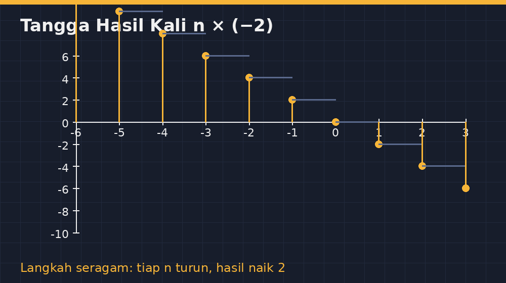

Ada satu momen di kelas VIII dulu yang tidak pernah saya lupa. Saat membahas perkalian bilangan bulat, seorang siswa — sebut saja Rani — mengangkat tangan dan bertanya dengan muka paling polos: "Pak, kenapa minus kali minus jadi plus? Kok aneh, Pak. Yang negatif dikali negatif kok malah positif."

Saya jadi terdiam. Bukan karena tidak tahu jawabannya, tapi karena saya sadar jawaban yang biasa saya pakai — "ya memang begitu aturannya" — sebenarnya bukan penjelasan. Itu larangan yang dibungkus suara tegas. Dan larangan tidak pernah bikin anak paham; yang terjadi hanya anak menurut, lalu lupa, lalu salah lagi di ulangan berikutnya.

<!--more-->

## Jejak miskonsepsinya di kertas

Sebelum menulis ini, saya iseng membuka tumpukan lembar kerja dari beberapa kelas. Polanya nyaris seragam. Perkalian bilangan satu tanda — misalnya $(-3) \times 5$ — hampir semua benar. Begitu tanda negatifnya bertemu, misalnya $(-2) \times (-4)$, benang merahnya putus.

Yang menarik, kesalahannya tidak acak. Ada yang menjawab $-8$, artinya dia mengalikan angkanya lalu "kira-kira" tanda negatifnya menular. Ada juga yang menjawab benar, $+8$, tapi ketika saya minta menjelaskan di papan, dia cuma bilang, "Dikatakan Pak ya, min min minya plus."

Itu tanda klasik: pengetahuan prosedural tanpa makna. Anak bisa menjawab benar tanpa paham — dan itu rapuh. Begitu soalnya berubah bentuk, misalnya $-3 \times (-2) \times (-1)$, hafalan yang setengah jalan langsung roboh.

## Bermain dengan pola, biar aturannya "tidak bisa tidak"

Cara pertama yang saya pakai di kelas itu hari adalah cara pola. Saya menulis di papan:

$$
\begin{aligned}
3 \times (-2) &= -6 \\
2 \times (-2) &= -4 \\
1 \times (-2) &= -2 \\
0 \times (-2) &= 0
\end{aligned}
$$

Lalu saya tanya: "Kalau kita lanjut turun, tiap baris naik berapa?" Kelas berbisik, "Naik dua." "Kalau begitu baris berikutnya harus berapa?" Dengan tidak sangat yakin mereka jawab, $(-1) \times (-2) = +2$.

Inilah kekuatan cara pola: aturan tidak terasa seperti diktat dari buku, tapi sebagai *satu-satunya* pilihan supaya pola barisan tidak putus di tengah. Bilangan bulat itu rapi; hasilnya melangkah seragam. Kalau $(-1)\times(-2)$ tiba-tiba $-2$, tangganya patah. Anak bisa *melihat* kenapa minus kali minus harus positif — bukan karena gurunya berkata begitu, tapi karena sejarah angkanya menuntut begitu.

Untuk memperjelas, saya juga buatkan gambar garis bilangan bergerigi seperti ini:

*Gambar: Tangga hasil kali $n \times (-2)$ yang melangkah seragam naik dua tiap baris — pola yang "memaksa" hasil minus kali minus bernilai positif.*

Gambar semacam ini saya gambar ulang tiap tahun dengan TikZ, supaya jarak antarlangkanya benar-benar proporsional di lembar kerja. Pengalaman lama mengajari saya: kalau gambar di lembar soal tidak proporsional, anak mengukur dengan mata dan menemukan kontradiksi dengan angka — dan itu merusak kepercayaan mereka pada soal itu sendiri.

## Utang dan hutang: makna, bukan hanya pola

Cara pola itu meyakinkan di kepala, tapi ada siswa yang menolak: "Itu cuma pola, Pak. Buktinya apa?" Dan saya suka anak tipe ini — dia menuntut *makna*, bukan sekadar keteraturan.

Untuk makna, saya pakai cerita utang. Angka negatif itu hutang. Satu utang 2 ribu rupiah, ditulis $-2$. Sekarang bayangkan: kalau kondisi itu *dicabut*, atau di-*hapus tiga kali* — artinya tiga kali saya diampuni utang 2 ribu — kondisi keuangan saya naik 6 ribu. Ampunan itu ada tiga, dan menghapus utang sama dengan mengalikan dengan $-1$. Jadi:

$$(-3) \times (-2) = +6$$

Minus pertama: tiga kali pengampunan (menghapus). Minus kedua: yang dihapus adalah utang. Menghapus utang tiga kali sama dengan menambah harta. Kelas itu hari lumayan bereaksi — beberapa anak tertawa karena contohnya terlalu nyata bagi kantong mereka, apalagi menjelang akhir bulan.

Saya sadar analogi ini tidak sempurna secara matematis; perkalian bukan semata operasi "mengulang" atau "menghapus". Tapi untuk kelas VIII, tujuan saya bukan pembuktian formal di $\mathbb{Z}$ — itu pekerjaan nanti di jenjang berikutnya. Tujuan saya lebih modest: supaya hasil $(-3)\times(-2)=+6$ tidak lagi terasa seperti sihir yang harus dihafal, melainkan sesuatu yang masuk akal.

## Tanda tanda: tabel kecil yang jujur

Setelah pola dan cerita, barulah saya rangkum ke tabel tanda — bukan sebagai hafalan pertama, tapi sebagai *kesimpulan terakhir*:

| $a$ | $b$ | $a \times b$ |
|---|---|---|
| $+$ | $+$ | $+$ |
| $+$ | $-$ | $-$ |
| $-$ | $+$ | $-$ |
| $-$ | $-$ | $+$ |

Urutannya penting. Tabel yang diberikan *sebelum* pemahaman hanya jadi kambing hafalan; tabel yang muncul *setelah* pola dan cerita jadi ringkasan yang memantapkan. Sama materi, urutan berbeda, hasilnya beda jauh.

## Uji kecil yang membuktikan

Di akhir jam, saya memberi soal singkat: $-2 \times (-3) \times (-4)$. Yang hafal "min min jadi plus" setengah jalan biasanya langsung tergoda menjawab positif. Mereka lupa bahwa tanda ketiga masih menunggu untuk membalik kembali: hasilnya $-24$. Yang melalui jalan pola, mereka menghitung dua-dua dengan tenang: $(-2)\times(-3)=+6$, lalu $6 \times (-4) = -24$. Jumlah ganjil tanda negatif menghasilkan negatif — dan kali ini mereka bisa *menjelaskan* kenapa, bukan cuma menyebut.

## Penutup: pertanyaan Rani yang saya syukuri

Pertanyaan Rani itu dulu sempat membuat saya merasa tidak kompeten. Sekarang justru saya berterima kasih. Karena justru pertanyaan "kenapa" seperti itulah yang memaksa guru mencari cara menjelaskan yang lebih jujur — bukan sekadar menyebut aturan.

Kalau Bapak/Ibu guru matematika menemukan murid yang menolak percaya pada minus kali minus, jangan anggap itu perlawanan. Itu tanda anak itu berpikir. Berikan dia pola yang tidak bisa dipatahkan, cerita yang bisa dia rasakan, dan barulah tabel tanda. Hafalan boleh datang terakhir — selama tidak datang pertama.

Dan kalau ada waktu, gambar tangganya dengan TikZ. Anak yang melihat tangga itu naik seragam akan mengerti bahwa matematika bukan tempat aturan asal-asalan; semua aturan di sana punya alasan, termasuk yang paling sering dianggap aneh.
