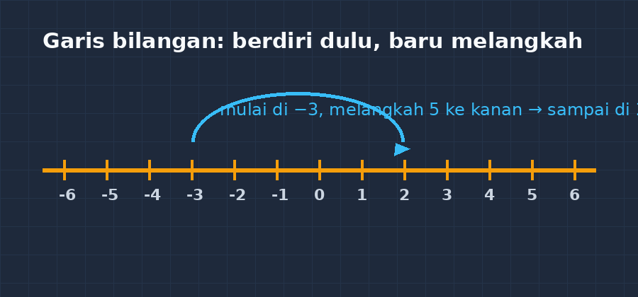

Tahun lalu, saat mengoreksi lembar kerja kelas VII, saya menemukan satu pola yang membuat saya berhenti sejenak. Dari 32 siswa, hampir separuh menjawab $-3 + 5 = -8$. Bukan typo. Bukan karena terburu-buru. Jawaban itu ditulis rapi, lengkap dengan langkah pengerjaannya — dan langkahnya pun konsisten: angka dijumlahkan, tanda ikut yang "terlihat".

<!--more-->

Malam itu saya menandai jawaban-jawaban itu dengan pulpen merah, tetapi di kepala saya yang terus berputar bukan nilai, melainkan pertanyaan: di mana persisnya pemahaman mereka patah? Soal $5 - 8$ di lembar yang sama justru banyak yang benar. Aneh. Kalau mereka paham $5 - 8 = -3$, kok gagal di $-3 + 5$ yang secara matematis identik?

## Miskonsepsi itu bukan kebodohan

Istilah "miskonsepsi" kadang terdengar seperti kata sopan untuk "salah paham". Padahal yang terjadi di kelas jauh lebih menarik dari itu. Miskonsepsi adalah pengetahuan yang *berfungsi* — siswa membangunnya dari pengalaman, dan selama situasinya cocok, pengetahuan itu berhasil.

Siswa yang menjawab $-3 + 5 = -8$ biasanya membawa aturan yang bekerja baik di dunia bilangan cacah. Di sana, mereka belajar bahwa penjumlahan berarti "menggabungkan", dan tanda minus adalah penanda "yang di bawah" atau "yang dikurangkan". Ketika minus berpindah ke depan angka — menjadi bilangan negatif yang berdiri sendiri — aturan lama itu tidak dibuang; ia dipaksa tetap bekerja di tempat yang tidak lagi cocok.

Ada juga siswa yang membawa pengalaman dari kehidupan sehari-hari: "minus berarti kurang". Jadi $-3 + 5$ dibaca sebagai "kurang tiga ditambah lima" — dan karena kata *kurang* lebih dulu terdengar, hasilnya "kurang delapan". Logika mereka utuh. Sayangnya, logika itu dibangun di atas bata yang salah.

Bagi saya, inilah bagian tersulit dari mengajar: mengoreksi sesuatu yang dari sudut pandang siswa *sudah masuk akal*.

## Garis bilangan: alat tua yang masih juara

Cara yang saya pakai untuk menanggulangi ini sebenarnya tidak baru: garis bilangan. Tetapi cara penyajiannya yang saya ubah-ubah bertahun-tahun, dan versi yang paling berhasil di kelas saya sederhana sekali.

*Ilustrasi: melangkah dari $-3$ sebanyak 5 langkah ke kanan, mendarat di $2$. Diagram sederhana seperti ini saya gambar di papan setiap kali muncul kebingungan.*

Aturannya hanya satu kalimat: **bilangan pertama menentukan tempat berdiri, bilangan kedua menentukan arah dan jumlah langkah**. Tanda positif berarti menghadap kanan, tanda negatif menghadap kiri. Jadi $-3 + 5$ dibaca: berdiri di $-3$, lalu melangkah 5 kali ke kanan. Mendarat di $2$. Titik.

Yang membuat garis bilangan lebih baik daripada hafalan aturan tanda ("positif ketemu negatif hasilnya negatif") adalah karena garis bilangan *tidak bisa dihafal salah*. Aturan tanda mudah tercampur jadi "positif kali negatif hasilnya positif" — versi yang sedikit tergeser di ingatan, dan langsung fatal. Garis bilangan, sebaliknya, memberi siswa sesuatu yang bisa mereka *bayangkan*. Ketika lupa, mereka bisa menggambar ulang sendiri di sudut kertas.

Saya juga mulai memaksa siswa mengucapkan kalimat baca sebelum menghitung. $-3 + 5$ dibaca "negatif tiga tambah lima", bukan "tiga minus lima". Kedua kalimat itu terdengar mirip, tetapi mereka memerintahkan tubuh — atau jari di atas garis bilangan — melakukan hal yang berbeda.

## Ujian yang datang dari soal cerita

Perbaikan ini diuji di tempat yang tidak saya duga: soal cerita suhu. "Suhu di puncak gunung pagi hari $-2\,^\circ\text{C}$, siang hari naik $7\,^\circ\text{C}$. Berapa suhu siang hari?" Sebelum perbaikan, jawaban yang beredar di kelas adalah $-9$. Setelah garis bilangan ditanamkan dengan baik — berdiri di $-2$, tujuh langkah ke kanan — jawaban $5$ muncul jauh lebih sering, dan yang lebih penting: siswa bisa *menjelaskan* mengapa.

Kemampuan menjelaskan itulah yang saya jadikan patokan. Siswa yang menjawab benar karena hafal aturan akan bengong saat diminta menjelaskan; siswa yang menjawab benar karena punya gambaran mental akan langsung bercerita tentang berdiri dan melangkah. Bedanya terasa jelas sekali saat saya berkeliling memeriksa pekerjaan.

Tentu tidak semua langsung pulih. Ada siswa yang tetap memegang aturan lama bulat-bulat, dan yang saya pelajari adalah: mengetahui bahwa siswa itu salah bukan cukup alasan baginya untuk berpindah. Yang berhasil lebih sering adalah memberi mereka soal yang *aturan lama gagal di depan mata* — misalnya meminta mereka membandingkan jawaban $-3 + 5$ dengan $5 - 3$, dua soal yang bagi aturan lama mereka menghasilkan jawaban yang sama, padahal jelas berbeda. Kebingungan yang muncul saat itu adalah pintu masuknya.

## Kenapa saya tidak buru-buru mengganti dengan "cara cepat"

Kadang ada godaan untuk langsung memberi jalan pintas: "ingat saja, kalau tandanya beda, kurangkan dan ikuti tanda yang besar." Cara cepat itu nyata bekerja — untuk ujian minggu ini. Tetapi miskonsepsi bilangan bulat tidak tinggal di kelas VII. Ia menyusup ke penjumlahan aljabar ($-3x + 5x$), ke operasi bilangan berpangkat negatif, bahkan ke fisika di jenjang atas ketika siswa menemui besaran vektor dengan arah berlawanan. Siswa yang fondasinya berdiri di hafalan tanda akan runtuh di depan sana; yang berdiri di garis bilangan tinggal menggambar ulang model lamanya dengan konteks baru.

Karena itu saya memilih jalan yang lebih lambat di awal. Beberapa pertemuan pertama memang terasa "boros" — banyak menggambar, banyak melangkah dengan jari, banyak tanya-jawab. Tetapi setelah model itu mengendap, kecepatan mengejar dengan sendirinya. Sebaliknya, kelas yang buru-buru ke cara cepat biasanya harus mengulang materi yang sama di semester berikutnya, dengan miskonsepsi yang sama, hanya berpakaian beda.

## Catatan kecil untuk rekan guru

Tiga hal yang ingin saya tinggalkan dari pengalaman ini. Pertama, jangan menilai miskonsepsi dari satu soal — beri soal dalam beberapa wajah berbeda, karena siswa yang salah di satu bentuk bisa benar di bentuk lain, dan pola itulah yang mengungkap akar masalahnya. Kedua, saat menemukan jawaban aneh, tanyakan *bagaimana* mereka sampai di sana sebelum mengatakan itu salah; sering kali kita menemukan aturan yang masuk akal bagi mereka, dan itulah yang harus dibongkar, bukan sekadar diganti jawabannya. Ketiga, sayangi garis bilangan. Alat yang tidak sedebut teknologi pembelajaran terbaru itu ternyata masih menjadi jembatan paling kokoh antara intuisi siswa dan notasi formal matematika.

Di akhir semester, siswa yang dulu menulis $-3 + 5 = -8$ dengan percaya diri kini menggambar garis bilangan kecil di pinggir kertasnya tanpa saya suruh. Bagi saya, gambar kecil di pinggir kertas itu lebih bernilai daripada nilai ulangan sempurna — karena itu tanda bahwa yang berubah bukan jawabannya, melainkan cara ia berpikir.
