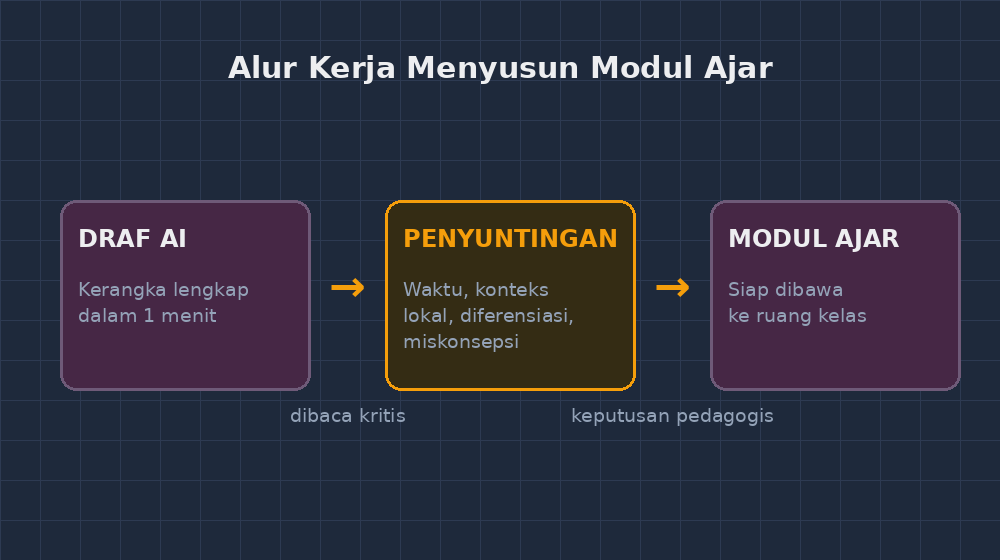

+++
title = "Modul Ajar Hasil AI yang Tidak Langsung Saya Pakai: Guru sebagai Penyunting"
date = "2026-10-25T18:20:00+07:00"
draft = false
authors = ["Gunanto"]
description = "Pengalaman menyunting modul ajar hasil AI: kenapa draf pertama mesin tidak pernah cukup, dan kenapa justru di sanalah peran guru terlihat paling jelas."
featuredImage = "featured-image.png"
tags = ["AI", "modul ajar", "perencanaan pembelajaran", "refleksi"]
categories = ["AI dalam Pendidikan"]
math = { enable = true }
+++

Sabtu sore pekan lalu, saya duduk di depan layar dengan satu tugas yang setiap guru kenal baik: menyiapkan modul ajar untuk pekan berikutnya. Kurikulum sudah berubah beberapa kali sejak saya mulai mengajar, tetapi satu hal tidak pernah berubah — pekerjaan administratif perencanaan selalu lebih memakan waktu daripada memikirkan bagaimana anak-anak akan belajarnya nanti.

Kali ini saya mencoba jalur yang berbeda. Saya buka aplikasi AI, ketik permintaan yang cukup rinci: modul ajar untuk materi aritmetika sosial kelas VII, satu pertemuan, dengan konteks pasar dan warung — sesuatu yang dekat dengan kehidupan anak-anak di sekitar sekolah kami. Dalam waktu kurang dari satu menit, draf lengkap muncul di layar. Capaian pembelajaran, kegiatan pendahuluan, kegiatan inti, lembar kerja, rubrik penilaian. Semuanya ada.

Kalau dulu saya butuh dua sampai tiga jam untuk menyusun dokumen seperti itu, kali ini butuh satu menit. Tetapi justru di titik itulah pekerjaan sesungguhnya baru saja dimulai.

## Draf Pertama Selalu Terlihat Cerdas — sampai Dibaca Pelan-pelan

Saya mulai membaca draf itu seperti saya membaca naskah ujian yang saya buat sendiri: pelan, curiga, dan siap menandai. Tidak butuh waktu lama untuk menemukan hal pertama yang mengganjal. Di bagian kegiatan inti, AI menuliskan skenario diskusi kelompok berdurasi "45 menit" untuk menganalisis tiga soal kontekstual. Kelas saya hanya 40 menit, dan tiga soal seperti itu dengan diskusi presentasi realistisnya butuh lebih dari satu pertemuan. Angkanya terlihat masuk akal — 45, kira-kira satu jam pelajaran — tetapi siapa pun yang pernah mengajar tahu bahwa itu tidak akan selesai.

Hal kedua: contoh soalnya. AI membuat soal tentang Bu Rina membeli 2,5 kg gula dengan diskon 20% di sebuah "toko modern". Kalimatnya rapi, angkanya tidak ada yang salah secara matematika. Tetapi anak-anak di kelas saya kebanyakan lebih akrab dengan warung dekat gapura sekolah daripada toko modern, dan konsep diskon persentase justru paling hidup kalau konteksnya benar-benar mereka alami — tawar-menawar, harga satuan pukul rata, uang kembalian. Konteks yang digarap AI itu "netral", dan justru kenetralan itulah yang membuatnya tidak menyentuh.

Hal ketiga, dan ini yang paling sering lolos kalau kita terburu-buru: capaian pembelajarannya. Tertulis "peserta didik mampu memahami aritmetika sosial". Kata *memahami* adalah kata yang paling tidak bisa diukur. Saya harus menuliskannya ulang menjadi sesuatu yang bisa saya amati di kelas — misalnya, peserta didik dapat menentukan mana dari dua cara pembelian yang lebih menguntungkan dan *menjelaskan alasannya*. Perbedaannya terdengar kecil, tetapi menentukan bentuk asesmen dan umpan balik saya sepanjang pertemuan.

## Menyunting itu Bukan Mengubah Kata-kata

Ada anggapan bahwa menyunting hasil AI artinya memperbaiki kalimat, merapikan redaksi, memoles gaya bahasa. Pengalaman saya justru sebaliknya: bahasa hasil AI biasanya sudah rapi — kadang terlalu rapi, sampai terasa bukan suara seorang guru. Yang perlu disunting bukan kalimatnya, melainkan keputusan-keputusan pedagogisnya. Beberapa yang hampir selalu saya ganti:

**Alokasi waktu dan ritme kegiatan.** AI merencanakan kegiatan seperti daftar belanja: langkah A, langkah B, langkah C, selesai. Padahal di kelas, langkah B hampir pasti lebih lama dari rencana karena ada anak yang bertanya hal yang tidak diduga. Saya selalu menyisakan waktu kosong — dan itu bukan kemalasan, itu jatah untuk hal-hal yang tidak bisa diprediksi.

**Konteks dan contoh.** Ini bagian yang tidak mungkin digarap AI tanpa bahan dari saya. Nama jalan di sekitar sekolah, harga di warung tempat anak-anak membeli jajan, kisah dari kelas sebelumnya — bahan-bahan itu ada di kepala guru, bukan di data latihan mesin. Justru di sinilah modul ajar menjadi milik sekolah kami, bukan dokumen generik yang bisa dipakai di mana saja.

**Diferensiasi.** Draf AI biasanya menulis satu kalimat formalitas seperti "berikan bimbingan bagi peserta didik yang kesulitan". Itu bukan rencana, itu pengakuan bahwa rencana tidak dibuat. Yang saya butuhkan lebih konkret: soal penarik mana yang dipakai untuk anak yang sudah selesai lebih cepat, prompt apa yang saya ucapkan untuk anak yang macet di langkah pertama, bentuk bantuan apa yang tidak langsung memberi jawaban.

**Prediksi miskonsepsi.** Ini favorit saya. Draf AI hampir tidak pernah menuliskan bagian "di titik ini, anak cenderung akan salah dengan cara begini". Padahal dari jurnal mengajar harian yang saya catat di aplikasi sendiri, saya tahu persis: dalam aritmetika sosial, banyak anak menghitung diskon 20% dengan mengurangi 20 rupiah, atau mencampur adukkan persen keuntungan dan persen rugi karena keduanya dihitung dari harga yang berbeda. Rencana yang baik menyediakan pintu untuk miskonsepsi itu, bukan berharap tidak terjadi.

## Berapa Lama Sebenarnya Waktu yang Dihemat?

Setelah satu setengah jam menyunting, hasil akhirnya jauh lebih baik daripada apa pun yang bisa saya tulis dalam satu setengah jam tanpa bantuan. Di situlah letak nilai sesungguhnya: AI tidak menggantikan pekerjaan menyusun modul, ia mengubah pekerjaan itu menjadi pekerjaan menyunting dan memutuskan. Waktu yang tadinya habis untuk mengetik kerangka, kini habis untuk hal yang lebih bernilai — memikirkan anak-anak.

Tetapi saya juga ingin jujur tentang risikonya. Ada godaan yang sangat manusiawi: draf pertama itu terlihat sangat layak, dan kalau hari itu saya sedang lelah, mudah sekali untuk berkata "sudah cukup baik" lalu mengunduhnya tanpa disunting. Bahaya bukan pada AI yang menulis jelek — AI yang menulis jelek justru mudah dikenali. Bahaya ada pada AI yang menulis *cukup baik* sampai guru berhenti membaca secara kritis. Modul ajar yang sekadar terlihat lengkap akan lolos administrasi, tetapi gagal di ruang kelas, dan satu-satunya orang yang bisa mencegah itu adalah guru yang membacanya dengan serius.

## Guru sebagai Penyunting, Bukan Pengetik

Dulu saya pernah berpikir bahwa penggunaan AI dalam perencanaan pembelajaran adalah bentuk kemalasan. Sekarang saya melihatnya dengan sudut yang berbeda. Penyunting buku tidak dianggap malas karena tidak menulis naskahnya sendiri — justru penilaian penyuntinglah yang menentukan apakah naskah itu layak baca. Begitu pula kita: tanggung jawab profesional atas apa yang terjadi di kelas tetap 100% di pundak guru, tidak pernah pindah ke mesin.

Praktik yang sekarang saya jalankan sederhana dan mungkin bisa dicoba Bapak/Ibu: minta draf yang sangat spesifik (materi, durasi nyata, konteks lokal, bahkan nama-nama contoh yang mau saya pakai), lalu bacalah draf itu dengan satu pertanyaan pegang — *besok, kalau saya mengajar persis sesuai lembar ini, apa yang akan salah?* Setiap jawaban atas pertanyaan itu adalah pekerjaan penyuntingan saya. Biasanya daftarnya tidak pendek, dan biasanya justru di situ letak keahlian kita yang tidak bisa ditulis oleh mesin mana pun.

Mesin boleh mengetik draf pertama. Tetapi keputusan tentang anak-anak di ruang kelas saya — itu tetap tanggungan saya.
