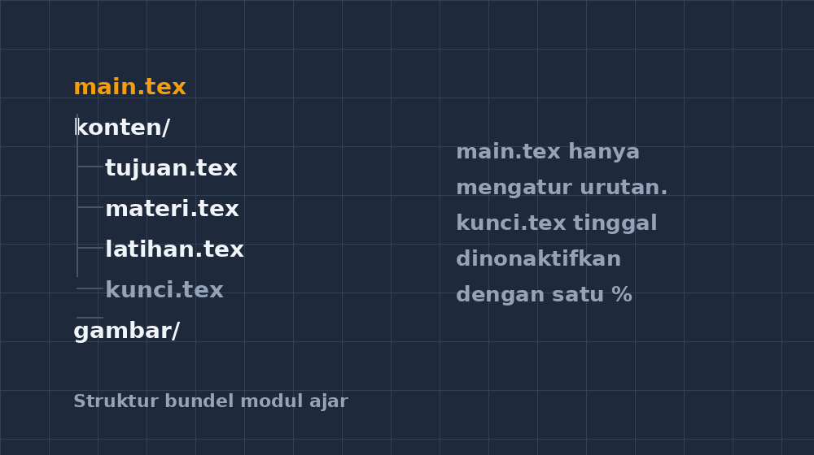
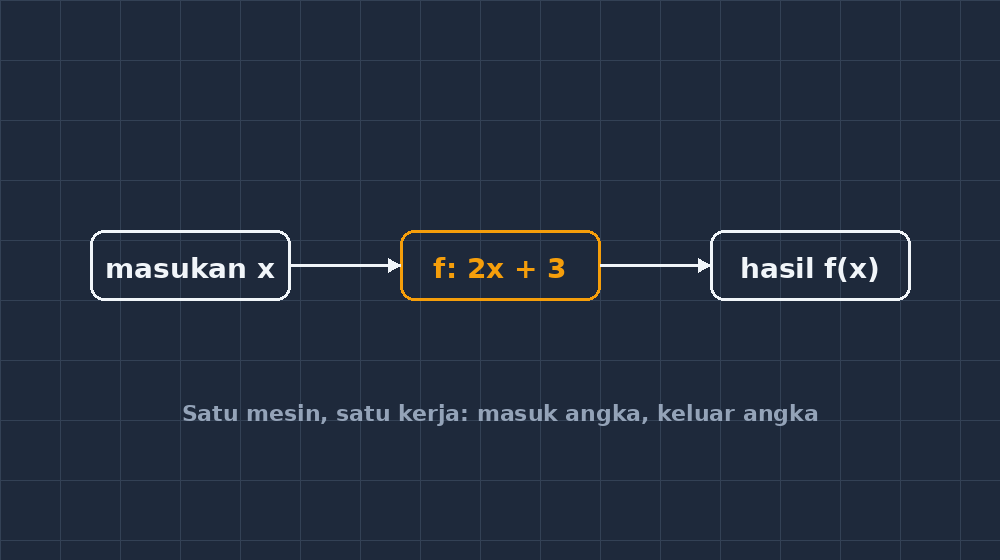

Semester ini saya memutuskan menata ulang semua modul ajar matematika kelas VII dan VIII. Bukan hanya karena berkas-berkasnya menumpuk, tapi karena saya hampir membuat kesalahan yang cukup memalukan: hampir mengirimkan soal ulangan harian ke grup wali murid, padahal yang saya maksud kisi-kisi untuk rekan sejawat. Keduanya kebetulan saya simpan di folder yang sama, dengan nama yang hampir mirip, dibuat di malam yang sama. Untung saya lihat dua kali.

Peristiwa hampir-kejadian itu yang akhirnya memaksa saya menata ulang semuanya. Dan anehnya, proses menata berkas LaTeX untuk modul ajar itu mengingatkan saya pada pelajaran yang justru biasa saya ajarkan dalam konteks lain: kalau satu benda dipaksa menanggung terlalu banyak tugas, ia akan mengerjakan semuanya dengan buruk.

<!--more-->

## Berkas Ulang Tahun yang Menjadi Monster

Sebelum ditata ulang, kebiasaan saya bekerja begini: satu berkas `.tex` untuk satu keperluan, dan saya terus menambahinya. Mulai dari modul ajar bilangan bulat, lalu ditambah soal latihan, lalu kunci jawaban, lalu rubrik penilaian, lalu — karena sudah nyambung — catatan remedial. Dalam beberapa bulan, satu berkas itu berubah menjadi dokumen berisi segala-galanya, dengan cabang-cabang `\if` yang saya lupa sendiri untuk apa.

Konsekuensinya muncul saat saya ingin mencetak *hanya* lembar latihan untuk remedial. Saya harus membuka dokumen raksasa itu, mematikan bagian-bagian tertentu, mencetak, lalu berdoa tidak lupa menyalakannya kembali. Sekali dua kali saya lupa, dan hasilnya lembar remedial yang tercetak lengkap dengan kunci jawabannya di halaman terakhir. Lembar itu nyaris dibagikan. Anak-anak akan tahu semua jawabannya sebelum mencoba satu soal pun.

Saat itu saya ingat sesuatu dari dunia pemrograman — dunia yang kebetulan saya dekati belakangan karena membangun aplikasi pembelajaran sendiri. Ada satu prinsip di sana yang disebut *single responsibility*: satu fungsi sebaiknya hanya punya satu tanggung jawab. Fungsi yang menghitung rata-rata tidak seharusnya sekaligus menggambar grafik dan menyimpan berkas. Kalau ia melakukan semuanya, mengubah satu hal berarti menaklukkan yang lain secara tak terduga.

## Membelah Dokumen, Menyusun Bundel

Terapan sederhananya untuk modul ajar saya: pisahkan konten dari pembungkusnya. Sekarang setiap materi punya struktur yang kurang lebih begini:

```text
modul/
├── main.tex          → pembungkus: memanggil kelas, paket, dan konten
├── konten/
│   ├── tujuan.tex    → capaian dan alur tujuan pembelajaran
│   ├── materi.tex    → uraian materi dan contoh
│   ├── latihan.tex   → soal latihan
│   └── kunci.tex     → kunci dan pedoman penskoran
└── gambar/
    └── ...
```



Berkas `main.tex`-nya sendiri cuma beberapa baris:

```latex
\documentclass[11pt,a4paper]{article}
\usepackage{amsmath,amssymb}
\usepackage{graphicx}
\usepackage{tikz}
\usepackage[margin=2.2cm]{geometry}
\input{konten/tujuan}
\input{konten/materi}
\input{konten/latihan}
% \input{konten/kunci}   ← sengaja saya beri komentar
```

Baris yang diberi komentar itulah inti dari semua cerita ini. Dengan struktur seperti itu, mencetak modul untuk siswa dan mencetak versi dengan kunci jawaban tinggal memindahkan satu tanda persen. Tidak ada lagi risiko kunci bocor ke lembar siswa, karena kontennya memang hidup di berkas yang berbeda. Latihan bisa saya `\input` ulang di dokumen remedial tanpa menyalin-tempel soal — dan kalau ada soal yang ternyata kurang jelas, saya cukup memperbaikinya di satu tempat.

Ini persis logika yang biasa saya tulis di kelas ketika menjelaskan fungsi matematika kepada murid kelas VIII. Fungsi $f(x) = 2x + 3$ itu mesin kecil yang kerjanya satu: masukkan angka, kalikan dua, tambah tiga. Ia tidak peduli angka itu dari mana, dan ia tidak sambil-lalu menggambar grafik atau menghafal tabel. Justru karena kerjanya satu, ia bisa dipercaya. Kalau mesin itu diam-diam juga mencatat siapa yang memakainya dan kadang mengubah hasil kalau hari hujan, murid-murid akan — dengan alasan — kehilangan kepercayaan pada konsep fungsi itu sendiri.



## Kenapa Ini Penting untuk Guru yang Bukan Programmer

Saya tahu sebagian rekan guru akan berkata, "Saya cuma guru matematika, bukan programmer. Kenapa harus peduli soal fungsi dan tanggung jawab berkas?" Jawaban saya jujur saja: karena kita sudah melakukannya setiap hari, hanya saja tidak menyebutnya begitu.

Satu contoh yang paling dekat: raport. Nilai harian, nilai PTS, nilai PAS, sikap, catatan wali — semua itu "input" yang berbeda, tapi proses penentuannya satu prinsip: ambil bobot sesuai ketentuan, gabungkan, keluarkan satu angka. Ketentuan rapor berubah tiap beberapa tahun. Kalau perhitungannya saya tulis rapi di satu tempat — satu "fungsi" yang jelas input dan outputnya — mengubah ketentuan berarti mengubah satu bagian saja. Kalau perhitungannya tercampur dengan segala macam hal lain, tiap perubahan ketentuan berarti membongkar semua lembar kerja dari awal.

Pengalaman serupa saya alami ketika membangun aplikasi CBT untuk sekolah. Versi pertamanya, jujur, saya tulis begitu saja: satu halaman yang sekaligus menampilkan soal, mencatat waktu, memvalidasi jawaban, dan menghitung skor. Berhasil jalan, tapi setiap kali saya ingin mengubah sesuatu kecil — misalnya menambah fitur tandai soal — saya harus menyentuh kode yang saya sendiri sudah tidak paham. Versi yang sekarang saya pecah: soal satu bagian, pewaktu satu bagian, penyimpanan jawaban satu bagian. Perubahan jadi tidak menakutkan lagi.

## Belajar dari Murid yang Mengerjakan Semua Sendiri

Ada juga sisi pedagogisnya, dan ini yang paling saya sukai. Di kelas, saya biasa melihat murid yang mengerjakan semua peran sendiri dalam kerja kelompok: ia menghitung, menulis, menggambar, mempresentasikan, bahkan memanggil temannya yang mengobrol. Kelompok itu bisa lolos untuk tugas kecil. Tapi untuk tugas panjang, murid itu lelah, hasilnya tidak merata, dan — yang paling penting — kalau ia salah di satu langkah, seluruh kerja kelompok salah ikut-ikutan tanpa jelas letak kesalahannya di mana.

Membandingkan itu dengan dokumen LaTeX yang "mengerjakan semuanya" bukan analogi yang dipaksakan. Dokumen monster saya dulu adalah murid yang bekerja sendirian: penuh semangat di awal, lalu sulit diperbaiki, dan saat salah, tidak jelas bagian mana yang salah. Setelah dipecah, mencari sumber kesalahan menjadi hampir trivial. Salah di lembar latihan? Perbaiki `latihan.tex`, dokumen lain tidak tersentuh.

## Skala Kecil, Prinsip yang Sama

Saya tidak bermaksud mengajak semua guru menulis LaTeX dan membangun sistem berkas yang rumit. Poin saya lebih sederhana dari itu. Kebiasaan memisahkan "satu benda, satu tanggung jawab" bisa dimulai dari hal yang jauh lebih akrab: satu folder khusus untuk soal yang sudah dicetak dan satu untuk soal yang masih draf — persis masalah yang nyaris membuat saya mengirim ulangan ke grup wali murid. Atau satu berfas untuk kunci jawaban, terpisah dari lembar soalnya, sehingga kunci tidak mungkin ikut tercetak karena memang tidak ada di berkas yang sama.

Prinsip yang sama kemudian merambat ke kebiasaan lain di kelas. Ketika saya meminta murid memeriksa pekerjaan temannya, saya belajar memberi mereka satu tugas saja: "periksa langkah perhitungannya", bukan "periksa semuanya". Murid pemeriksa jadi fokus, dan hasil pemeriksaannya jauh lebih dapat diandalkan. Satu peran, satu tanggung jawab, hasil yang lebih jujur.

Kalau akhirnya ada satu kalimat yang ingin saya tinggalkan dari pengalaman menata ulang modul ajar ini, kira-kira begini: dokumen, aplikasi, fungsi matematika, bahkan pembagian tugas di kelompok — semuanya berbicara bahasa yang sama. Benda yang kerjanya satu hal, kita bisa percaya. Benda yang klaim bisa segalanya, kita harus curiga. Dan curiga itu sehat, terutama pada dokumen yang kita sendiri tulis tengah malam.

Sekarang folder modul ajar saya masih jauh dari rapi, tapi paling tidak tidak ada lagi berkas yang menanggung semuanya. Dan kunci jawaban tinggal satu tanda persen jauhnya dari lembar siswa — aman, karena memang tidak pernah berada di berkas yang sama.
