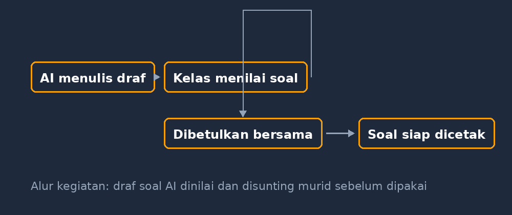

Kebiasaan aneh mulai tumbuh di kelas VIII-B semester ini. Ketika saya membagikan lembar latihan, tidak sedikit murid yang membacanya dengan tatapan curiga — bukan curiga kepada saya, tapi curiga kepada "si penulis soal". Suatu sore saya memang membuat lima soal tambahan dengan bantuan AI, terburu-buru, dan hanya sebagian yang saya periksa ulang. Keesokan paginya, seorang murid bernama Salsa mengangkat tangan sambil menunjuk soal nomor tiga: "Pak, ini soalnya kok aneh? Sepeda yang harganya lima belas ribu?"

Betul saja. Soal buatan AI itu bercerita tentang Rina membeli sepeda seharga Rp15.000, lalu mendapat diskon 20%. Angkanya rapi, kalimatnya lancar, tetapi logika harganya konyol. Di kelas yang lain, soal seperti ini mungkin lewat begitu saja — murid menghitung $15.000 \times 0{,}8 = 12.000$ dan selesai. Tetapi di kelas VIII-B hari itu, justru angka yang konyol itulah yang membuat diskusi ramai. Dari situ saya mulai sadar: mungkin soal yang salah justru punya nilai pedagogis yang tidak dimiliki soal yang sempurna.

<!--more-->

## Kecurigaan sebagai Keterampilan

Dulu saya sempat gelisah dengan kecurigaan murid-murid terhadap soal buatan AI. Sepertinya kurang hormat, sepertinya malah mencari-cari kesalahan. Tetapi lama-lama saya berbalik arah: kalau kecurigaan itu bisa diarahkan, ia berubah menjadi keterampilan memeriksa. Dan memeriksa soal — bukan sekadar mengerjakan soal — ternyata menuntut pemahaman yang jauh lebih dalam.

Untuk bisa berkata "diskon 20% dari 15.000 seharusnya 12.000, jadi kalimatnya benar tapi harganya tidak masuk akal", murid harus: (1) menghitung dengan benar, (2) mengenali konteks soal, dan (3) menilai apakah konteks itu wajar. Tiga langkah itu persis definisi literasi numerasi yang selama ini susah saya tanam lewat soal-soal "bersih". Soal yang rapi membuat murid berhenti pada langkah pertama. Soal yang janggal memaksa mereka menyusuri sampai langkah ketiga.

## Aturan Main yang Saya Buat

Setelah kejadian sepeda itu, saya tetapkan sebuah kegiatan rutin: kira-kira dua minggu sekali, saya membagikan satu atau dua soal buatan AI — kadang saya buat sengaja janggal, kadang memang bawaan asli dari AI-nya — dan tugas kelas bukan mengerjakannya sampai selesai, melainkan *menilai soalnya dulu*. Mereka menulis di lembar jawaban tiga hal:

1. Apa yang dicari soal ini, dan apakah kalimatnya bisa dipahami?
2. Apakah angka-angkanya masuk akal di dunia nyata?
3. Kalau ada yang salah, bagaimana seharusnya?

Aturan yang paling penting: tidak boleh menjawab "salah" tanpa alasan. Kalimat "soalnya jelek" tidak diterima; kalimat "diskon dihitung dari harga setelah PPN, padahal di soal tidak disebut PPN" itu diterima. Perbedaan dua kalimat itu adalah perbedaan antara ngeluh dan berpikir.

Hasilnya menarik. Murid yang biasanya diam di bangku belakang justru rajin angkat tangan pada kegiatan ini — mungkin karena tidak ada jawaban yang harus "ketemu", hanya pendapat yang harus dijelaskan. Beberapa bahkan mulai menyimpan kalimat-kalimat soal janggal di buku catatan mereka, seperti mengumpulkan stiker.

## Contoh yang Berhasil Membuat Kelas Berdebat

Soal yang paling lama diperdebatkan di kelas saya kurang lebih begini:

> Sebuah persegi panjang memiliki keliling 36 cm dan panjang 10 cm. Berapa lebarnya? Berapa pula luasnya?

Soal ini secara teknis tidak salah: $2(10 + l) = 36$ memberi $l = 8$ cm, dan luasnya $80\ \text{cm}^2$. Tetapi ada murid bernama Farhan yang menyebut soal itu "setengah salah". Alasannya: soal itu tidak butuh AI, tidak butuh siapa-siapa — lebarnya tinggal ditebak, 10 dan 8, karena semua orang tahu $10+8 = 18$. Ia mengusulkan agar soal memakai angka yang tidak mudah ditebak, misalnya keliling 38 cm dengan panjang 11 cm, supaya yang dites adalah prosesnya, bukan keberuntungan menebak.

Debat kecil itu justru membuka topik yang tidak saya rencanakan: apa bedanya soal yang *dapat dikerjakan* dengan soal yang *baik untuk dikerjakan*. Murid kelas SMP berdebat tentang desain soal. Saya hanya duduk di bangku samping dan sesekali menjadi wasit.

## AI sebagai Penulis Draf, Bukan Penulis Final

Dari semua pengalaman ini, satu prinsip yang makin kukakukan: AI boleh menulis draf soal, tetapi statusnya adalah draf — sama seperti status murid saya ketika menulis draf karangan. Draf itu kemudian disunting. Yang menarik, di kelas ini penyuntingnya bukan hanya saya, tapi murid-murid juga.

Ada rasa kepemilikan yang tumbuh dari situ. Ketika versi akhir soal sudah dibetulkan bersama, murid-murid merasa soal itu "punya mereka". Beberapa minta namanya dicantumkan sebagai penyunting. Saya tidak pernah sangka bahwa pekerjaan paling membosankan bagi guru — menyunting soal — bisa berubah menjadi kegiatan kelompok yang dinanti.

Tetapi saya juga tidak mau berlebihan. Kegiatan ini bukan pengganti soal-soal ujian yang serius. Soal ujian tetap harus saya periksa baris per baris, karena taruhannya nilai raport murid. Yang berubah hanyalah latihan harian: di sana, boleh ada cacat, dan cacat itu justru bahan belajar.

## Yang Saya Pelajari Sendiri

Kegiatan ini diam-diam mengoreksi cara saya menilai pekerjaan AI. Dulu saya menilai dari kelancaran kalimatnya — dan AI memang sangat pandai melancarkan kalimat. Sekarang saya menilai dari seberapa jauh saya perlu membetulkannya. Semakin lancar sebuah teks buatan AI, semakin mudah saya tertipu melewatkannya tanpa memeriksa angkanya. Justru soal-soal yang "terasa enak dibaca" itulah yang paling berbahaya kalau langsung dicetak.

Ada juga pelajaran yang lebih personal. Ketika murid menemukan kesalahan yang terlewat dari mata saya, saya mulai berkata terbuka di depan kelas: "Betul, Bapak tidak menangkap yang itu. Bagus." Kalimat semacam itu dulu terasa menurunkan harga diri guru. Sekarang saya menganggapnya sebagai teladan yang justru ingin saya tanam: orang dewasa pun memeriksa, orang dewasa pun bisa terlewat, dan yang membedakan orang teliti dari orang tidak adalah kebiasaan memeriksa ulang — bukan kecerdasan yang bawaan.

## Penutup: Salah itu Bahan Baku

Malam itu, setelah kelas VIII-B bubar, saya menata ulang lembar latihan dan menandai soal-sepal yang lolos dari pemeriksaan saya. Sepeda lima belas ribu itu akhirnya saya betulkan menjadi harga yang masuk akal, dengan catatan kaki: "Ditemukan oleh Salsa, kelas VIII-B." Versi soal itu sekarang menjadi soal andalan di lembar latihan berikutnya — lengkap dengan catatan kaki penemunya.

Kalau dulu saya menganggap soal yang salah adalah sampah yang harus dibuang sebelum terlihat siapa pun, sekarang saya menganggapnya bahan baku. Soal yang salah adalah soal yang paling jujur tentang cara kerja berpikir — baik cara kerja AI maupun cara kerja kita sendiri. Dan murid yang terbiasa membetulkan soal, saya yakin, kelak akan terbiasa pula memeriksa jawaban apa pun yang datang kepadanya, dari mana pun sumbernya.
