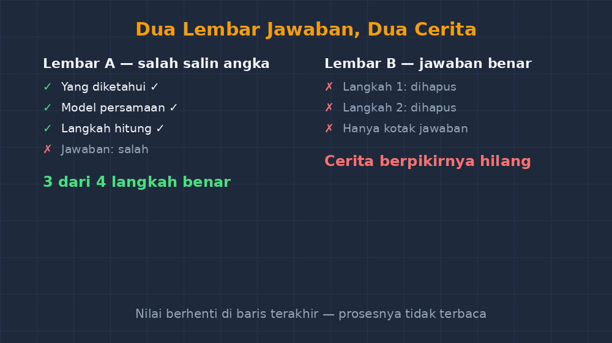

title: "Nilai yang Bersembunyi di Balik Tinta Coretan: Menilai Langkah, Bukan Hanya Jawaban"
date: 2026-10-27T13:15:00+07:00
draft: false
authors: ["Gunanto"]
description: "Dua siswa menjawab benar, tapi satu menulis tiga baris dan satu menulis setengah halaman. Artikel ini bercerita tentang apa yang saya lewatkan bertahun-tahun karena hanya menandai hasil akhir."
featuredImage: "featured-image.png"

tags: ["Pembelajaran Matematika", "Asesmen", "Penilaian Proses", "Kelas VII"]
categories: ["Pembelajaran Matematika"]

math:
  enable: true
---

Ada satu lembar jawaban yang saya ingat sampai sekarang. Kuis himpunan di kelas VII, soal operasi gabungan dan irisan dua himpunan, nilai akhirnya benar. Tapi di atas jawaban itu ada tiga baris tulisan pucat, diteguri lalu dihapus sebagian, isi ulang dengan pensil, dan di akhir hanya tersisa kotak jawaban yang rapi: $n(A \cup B) = 15$. Anak itu, sebut saja Raka, dapat nilai sempurna dari saya waktu itu. Padahal kalau jujur, saya tidak tahu apa yang terjadi di tiga baris yang dia hapus itu. Apakah dia salah dulu lalu menemukan jalan sendiri, atau dia cuma menyalin jawaban teman dan berusaha menyamarkan tinta aslinya? Lembar itu benar, tapi ceritanya hilang.

<!--more-->

Kebalikannya juga pernah terjadi. Ada murid yang jawaban akhirnya salah — dia salah salin satu angka dari soal, $32$ ditulis $23$, dan dari situ semua hitungannya runtuh — tapi langkah demi langkah sebelum itu semuanya benar dan teratur. Dia mendapat angka merah yang sama dengan temannya yang asal menebak. Dua anak, satu angka di rapor, dua cerita yang sangat berbeda. Dan saya yang menandainya, waktu itu, tidak bisa membedakan keduanya karena cara saya menilai hanya berhenti di baris terakhir.

## Bertahun-tahun Menilai Setengah Cerita

Kalau dipikir-pikir, cara saya menilai dulu warisan dari cara saya dinilai. Guru saya dulu juga menandai hasil akhir: benar dicentang, salah disilang, poin dihitung dari jumlah centang. Sistem itu cepat, dan cepat itu penting kalau yang harus dikoreksi seratus dua puluh lembar dalam satu malam. Tapi kecepatan itu punya harga yang saya baru sadar belakangan: jawaban akhir adalah ujung gunung es yang paling kecil. Di bawahnya ada pilihan-pilihan yang dibuat siswa — mulai dari mana, kenapa pilih rumus itu, kenapa berhenti di situ, kenapa pindah metode di tengah jalan — dan semuanya tidak terlihat kalau yang dicari cuma angka di kotak jawaban.

Masalahnya bukan cuma soal keadilan nilai. Masalah yang lebih dalam: saya jadi kehilangan data diagnostik. Murid yang salah karena salah salin angka butuh perlakuan yang sangat berbeda dari murid yang salah karena salah konsep. Yang pertama sebenarnya sudah paham; dia cuma butuh kebiasaan memeriksa ulang. Yang kedua butuh pembelajaran ulang dari fondasi. Tapi begitu keduanya sama-sama dapat silang merah di kertas saya, keduanya mendapat perlakuan yang sama: remedial bersama, soal latihan yang sama, dan pesan yang sama — "kamu belum bisa."

Padahal Raka, si anak yang menghapus tiga baris tadi, mungkin justru anak yang paling paham di kelas. Anak yang mengerjakan lalu memeriksa dan menemukan kejanggalan sendiri adalah anak yang sedang berpikir metakognitif — dia memantau pekerjaannya sendiri. Dari cara menilai saya, proses berpikir paling sehat di kelas itu justru tak terlihat, karena jejaknya dia hapus sendiri sebelum saya sempat membacanya.

## Kebiasaan Kecil yang Saya Ubah

Perubahan yang saya lakukan sederhana banget, sampai saya agak malu butuh bertahun-tahun untuk memulainya: saya berhenti mengoreksi dari bawah lembar, dan mulai mengoreksi dari atas.

Dulu kebiasaan saya mata langsung melompat ke kotak jawaban — itu refleks, karena kotak jawaban memang dirancang untuk ditemukan. Sekarang saya paksa mata saya berhenti di baris pertama. Dari mana dia mulai? Apakah dia menuliskan apa yang diketahui dan ditanya dulu? Kalau soalnya operasi himpunan, apakah dia daftar anggota $A$ dan $B$ dulu secara eksplisit, atau langsung lompat ke rumus $n(A) + n(B) - n(A \cap B)$ tanpa tahu anggotanya apa?

Saya juga mulai menulis di margin, bukan cuma silang dan centang. Tulisan kecil seperti "langkah ini bagus, tapi kenapa ganti metode di sini?" atau "angka ini beda dengan di soal — cek ya" ternyata lebih berguna bagi siswa daripada angka $65$ yang muncul di pojok tanpa penjelasan. Ada murid yang bilang, jujur-jujuran, bahwa dia tidak pernah membaca angka nilainya, tapi selalu membaca tulisan saya di margin. Kalau begitu, tulisan di margin itu justru penilaian yang sesungguhnya; angkanya cuma formalitas administratif.

Satu lagi yang saya ubah: soal mulai saya susun agar langkahnya bernilai. Soal multi-langkah sekarang saya beri sub-poin — "a) tuliskan yang diketahui, b) susun model, c) hitung jawaban" — dan poin diberikan per bagian. Ini bukan cuma untuk mempermudah koreksi. Ini memberi pesan yang jelas bahwa menuliskan yang diketahui bukan pekerjaan anak kecil, dan bahwa model persamaan $2x + 5 = 17$ itu sendiri sudah sebuah pencapaian sebelum $x$ ditemukan. Anak yang sampai di langkah b) dengan benar tapi tersandung di hitungan, akan mendapat dua dari tiga — dan dua dari tiga itu jujur, karena memang dia sudah menguasai dua pertiga perjalanan itu.

*Dua lembar jawaban: kiri salah salin angka tapi langkahnya utuh, kanan jawabannya benar tapi jejaknya dihapus. Dinilai dari langkah, keduanya bercerita.*

## Yang Saya Lepas, dan Yang Ternyata Berat

Kebiasaan baru ini tidak gratis. Mengoreksi dari atas ke bawah itu lebih lambat — saya kira dua sampai tiga kali lebih lama dibanding menandai hasil akhir. Untuk soal pilihan ganda, cara ini tidak relevan sama sekali; tidak ada langkah yang bisa dibaca dari huruf A sampai D. Jadi saya jujur memisah: asesmen pilihan ganda tetap dinilai mesin, dan justru karena itu, soal uraian harus dibayar dengan waktu koreksi yang layak. Tidak mungkin menilai langkah sambil melirik jam.

Ada juga godaan yang harus saya lawan: menilai kerapian, bukan penalaran. Lembar yang rapi dengan langkah tertulis rapi bukan otomatis langkah yang benar. Sebaliknya, ada murid yang tulisannya berantakan tapi alurnya jujur dan benar — dan saya pernah hampir memberi nilai rendah padanya hanya karena susah membaca tulisannya. Itu kesalahan saya, bukan kesalahannya. Jadi sekarang saya beri aturan kecil untuk diri sendiri: baca dulu alurnya, baru nilaikan penyajiannya, dan pisahkan keduanya di kepala.

## Sebuah Pertanyaan yang Masih Menggantung

Yang saya belum selesaikan sampai sekarang: bagaimana mengajar siswa untuk *menampilkan* langkahnya dengan jujur, tanpa jadi formalitas kosong. Karena seperti Raka, siswa pintar kadang menghapus jejaknya justru karena dia diajari bahwa tulisan yang dihapus itu "jelek". Atau sebaliknya — siswa lain menulis langkah demi langkah yang tidak dia pahami, hanya karena dia tahu guru memberi poin per langkah. Menilai langkah bisa saja cuma memindahkan permainan tebak-tebakan dari kotak jawaban ke badan soal, kalau tidak disertai percakapan. Makanya untuk kasus-kasus yang meragukan, saya mulai minta siswa menjelaskan lisan dua menit: baris mana yang paling susah baginya. Dua menit itu sering mengungkap lebih banyak daripada satu halaman tulisan.

Tapi dari semua keraguan itu, satu hal saya yakin: lembar jawaban siswa adalah rekaman berpikir, bukan sekadar lembar pengumpulan angka. Dan rekaman berpikir itu hanya bisa dibaca kalau kita, gurunya, benar-benar mau membacanya dari awal — bukan cuma mencari apakah sampai.

Waktu koreksi saya jadi lebih lama. Tapi waktu koreksi yang lebih lama itu, kalau dipikir lagi, adalah waktu mengajar yang berpindah tempat: dari depan kelas ke atas kertas. Dan selama tinta coretannya masih bercerita, saya ingin terus membacanya.
