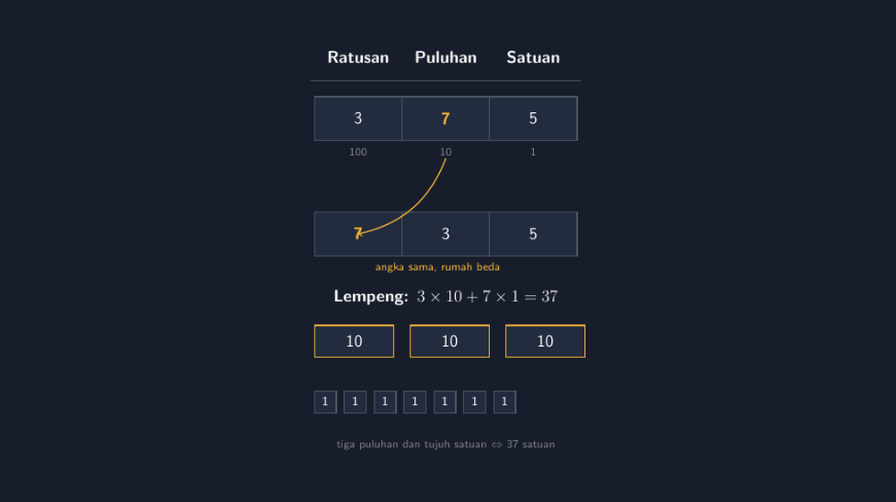
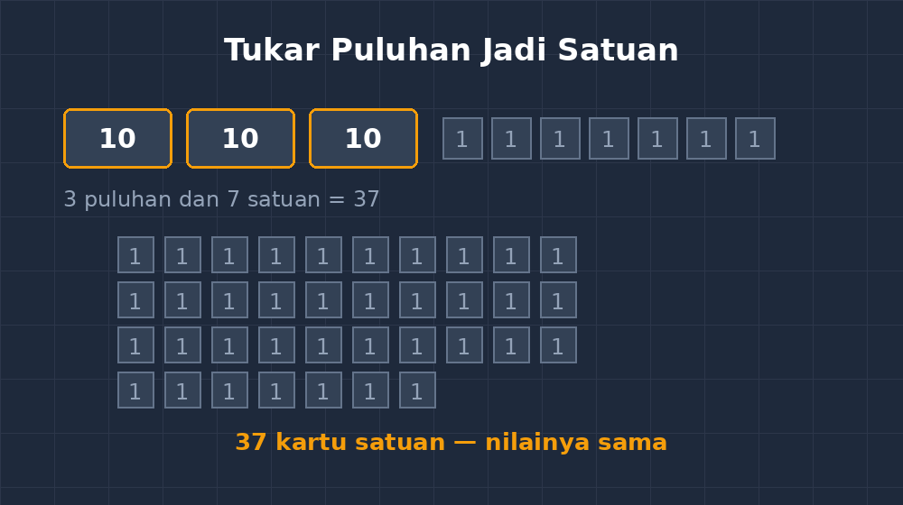

Kesalahan paling sunyi yang pernah saya temui di kelas VII bukan soal aljabar atau pecahan, melainkan soal yang seharusnya sudah selesai sejak SD: nilai tempat. Suatu hari, saat membahas soal sederhana "berapa nilai dari angka 7 pada bilangan 375?", anak yang biasanya paling aktif menjawab dengan mantap: "Tujuh, Pak." Saya tanyakan lagi untuk bilangan 735. Jawabannya sama: "Tujuh." Dia lancar sekali membaca bilangan itu — tiga ratus tiga puluh lima — tapi saat angka 7-nya ditanya satu per satu, yang dijawab adalah nama angkanya, bukan nilainya.

<!--more-->

Awalnya saya hampir menganggap ini sekadar kecelekaan. Tapi begitu saya uji ke kelas lain dengan pertanyaan yang sama, polanya berulang. Ada juga yang menjawab "tujuh puluh" untuk angka 7 di 735 — benar — tapi gagal di pertanyaan lanjutan: "kalau angka 7 itu dipindah ke paling kiri, berapa nilainya sekarang?" Diam. Berapa pun angkanya, begitu posisinya diubah, siswa yang belum paham nilai tempat kehilangan pijakan. Baginya angka 7 itu angka 7, sama seperti huruf tidak berubah walaupun pindah posisi di dalam kata.

Masalah ini tersembunyi justru karena siswa terlihat "bisa". Mereka bisa menghitung, bisa mengurutkan bilangan, bahkan bisa menyelesaikan soal operasi hitung dengan cepat. Tapi banyak dari kemampuan itu bergantung pada prosedur yang dihafal, bukan pada pemahaman bahwa dalam sistem bilangan desimal, **posisi adalah pengali**. Angka 5 di 570 dan angka 5 di 5.700 beda faktornya sepuluh kali. Kalau siswa tidak membawa pengertian ini, konsep-konsep selanjutnya — perkalian bersusun, pembagian bersusun, hingga notasi ilmiah di kelas IX — akan berdiri di atas tanah yang tidak stabil.

## Tabel nilai tempat: alat yang terlalu sering dilewati

Yang akhirnya saya pakai di kelas adalah alat paling sederhana: tabel nilai tempat. Tapi bukan tabel yang digambar seadanya di papan dengan garis yang miring dan kolom yang tidak sama lebar — kebiasaan lama saya — melainkan tabel yang digambar rapi dan konsisten, supaya siswa bisa membandingkan dua bilangan berdampingan dengan jelas.



Gambar di atas saya buat dengan TikZ, dan jujur, begitulah pertama kali saya sendiri menyadari sesuatu yang tidak pernah saya pikirkan selama mengajar: dua bilangan yang saya contohkan, 375 dan 735, memakai **angka yang sama persis** — hanya ditukar posisinya. Ini bukan kebetulan pilihan saya saat menyusun contoh; ini justru inti dari contoh itu. Ketika dua bilangan berisi angka-angka yang sama tapi nilainya berbeda jauh, tidak ada tempat untuk bersembunyi di balik "angkanya saja". Yang menentukan nilainya adalah rumah tempat angka itu tinggal.

Di TikZ, tabel seperti itu digambar dengan koordinat yang jelas. Potongan intinya kira-kira begini:

```latex
\begin{tikzpicture}
  \def\cw{2.2}   % lebar kolom
  \def\ch{1.0}   % tinggi baris
  % kepala tabel
  \foreach \i/\nama in {0/Ratusan, 1/Puluhan, 2/Satuan} {
    \node at ({\i*\cw+\cw/2}, \ch+0.55) {\textbf{\nama}};
  }
  % sel bilangan 375
  \node at (0.5*\cw, 0.5*\ch) {3};
  \node at (1.5*\cw, 0.5*\ch) {\textcolor{F7B538}{\textbf{7}}};
  \node at (2.5*\cw, 0.5*\ch) {5};
\end{tikzpicture}
```

Apa yang saya sukai dari cara ini bukan kerapian gambarnya, tapi disiplin yang dipaksakannya. Kalau saya mau menggambarkan perpindahan angka 7 dari kolom puluhan ke kolom ratusan, saya tidak bisa asal menggeser lingkaran. Saya harus menyebut koordinat sel asal dan sel tujuan — dan sel asal harus diberi tanda kosong, bukan dihapus begitu saja. Itu persis logika yang ingin saya tanamkan ke siswa: ketika angka pindah rumah, rumah lamanya jadi kosong, dan nilai berubah sepuluh kali lipat.

## Lempeng: satu batang yang menukar harga

Untuk memperkuat makna "posisi adalah pengali", saya tambahkan peraga kedua: lempeng nilai tempat. Di kelas, ini cuma kertas berwarna: kartu satuan berharga 1, kartu puluhan berharga 10. Satu kartu puluhan bisa ditukar dengan sepuluh kartu satuan. Kalau saya pegang 7 kartu satuan dan 3 kartu puluhan, totalnya 37. Sekarang saya tukar: setiap kartu puluhan saya ganti dengan kartu satuan. Jumlah kartunya meledak jadi 30, tapi angka yang ditulisnya tetap 3 dan 7 — hanya barisnya yang berubah.



Dari peraga ini, siswa yang tadi menjawab "tujuh" untuk angka 7 di 375 mulai punya bahasa baru: "yang tujuh yang satu di sebelah kiri tujuhnya puluhan, Pak." Bahasa itu terdengar canggung, tapi bagi saya itu tanda bahwa konsep sedang dibangun — bukan dihafal. Dari sini barulah pertanyaan lanjutan bisa berjalan: berapa nilai angka 3 di 375? Bagaimana kalau ada angka 0, misalnya di 305 — kenapa angka 0 tetap harus ditulis padahal "tidak bernilai"? Pertanyaan yang terakhir ini selalu memicu diskusi bagus: 305 bukan 35, dan alasan kenapa harus ada 0 di situ adalah supaya angka 3 tetap tinggal di rumah ratusan.

## Jembatan ke materi selanjutnya

Nilai tempat bukan bab yang berdiri sendiri. Hampir semua materi bilangan di SMP menumpang di atasnya. Perkalian bersusun, yang sering dibahas dengan "geser satu kolom ke kiri", hanya masuk akal kalau siswa paham bahwa geser satu kolom itu sama dengan mengalikan sepuluh. Pembagian bersusun dengan "turunkan angka berikutnya" juga sama: angka yang diturunkan itu masuk ke rumah yang lebih kecil. Bahkan saat membahas satuan pengukuran — meter ke sentimeter, liter ke mililiter — pola pengali sepuluh yang sama muncul lagi, hanya kali ini yang berpindah adalah koma, bukan angka.

Makanya saya sekarang memperlakukan nilai tempat bukan sebagai materi prasyarat yang "seharusnya sudah bisa", melainkan sebagai sesuatu yang sesekali perlu saya pindai ulang. Kalau ada siswa yang tersandung di perkalian bersusun, saya tidak langsung mengulang prosedur perkaliannya. Saya tanyakan dulu: "angka 4 di 4.560 ini nilainya berapa?" Kalau jawabannya macet, kita mundur dulu ke tabelnya. Lebih baik mundur tiga menit daripada berjalan penuh semangat di jalan yang salah.

Penutup dari pertemuan itu sederhana. Saya tulis 375 dan 735 berdampingan di papan, saya beri garis dari angka 7 yang satu ke angka 7 yang lain, dan saya bilang: "angkanya sama, rumahnya yang beda." Seorang siswa di belakang bergumam, "oh, jadi angkanya seperti orang yang pindah kost, nilai gajinya tetap sama tapi tanggung jawabnya berubah." Metaforanya tidak persis tepat secara matematika — tapi dia menangkap intinya: identitas yang sama, peran yang bergantung pada tempat. Untuk pelajaran tentang sistem desimal, perumpamaan seperti itu yang saya simpan, bukan rumus yang dihafal.

> 📎 **Berkas TikZ lengkap:** [nilai-tempat-tikz.tex](tex/nilai-tempat-tikz.tex) — siap kompilasi (butuh paket `tikz`).
