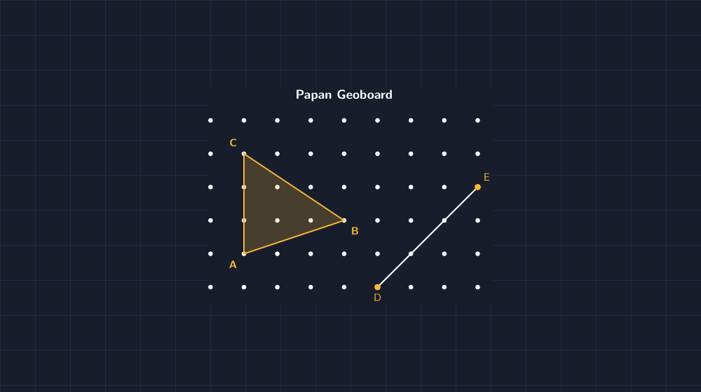
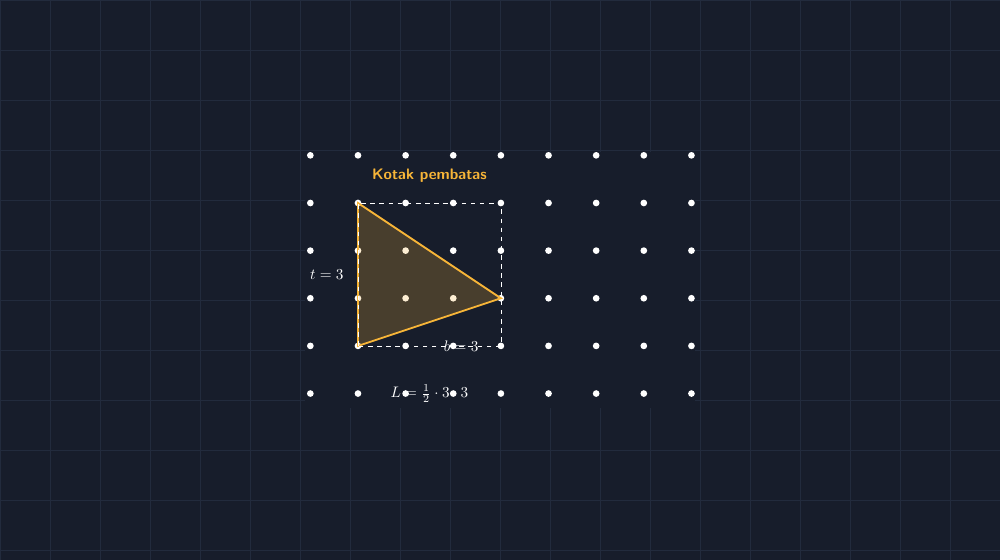

Ada satu kotak kayu tua di lemari laboratorium sekolah yang dulu sering saya lewati begitu saja: papan paku, atau geoboard. Isinya cuma susunan paku kecil yang berjarak sama satu sama lain, plus segenggam karet gelang warna-warni yang sebagian sudah menguning karena usia. Dulu saya mengira alat ini hanya untuk anak kecil, main bentuk saja. Sampai suatu hari, saat materi kelas VIII menyentuh luas bangun datar yang sisi-sisinya tidak "sopan" — tidak tegak lurus, tidak bisa langsung dikali panjang kali lebar — saya mencoba membawa papan itu ke kelas. Saya tidak menyangka jam pelajaran itu jadi salah satu yang paling sering saya ceritakan sejak itu.

Saya mulai sederhana. Saya tarik karet gelang membentuk segitiga pada papan titik, kira-kira seperti ini:

*Lalu saya tanya, "Berapa luas segitiga ini, kalau jarak antar paku kita anggap satu satuan?"*

<!--more-->

## Pertanyaan yang Tidak Bisa Dijawab dengan Rumus Langsung

Masalahnya memang sengaja saya rancang begitu. Segitiga yang saya bentuk punya alas yang miring, jadi rumus $\frac{1}{2} \times a \times t$ yang biasa jadi tongkat sakti murid langsung macet. Mereka tahu alasnya "kira-kira" tiga, tapi miring itu mengganggu. Ada yang mencoba mengukur pakai penggaris di atas papan, lalu saya tanya balik, "Emang satuan luas kita tadi centimeter, atau kotak?"

Pertanyaan balik itu penting. Begitu satuan luas didefinisikan sebagai satu kotak papan (satu paku kali satu paku), siswa mulai punya pijakan. Luas jadi sesuatu yang bisa dihitung dengan menjumlah kotak, bukan sekadar memasukkan angka ke rumus. Dan di titik inilah papan paku menunjukkan nilainya: bangun yang ditarik karet gelang selalu punya titik sudut di paku, jadi semua kotaknya "jujur" — ada yang utuh, ada yang terpotong.

## Kotak Pembatas: Jalan Pintas Pertama

Siswa yang paling gigih biasanya menemukan trik ini lebih dulu: gambar saja kotak terbesar yang memuat segitiga itu, hitung luas kotaknya, lalu kurangi bagian-bagian yang bukan segitiga.

Segitiga $ABC$ di papan saya muat dalam kotak $3 \times 3$. Luas kotaknya 9. Bagian yang tersisa terdiri dari dua segitiga siku-siku kecil dan satu segitiga lagi di bawah — semuanya bisa dihitung dengan rumus yang sudah mereka kuasai. Kurangi, dapat luas segitiga miring tadi. Beberapa kelompok mendapat 4,5. Ada yang mendapat 4,5 juga tapi lewat jalan berbeda, dan momen ketika dua kelompok menyadari jawaban mereka sama padahal caranya beda itu selalu jadi momen favorit saya. Di situ terlihat jelas bahwa luas itu milik bangunnya, bukan milik caranya.

Tapi saya tidak berhenti di situ. Saya tarik lagi karet gelang, bentuk segitiga lain. Lalu lagi. Dan di tiap bangun, saya minta mereka mencatat luasnya dengan metode kotak pembatas. Di bangun ketiga atau keempat, mulai terdengar keluhan: "Pak Gun, kalau bentuknya banyak banget sisi, capek juga ya kurang-kurang begini."

Kalimat itu yang saya tunggu. Karena dari keluhan itulah kebutuhan akan *rumus yang lebih efisien* muncul dari mereka, bukan dari saya.

## Rumus yang Terlihat Seperti Tali Sepatu

Di papan tulis, saya perkenalkan sesuatu yang sebenarnya sudah dikenal orang sejak lama: rumus shoelace, atau rumus tali sepatu. Nama asing, tapi begitu kita tulis bersama, siswa langsung paham kenapa namanya begitu.

Untuk bangun dengan titik-titik sudut $(x_1, y_1), (x_2, y_2), \ldots, (x_n, y_n)$ yang disusun berurutan (searah atau berlawanan jarum jam, asal konsisten), luasnya:

$$L = \frac{1}{2} \left| \sum_{i=1}^{n} (x_i \, y_{i+1} - x_{i+1} \, y_i) \right|$$

dengan titik terakhir "kembali" ke titik pertama. Cara mengingatnya: tuliskan koordinat vertikal dua kali, kalikan menyilang ke bawah dan menyilang ke atas seperti tali sepatu yang disilangkan, lalu selisihkan dan bagi dua.

Untuk segitiga pertama kita, dengan $A(1,1)$, $B(4,2)$, $C(1,4)$:

$$L = \frac{1}{2} \left| (1 \cdot 2 + 4 \cdot 4 + 1 \cdot 1) - (1 \cdot 4 + 2 \cdot 1 + 4 \cdot 1) \right| = \frac{1}{2}|21 - 10| = 5{,}5$$

Tunggu — dapat 5,5? Padahal tadi kelompok yang pakai kotak pembatas dapat 4,5? Justru di sinilah magangnya. Saya sengaja menuliskan perhitungan dengan satu koordinat yang "keseleo" — koordinat $B$ yang saya tulis $(4,2)$ padahal di papan titiknya ada di kolom keempat setelah kolom nol. Begitu siswa menghitung ulang dari papan, mereka menemukan sendiri letak salahnya. Rumus tidak pernah bohong; yang sering bohong adalah data yang kita masukkan.

> Saya benar-benar melewatkan kejadian ini di kelas: saya tulis rumus shoelace, dapat jawaban yang berbeda dari hitungan kotak pembatas, dan satu anak di barisan belakang berteriak, "Pak Gun, titiknya aja yang salah di papan tulis!" Itu mungkin satu-satunya kali sepanjang semester murid itu berteriak, dan ia benar.

Begitu koordinat dikoreksi, kedua metode bertemu di angka yang sama, dan kepercayaan siswa terhadap rumus itu jadi berbeda kualitas. Mereka tidak percaya karena saya bilang rumusnya benar; mereka percaya karena rumusnya *lolos uji* terhadap hitungan kotak yang bisa mereka lihat dan sentuh.

## Dari Papan Paku ke Layar

Masalah klasik papan paku: alatnya satu, muridnya tiga puluh dua. Maka papan itu jadi alat demokrasi di depan, sementara tiap kelompok mengerjakan versi mereka di kertas berpetak. Dan supaya versi digitalnya konsisten — dengan jarak paku yang benar-benar sama, label yang tidak asal tempat — saya menggambar ulang papan itu dengan TikZ. Gambar papan dan gambar kotak pembatas di artikel ini keduanya lahir dari kode yang sama dengan yang saya pakai untuk menyiapkan soal, jadi kalau suatu saat saya butuh bangun dengan luas tertentu untuk soal cerita, tinggal ubah koordinatnya.

Bagi yang ingin mencoba, berkas TikZ lengkapnya sudah saya siapkan — papan titiknya digambar dengan dua perulangan `\foreach` sederhana, dan karet gelangnya cuma garis yang menyambung koordinat paku:

> 📎 **Berkas TikZ lengkap:** [papan-geoboard-luas-shoelace.tex](tex/papan-geoboard-luas-shoelace.tex) — siap kompilasi (butuh paket `tikz`).

Kalau mau mengganti bangunnya, cukup pindahkan koordinat $A$, $B$, $C$ ke paku lain — asal tetap di paku, rumus shoelace-nya tetap berlaku.

## Yang Saya Simpan dari Jam Itu

Ada dua hal yang membuat saya ingin mengulang pembelajaran seperti ini untuk materi lain. Pertama, urutannya: pengalaman konkret dulu, metode pembatas sebagai jembatan, lalu rumus umum sebagai *hadiah* untuk yang sudah capek menghitung manual. Rumus yang datang setelah kebutuhan terasa selalu diterima lebih hangat daripada rumus yang datang sebelum pertanyaan muncul.

Kedua, soal data yang salah tadi. Saya makin yakin bahwa justru momen ketika angka tidak cocok adalah momen belajar paling mahal di kelas matematika. Anak-anak belajar bahwa matematika punya mekanisme kontrol diri: dua metode berbeda harus sepakat, dan kalau tidak sepakat, salah satunya — kadang rumusnya, kadang papan tulisnya — perlu diperiksa ulang. Keterampilan itu tidak tertulis di capaian pembelajaran, tapi saya pikir inilah inti dari berpikir matematis: tidak langsung percaya, termasuk pada gurunya sendiri.

Papan paku tua itu sekarang tidak lagi menganggur di lemari. Dan tiap kali saya melewatinya ke depan kelas, saya selalu ingat pesan sederhana dari jam shoelace itu: sebelum menyerahkan rumus, pastikan dulu murid sudah sempat capek mencari jalannya sendiri.
