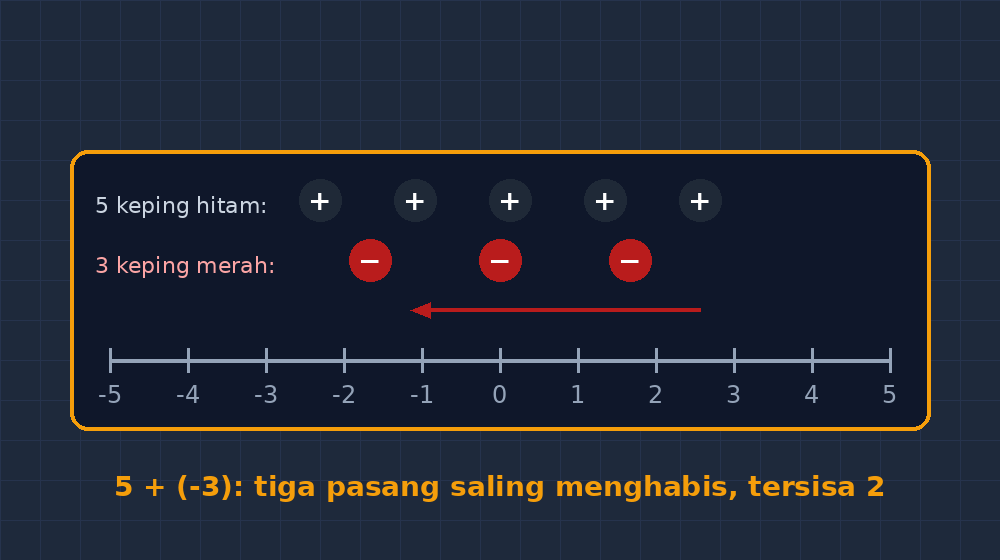

Ada satu bab yang selalu saya tanggapi dengan hati-hati setiap awal kelas VII: bilangan bulat. Bukan karena materinya sulit bagi saya, tapi karena materinya terlalu sering diajarkan dengan cara yang membuat anak berhenti berpikir. "Minus kali minus sama dengan plus, hafalkan." "Kalau dikurangi minus, jadi ditambah, hafalkan." Anak-anak mengangguk, mengisi lembar kerja, nilai latihannya lumayan. Dua minggu kemudian, saya tulis $5 - (-3)$ di papan, dan setengah kelas menjawab 2.

Tahun lalu saya menulis di blog ini soal minus yang hilang — tentang miskonsepsi itu sendiri. Kali ini saya ingin bercerita soal alatnya. Soal papan positif-negatif dari kardus bekas yang ternyata jadi salah satu benda paling sibuk di kelas saya sepanjang semester.

<!--more-->

## Alasannya Sederhana: Anak Butuh Benda yang Bisa Digeser

Saya pernah mencoba meyakinkan siswa dengan garis bilangan di papan tulis. Saya gambar garis panjang, beri panah, maju mundur, jalan ke kiri. Sebagian anak mengerti. Tapi garis bilangan di papan itu milik saya, bukan milik mereka. Mereka cuma penonton. Yang bertanya "kenapa kok mundur?" tidak bisa menyentuh garisnya, mencoba mundur sendiri, lalu mundur lagi sambil mengamati.

Media manipulatif menutup jurang itu. Kalau benda itu ada di tangan mereka, aturan tidak lagi sesuatu yang saya umumkan — aturan jadi sesuatu yang mereka temukan sendiri. Dan menurut pengalaman saya, aturan yang ditemukan sendiri jauh lebih tahan lama daripada aturan yang dihafal.

Masalahnya, media matematika yang dijual biasanya mahal, atau harus dicetak-print-laminasi yang bikin saya malas bahkan sebelum mulai. Jadi saya pakai bahan yang hampir pasti ada di setiap sekolah: kardus bekas.

## Membuat Papan Itu: Kurang dari Satu Jam

Bahan-bahannya memalukan sederhananya:

Satu potong kardus bekas, ukuran kira-kira 40 x 60 cm. Spidol hitam dan spidol merah. Magnet kulkas bekas — di rumah saya banyak yang datang dari iklan yang ditempel di pintu. Gunting dan lem kertas.

Saya potong kardus jadi papan, lalu menggambar garis bilangan besar di tengahnya: angka dari $-10$ sampai $10$, jarak antar angka kira-kira 2,5 cm supaya kotak magnet muat di antaranya. Di bagian bawah papan, saya gambar dua "kantong": kantong kiri untuk bilangan positif, kantong kanan untuk bilangan negatif. Lalu dari magnet kulkas, saya potong-potong jadi kepingan kecil — sekitar 30 keping. Keping yang diberi tanda plus saya warnai hitam, keping minus saya warnai merah.

Itu saja. Total biaya nol rupiah, waktu pembuatan satu jam sambil menonton televisi.

*Papan bilangan dengan garis bilangan $-10$ sampai $10$, kantong keping positif (hitam) dan negatif (merah).*

## Cara Mainnya: Keping sebagai Pasukan

Aturan dasarnya satu kalimat: **keping hitam menambah, keping merah mengurangi.** Itu saja. Semua operasi bilangan bulat, kalau ditaruh di papan ini, berubah jadi soal manajemen pasukan.

Misalnya $5 + 3$. Siswa taruh 5 keping hitam di garis bilangan mulai dari nol, maju 3 langkah, mendarat di 8. Tidak menarik, memang — ini soal SD yang sudah lancar. Yang menarik dimulai di sini:

$5 + (-3)$. Lima keping hitam di garis. Lalu datang tiga keping merah dari kantong kanan. Anak menaruh satu keping merah di dekat keping hitam, dan saya tak pernah bosan menunggu momen ini: ada anak yang bertanya, "Bu, ini dua-duanya ditaruh apa dihapus?" Di kelas saya tahun lalu, yang bertanya namanya Dinar. Dia menaruh keping merah di atas keping hitam, menatap saya, menatap kepingnya lagi, lalu berkata pelan, "Oh. Saling habis."

Saya tidak menjelaskan apa pun. Dia yang menemukannya. Tiga keping merah menghabiskan tiga keping hitam, tersisa dua keping hitam, jawabannya 2. Istilah "nilainya berlawanan dan jumlahnya nol" yang di buku tertulis rapi di kotak definisi, di papan itu bernama "saling habis". Dan "saling habis" itu milik anak-anak.

*Ilustrasi $5 + (-3)$: tiga keping hitam dan tiga keping merah saling menghabiskan, tersisa dua keping hitam.*

## Operasi yang Biasanya Bikin Kelas Hening

Bagian yang paling saya tunggu adalah pengurangan. $3 - 5$, misalnya. Anak taruh tiga keping hitam, lalu disuruh mengambil lima. Tersedia tiga. Di titik ini biasanya kelas hening sebentar — dan justru keheningan itu yang saya cari. Anak merasa sesuatu yang ganjil: ingin mengambil lima, tapi cuma ada tiga.

Dari keheningan itu, hampir selalu ada yang menemukan jalan keluarnya sendiri: "Bu, boleh tambah keping nol?" Dari mana keping nol? Ya dari pasangan hitam-merah yang saling menghabis. Tambah satu pasang: tetap nilainya 3, tapi keping hitamnya jadi empat. Tambah dua pasang: hitam jadi lima. Sekarang bisa ambil lima keping hitam. Tersisa? Tiga keping merah. Jawabannya $-3$.

Kalau Anda pernah mengajar materi ini, Anda tahu betapa berharganya momen itu. Konsep "menambah pasangan yang jumlahnya nol tidak mengubah nilai" — yang biasanya cuma jadi catatan kaki di buku — di papan itu jadi keterampilan yang harus dipakai untuk menyelesaikan masalah. Anak tidak diberi tahu; anak dipaksa menemukan.

Pengurangan dengan bilangan negatif, yang biasanya jadi neraka, jadi tahap lanjutan yang masuk akal: $4 - (-2)$. Empat keping hitam di garis, lalu diminta "mengurangi dua keping merah" — padahal tidak ada keping merah sama sekali. Gimana caranya mengurangi sesuatu yang tidak ada? Siswa menggeleng. Saya senyum. Lalu seseorang, biasanya yang paling ribut tadi, berkata: "Tambahin keping merahnya dulu, Bu. Yang saling habis juga." Dan begitu keping merah muncul, "mengurangi keping merah" berarti mengambil dua keping merah yang paling dekat — pasangan hitam-merahnya ikut bubar, dua keping hitam lepas, tersisa enam keping hitam. Jawabannya 6. Rumus "mengurangi bilangan negatif sama dengan menambah" tidak pernah saya sebut. Dia muncul sendiri.

## Apa yang Berubah Setelah Papan Itu Ada

Saya tidak mau berlebihan. Papan kardus ini bukan tongkat ajaib. Nilai ulangan harian anak saya tidak tiba-tiba semua 90. Tapi ada beberapa hal yang jelas berubah.

Pertama, jumlah pertanyaan di kelas naik drastis. Kepingan yang bisa digeser membuat anak berani mencoba kombinasi yang tidak saya minta. "Bu, kalau minusnya lebih banyak dari plusnya terus ditambah minus lagi gimana?" Pertanyaan seperti itu jarang muncul waktu materinya cuma di papan tulis.

Kedua, miskonsepsi jadi terlihat. Dulu, kesalahan anak baru ketahuan waktu saya koreksi jawaban di kertas — saat pemahaman yang salah sudah mengendap. Sekarang, kesalahan itu muncul di atas papan, di depan mata saya, dalam bentuk keping yang salah taruh, dan bisa dibetulkan sebelum sempat mengendap.

Ketiga, dan ini yang paling saya syukuri: anak yang biasanya diam mulai bicara. Benda yang bisa digenggam menurunkan risiko salah. Menaruh keping di tempat yang salah itu tidak memalukan — tinggal digeser. Menulis angka yang salah di papan tulis di depan semua orang, bagi sebagian anak, itu menghancurkan. Papan kardus memberi mereka ruang mencoba yang lebih murah harganya.

## Catatan untuk yang Ingin Mencoba

Beberapa hal yang saya pelajari cara sulit:

Jangan buat keping terlalu kecil. Percobaan pertama saya kepingnya sebesar koin 500 rupiah, hilang lima keping dalam satu minggu. Sekarang keping saya sebesar koin 1000, dan magnetnya cukup tebal supaya tidak bergeser sendiri kalau papan ditepuk.

Bilangan di garis jangan terlalu banyak. $-10$ sampai $10$ itu sudah pas. Papan yang penuh angka justru bikin anak fokus ke angka, bukan ke keping.

Dan yang penting: jangan buru-buru mengambil papan itu dari tangan mereka. Ada godaan, waktu jam pelajaran tinggal sepuluh menit, untuk bilang "sudah, langsung aja hitungnya". Saya pernah begitu, dan hasilnya anak-anak yang belum menemukan polanya langsung tertinggal. Papan itu bukan penghias pembuka materi — papan itu tempat materi itu dibangun. Kalau perlu dua pertemuan untuk membangun, ya dua pertemuan. Lebih baik dua pertemuan yang dimengerti daripada satu pertemuan yang dihafal.

Kadang saya berpikir, dari semua aplikasi yang saya bangun — kuis interaktif, CBT, media matematika di layar — alat yang paling sering saya ambil dari tas ke kelas justru selembar kardus bekas dengan magnet iklan yang ditempel di pintu. Teknologi bagus itu nyata ada dan saya terus membangunnya. Tapi di titik-titik tertentu, yang dibutuhkan anak bukan layar yang lebih besar atau animasi yang lebih halus. Kadang yang mereka butuhkan cuma sesuatu yang bisa dipegang, digeser, disalahtempatkan, lalu digeser lagi.

Dan kalau itu bisa dibuat dari kardus bekas dengan biaya nol rupiah, tidak ada alasan untuk tidak mencoba.
