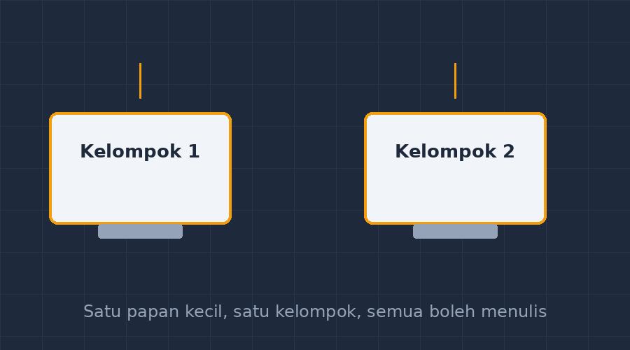

Kelas tujuh sedang mengerjakan soal pecahan campuran. Lima kelompok, masing-masing empat anak, dan seperti biasa polanya terulang: satu anak menulis di buku, satu anak mengatur, dua sisanya menunggu waktu berlalu. Saya berkeliling dan menanyai anak-anak yang diam. Jawabannya beragam, tapi semuanya bermuara ke satu hal — mereka merasa pekerjaan itu bukan milik mereka.

Malam itu saya teringat sesuatu yang sudah lama tidak saya pakai: papan tulis mini. Papan putih kecil ukuran A3, satu buah per kelompok, plus spidol dan tisu lap. Awalnya saya beli dua lembar itu sekadar iseng di toko alat tulis. Ternyata ia menjadi alat yang paling sering saya angkat dari lemari di semester itu.

<!--more-->

## Kenapa buku tulis tidak cukup

Masalahnya bukan pada soalnya. Soalnya bagus, kontekstual, sudah saya pikirkan matang. Masalahnya pada media. Kalau pekerjaan kelompok ditulis di buku milik satu orang, maka secara psikologis pekerjaan itu adalah milik satu orang itu juga. Anak yang menulis merasa diawasi anak yang tidak menulis. Anak yang tidak menulis merasa tidak punya hak bicara karena "toh tulisannya bukan tulisanku".

Papan kecil mengubah hak milik itu. Papan itu milik kelompok, bukan milik seseorang. Tidak ada nama di atasnya. Dan anehnya, karena tidak ada nama, semua anak merasa boleh ikut mengambil spidol.

## Papan kecil memaksa jawaban berani "salah"

Ini temuan yang paling saya suka. Di papan tulis kecil, semua tulisan bisa dihapus dalam tiga detik. Turunkan tisu, selesai. Untuk anak yang takut salah — dan banyak sekali anak yang takut salah, seperti yang pernah saya tulis di artikel tentang kecemasan matematika — kemungkinan hapus ini adalah jaminan. Mereka berani menulis dugaan mereka di papan, sesuatu yang tidak akan mereka lakukan di kertas yang akan dinilai.

Ada satu momen yang tidak akan saya lupakan. Kelompok dekat jendela sedang berdebat soal urutan pecahan $\frac{3}{5}$ dan $\frac{2}{3}$. Anak yang biasanya paling pendiam tiba-tiba mengambil spidol dan menulis $\frac{9}{15}$ dan $\frac{10}{15}$ di papan. Dia menyamakan penyebutnya sendiri, tanpa diminta, karena ingin membuktikan pendapatnya. Di buku, dia mungkin hanya akan bilang "saya nggak tahu". Di papan, dia menunjukkan.

## Papan yang terlihat semua orang

Ketika semua kelompok menulis di papan kecil, saya tinggal minta mereka angkat papan dan letakkan di meja menghadap depan, atau saya pegang satu per satu ke depan kelas. Dalam dua menit, lima jawaban berbeda terpajang untuk didiskusikan bersama. Bandingkan dengan metode lama: menunggu ketua kelompok membaca jawaban dari buku sambil siswa lain pura-pura mendengarkan.

Dengan papan, perbandingan jawaban jadi konkret. Siswa bisa melihat dengan mata bahwa kelompok lain menggambar model berbeda untuk soal yang sama. Dari perbedaan inilah diskusi kelas yang benar-benar hidup biasanya dimulai.

*Diagram sederhana: satu kelompok, satu papan kecil, dan semua spidol bebas diambil.*

## Ritual kecil yang membuatnya bekerja

Papan mini tidak ajaib. Tanpa aturan, hasilnya akan tetap satu orang menulis sementara yang lain menonton. Jadi saya buat beberapa kesepakatan sederhana dengan kelas:

- Siapa yang memegang spidol harus menulis dengan tulisan tangan orang lain — artinya, ganti penulis setiap berganti langkah pengerjaan, bukan satu orang yang mengulur waktu sampai selesai.
- Papan boleh dihapus kapan saja tanpa minta izin. Justru itu gunanya.
- Saat presentasi, siapa pun di kelompok boleh menjelaskan papan itu, tidak harus penulis terakhir.

Aturan ketiga adalah yang paling sering dilanggar, dan justru pelanggarannya yang saya tunggu. Ketika anak yang bukan penulis terakhir berani maju menjelaskan, tandanya dia benar-benar mengikuti alur pikir kelompoknya.

## Batas-batasnya

Saya juga harus jujur soal kekurangannya. Tulisan spidol mudah luntur kalau tangan basah menyentuhnya. Papan harus dilap bersih setiap dipakai, kalau tidak, lapisan tulisan lama yang mengeras akan susah dihapus. Dan untuk pekerjaan yang harus diserahkan atau diarsipkan, papan jelas tidak menggantikan kertas — papan itu untuk proses berpikir, bukan produk akhir.

Untuk kelas besar, biaya juga menjadi pertimbangan. Tapi papan putih kecil ukuran A3 harganya cukup terjangkau, dan kalau anggaran benar-benar tidak ada, alternatifnya plastik map bening yang dilapisi kertas HVS: bisa ditulisi spidol papan tulis, bisa dilap, dan bisa diselipkan lembar soal di dalamnya. Beberapa rekan guru saya bahkan lebih suka versi plastik ini karena bisa memasukkan soal atau grid koordinat yang sudah dicetak.

## Catatan penutup

Alat ini tidak ada hubungannya dengan teknologi, dan mungkin justru itu pelajarannya. Saya pernah menghabiskan malam-malam membangun aplikasi kuis dan CBT, dan saya tetap akan terus melakukannya. Tapi kadang perubahan suasana kelas yang paling besar datang dari benda seharga beberapa lembar papan kecil — benda yang hanya melakukan satu hal: membuat tulisan murid-murid saya terlihat, boleh salah, dan milik bersama.

Kalau Bapak/Ibu guru belum pernah mencoba, mulailah dari dua atau tiga papan saja. Pinjamkan ke kelompok yang paling sering diam. Saya rasa, seperti pengalaman saya, papan itu tidak akan kembali ke lemari untuk waktu yang lama.
