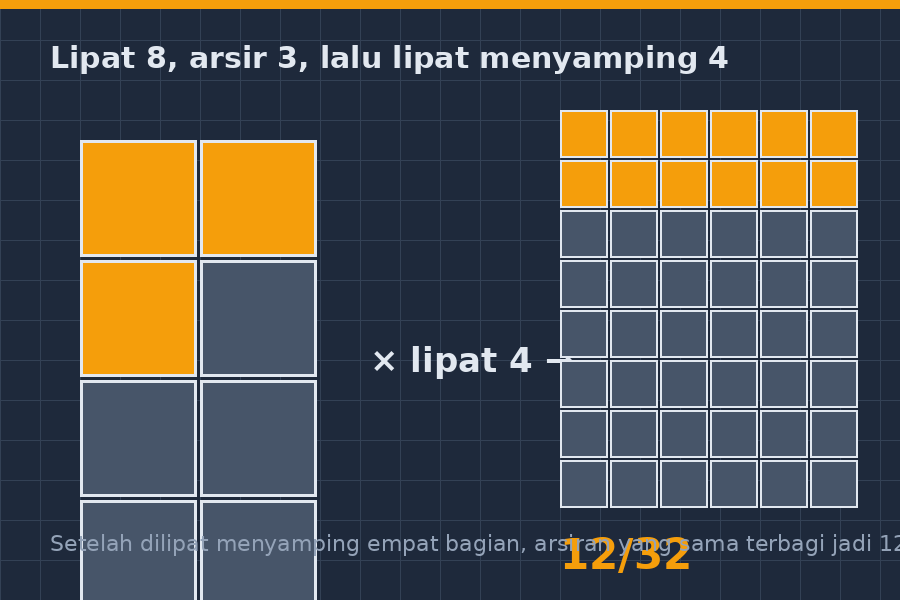
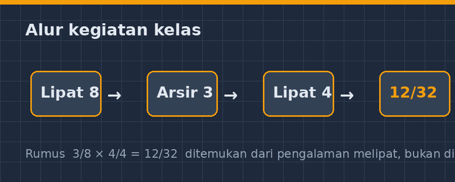

Ada satu topik yang setiap tahun selalu membuat saya menyiapkan mental ekstra sebelum masuk kelas: pecahan. Bukan pecahan biasa yang cuma soal dibaca, tapi pecahan yang dioperasikan — terutama perkalian. Kalau Bapak/Ibu guru pernah mengajar materi ini, pasti tahu persis raut wajah murid ketika papan tulis penuh dengan $\frac{2}{3} \times \frac{3}{4}$. Ada yang pasrah menyalin rumus, ada yang langsung menyerah sebelum perang dimulai, dan ada pula yang bertanya dengan lirih, "Pak, kok dikali tapi hasilnya malah lebih kecil?"

<!--more-->

Pertanyaan itu, "kok dikali malah makin kecil", sebenarnya adalah pertanyaan yang sangat bagus. Sangat matematis, justru. Tapi selama bertahun-tahun saya menjawabnya dengan cara yang salah: saya menjelaskan rumus lebih keras. Saya tulis besar-besar di papan, saya garis-bawahi, saya ulangi. "Kaliin pembilang, kalikan penyebut. Ingat ya, dikali pembilang, dikali penyebut." Rumusnya hafal semua. Pemahamannya? Nol koma nol.

Tahun ini saya mencoba jalan lain. Dan jalan itu ternyata dimulai dari tumpukan kertas origami sisa kegiatan panen karya bulan lalu.

## Titik Temu yang Tidak Terduga

Ceritanya sederhana. Di gudang kelas ada dua bungkus kertas origami warna-warni yang belum terpakai, sisanya dari kegiatan seni bulan September. Waktu itu saya iseng membawa setengah bungkusnya ke kelas VII-B, kelas yang paling ramai tapi juga paling cepat menyerah pada pecahan.

"Hari ini kita tidak pakai buku paket dulu," kata saya sambil membagikan kertas. "Ambil satu lembar. Lipat dua, lipat lagi, terus lipat sekali lagi."

Mereka mengikuti dengan campuran penasaran dan curiga — murid SMP kelas VII itu mudah terdeteksi, dan curiga mereka biasanya berarti "ini jebakan atau bukan?". Setelah kertas terlipat menjadi delapan bagian, saya minta mereka buka lagi.

"Perhatikan garis-garis lipatannya. Satu lembar kertas itu berapa bagian?"

"Delapan, Pak."

"Nah. Kalau saya arsir dua bagian, itu berapa?"

"$\frac{2}{8}$, Pak," jawab mereka hampir serempak. Sempurna. Tapi ini baru pemanasan.

## Dari Kertas ke Perkalian

Bagian menariknya mulai di sini. Saya minta mereka lipat kembali menjadi delapan bagian, lalu arsir tiga bagian — jadi $\frac{3}{8}$. Setelah itu, perintah berikutnya membuat kelas hening sebentar: "Sekarang, lipat lagi kalian yang sudah diarsir itu. Lipat menyamping, jadi empat bagian."

Garis lipatan baru muncul memotong daerah yang sudah diarsir. Dan di situ, entah bagaimana, beberapa kepala mulai mengangguk-angguk sendiri.

"Yang tadinya tiga bagian arsiran itu sekarang kepotong jadi berapa bagian kecil?"

"Enam, Pak."

"Dari total berapa bagian sekarang?"

"Sebelas... eh, tiga puluh dua, Pak."

Tiga dari delapan, dilipat empat, menghasilkan dua belas bagian kecil dari tiga puluh dua. Dan di papan tulis, saya tulis pelan-pelan:

$$\frac{3}{8} \times \frac{4}{4} = \frac{12}{32}$$

Bukan sihir. Bukan trik. Pembilang dikali pembilang, penyebut dikali penyebut — dan kertas itu sudah "membuktikannya" di tangan mereka sendiri sebelum saya selesai menulis rumusnya.

## "Kok Dikali Malah Makin Kecil?"

Pertanyaan legendaris itu akhirnya muncul juga, tentu saja. Tapi kali ini dia muncul dari tempat yang berbeda — bukan dari kebingungan, tapi dari pengamatan. Seorang murid bernama Rafi (bukan nama sebenarnya, tapi ceritanya nyata) mengangkat tangan dan berkata, "Pak, $\frac{3}{4}$ kan lebih besar dari setengah. Terus kok $\frac{3}{4} \times \frac{1}{2}$ hasilnya $\frac{3}{8}$, lebih kecil?"

Saya tidak langsung jawab. Saya balik tanyanya ke kelas: "Ada yang bisa jelasin pakai kertasnya?"

Dan yang menjawab bukan siswa terpintar di kelas. Seorang murid yang biasanya diam di pojok belakang berkata pelan, "Karena yang dikali setengah itu... setengahnya $\frac{3}{4}$-nya, Pak. Jadi ya tinggal separonya."

Sebelas tahun mengajar, dan kalimat itu tetap terasa seperti hadiah.

## Apa yang Saya Pelajari

Saya tidak bermaksud mengklaim bahwa kertas origami adalah solusi ajaib untuk semua masalah pecahan. Jelas bukan. Besok lusa, ketika pecahannya jadi $\frac{5}{7} \times \frac{2}{9}$, kertas lipat itu tidak lagi praktis. Siswa tetap perlu melatih prosedurnya, tetap perlu berlatih soal, tetap perlu terbiasa dengan notasi.

Tapi ada satu hal yang sekarang saya yakini lebih dari sebelumnya: rumus itu bukan titik awal, rumus itu titik akhir. Murid yang memahami *mengapa* $\frac{3}{8} \times \frac{4}{4}$ menghasilkan $\frac{12}{32}$ — karena lipatannya memotong bagian yang sudah ada, bukan menambah bagian baru — akan jauh lebih sulit keliru saat menghadapi pecahan yang lebih rumit. Dia punya gambar mental. Dia punya cerita. Dia punya pengalaman tangan yang pernah melipat.

Bagi rekan-rekan guru yang ingin mencoba, ini yang saya temukan dari satu jam pelajaran itu:

- Kertas origami, kertas HVS bekas yang dilipat, bahkan kertas koran — semuanya bisa. Yang penting murid yang melipat, bukan kita yang menunjukkan gambar jadi.
- Jangan buru-buru menulis rumus di papan. Biarkan mereka menemukan pola pembilang-dikali-pembilang sendiri. Rasanya lebih lambat, tapi yang tertanam jauh lebih dalam.
- Pertanyaan "kok dikali malah makin kecil" itu bukan gangguan. Itu pintu masuk. Siapkan diri untuk menghadapinya dengan kertas di tangan, bukan dengan pengulangan rumus.

## Penutup

Sore itu, ketika bel pulang berbunyi, beberapa murid masih sibuk melipat kertasnya dengan arsiran-arsiran sendiri, mencoba pecahan lain di luar yang saya perintahkan. Salah satu dari mereka berkata sambil berlari keluar kelas, "Besok pecahan pembagian pakai kertas juga, Pak?"

Saya tertawa. "Nanti kita coba ya."

Dan jujur saja, malam itu saya mulai mencari-cari cara menjelaskan pembagian pecahan dengan lipatan kertas. Karena kalau murid sudah bertanya, kita tidak boleh datang kosong besoknya.
