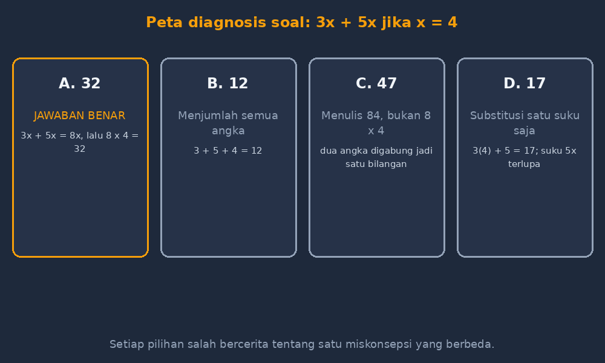

Malam sebelum ulangan harian bab aljabar, saya duduk di depan laptop menyusun sepuluh soal pilihan ganda. Pekerjaan yang kelihatannya paling ringan dalam persiapan mengajar — lebih cepat daripada membuat rubrik, lebih singkat daripada menulis soal uraian. Empat pilihan, satu jawaban, selesai. Tapi malam itu saya terpaku pada satu soal sederhana:

$$\text{Nilai dari } 3x + 5x \text{ jika } x = 4 \text{ adalah } \ldots$$

Pilihan yang saya tulis dulu: 32, 12, 47, dan 17. Saya menatapnya lama. Lalu saya sadar satu hal: dari empat pilihan itu, cuma satu yang benar, dan tiga lainnya saya buat asal, sekadar angka-angka yang "kelihatan masuk akal". Padahal kalau dipikir-pikir, tiga pilihan salah itu punya pekerjaan yang jauh lebih penting daripada sekadar jadi pengisi huruf B, C, dan D.

<!--more-->

## Pengecoh Bukan Penipu, Tapi Cermin

Di banyak lokakarya asesmen, istilahnya distractor — pengecoh. Nama yang agak jahat, seolah tugasnya menjebak siswa supaya jatuh. Padahal kalau dirancang dengan benar, pengecoh justru alat diagnosis paling murah yang saya punya. Setiap pilihan salah sebaiknya *direkayasa dari satu miskonsepsi spesifik*. Jadi ketika seorang siswa memilih C, saya tidak hanya tahu bahwa dia salah — saya tahu *persis bagaimana* dia salah.

Untuk soal $3x + 5x$ tadi, mari saya susun ulang pengecohnya:

- **32** — jawaban benar: $3x + 5x = 8x = 8 \cdot 4$.
- **12** — siswa mengganti $x$ dengan 4 sejak awal: $3 \cdot 4 + 5 = 17$? Bukan. Versi lain: dia menghitung $3 + 5 + 4 = 12$, menjumlahkan semua angka yang terlihat.
- **47** — siswa tahu $3x + 5x = 8x$, tapi saat substitusi dia menulis $84$, bukan $8 \times 4$. Kesalahan klasik menggabungkan dua angka jadi satu bilangan.
- **17** — siswa hanya menyubstitusi pada satu suku: $3 \cdot 4 + 5 = 17$. Ia lupa bahwa $5x$ juga mengandung $x$.

*Peta diagnosis: setiap pilihan salah "memberi suara" untuk satu jenis kesalahan yang berbeda.*

Sekarang kalau saya lihat hasil ulangan besoknya, soal ini bukan lagi sekadar benar-salah. Kalau delapan anak memilih 17, saya tahu ada masalah serius dengan pemahaman mereka tentang koefisien — bahwa $5x$ artinya "lima kali $x$", bukan "lima dan $x$". Kalau yang banyak memilih 47, masalahnya di kebiasaan menulis substitusi, bukan di konsep suku sejenis. Satu soal, empat kemungkinan cerita.

## Kapan Saya Mulai Peduli

Jujur, tahun-tahun awal mengajar saya tidak peduli sejauh ini. Pengecoh saya buat dengan rumus yang populer di kalangan guru: "jawaban benar ± sedikit". Kalau jawabannya 32, tulis saja 23, 34, 42. Angka mirip, terasa sulit, selesai. Masalahnya saya sadari suatu hari ketika mengoreksi ulangan harian bilangan bulat.

Ada satu soal tentang $(-3) + (-5)$, dan pengecoh yang saya tulis adalah 8 — miskonsepsi "minus yang saling meniadakan" yang memang sering muncul. Tapi dua pengecoh lainnya, 15 dan 2, saya buat asal. Hasilnya? Hampir semua anak yang salah memilih 8, dan sisanya memilih 15 atau 2 secara acak. Dua pilihan itu tidak memberi saya informasi apa pun. Mereka cuma noise. Dan lebih parah lagi: pengecoh yang terlalu konyol membuat soal mudah ditebak dengan eliminasi, sehingga nilai yang cantik di lembar jawaban tidak mencerminkan apa pun yang sebenarnya dipahami anak.

Sejak itu saya mengubah kebiasaan. Sebelum menulis pengecoh, saya bertanya pada diri sendiri: *kalau ada siswa memilih ini, miskonsepsi apa yang dia pegang?* Kalau saya tidak bisa menjawab pertanyaan itu, pengecoh itu saya buang dan diganti.

## Dari Mana Sumber Miskonsepsinya

Kabar baiknya, guru tidak perlu menebak-nebak. Sumber miskonsepsi ada di sekitar kita, tinggal dikumpulkan dengan sengaja:

**Koreksi-koreksi lama.** Saya punya kebiasaan (yang dulu terasa sia-sia) mencatat kesalahan yang berulang di buku kerja siswa, lengkap dengan tulisan anak persis seperti yang dia tulis. Catatan itu sekarang jadi gudang pengecoh. Kesalahan $84$ untuk $8 \times 4$, misalnya, saya kutip apa adanya dari tulisan seorang siswa dua tahun lalu.

**Pilih jawaban salah sendiri dulu.** Sebelum menyimpan soal, saya mengerjakannya dengan sengaja *salah* — mencoba setiap jalan pintas yang biasa dipakai siswa: lupa menyubstitusi satu suku, salah urutan operasi, menukar luas dengan keliling. Jalan pintas yang berhasil membuat saya "sampai" ke salah satu pilihan itulah pengecoh yang layak dipertahankan.

**Tanya ke AI sebagai murid percobaan.** Kebiasaan lain yang saya ceritakan di artikel sebelumnya: menjadikan AI murid uji coba. Tapi kali ini saya pakai dengan cara terbalik. Saya minta AI menjawab soal saya *tanpa diberi tahu jawabannya*, lalu memilih salah satu pilihan. Kalau AI — yang seharusnya "pintar" — tergoda memilih pengecoh tertentu, itu sinyal pengecoh saya terlalu manis, terlalu mudah terjebak, dan mungkin siswa yang benar-benar paham pun akan ragu. Sebaliknya, pengecoh yang baik harusnya hanya memikat mereka yang benar-benar membawa miskonsepsi itu.

**Minta siswa menulis pilihan sendiri.** Ini favorit saya di kelas. Setelah pembahasan, saya kadang meminta kelompok membuat satu soal pilihan ganda lengkap dengan pengecohnya. Menariknya, pengecoh yang mereka tulis hampir selalu merupakan kesalahan mereka sendiri atau teman sebangkunya. Saya kumpulkan, dan lembar itu menjadi bahan mentah ulangan berikutnya. Anak-anak merasa diperdaya sedikit — "pilihannya dari jawaban kami, Pak?" — tapi justru itu buktinya bekerja.

## Batas-Batas yang Perlu Diakui

Supaya adil, metode ini bukan obat mujarab dan punya batas. Pertama, satu soal pilihan ganda tetap cuma punya empat pintu diagnosis. Kalau ada sepuluh miskonsepsi yang beredar di kelas, satu soal tidak akan cukup — butuh beberapa soal yang mengecoh miskonsepsi berbeda. Kedua, ada siswa yang salah bukan karena miskonsepsi, tapi karena salah baca, kurang tidur, atau lupa menandai jawaban yang benar di lembar LJK. Tidak semua pola jawaban adalah data yang bersih.

Ketiga — dan ini penting — pengecoh yang terlalu bagus kadang menyakitkan. Pernah ada soal tentang volume kerucut di mana pengecoh saya (hasil lupa membagi tiga: $\frac{1}{3}\pi r^2 t$ dihitung tanpa $\frac{1}{3}$) dipilih oleh hampir setengah kelas. Nilai ulangan itu jelek. Tapi justru itu gunanya: saya tahu hari itu sebelum lanjut ke bab berikutnya, saya harus kembali duduk bersama mereka di depan kerucut kertas dan benang, bukan sekadar memberi tahu jawabannya yang mana. Diagnosis yang bagus memang sering membawa kabar yang tidak enak.

## Penutup: Menulis Soal Juga Merupakan Mengajar

Dulu saya menganggap menyusun soal pilihan ganda sebagai administrasi — sesuatu yang dikerjakan cepat agar bisa cepat selesai. Sekarang saya memandangnya sebagai bagian dari pembelajaran itu sendiri. Waktu saya merancang pengecoh, saya dipaksa menelusuri pikiran siswa: di titik mana mereka biasanya belok, apa yang keliru mereka dengar saat saya menjelaskan, operasi mana yang mereka lewati. Menulis pengecoh yang jujur, ternyata, adalah latihan empati yang agak teknis.

Jadi kalau Bapak/Ibu guru menemukan diri sedang duduk malam-malam di depan empat pilihan jawaban, coba uji masing-masing pilihan salah dengan satu pertanyaan: *miskonsepsi apa yang mengantar anak ke sini?* Kalau jawabannya ada, pertahankan pilihan itu. Kalau tidak, itu bukan pengecoh — itu cuma pengisi.

Dan soal $3x + 5x$ tadi? Versi finalnya sekarang tersimpan di berkas soal saya, lengkap dengan catatan kecil di samping tiap pilihan: 32 untuk yang paham, 17 untuk yang lupa suku kedua, 47 untuk yang menulis $84$, 12 untuk yang menjumlah semua angka. Sepuluh detik ekstra saat menulis soal, dan hasil koreksinya bercerita panjang di sore hari koreksi.
