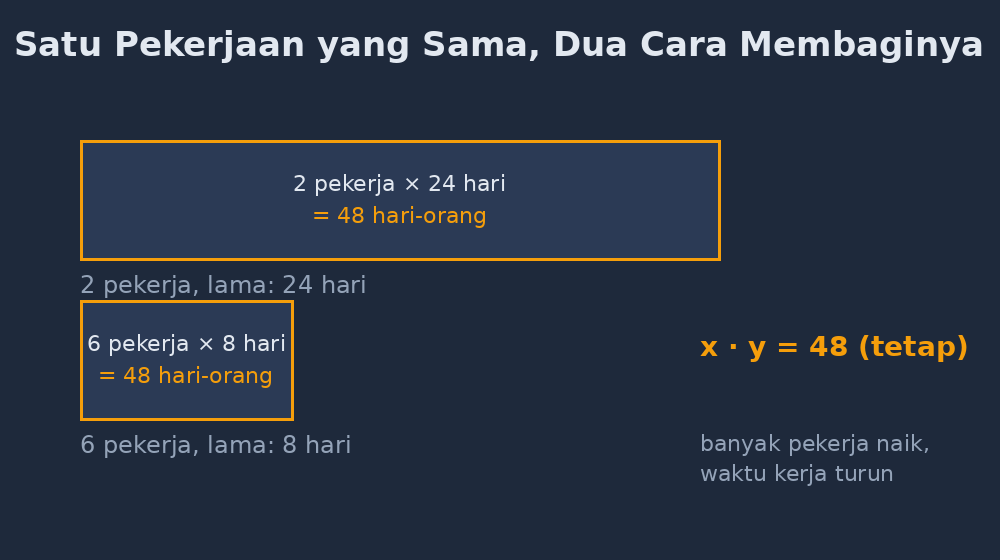

Kelas VIII itu sedang berisik ketika saya masuk. Bukan berisik karena gaduh, tapi berisik karena empat anak di pojok kelas sedang berselisih soal sesuatu. Rupanya mereka mengingat-ingat pekerjaan yang dikerjakan tukang di depan rumah salah satu dari mereka. Ada yang bilang tukangnya enam orang, ada yang bilang lima. Detail kecil. Tapi detail kecil itu ternyata jadi pintu masuk terbaik untuk materi yang hari itu harus saya ajarkan: perbandingan berbalik nilai.

<!--more-->

## Masalah yang Sudah Saya Duga

Kalau Bapak/Ibu pernah mengajar perbandingan berbalik nilai, pasti tahu penyakit klasiknya: siswa hafal bahwa "kalau berbalik nilai ya dikali silang", lalu mengerjakan semua soal — termasuk yang perbandingannya senilai — dengan dikali silang. Atau sebaliknya. Rumusnya ada di kepala, maknanya tidak.

Saya sendiri dulu mengajarkannya dengan cara yang sayang sekali dilihat dari sekarang. Saya tulis di papan: jika $x_1 y_1 = x_2 y_2$, maka nilainya berbalik. Titik. Siswa menyalin, mengangguk, lalu di ulangan mereka salah menjawab soal seperti ini:

> Enam pekerja dapat menyelesaikan satu pagar dalam 8 hari. Kalau pekerjanya ditambah menjadi 8 orang, berapa hari pagarnya selesai?

Jawaban yang bermunculan: 12 hari. Naik, bukan turun. Bagi mereka, "ditambah" ya hasilnya bertambah. Kalimat "berbalik nilai" itu tidak pernah benar-benar mereka rasa.

## Mulai dari Pagar di Depan Rumah

Jadi hari itu saya tidak langsung menulis rumus. Saya mulai dari selisih yang mereka bawa sendiri ke kelas.

"Rina tadi bilang tukang di depan rumahnya enam orang. Bayangkan kalau cuma dua orang yang kerja," kata saya. "Pagar yang sama. Lebih cepat atau lebih lama selesainya?"

"Lebih lama, Pak," jawab mereka hampir serentak. Soal ini mudah bagi mereka karena konteksnya nyata.

"Nah, sekarang yang susah: kalau dua orang selesai dalam 24 hari, enam orang selesai berapa hari?"

Di sini biasanya ada jeda yang bagus. Beberapa anak langsung ingin membagi 24 dengan 3. Saya sengaja tidak buru-buru menyebut bahwa itu benar. Saya minta mereka menjelaskan dulu, dari mana angka 3 itu. Dan jawaban mereka, kalau kita beri ruang, biasanya indah: "Karena 6 itu 3 kali 2, jadi orangnya 3 kali banyak, waktunya harus 3 kali cepat."

Barulah itu saya namai. Itulah yang orang-orang sebut perbandingan berbalik nilai. Rumus $x_1 y_1 = x_2 y_2$ yang biasanya saya tulis di awal, hari itu muncul di akhir — sebagai kesimpulan yang mereka temukan sendiri, bukan aturan yang mereka terima.

## Tabel yang Membuat Polanya Kelihatan

Alat bantu yang paling saya andalkan untuk materi ini ternyata bukan rumus, tapi tabel. Kita isi bersama di papan: banyak pekerja di kolom kiri, lama kerja di kolom kanan.

| Pekerja | Hari |
|---|---|
| 2 | 24 |
| 3 | ? |
| 4 | ? |
| 6 | 8 |
| 8 | ? |
| 12 | 2 |

Saya minta mereka mengisi baris-baris bertanda tanya, dan yang paling penting: mencari yang **tetap**. Begitu ada yang berseru, "Pak, dikali terus sama! 2 × 24 = 48, 4 × 12 = 48, 6 × 8 = 48 juga," kelas itu seolah menemukan sesuatu. Karena memang mereka menemukannya.

Angka 48 itu, dalam bahasa kita, adalah "besarnya pekerjaan" — pagarnya menuntut 48 hari-orang, tidak peduli dibagi berapa orang. Satu pekerjaan punya "harga" yang tetap. Itu inti dari $x \cdot y = k$: bukan sekadar ciri-ciri soal berbalik nilai, tapi makna bahwa jumlah kerja tidak berubah.

*Gambar: pekerjaan yang sama (48 hari-orang) tampak sebagai daerah yang sama luas, hanya dibagi berbeda — 2 pekerja selama 24 hari atau 6 pekerja selama 8 hari.*

Saya juga suka menyelipkan pertanyaan jebakan yang jujur: kalau 48 pekerja, selesai berapa hari? Jawabannya satu hari. Lalu kalau 480 pekerja? Di sinilah biasanya ada yang tertawa dan ada yang berpikir. Lebih dari cukup untuk saya sampaikan bahwa model matematika punya batas: pagar itu tetap butuh waktu minimum untuk dipasang, tidak bisa diselesaikan dalam satu detik oleh seribu orang. Matematika itu model, dan model yang baik diketahui batasnya.

## Yang Sering Tertukar dengan Perbandingan Senilai

Setelah tabelnya jalan, barulah soal pembeda yang dulu selalu menggagalkan mereka: bagaimana membedakan senilai dan berbalik nilai? Sekarang mereka punya alatnya — bukan menghafal "berbalik itu dikali silang", tapi bertanya pada konteks: kalau variabel pertamanya naik, apakah hasilnya ikut naik atau justru turun?

- Banyak pekerja naik, waktu turun → berbalik nilai.
- Banyak pagar naik, waktu naik → senilai.

Satu pertanyaan konteks itu lebih awet di kepala daripada dua nama rumus. Bahkan ada siswa yang menemukan sendiri kalimat kuncinya: "Kalau berbalik, dikalinya harus tetap." Kalimat yang tidak saya tulis di modul manapun, tapi persis inti materinya.

## Penutup: Pekerjaan Nyata Adalah Rumus yang Belum Dinamai

Yang membuat saya senang dari pelajaran itu bukan nilai ulangannya — meski jujur, soal berbalik nilai hari itu dijawab jauh lebih rapi dari tahun-tahun sebelumnya. Yang saya senang adalah kalimat Rina saat kelas bubar: "Jadi kalau saya kerja PR sendirian tiga jam, kalau diajak teman tinggal satu setengah jam ya, Bu... eh, Pak?" Dia bercanda, tapi kalimatnya persis model $x_1 y_1 = x_2 y_2$, hanya saja digubah dalam bahasa sehari-hari.

Sering kali materi matematika itu tidak sulit; yang sulit adalah urutannya. Kalau rumus diberi duluan, siswa belajar menghafal. Kalau pengalaman diberi duluan — pagar di depan rumah, tabel yang diisi bertahap, pertanyaan jebakan yang jujur — rumus tinggal menjadi nama untuk hal yang sudah mereka pahami. Dan nama untuk hal yang sudah dipahami itu tidak pernah mudah terlupa.

Untuk Bapak/Ibu yang ingin mencoba: tidak perlu media mahal. Cukup satu cerita pekerjaan nyata yang sedang terjadi di lingkungan siswa, satu tabel di papan, dan keberanian menunda rumus sampai mereka benar-benar mencium polanya sendiri.
