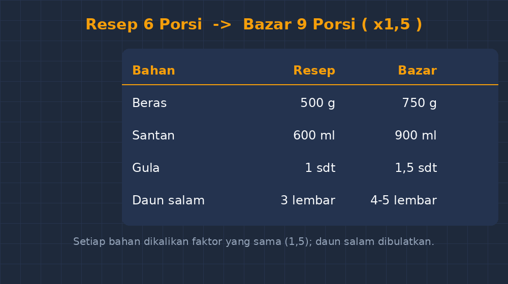

Di rumah, ibu saya yang biasa memasak nasi uduk untuk bazar pagi. Kalau biasanya beras lima kilang, hari Minggu itu tinggal setengahnya. Ibu menggerutu pelan sambil menakar santan, dan tanpa sadar dia melakukan operasi matematika yang persis sama dengan yang akan saya ajarkan dua hari kemudian di kelas VIII: perbandingan senilai. Dia tidak memakai rumus $a_1 : b_1 = a_2 : b_2$. Dia cukup tahu: berasnya jadi separuh, ya santan dan garam ikut separuh.

Nah, justru di titik itulah saya merasa gagal selama bertahun-tahun. Di kelas, perbandingan senilai saya ajarkan sebagai sesuatu yang berdiri sendiri. Ada tabel, ada silang-menyilang, ada aturan "kali bagi". Siswa bisa menjawab latihan, tapi begitu soalnya berubah wujud jadi cerita dapur, bazar, atau resep kue untuk lomba di sekolah, jawaban mereka berantakan. Angka yang seharusnya dibagi dua justru dikali dua, dan sebaliknya.

<!--more-->

## Miskonsepsi yang Menempel di Rumus

Saya masih ingat dengan jelas seorang siswa — sebut saja Rani — yang saat ulangan menjawab soal seperti ini dengan mantap. Soalnya kira-kira begini: untuk membuat 6 gelas es teh dibutuhkan 3 sendok teh gula. Berapa sendok teh gula untuk 9 gelas es teh?

Rani menjawab dengan menyilang dua angka mana pun yang terlihat berpasangan. Jawabannya 18. Ketika saya tanya, "Rani, kalau gelasnya cuma naik sedikit, kok gulanya bisa naik tiga kali lipat?" dia terdiam. Dia tahu ada yang janggal, tapi karena jawabannya diperoleh lewat "prosedur yang benar" — dia menyilang, membagi, hasilnya muncul — dia menyerahkan tanggung jawab pada rumus.

Ini masalah yang saya temui hampir setiap tahun: siswa menguasai *prosedur* proporsi tanpa pernah merasakan *hubungan* proporsional. Mereka tidak punya bayangan batin bahwa kalau satu besaran dilipatgandakan, besaran satunya ikut dilipatgandakan dengan faktor yang sama. Tanpa bayangan itu, rumus hanyalah gerbang yang mereka lewati dengan mata tertutup.

## Membawa Resep ke Kelas

Kali ini saya mencoba jalan yang berbeda. Saya bawa salinan resep nasi uduk versi ibu saya ke kelas — memang sengaja saya salin rapi, lengkap dengan takaran: beras 500 gram, santan 600 ml, daun salam 3 lembar, garam 1 sendok teh. Resep untuk "sekitar 6 porsi", tulis ibu saya di pinggir kertasnya.

Tugasnya sederhana, tapi saya sengaja tidak memberi instruksi cara menghitung: "Kelas ini akan buka bazar di acara pentas seni. Kita hanya punya beras 750 gram. Hitung semua bahan yang perlu disiapkan."

Saya membiarkan mereka bekerja berkelompok selama hampir lima belas menit tanpa saya bicara apa pun. Yang menarik justru prosesnya. Ada kelompok yang langsung membuat tabel — kolom resep dan kolom bazar. Ada yang mencoba menggambar gelas dan beras di kertasnya, membagi menjadi bagian-bagian kecil. Ada juga yang terjebak, mencari-cari tahu apakah harus pakai rumus, dan memanggil saya: "Bu, ini soalnya perbandingan senilai atau perbandingan berbalik nilai?"

Pertanyaan itu, sejujurnya, lebih berharga daripada jawaban mereka. Selama ini saya yang selalu memberi tahu "ini perbandingan senilai, silakan pakai rumus". Sekarang mereka yang harus memutuskan sendiri — dan keputusan itu hanya bisa diambil kalau mereka paham maknanya, bukan sekadar hafal namanya.

## Dari Resep ke Tabel, dari Tabel ke Sifat

Setelah diskusi, kami bangun bersama-sama tabel di papan tulis. Dari resep 500 gram beras ke 750 gram beras, ada kelompok yang menemukan jalur yang saya suka: mereka melihat 500 gram itu setara dengan 5 "takaran" 100 gram, dan 750 gram berarti 7,5 takaran. Jadi semua bahan tinggal dikali 1,5. Santan 600 ml jadi 900 ml, daun salam 3 lembar jadi 4,5 — di sini kelas tertawa karena bingung daun salam setengah lembar itu seperti apa.

Tawa kecil itu justru jadi pintu masuk diskusi yang baik. Saya tanyakan, "Daun salam kenapa bisa setengah? Garam kenapa tidak?" Perdebatan singkat itu membawa mereka pada kesadaran bahwa perbandingan senilai bekerja pada besaran yang bisa dipecah, dan pada bahan baku yang takaran-nya bisa ditakar ulang. Mereka akhirnya sepakat: daun salam cukup 4 atau 5 lembar, "kira-kira saja", tapi santan dan garam harus tetap proporsional supaya rasanya tidak berubah.

Dari situ kami naik ke notasi formal. Saya tulis di papan:

$$\frac{500}{600} = \frac{750}{x}$$

dan tanyakan kepada mereka, "Angka $x$ ini kenapa memang harus 900? Jelaskan dengan kata-kata kalian, jangan dengan rumus." Jawaban yang saya dapat cukup beragam — "karena santan ikut naik satu setengah kali", "karena perbandingan beras dan santan harus tetap sama, kalau tidak rasanya berubah", sampai satu yang saya ingat sampai sekarang: "kalau santannya tidak ikut, nasi uduknya jadi nasi uduk hambar, Bu, dan pembeli kabur." Lucu, tapi tepat.

Sifat tetapnya hasil kali — kalau $500 \times x = 600 \times 750$, maka $x = 900$ — jadi terasa bukan sebagai rumus yang diturunkan, melainkan sebagai cara menuliskan hubungan yang sudah mereka pahami lewat resep.

## Gambar yang Saya Buat untuk Merekatkan Ide

Agar ide itu menempel, saya buat satu gambar sederhana untuk ditempel di kelas: tabel yang menghubungkan resep 6 porsi dengan bazar 9 porsi, dengan panah kecil yang menunjukkan faktor pengali yang sama untuk setiap bahan.

Setiap kali ada siswa yang ragu saat latihan soal berikutnya, mereka tinggal melihat ke gambar itu dan bertanya pada dirinya sendiri: "kalau yang satu naik, yang satunya naik berapa kali?" Pertanyaan batin semacam itu yang tidak bisa dihasilkan oleh hafalan rumus.

## Perbandingan Berbalik Nilai: Cerita yang Bisa Ditunjukkan

Dari resep yang sama, saya juga bisa memperkenalkan perbandingan berbalik nilai secara lebih natural daripada biasanya. Soal klasik seperti "6 pekerja menyelesaikan pagar dalam 12 hari, berapa hari untuk 9 pekerja?" sering jadi tempat siswa bertukar-jawab karena mereka tidak melihat wujudnya. Tapi di dapur, wujudnya ada: kalau satu panci besar berisi nasi uduk dipindah ke porsi kecil di plastik bungkus, maka makin kecil porsinya, makin banyak bungkusan yang dihasilkan dari panci yang sama.

Jumlah nasi tetap, porsi dan banyaknya bungkusan bergerak ke arah yang berlawanan. Itu perbandingan berbalik nilai yang bisa dibayangkan siswa tanpa harus menghafal istilahnya dulu. Setelah bayangannya ada, barulah kita bicara notasi.

## Apa yang Berubah Setelah Sesi Ini

Kuis singkat lima soal di pertemuan berikutnya memberi sinyal yang saya sukai. Soal-soal berbentuk cerita — tentang bensin dan jarak, tentang upah harian dan hari kerja — dijawab dengan persentase kesalahan yang lebih rendah daripada tahun-tahun sebelumnya. Yang lebih penting, di lembar jawaban banyak yang menulis langkah perantara: "500 gram → ×1,5 → 750 gram, jadi santan 600 × 1,5 = 900 ml". Mereka tidak lagi melompat langsung ke silang-menyilang.

Tentu bukan berarti semua siswa langsung lancar. Masih ada yang bingung ketika soalnya memakai konteks yang berbeda jauh dari dapur — misalnya kecepatan dan waktu, yang sebenarnya sudah masuk wilayah perbandingan berbalik nilai. Tapi perbedaannya jelas: sekarang mereka punya *sesuatu* untuk dikembalikan ke akal sehat mereka. Ada bayangan nasi uduk dan santan yang harus ikut proporsional.

## Pelajaran untuk Saya Sendiri

Dari pengalaman ini saya mengambil dua hal. Pertama, konteks yang bagus bukan konteks yang "terdengar keren" atau yang berbau teknologi; konteks yang bagus adalah konteks yang punya konsekuensi logis yang bisa dirasakan siswa. Resep dapur punya konsekuensi itu: kalau takarannya salah, rasanya salah. Konsekuensi yang bisa dirasakan itulah yang membuat matematika terasa perlu, bukan sekadar dituntut.

Kedua, saya belajar untuk tidak buru-buru memberi nama. Dulu saya kebiasaan membuka materi dengan judul "Perbandingan Senilai" lengkap dengan definisi, baru memberi contoh. Sekarang saya mencoba sebaliknya: beri situasi dulu, biarkan siswa merasakan hubungannya, dan rumus datang belakangan sebagai bahasa untuk menuliskan sesuatu yang sudah mereka pahami.

Ibu saya mungkin tidak pernah tahu bahwa resep nasi uduknya hari itu jadi bahan ajar di kelas VIII. Tapi entah kenapa, rasanya enak — bahwa matematika yang saya ajarkan di kelas ternyata sudah hidup lebih dulu di dapur rumah, dan tugas saya cuma mempertemukan keduanya.
