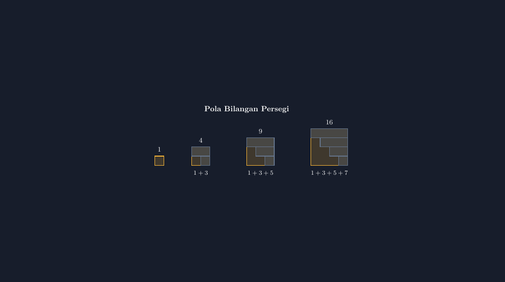

Kemarin saya menemukan soal yang pernah saya buat sendiri dua tahun lalu: "tentukan suku berikutnya dari barisan 1, 4, 9, 16, ..." Saya ingat betul waktu itu siswa-siswa saya menjawab dengan lancar. Dua puluh lima. Nambah lima, nambah tujuh, terus bedanya naik satu. Tapi ketika saya menanyakan satu hal saja — *kenapa* bilangan-bilangan itu disebut bilangan persegi — jawabannya berhenti di "karena ada di buku, Pak."

Saya bisa mengiyakan. Tapi rasanya seperti memberi nama tanpa wajah. Bilangan persegi itu punya bentuk, punya susunan, punya cara tumbuh yang bisa dilihat mata. Kalau anak-anak cuma membawa pulang nama dan selisihnya, mereka belum kenal bilangan itu sama sekali.

<!--more-->

## Masalahnya Bukan Pola, Tapi Nama yang Menggantung

Sejujurnya, "pola bilangan" ini topik yang paling rawan jadi hafalan murni. Selisihnya teratur, siswa mudah menemukannya, dan soal ujian pun biasanya berhenti di "tentukan suku berikutnya." Semua lulus. Tidak ada yang paham.

Nama "bilangan persegi" sendiri sudah semestinya jadi pintu masuk. Satu, empat, sembilan, enam belas — kalau titik-titik disusun, angka-angka itu memang jadi persegi, ukurannya naik satu-satu. $4$ adalah persegi dua kali dua, $9$ persegi tiga kali tiga. Tapi di lembar kerja, angka-angka itu muncul telanjang: hanya deretan angka dan garis panah kecil yang menyuruh mencari selisih.

Ketika itu terjadi, dua hal penting hilang. Pertama, anak tidak melihat bahwa $16$ itu *bentuk* — ia bisa dibayangkan, digambar, bahkan disentuh lewat kelereng atau biji kancing. Kedua, dan ini yang paling saya sesalkan dulu, mereka tidak melihat hubungan antara satu persegi dan persegi berikutnya. Padahal di hubungan itulah teorema yang indah bersembunyi: setiap persegi tumbuh dari persegi sebelumnya ditambah satu lapisan ganjil.

## Lapisan Ganjil yang Membungkus Kuadrat

Mari susun titik-titiknya. Persegi pertama hanya satu titik. Persegi kedua, ukuran $2 \times 2$, punya empat titik — dan kalau kita bandingkan dengan yang pertama, tambahannya tiga titik: satu kolom di kanan dan satu baris di atas, dengan satu titik sudut yang ikut keduanya. Persegi ketiga tambah lima. Keempat tambah tujuh.

$$1 + 3 + 5 + 7 = 16$$

Jumlah bilangan ganjil dari $1$ sampai $(2n-1)$ selalu $n^2$. Rumus ini sering saya lihat diajarkan sebagai fakta yang "menarik untuk dicatat." Menarik untuk dicatat, ya — tapi tidak dimengerti, karena yang di catat cuma kalimatnya, bukan gambarnya.

Ketika saya menggambar di papan, saya berhenti menggambar persegi penuh satu per satu. Saya gambar persegi sebelumnya dulu, warna satu, lalu lapisan tambahannya warna lain. Jadi siswa melihat $9$ bukan sebagai persegi yang berdiri sendiri, tapi sebagai persegi empat yang *dipakaikan* lima titik baru. Persegi itu tumbuh seperti bawang: satu lapis ganjil membungkus lapis sebelumnya.

Gambarnya kira-kira begini — empat persegi bertingkat, dengan lapisan tambahan tiap langkah diberi warna beda:



Dari gambar itu, pertanyaan yang dulu menggantung jadi punya jawaban. Kenapa dinamai bilangan persegi? Karena jumlah titiknya benar-benar menyusun persegi. Kenapa jumlahnya $1+3+5+7$? Karena itu panjang-panjang semua lapisan yang menyusunnya.

## Menggambar Lapisan dengan TikZ

Di papan tulis, gambar seperti itu butuh penghapus dua kali — yang pertama karena salah proporsi, yang kedua karena label bertabrakan. Di TikZ, gambarnya sekali ketik dan bisa dipakai ulang tahunan.

Inti idenya sederhana: gambar persegi besar dengan warna dasar, lalu timpa dengan persegi-persegi kecil yang mewakili lapisan ganjil. Untuk persegi keempat, lapisan tambahannya terdiri dari empat persegi panjang: satu kolom di kanan, satu baris di atas, dan seterusnya mengikuti ukuran persegi sebelumnya.

```latex
\begin{tikzpicture}[scale=0.42,
  kuadrat/.style={draw=aksen, fill=aksen, fill opacity=0.18},
  tambah/.style={draw=isi, fill=isi, fill opacity=0.25}]
% Persegi 4 (warna dasar)
\draw[kuadrat] (17,0) rectangle (21,4);
% Lapisan ganjil yang menyusunnya
\draw[tambah] (20,0) rectangle (21,1);
\draw[tambah] (19,1) rectangle (21,2);
\draw[tambah] (18,2) rectangle (21,3);
\draw[tambah] (17,3) rectangle (21,4);
% label jumlah titik dan jumlah lapisan
\node[anchor=south] at (19,4.15) {16};
\node[anchor=north] at (19,-0.35) {$1+3+5+7$};
\end{tikzpicture}
```

Ada dua hal kecil di kode ini yang saya suka. Pertama, koordinat lapisan tidak saya tebak. Lapisan teratas dari persegi keempat selalu mulai dari $(21-n,\, n-1)$ sampai $(21,\,n)$ untuk $n$ dari $1$ sampai $4$ — polanya berulang persis seperti bilangan ganjilnya. Jadi kalau suatu hari saya ingin menggambar persegi kelima, saya tinggal menambah satu baris mengikuti pola yang sama, bukan menghitung ulang dari awal.

Kedua, `fill opacity` yang dipakai di kedua style. Kalau saya pakai warna penuh, lapisan yang menumpuk akan saling menutupi dan siswa tidak lagi melihat bahwa persegi lama masih ada *di bawah* lapisan baru. Dengan transparansi, persegi empat masih kelihatan di balik lima titik tambahannya — dan itu justru inti ceritanya.

Kode lengkap yang bisa langsung dikompilasi ada di tautan di bawah. Di dalamnya ada keempat persegi, lengkap dari $1$ sampai $16$, dengan label jumlah lapisannya.

## Dari Gambar ke Rumus, Bukan Sebaliknya

Kelas kemarin saya mencoba urutan terbalik. Biasanya saya tulis dulu $1 + 3 + 5 + 7 = 16$, lalu gambar sebagai penjelas. Kemarin gambar dulu, dan saya tanya: "berapa titik yang berwarna kelabu di persegi keempat?" Mereka menghitung: empat, enam, delapan — lalu ada yang menyadarinya sendiri. "Panjang tiap lapisan, Pak. Ganjil terus."

Di situ saya tarik ke pertanyaan yang lebih besar: kalau persegi keseratus, berapa titik yang ditambahkan? Sebelum ada gambar, pertanyaan ini biasanya dijawab dengan mencoba menghafal rumus. Sekarang mereka menjawab dari pola: lapisan keseratus panjangnya $2 \times 100 - 1 = 199$. Lalu saya dorong satu langkah lagi — totalnya? Ada yang menjawab "ya $100^2$, kelihatan kan, jadinya persegi." Itu kalimat yang dua tahun lalu tidak pernah muncul di kelas saya.

Saya tidak berpikir TikZ-nya sendiri yang membuat anak paham. Papan tulis dan biji kancing juga bisa. Tapi TikZ memberi sesuatu yang papan tulis tidak: gambar yang bisa saya simpan, pakai ulang di lembar kerja, tempel di gezyMaterials, dan tahun depan tinggal dipanggil lagi tanpa digambar ulang. Dan yang paling penting, karena gambarnya konsisten — koordinatnya dihitung, bukan dikira — dia tidak bisa berbohong. Lapisan ketiga dari persegi keempat *pasti* tiga titik panjangnya, karena begitulah koordinatnya ditulis.

## Yang Saya Catat untuk Diriku Sendiri

Ada satu penyesalan kecil dari kelas kemarin. Saya terlalu cepat menuju rumus. Ketika anak-anak baru saja menemukan bahwa lapisannya ganjil, saya langsung tuliskan bentuk umumnya di papan. Sebagian wajah yang tadi menyala, meredup lagi — rumus selalu punya efek dingin seperti itu. Lain kali saya akan berhenti lebih lama di gambar, memberi mereka waktu menghitung beberapa lapisan sendiri, dan membiarkan rumus itu *mereka* yang menuliskan pertama kali, entah dalam bentuk apa pun yang mereka pilih.

Tapi satu hal itu hari berubah: "bilangan persegi" sudah tidak lagi nama yang menggantung tanpa wajah. Empat puluh sembilan sekarang punya bentuk di kepala mereka — persegi tujuh, bertumbuh dari persegi enam, dipakaikan tiga belas titik ganjil. Dan untuk mata pelajaran yang sering dikritik sebagai kumpulan hafalan, momen seperti itu cukup untuk membuat saya betah menyiapkan bahan ajar sampai larut malam.

> 📎 **Berkas TikZ lengkap:** [pola-bilangan-persegi-tikz.tex](tex/pola-bilangan-persegi-tikz.tex) — siap kompilasi (butuh paket `tikz`).
