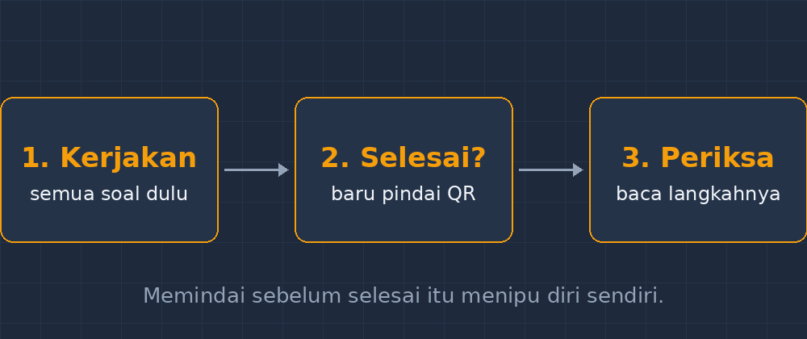

Pernah kejadian begini di kelas saya. Saya membagikan lembar latihan, baru sebagian siswa yang membuka soal pertama, tiba-tiba ada yang berbisik, "Yang nomor tiga jawabannya B." Suara itu menjalar seperti kabar angin. Belum lima menit, setengah kelas sudah menganggap soal nomor tiga terjawab, padahal belum satu pun dari mereka yang benar-benar mencobanya. Saya cuma bisa menghela napas. Lembar kerja yang saya susun dengan susah payah malam sebelumnya, kalah cepat oleh satu orang yang kebagian lembar berisi jawaban dari kelompok lain.

Masalahnya bukan pada siswa yang jujur atau tidak. Anak-anak itu umumnya mau berusaha. Masalahnya ada pada desain lembar kerja saya sendiri: kunci jawaban beredar di suatu tempat sebelum waktunya, dan begitu satu orang tahu, semua orang tahu. Sistem saya memberi hadiah bagi yang paling cepat mendapat informasi, bukan bagi yang paling serius berpikir.

Belakangan saya menemukan solusi yang sederhana sampai saya hampir tidak percaya: QR Code di pojok kanan bawah lembar kerja. Sekecil itu, tapi kelas saya berubah.

<!--more-->

## Bagaimana caranya

Caranya begini. Saya menyiapkan lembar kerja seperti biasa. Di pojok kanan bawah, saya tempel sebuah QR Code berukuran kecil, kira-kira dua senti persegi. Di bawahnya saya tulis satu kalimat pendek: "Selesai semua? Pindai untuk memeriksa."

QR itu menuju satu halaman sederhana berisi kunci jawaban dan, untuk beberapa soal, langkah pengerjaan singkat. Saya taruh halaman itu di salah satu aplikasi kecil saya, jadi tidak perlu layanan luar. Yang penting satu hal: halaman itu tidak ada di internet untuk dicari orang. Tidak ada nomor halaman, tidak ada indeks, tidak ada tautan dari mana pun. Satu-satunya pintu masuk adalah kode di atas kertas yang ada di tangan siswa, pada saat saya membagikannya.

Efeknya langsung terasa pada distribusi waktu. Dulu, jawaban bocor sebelum soal dibaca. Sekarang, jawaban baru terbuka setelah siswa menganggap dirinya selesai. Informasi yang sama, tapi waktunya saya yang pegang.

*Alurnya pendek: selesai dulu, baru memindai. Tidak ada pintu pintas.*

## Yang berubah di kelas

Hal pertama yang berubah: gosip jawaban mereda. Bukan hilang — siswa tetap saja saling bertanya, itu manusiawi — tapi nilai jualnya turun. Kalau temanmu bilang "nomor tiga jawabannya B", kamu tidak bisa langsung percaya, karena sekarang ada cara resmi untuk mengecek. Kebisikan itu kehilangan pasarnya.

Hal kedua: siswa jadi lebih jujur pada dirinya sendiri. Ini yang paling saya sukai. Dulu, banyak yang menunggu jawaban teman lalu menyalin, dan saya tidak pernah tahu. Sekarang, setelah memeriksa lewat QR, mereka tahu sendiri mana yang betul. Ada siswa perempuan di kelas VII yang datang ke meja saya sambil membawa lembar kerjanya, "Bu — Pak, saya tadi nomor dua salah, tapi sekarang sudah paham kok, ada langkahnya di situ." Kalimat seperti itu yang dulu saya perburu lewat koreksi merah, muncul sendiri sebelum saya menyentuh korek apa pun.

Hal ketiga, yang tidak saya duga: lembar kerja bekerja sampai ke rumah. Kertas itu dibawa pulang, QR-nya ikut. Siswa yang di kelas belum selesai bisa melanjutkan dan tetap memeriksa sendiri. Orang tua tidak perlu mengunduh apa pun, cukup kamera ponsel. Saya tidak menjanjikan bahwa semua siswa memanfaatkannya — tidak juga — tapi bagi yang mau, pintunya terbuka sampai malam.

## Bukan sekadar kunci jawaban

Setelah beberapa lembar, saya mulai mengubah isi halaman di balik QR itu. Kadang berisi kunci plus langkah pengerjaan. Kadang berisi satu soal lanjutan, versi sedikit lebih sulit, untuk yang ternyata selesai cepat dan benar semua. Kadang berisi tautan ke media interaktif yang biasa saya pakai di kelas.

Jadi QR itu bukan sekadar laci kunci jawaban. Ia jadi pintu belakang lembar kerja, tempat saya menaruh kelanjutan belajar untuk setiap siswa secara personal, tanpa perlu mencetak lembar tambahan. Satu kertas, dua lapisan: yang kasat mata untuk dikerjakan, yang tersembunyi untuk dilanjutkan.

Untuk soal pilihan ganda, saya biasa menulis ringkas begini di halaman tujuan:

**Nomor 3.** Jawaban: B. Ingat, luas jajargenjang adalah alas dikali tinggi: $L = a \times t$. Panjang sisi miring tidak dipakai — itu pengecoh.

Sedikit saja, tapi cukup. Siswa yang salah langsung tahu di mana letak kesalahannya, bukan cuma tahu bahwa dia salah.

## Hal-hal kecil yang saya pelajari

Tentu tidak semua mulus. Ada beberapa hal yang saya pelajari dengan cara kejadian dulu, baru paham.

Pertama, QR-nya harus benar-benar kecil tapi tetap terbaca. Kalau terlalu kecil dan kertasnya fotokopi agak gelap, ponsel siswa lambat mengenali. Ukuran dua senti persegi di kertas putih polos terbukti aman di kelas saya.

Kedua, saya menuliskan di depan kelas aturan mainnya dengan jelas: "Memindai sebelum selesai itu sama artinya dengan menipu diri sendiri." Kalimat ini penting, karena kalau tidak, QR itu justru jadi pintu pintas baru. Menariknya, siswa justru mengawasi satu sama lain. Yang belum selesai dan sudah memegang ponsel akan ditunjuk temannya. Aturan kelas bekerja lebih efektif daripada aturan paksaan dari saya.

Ketiga, jangan taruh halaman kunci itu di tempat yang bisa ditemukan lewat mesin pencari. Saya sengaja tidak memberi tautan dari halaman mana pun. Kalau ada siswa yang menyebar tangkapan layarnya ke grup kelas, ya sudah, berarti sedang peruntungannya — tapi setidaknya tidak ada pintu yang terbuka untuk semua orang sejak awal.

## Penutup: teknologi yang paling murah

Saya suka membangun aplikasi untuk kelas saya, dan itu memang pekerjaan yang saya nikmati. Tapi QR Code ini mengingatkan saya bahwa tidak semua masalah kelas butuh aplikasi besar. Kadang yang dibutuhkan cuma menggeser *waktu* sebuah informasi: jawaban tidak perlu disembunyikan selamanya, cukup ditunda sampai siswa berhak melihatnya.

Teknologi termurah yang saya pakai tahun ini ternyata sekecil perangko. Dan seperti biasa, yang mengubah kelas bukan kodenya, tapi pertanyaan yang jujur dari guru: masalah sesungguhnya di kelas saya apa? Masalah saya bukan siswa malas, tapi informasi yang datang terlalu cepat. QR Code hanyalah jawaban kecil untuk pertanyaan kecil itu.

Kalau Bapak/Ibu mau mencoba, mulailah dari satu lembar kerja saja. Siapkan kunci jawabannya, ubah jadi halaman web sederhana, jadikan QR, tempel di pojok. Lalu duduklah dan perhatikan lima menit pertama kelas. Percaya deh, gosip jawaban itu akan kehilangan pelanggannya.
