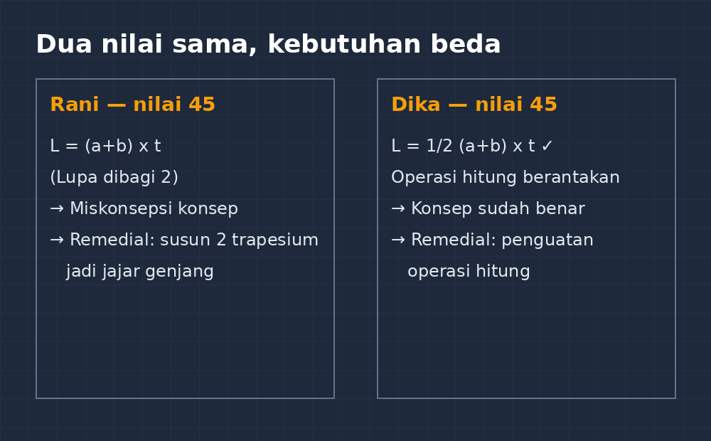
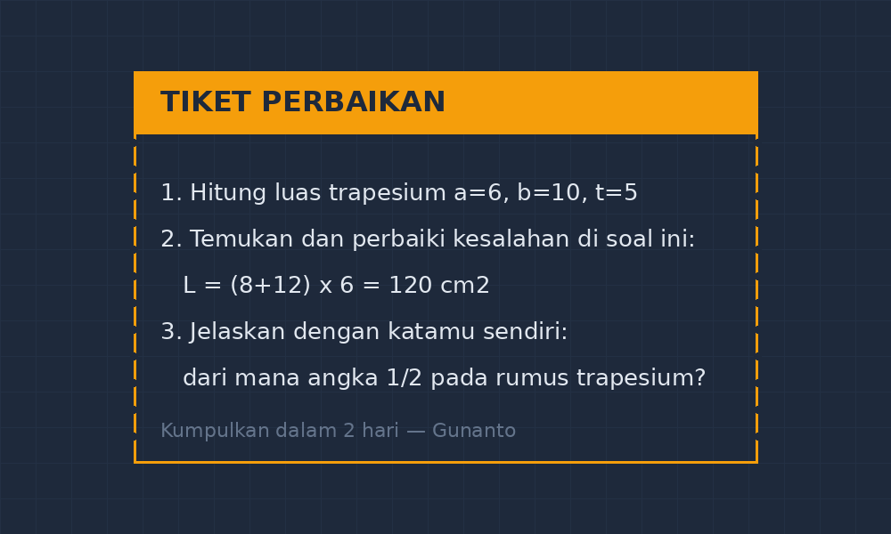

Ada satu kebiasaan lama yang dulu saya jalani tanpa banyak mikir: habis ulangan, saya koreksi, nilai saya tulis merah di pojok kanan atas, terus di daftar nilai saya beri tanda kecil untuk nama-nama yang nilainya di bawah batas. Mereka yang kena tanda itu wajib remedial. Kata "remedial" di kelas saya dulu ibarat vonis. Begitu saya bilang, "Nilai kamu belum memenuhi KKTP, nanti ikut remedial ya," yang muncul bukan semangat memperbaiki, tapi wajah memelas, gelak teman sebangku, dan satu-dua anak yang diam-diam menyobek sobekan kertas di meja karena malu.

<!--more-->

Tahun-tahun awal mengajar, saya pikir begitulah wajar. Remedial memang untuk anak yang belum lulus, ya toh? Tapi makin lama saya makin tidak enak hati. Ada satu kejadian yang jadi titik balik: seorang murid yang biasanya rajin mendapat nilai rendah di ulangan bilangan berpangkat. Ketika saya panggil untuk remedial, dia menolak halus, "Pak Gun, nanti teman saya bilang saya bodoh lagi." Dia lebih memilih nilai rendahnya dibiarkan daripada harus berdiri di depan kelas sebagai "anak remedial". Di situ saya sadar, masalahnya bukan cuma nilai yang belum capai. Masalahnya adalah cara saya menyajikan kesempatan memperbaikinya.

## Remedial bukan hukuman, tapi janji

Sekarang saya pegang prinsip sederhana: remedial itu bukan hukuman atas kegagalan, melainkan janji bahwa pembelajaran belum selesai. Kalau murid belum paham, tugas saya belum selesai. Dari prinsip itu, praktik di kelas saya berubah cukup banyak.

Pertama, saya tidak lagi mengumumkan nama "yang remedial" di depan kelas. Semua murid menerima lembar tindak lanjut yang sama. Isinya beda-beda sesuai hasil diagnosa mereka, tapi bentuknya sama. Anak yang nilainya bagus dapat pengayaan, anak yang belum capai dapat latihan remedial. Kelas jadi tidak punya dua kasta.

Kedua, saya pisahkan antara "remedial" dan "pengayaan" secara verbal juga. Saya sebut keduanya "Program Lanjutan". Kedengarannya sepele, tapi efeknya nyata. Anak-anak yang tadinya menunduk sekarang datang ke meja saya bertanya, "Pak Gun, lembar lanjutan saya yang mana?" Tidak ada gengsi. Yang mengubah bukan materinya, tapi labelnya.

Ketiga, remedial saya buat bertahap dan spesifik. Saya tidak lagi mengulang soal ulangan yang sama persis. Itu percuma dan sering cuma menguji ingatan jangka pendek. Saya cermati dulu di bagian mana murid kesulitan, baru dari situ saya susun latihan yang menyasar akar kesalahannya.

## Membaca kesalahan sebelum menentukan remedial

Kesalahan murid itu tidak seragam. Dua murid sama-sama dapat 45 belum tentu butuh remedial yang sama. Contoh konkret dari ulangan segitiga dan segiempat semester lalu. Ada dua murid saya, sebut saja Rani dan Dika (bukan nama asli). Keduanya nilainya di bawah batas. Tapi ketika saya bedah lembar jawabannya, kesalahannya beda jauh.

Rani keliru di konsep luas trapesium. Dia mengalikan jumlah sisi sejajar dengan tinggi, lalu lupa membagi dua: $L = (a+b) \times t$ tanpa $\tfrac{1}{2}$. Kesalahannya konsisten, muncul di hampir semua soal trapesium. Ini miskonsepsi konsep, dan remedialnya jelas: bangun ulang pemahaman, misalnya lewat memotong dua trapesium kongruen dan menyusunnya jadi jajar genjang, supaya murid melihat sendiri dari mana $\tfrac{1}{2}$ itu berasal.

Dika beda. Konsep luas trapesiumnya paham, rumusnya tulis benar, tapi perhitungannya berantakan. Pecahan campuran dikali bilangan desimal dia keliru, tanda operasinya tertukar. Remedial untuk Dika bukan mengulang materi luas bangun, tapi penguatan operasi hitung. Kalau saya sembarkan remediaI umum yang sama untuk dua anak ini, Rani akan mengulang hal yang sudah dia butuhkan (operasi hitung) dan Dika akan membosankan diri dengan trapesium yang dia sudah paham.

Hampir semua miskonsepsi bisa dideteksi lewat cara ini. Dua nilai yang sama di atas kertas bisa bercerita dua hal yang berbeda begitu lembar jawabannya dibaca dengan sungguh-sungguh:

*Dua murid, dua nilai sama, dua remedial yang berbeda. Nilai akhir cuma gejala; pola kesalahannya yang perlu didiagnosis.*

Prinsipnya sederhana: koreksi dulu kesalahannya, baru tentukan remedialnya. Nilai akhir cuma gejala. Penyakitnya ada di pola kesalahan. Untuk itu saya mulai membiasakan diri membaca lembar jawaban bukan dengan mata pemberi nilai, tapi dengan mata pemberi diagnosis. Kadang saya tulis catatan kecil di pinggir lembar: "Kesalahan di sini bukan soal rumus, tapi di perkalian pecahan. Cek lagi ya."

## Bentuk remedial yang saya pakai sekarang

Setelah beberapa kali mencoba dan gagal, bentuk remedial yang bertahan sampai sekarang di kelas saya ada tiga.

**Remedial "tiket perbaikan".** Murid yang belum capai dapat tiket kecil (kertas lipat seperempat) berisi 3 sampai 5 soal yang menyasar miskonsepsi spesifiknya, plus satu instruksi singkat seperti "ingat, bagi dua setelah mengalikan". Tiket dikumpulkan dalam dua hari. Kalau sudah benar, nilai ulangan saya naikkan sesuai ketentuan yang berlaku, dan saya tulis di depan nama murid "sudah perbaikan", bukan "remedial". Tiket ini saya buat dengan LaTeX, jadi soalnya rapi dan bisa saya simpan di bank soal per miskonsepsi untuk tahun berikutnya.

Bentuknya memang sederhana, dan justru kesederhanaan itu yang membuatnya berjalan. Beginilah wujud tiket yang saya bagikan:

*Contoh tiket perbaikan untuk miskonsepsi rumus luas trapesium: tiga soal, satu fokus, tanpa label "remedial".*

**Remedial teman sebaya yang terjadwal.** Saya tunjuk beberapa murid yang pahamnya kuat jadi "tutor sebaya", tapi jangan bayangkan sekelas berantakan berkelompok. Skemanya kecil: sepasang murid, sepuluh menit sebelum pelajaran dimulai atau sepuluh menit terakhir, satu lembar latihan. Tutor sebaya saya beri catatan singkat: jelaskan dengan kata sendiri, jangan kasih jawaban langsung. Yang menarik, tutor-nya juga belajar. Ada murid yang nilai ulangannya biasa saja tapi jadi jauh lebih paham setelah beberapa kali menjelaskan ke temannya. Menjelaskan itu cara belajar yang paling jujur; kalau pemahamanmu retak, penjelasanmu ikut retak.

**Remedial lewat produksi.** Untuk beberapa murid yang lebih nyaman berkarya daripada mengerjakan soal, saya minta mereka membuat satu contoh soal sendiri beserta penyelesaian lengkapnya, misalnya soal luas gabungan bangun datar dengan konteks sawah atau lapangan. Menyusun soal itu jauh lebih menuntut daripada mengerjakan soal. Kalau murid bisa bikin soal trapesium yang benar lengkap dengan penyelesaian yang benar, biasanya miskonsepsinya sudah lepas. Untuk bagian menggambar bangunnya, saya biarkan mereka pakai penggaris biasa, yang penting ukurannya jujur dan konsisten.

## Yang tidak berhasil dan yang saya pelajari

Biar jujur, tidak semua ide saya berjalan mulus. Pernah sekali saya coba remedial digital lewat kuis interaktif. Saya buat latihan singkat, murid mengerjakan di HP, langsung keluar skor. Praktisnya ya, tapi efeknya kurang. Murid mengerjakan sambil lalu, asal selesai, skor muncul merah, selesai. Tidak ada percakapan, tidak ada bangun ulang konsep. Dari situ saya sadar remedial yang efektif butuh satu hal yang tidak bisa digantikan aplikasi: percakapan manusia tentang apa yang salah dan kenapa salah. Sekarang kuis interaktif saya pakai cuma sebagai pemanasan atau pengecekan cepat, bukan sebagai inti remedial.

Pelajaran kedua: konsistensi itu lebih penting dari kerapihan administrasi. Pernah ada semester di mana lembar remedial saya cantik-cantik, dokumen tindak lanjut lengkap, tapi eksekusinya tertunda karena sibuk hal lain. Hasilnya sama dengan tidak ada remedial. Murid itu peka; kalau tiket perbaikan yang saya janjikan dikumpulkan dalam dua hari ternyata tidak pernah saya koreksi, kepercayaannya hilang. Sekarang saya lebih memilih remedial sederhana yang benar-benar berjalan daripada remedial megah yang hanya ada di arsip.

## Penutup: nilai merah itu titik awal

Kadang saya teringat murid yang dulu menolak remedial karena malu. Murid-murid seperti itu ada di banyak kelas, mungkin juga di kelas Bapak/Ibu. Mereka bukan malas. Mereka cuma tidak mau diperlakukan sebagai orang yang gagal di depan orang lain. RemediaI yang baik menjawab kebutuhan itu: dia memberi jalan memperbaiki tanpa mengorbankan harga diri.

Kalau ada satu kalimat yang ingin saya tinggalkan dari pengalaman ini, kira-kira begini: nilai merah di kertas bukanlah akhir cerita murid, dia hanya menunjuk bagian cerita yang belum selesai. Tugas kita sebagai guru adalah memastikan bagian yang belum selesai itu benar-benar diberi kesempatan menuntaskan dirinya. Dan sering kali, yang perlu diubah duluan bukan materi remedialnya, tapi cara kita memandang kata "remedial" itu sendiri.
