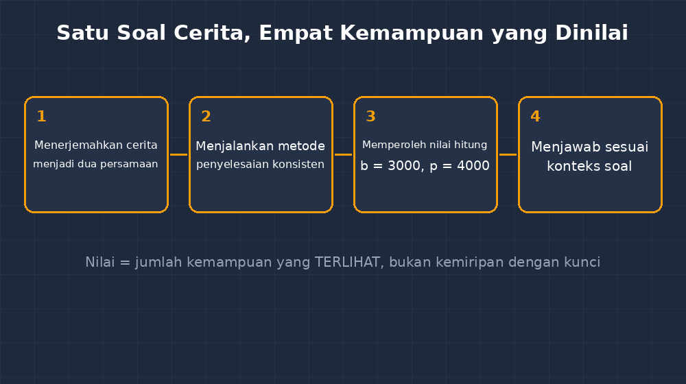
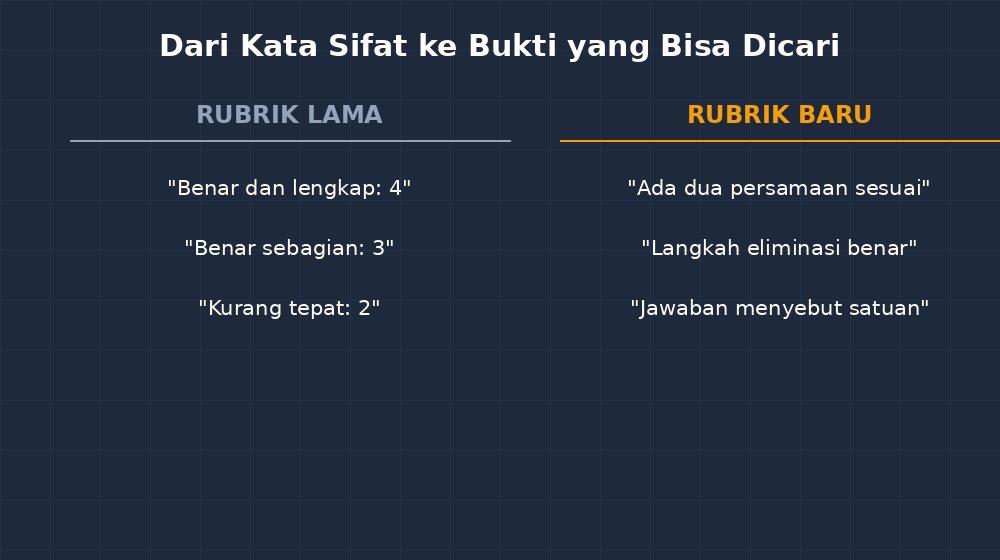

Ada satu pertanyaan yang menahun di kepala saya bertahun-tahun: kalau dua guru mengoreksi jawaban uraian yang sama, berapa besar kemungkinan mereka memberi nilai yang sama? Pengalaman saya bilang: tidak sebesar yang kita harapkan. Dan pengalaman itu bukan sekadar dengar-dengar. Pernah suatu kali, di sebuah kegiatan MGMP, kami diminta mengoreksi salinan jawaban siswa yang sama. Jawaban itu sebenarnya cukup baik — alurnya jelas, tapi perhitungan akhirnya salah satu langkah. Skor dari rekan-rekan di ruangan itu berkisar dari enam sampai delapan koma lima. Dua koma lima poin selisihnya, untuk kertas yang sama persis.

<!--more-->

## Rubrik yang Saya Punya, Rubrik yang Saya Pakai

Kalau ditanya, tentu semua guru menjawab: "Tentu saya pakai rubrik." Setiap penilaian uraian memang wajib punya kriteria, dan kriteria itu saya tulis di juknis, lengkap dengan bobotnya. Tapi jujur saja — dan mungkin Bapak/Ibu merasakan hal yang sama — rubrik yang saya tulis dan rubrik yang benar-benar bekerja di kepala saya saat mengoreksi jam sebelas malam itu dua hal yang berbeda.

Rubrik di kertas saya biasanya berbunyi seperti ini: "Jawaban benar dan lengkap: nilai 4. Jawaban benar sebagian: nilai 3. Jawaban kurang tepat: nilai 2." Perhatikan kata-katanya: *lengkap*, *sebagian*, *kurang tepat*. Semua kata itu menggantung. Lengkap menurut siapa? Sebagian dari berapa? Ketika koreksi baru sepuluh lembar, mata dan pikiran masih segar, perbedaan interpretasi itu tidak terasa. Tapi di lembar keempat puluh, ketika "benar sebagian" untuk satu siswa saya beri tiga dan untuk siswa lain saya beri dua — tanpa alasan yang bisa saya pertanggungjawabkan — di situlah rubrik formalitas saya ketahuan. Yang menentukan bukan kriterianya, tapi suasana hati dan kelelahan saya.

Puncak rasa tidak nyamannya terjadi ketika seorang siswa datang ke meja saya meminta penjelasan. "Pak, kenapa Budi dapat 85 padahal jawaban kita mirip?" Saya mengulang kertas itu di kepala, dan jujur, alasan saya sebagian besar berbunyi "jawabannya si Budi memang lebih rapi". Itu bukan penilaian matematika. Itu penilaian kerapian tulisan tangan.

## Kenapa Saya Mencoba AI untuk Hal Ini

Saya tidak langsung terpikir AI. Awalnya saya coba-coba saja: saya salin soal uraian tentang sistem persamaan linear dua variabel, salin beberapa jawaban siswa dari hasil CBT yang sudah tersimpan rapi di aplikasi, lalu tanyakan pada AI: *"Bagaimana cara membagi nilai maksimal 10 untuk jawaban uraian semacam ini secara adil?"*

Jawaban pertamanya biasa saja — terlalu umum, halus seperti rubrik saya sendiri. Tapi lalu saya ubah cara bertanyanya. Alih-alih minta "rubrik", saya minta: *"Pecah soal ini menjadi kemampuan-kemampuan terpisah yang harus terlihat pada jawaban, masing-masing dengan bukti yang bisa diamati pada tulisan siswa."* Dan di sini bedanya terasa.

Soal saya bunyinya kira-kira begini: "Andi membeli 2 buku dan 3 pensil seharga Rp18.000, sedangkan Budi membeli 1 buku dan 2 pensil seharga Rp11.000. Berapa harga satu buku?" AI memecahnya jadi empat hal yang sebenarnya sudah saya tahu secara intuitif selama ini, tapi tidak pernah saya tulis eksplisit:

1. Menyatakan kedua hubungan sebagai persamaan — misalnya $2b + 3p = 18000$ dan $b + 2p = 11000$. Pada tahap ini kebenaran hitung belum dinilai; yang dinilai adalah apakah siswa berhasil *menerjemahkan cerita ke model*.
2. Memilih dan menjalankan metode penyelesaian (eliminasi, substitusi, atau gabungan) secara konsisten.
3. Memperoleh $b = 3000$ dan $p = 4000$ — nilai hitung.
4. Menjawab pertanyaan sesuai konteks: harga satu buku adalah Rp3.000.

Yang membuat saya berhenti sejenak: pemecahan itu mengubah nilai dari "seberapa mirip jawabannya dengan kunci" menjadi "kemampuan mana saja yang terlihat". Siswa yang modelnya benar tapi salah aritmetika di langkah ketiga sekarang bisa mendapat nilai di langkah satu dan dua. Ia tidak sekadar "salah". Ia benar di dua kemampuan dan salah di satu — dan itu informasi yang jauh lebih berguna untuk dia, untuk orang tuanya, dan untuk perencanaan remedial saya.

## Yang AI Bantu, dan yang Tetap Saya Tangan

Sekarang mari saya luruskan dulu, karena kalimat "AI menyusun rubrik saya" itu menyesatkan kalau tidak dijelaskan. Yang AI bantu sebenarnya lebih sederhana daripada itu: ia memaksa saya membuat kriteria yang *operasional*. Rubrik lama saya memakai kata sifat — lengkap, baik, kurang. Rubrik baru kami memakai bukti yang bisa dicari di kertas — "ada dua persamaan yang sesuai dengan kalimat soal", "ada langkah eliminasi yang benar", "jawaban akhir menyebut satuan rupiah". Kata sifat itu bagus untuk pidato; bukti itu bagus untuk koreksi.

Tapi jangan bayangkan saya tinggal copy-paste. Ada beberapa hal yang selalu saya koreksi setelah AI memberi drafnya.

Pertama, AI kadang terlalu dermaga memecah kriteria — soal yang cukup dinilai tiga aspek bisa jadi tujuh aspek, dan koreksi jadi pekerjaan administratif, bukan membaca jawaban siswa. Biasanya saya gabungkan lagi sampai jumlah aspeknya masuk akal untuk bobot soal itu. Kedua, AI tidak tahu siswa saya. Ia tidak tahu bahwa ada anak yang selama ini selalu berhenti setelah satu langkah dan bahwa kalau untuk soal ini ia sampai dua langkah, itu kemajuan yang layak diapresiasi lewat catatan, meski nilainya tetap sesuai kriteria. Ketiga — dan ini yang paling penting — tanggung jawab nilai itu tidak berpindah. Kalau ada orang tua yang datang mempertanyakan nilai anaknya, jawabannya bukan "sistem AI saya yang begitu", melainkan rubrik yang saya tanda tangani sendiri. AI itu rekan penyusun draf; juri tetap saya.

## Perubahan yang Terasa di Koreksi Saya

Efek samping dari kebiasaan ini ternyata lebih luas dari sekadar rubrik. Ketika aspek-aspek penilaian sudah operasional, saya jadi bisa memakainya mundur: sebelum soal bahkan dibagikan, saya sudah tahu kemampuan apa saja yang soal itu menguji. Beberapa kali proses ini malah menunjukkan bahwa soal saya jelek — ia menguji kehati-hatian membaca angka besar, bukan pemahaman SPLDV seperti yang saya klaim. Soal itu saya revisi sebelum dicetak, bukan setelah koreksi.

Efek lainnya: koreksi jadi lebih cepat, ironisnya. Dengan empat bukti yang harus dicari, mata saya punya peta. Dulu saya membaca jawaban siswa dua kali — sekadar memahami, lalu sekadar memutuskan. Sekarang sekali baca sambil mencentang bukti. Dan anak yang bertanya "kenapa nilainya segini?" akhirnya bisa saya jawab dengan menunjuk baris-baris tertentu di kertasnya: "Persamaanmu dua-duanya benar, langkah eliminasi juga benar, tapi di sini perkalianmu keliru, dan jawaban akhirnya tidak kembali ke konteks harga." Dia pulang membawa informasi, bukan kekecewaan yang kaburnya asal-usul.

## Masih Ada yang Perlu Dijaga

Saya tetap waspada pada satu jebakan: rubrik yang terlalu rinci bisa membuat guru menilai *cenang* dan *cenang* kecil tapi kehilangan keseluruhan jawaban. Ada jawaban siswa yang tidak rapi langkahnya tapi matematikanya cerdas, berpikirnya melompat-lompat dengan cara yang tidak muat di kotak centang. Rubrik adalah alat bantu melihat, bukan pengganti membaca. Karena itu aturan saya sederhana: rubrik menentukan kerangka nilai, tapi saya selalu menyisakan ruang untuk membaca keseluruhan jawaban sekali lagi — dan kalau ada sesuatu yang rubrik tidak mampu menangkap, catatan saya yang bicara, bukan nilainya.

Kalau ada satu hal yang ingin saya titipkan dari pengalaman ini: jangan minta AI membuat rubrik untuk Anda. Minta ia memecah soal Anda menjadi kemampuan-kemampuan yang terlihat, lalu Anda yang memutuskan mana yang penting, mana yang berlebihan, dan bobotnya berapa. Rubrik yang jujur tidak lahir dari template — ia lahir dari guru yang mengenal soalnya dan mengenal muridnya, dengan rekan diskusi yang tidak pernah lelah.

---

*Karena nilai yang tidak bisa dijelaskan, akhirnya tidak bisa dipercaya — oleh siswa, oleh orang tua, bahkan oleh diri kita sendiri.*
