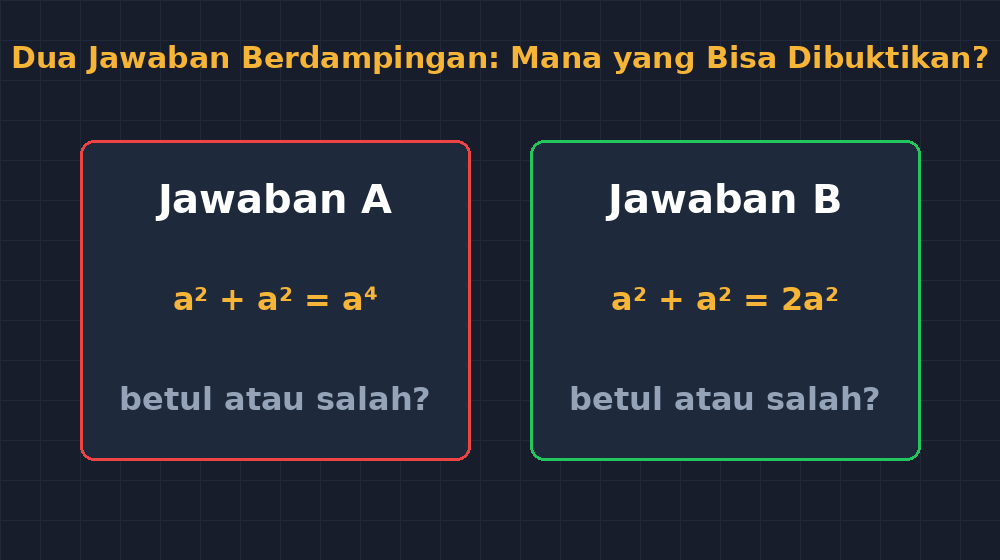

Ada satu momen tahun lalu yang sampai sekarang masih saya ingat. Saya sedang membahas ulangan harian tentang operasi hitung campuran di kelas VIII. Di papan tulis, dengan tulisan yang sengaja saya buat rapi dan yakin, saya menulis:

$$12 + 8 \div 4 \times 2 = 12 + 8 \div 8 = 12 + 1 = 13$$

Lalu saya mundur satu langkah, memandang kelas, dan bertanya santai, "Ada yang terasa janggal?" Awalnya sunyi. Beberapa anak menunduk seolah takut menyalahkan guru. Tapi tidak lama, ada suara dari baris belakang. "Bu... yang dikali dulu sama yang dibagi, kiri ke kanan." Saya pura-pura baru sadar, garis-garis jawaban saya, dan tulis besar-besar di pojok papan: *GURU JUGA BISA SALAH.*

Ruangan langsung berubah. Anak-anak yang tadi diam jadi berani menunjuk kesalahan lain — bahkan kesalahan yang mereka tulis sendiri di lembar jawab ulangan tadi pagi. Sepertinya ada perizinan baru yang lahir di kelas itu: boleh salah, boleh mengoreksi, bahkan boleh mengoreksi guru.

<!--more-->

## Kenapa saya mulai sengaja salah

Ide ini sebenarnya lahir dari kebiasaan buruk saya dulu. Saya suka memperbaiki kesalahan siswa langsung di papan: garis merah, tulisan "salah", lalu langkah benar yang saya tulis sendiri dengan cepat dan mulus. Saya pikir itu efisien. Tapi kalau dipikir lagi, siswa tidak benar-benar ikut memperbaiki apa pun — mereka hanya menonton saya bekerja. Kesalahan itu milik saya, bukan milik mereka, dari awal sampai akhir.

Sejak hari itu, saya mulai memakai apa yang sekarang saya sebut "salah yang sengaja". Ketika banyak siswa membuat kesalahan yang sama di ulangan — misalnya selalu menganggap $a^2 + a^2 = a^4$ — saya tidak lagi bicara panjang soal miskonsepsinya. Saya tulis saja di papan, dengan angka yang jelas:

$$a^2 + a^2 = a^4, \quad \text{betul atau salah?}$$

Percaya atau tidak, kelas VIII saya masih sering terpecah dua kubu.

*Dua klaim berdampingan — siswa diminta memilih dan membuktikan, bukan menebak mengikuti guru.* Yang bilang betul biasanya berdalih "kalau dikali, pangkatnya dijumlah". Kubu satunya mulai menggali argumen: coba saja $a = 2$. Jika $a^2 + a^2 = a^4$, berarti $4 + 4 = 16$. Berani juga mencoba menestasi klaim dengan angka. Diskusi lima menit seperti itu biasanya lebih melekat daripada penjelasan lima belas menit dari saya.

## Syarat-syarat yang saya pegang

Cara ini ternyata tidak bisa dipakai asal-asalan. Ada beberapa hal yang saya pelajari lewat coba-gagal di kelas lain.

Pertama, kesalahannya harus *asli* — kesalahan yang memang banyak dilakukan siswa, bukan kesalahan karangan yang tidak akan pernah mereka buat. Kalau salahnya janggal, siswa langsung tahu itu pertanyaan jebakan dan suasana jadi datar. Saya memanen bahan kesalahan ini dari pekerjaan siswa sendiri: foto atau tulis ulang bentuk kesalahan yang berulang. Miskonsepsi mereka adalah materi ajar terbaik yang pernah saya punya.

Kedua, tulisannya harus sama rapi seperti saat saya menulis yang benar. Kalau saya sengaja menulis lebih lemah atau lebih buruk, siswa langsung mencium ada yang aneh. Justru rapi dan yakin itulah yang membuat mereka berpikir keras: "kalau tulisannya sama, mana yang benar?" Kriteria kebenaran tidak boleh bergantung pada kerapian tinta.

Ketiga, jangan salah sengaja pada momen yang salah. Ada siswa yang mudah terpengaruh dan menyalin apa pun yang tertulis di papan — bahkan setelah salah itu dibongkar. Untuk materi yang krusial atau kelas yang masih sangat percaya pada guru, saya pakai variasi yang lebih aman: tampilkan dua jawaban berdampingan dan minta mereka memilih, bukan menulis satu jawaban yang saya bela mati-matian.

## Sesekali, memang saya benar-benar salah

Pernah satu kali terjadi kebalikan yang lucu. Saya menulis soal contoh di papan, lalu tanpa sadar saya sendiri yang salah hitung — ini salah sungguhan, bukan yang disengaja. Seorang siswa mengangkat tangan pelan-pelan, "Bu, tadi kok 7 kali 3 jadi 21 tapi sekarang jadi 23?" Saya cek ulang, dan memang salah. Yang saya lakukan hanya satu: berhenti, bilang terima kasih, dan tulis koreksinya di papan.

Dari situ saya sadar, salah yang sengaja dan salah yang tidak sengaja ternyata bermuara ke tempat yang sama. Keduanya memberi pesan yang sama ke kelas: kebenaran tidak ditentukan oleh siapa yang bicara, tapi oleh apakah alasannya kuat. Seorang siswa yang berani mengoreksi guru di papan tulis biasanya tidak akan keberatan memeriksa ulang jawabannya sendiri di lembar ujian. Dan kebiasaan memeriksa ulang itu, kalau boleh jujur, lebih berharga daripada sepuluh soal latihan tambahan.

## Keseimbangannya tetap dijaga

Tentu saya tidak menjadikan kelas penuh kejutan salah setiap hari. Kecurigaan berlebihan juga buruk — siswa bisa jadi tidak percaya apa pun yang saya tulis, termasuk yang benar. Pola yang saya pegang sekarang sederhana: mayoritas jam pelajaran berjalan wajar dan benar, tapi secara sengaja ada satu-dua momen per minggu di mana papan tulis menyimpan kesalahan, dan siswa tidak pernah tahu kapan.

Yang menarik, kesalahan yang paling sering mereka temukan justru kesalahan mereka sendiri. Ada siswa yang bilang, "Bu, di ulangan saya kemarin persis seperti itu." Saya hanya tersenyum. Berarti papan tulis tadi pagi bekerja lebih keras daripada koreksi merah kemarin sore.

## Penutup: guru yang boleh salah

Kalau direnungkan, cara ini sebenarnya bicara tentang sesuatu yang lebih besar dari strategi mengajar. Selama bertahun-tahun kita menghadirkan guru sebagai sumber jawaban yang tak tercela. Padahal matematika justru pelajaran yang paling ramah terhadap pemeriksaan: setiap klaim bisa diuji, setiap jawaban bisa dicek dengan cara lain, tidak ada yang harus diterima begitu saja karena disampaikan oleh orang tua atau berpangkat.

Siswa yang pernah mengoreksi guru dan dikatakan benar, akan membawa keberanian itu pulang. Mereka mulai berani bertanya pada buku teks, pada teman, bahkan pada diri sendiri: "ini betul, atau cuma terkesan betul?" Bagi saya, itulah hasil pendidikan matematika yang paling saya harapkan — bukan nilai ulangan yang naik beberapa angka, tapi anak-anak yang tidak lagi menerima angka di kertas tanpa bertanya dari mana angka itu datang.

Dan kalau besok pagi ada siswa yang menangkap saya salah di papan, saya sudah siap dengan dua kata yang sekarang paling sering saya tulis besar di pojok papan: *terima kasih*.
