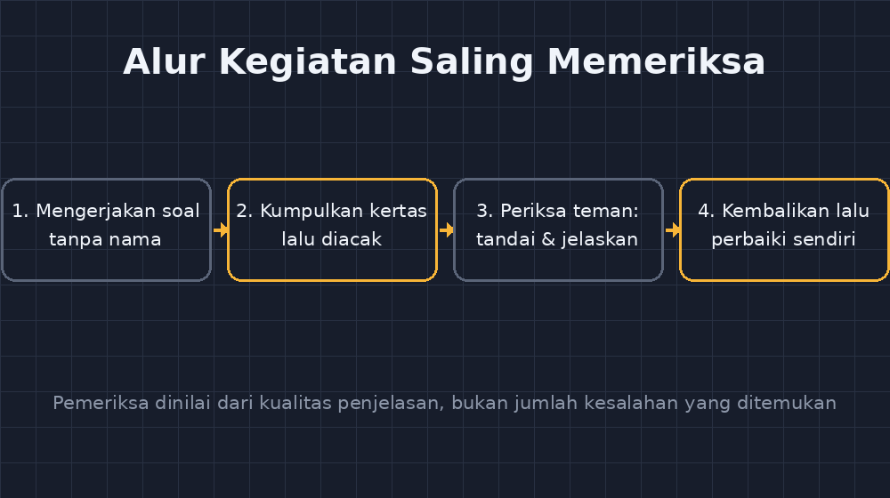

Ada satu momen yang membuat saya mulai percaya pada kegiatan yang sekarang jadi rutinitas di kelas saya. Waktu itu kelas VII sedang mengerjakan latihan operasi bilangan berpecahan. Salah satu siswa saya — sebut saja Raka — biasanya paling cepat selesai, paling percaya diri, dan paling malas menulis langkah. Hari itu saya tidak mengoreksi pekerjaannya. Saya memberikan pekerjaan teman sebangkunya, tulisan tangan acak-acak milik Dinda, dan berkata, "Periksa ini. Kalau ada yang salah, tandai dan jelaskan kenapa salah."

Raka mengembalikan kertas itu sepuluh menit kemudian dengan wajah bingung. "Pak, saya tidak nemu yang salah," katanya. Padahal di baris kedua, $\frac{2}{3} + \frac{1}{4}$ sudah dijawab menjadi $\frac{3}{7}$ — kesalahan klasik yang biasanya ia lakukan sendiri. Ia tidak melihatnya karena selama ini ia tidak pernah benar-benar *membaca* pekerjaan matematika. Ia hanya mengerjakannya.

<!--more-->

## Memperbaiki itu Lebih Sulit daripada Mengerjakan

Dari pengalaman itu saya belajar sesuatu yang sekarang saya yakini: kemampuan memeriksa pekerjaan orang lain adalah keterampilan yang terpisah dari kemampuan mengerjakan soal. Banyak siswa yang lancar menghitung ternyata buta ketika harus membaca alur pikir orang lain yang ditulis berantakan, dengan simbol yang miring dan langkah yang dilompati. Mereka terbiasa dengan tulisan buku yang rapi dan sempurna, lalu kaget bahwa pekerjaan manusia sungguhan tidak begitu.

Makanya kegiatan ini saya jadikan rutin, biasanya sekali atau dua kali seminggu di jam latihan. Caranya sederhana. Siswa mengerjakan beberapa soal seperti biasa, tanpa nama, kertasnya saya kumpulkan dan saya acak, lalu dibagikan lagi ke teman-teman lain. Tugas pemeriksa bukan sekadar memberi tanda benar-salah. Mereka harus menuliskan tiga hal: langkah mana yang mereka ragukan, apa letak kesalahannya jika ada, dan bagaimana perbaikannya. Nilai pemeriksa tidak datang dari jumlah kesalahan yang ditemukan, melainkan dari kualitas penjelasannya. Kesalahan yang ditandai tanpa alasan tidak dihitung.

Hasilnya menarik. Siswa yang biasanya diam di kelas justru berani menulis kritik pada kertas orang lain. Mungkin karena kritiknya ditujukan pada tulisan, bukan pada orang — anonimitas itu menyelamatkan banyak perasaan. Ada siswa yang menulis, "Di sini kamu lupa menyamakan penyebut, jadi hasilnya harusnya $\frac{11}{12}$ bukan $\frac{11}{8}$." Kalimat semacam itu tidak akan keluar dari mulutnya kalau harus bicara di depan kelas.

## Kesalahan Teman Lebih Mudah Diterima

Yang paling saya syukuri dari kegiatan ini adalah perubahan sikap terhadap kesalahan sendiri. Ketika kertas dikembalikan ke pemiliknya, saya minta pemiliknya membaca catatan pemeriksanya, lalu memperbaiki kesalahannya sendiri di kertas yang sama. Tidak ada nilai merah, tidak ada coretan tangan guru. Yang ada cuma tulisan teman sebaya yang berkata, "Coba cek langkah kedua."

Perbedaan psikologisnya besar. Koreksi dari guru sering terasa seperti vonis — tanda silang merah yang menyatakan kamu belum bisa. Koreksi dari teman terasa seperti diskusi. Saya pernah melihat dua siswa berdebat sepuluh menit soal satu langkah persamaan linear, dan keduanya keluar dari debat itu dengan pemahaman yang lebih baik daripada kalau mereka mendengar saya menjelaskan di depan. Karena untuk mempertahankan jawaban, mereka terpaksa menguraikan alasannya, dan menguraikan alasan adalah latihan matematika yang paling tidak murah.

Tentu tidak semua berjalan mulus. Ada pemeriksa yang asal memberi tanda centang. Ada juga yang salah membetulkan pekerjaan yang benar — membetulkan yang tidak perlu dibetulkan, sampai pemiliknya bingung. Justru kasus kedua yang paling mendidik. Ketika pemeriksa salah dan pemiliknya yakin ia benar, saya minta pemiliknya membuktikan. Mempertahankan kebenaran dengan argumen yang jelas adalah keterampilan yang tidak diajarkan di buku paket, dan momen itu sering jadi puncak kepercayaan diri siswa yang biasanya dianggap lemah.

Gambar di atas adalah alur kegiatan yang saya pakai. Sengaja saya buat sederhana, karena pada dasarnya memang sederhana — yang rumit adalah membangun kebiasaan dan rasa aman di kelas supaya kegiatan ini jalan.

## Apa yang Berubah Setelah Satu Semester

Setelah satu semester menjalankan ini, beberapa hal berubah dan menurut saya layak dicatat.

Pertama, kualitas tulisan pekerjaan siswa membaik dengan sendirinya. Ketika mereka tahu pekerjaannya akan dibaca orang lain — bukan sekadar dikoreksi — mereka mulai menulis langkah dengan lebih tertib. Motivasinya bukan takut pada guru, tapi malu pada teman. Saya rasa itu motivasi yang lebih sehat.

Kedua, kemampuan membaca notasi matematika meningkat. Siswa yang tadinya bingung melihat $\frac{a}{b} \times \frac{c}{d} = \frac{ac}{bd}$ ditulis temannya dengan tanda kali yang kurang jelas, perlahan belajar bahwa penulisan itu bagian dari matematika, bukan formalitas. Mereka jadi peka pada simbol — dan kepekaan pada simbol adalah fondasi aljabar.

Ketiga, dan ini yang paling penting bagi saya: kesalahan berhenti jadi aib. Di kelas yang budayanya seperti ini, siswa tidak lagi menyembunyikan kertasnya saat saya lewat. Mereka tahu kesalahan adalah bahan belajar, bukan bukti kebodohan. Saya bahkan pernah melihat siswa menulis di pojok kertasnya, "Kalau nemu salah, tolong kasih tahu ya, aku bingung di soal ini" — catatan kepada pemeriksa yang tidak saya minta.

## Catatan untuk Rekan Guru

Kalau Bapak/Ibu ingin mencoba, beberapa hal kecil yang saya pelajari dengan cara sukar. Pastikan soal yang diperiksa tidak terlalu mudah — kalau semua jawabannya benar, kegiatan jadi hiburan lima menit. Sediakan soal dengan ruang untuk keliru, biasanya soal berjenjang dari yang rutin sampai yang sedikit menjebak. Dan yang paling penting: jangan pernah mengekspos siapa yang membuat kesalahan yang paling parah. Begitu satu anak dipermalukan, kegiatan ini mati. Kejujuran pemeriksa hanya hidup di kelas yang aman.

Saya juga tetap mengoreksi sendiri di akhir. Peran saya bergeser — bukan lagi satu-satunya sumber kebenaran, tapi penengah terakhir yang memastikan tidak ada miskonsepsi yang lolos dan menularkan. Terkadang saya memotret satu-dua pekerjaan yang menarik (dengan izin pemiliknya, tanpa nama) untuk dibahas bersama di akhir jam, sebagai contoh cara membaca dan memperbaiki pekerjaan matematika.

Pada akhirnya, kegiatan ini bukan soal hemat waktu koreksi — jujur saja, mempersiapkan dan memfasilitasi kegiatan ini malah memakan waktu. Ini soal sesuatu yang lebih besar: melatih siswa untuk membaca pikiran orang lain dengan sabar, menguji argumen dengan jujur, dan menilai dirinya sendiri lewat mata orang lain. Keterampilan-keterampilan itu akan mereka bawa jauh melampaui ruang kelas matematika, ke mana pun mereka melangkah setelah lulus dari SMPN 1 Punggur.

Dan bagi saya, mendengar seorang siswa berkata pelan kepada temannya, "Coba cek lagi langkah ini, sepertinya ada yang belum pas" — kalimat tanpa nada menyalahkan, dengan niat sungguh-sungguh untuk menolong — itu bukti bahwa di kelas itu, matematika sudah menjadi bahasa yang dipakai untuk berteman.
