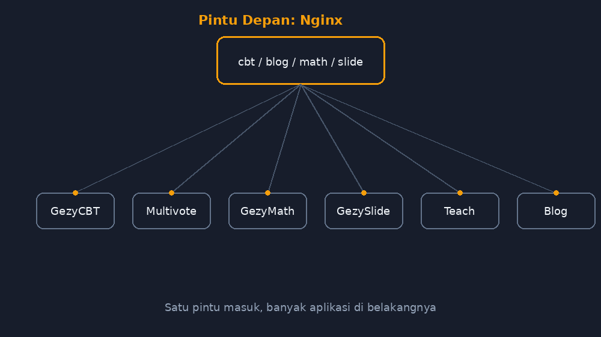

Suatu malam, sepulang membimbing lomba di sekolah, saya buka ponsel dan iseng mencoba satu per satu alamat aplikasi buatan saya. GezyCBT, Multivote, GezyMath, GezySlide, GezyMaterials, jurnal mengajar di Teach — semuanya terbuka. Lalu saya tersenyum sendiri, karena semua itu ternyata tinggal di satu tempat yang sama: satu server kecil sewaan di Jakarta, ukurannya cuma segelintir gigabita, harganya kira-kira setara dua telur negeri sehari.

Dulu saya tidak menyangka bisa sampai ke situ. Tulisan ini adalah catatan tentang bagaimana satu server kecil itu jadi "rumah digital" untuk hampir semua aplikasi GezyTech — dan pelajaran aneh-aneh yang saya petik di tengah jalan.

<!--more-->

## Awalnya Satu Aplikasi, Satu Tempat

Ketika aplikasi pertama saya — kuis interaktif matematika — selesai, saya cuma punya satu keinginan: supaya bisa dipakai siswa dari ponsel mereka. Saya ikuti tutorial hosting paling sederhana yang saya temukan, jalankan, dan berhasil. Untung-untungan. Saya bahas Penggalan kode yang tidak paham, tumpuk konfigurasi asal jalan, dan tidur lega begitu URL-nya bisa dibuka.

Lalu datang aplikasi kedua. Ketiga. Empat. Di sinilah saya mulai sadar bahwa masalahnya bukan lagi "bagaimana membuat aplikasi bisa diakses", melainkan "bagaimana supaya semuanya tidak saling menjegal". Kalau setiap aplikasi butuh proses sendiri, port sendiri, dan konfigurasi sendiri, tumpukan pengaturan yang tadinya rapi perlahan berubah jadi semacam lemari yang isinya dihimpit sendirian.

## Satu Pintu Depan untuk Semua

Solusinya, bagi saya, ternyata cukup elegan: satu pintu depan. Semua pengunjung masuk lewat alamat yang satu, lalu pintu itu — sebuah Nginx — yang memutuskan aplikasi mana yang harus melayani.

Bapak/Ibu yang bukan bidang teknis bisa membayangkannya seperti pos jaga sekolah. Semua tamu datang lewat gerbang yang sama, tetapi petugas jaga tahu ke mana setiap tamu harus diarahkan: yang mau keperpustakaan belok kiri, yang mau ke lab komputer belok kanan. Alamat `cbt.gezytech.web.id` dan `blog.gezytech.web.id` tampak beda di mata pengguna, tetapi di belakang, yang berputar-putar menyambut mereka adalah mesin yang sama.

Saya gambar sketsanya supaya lebih mudah dibayangkan:

*Sketsa sederhana: satu pintu masuk, banyak aplikasi di belakangnya.*

Dengan model ini, menambah aplikasi baru jadi pekerjaan yang jauh lebih ringan. Tidak perlu mengganti seluruh tata kelola — cukup daftarkan alamat barunya di pos jaga, lalu jalankan aplikasinya di belakang. Blog ini sendiri, yang Bapak/Ibu sedang baca, ya salah satu "penghuni" di balik pintu itu.

## Port, Nomor Kamar di dalam Rumah

Bagian yang paling saya suka pelajari justru konsep sederhana bernama *port*. Di dalam satu server, setiap aplikasi "menunggu" di nomor tertentu — seperti kamar bernomor di satu rumah. Satu aplikasi menunggu di kamar 3001, satu lagi di 3002, dan seterusnya. Pintu depan (Nginx) tinggal mencatat: tamu yang membawa alamat begitu, antar ke kamar begitu.

Saya sempat tertawa saat pertama kali paham ini, karena berulang-ulang error yang dulu saya takuti ("connection refused", "port already in use") ternyata cuma kasus sederhana: tamu datang ke kamar yang kosong, atau dua aplikasi berebut kamar yang sama. Dari rasa takut, berubah jadi hal yang bisa saya periksa dengan tenang — bahkan bisa saya jelaskan ke siswa yang penasaran.

## Pelajaran dari Malam yang Panjang

Tentu tidak semua berjalan mulus. Pelajaran paling mahal saya adalah tentang *memori*. Suatu sore, satu aplikasi CBT dipakai satu angkatan sekaligus untuk latihan ANBK. Server kecil saya sempat "sesak napas" — aplikasi lain ikut lambat, termasuk blog. Sejak itu saya belajar dua hal: menakar dulu kira-kira berapa pengguna serentak yang layak dilayani, dan mengawasi kesehatan server, bukan hanya menunggu laporan dari siswa yang bilang "situsnya lemot, Pak".

Pelajaran kedua: *cadangan*. Karena semua aplikasi kini tinggal di satu rumah, kalau rumahnya sakit, semuanya ikut sakit. Saya akhirnya membuat kebiasaan sederhana: data penting disalin secara rutin ke tempat lain. Kebiasaan ini lahir dari nalar guru saja — mirip menyimpan dua salinan kisi-kisi sebelum dibagikan ke supervisor.

## Kenapa Ini Masih Berhubungan dengan Mengajar

Ada pertanyaan yang mungkin muncul: apa urusannya guru matematika mempelajari urusan server begini? Jawaban saya sekarang: justru di sinilah banyak konsep matematika dan logika hidupnya terlihat.

Perbandingan dan skala: kapan satu server cukup, kapan harus dipecah — itu soal proporsi beban dan daya. Pencacahan dan pola: nomor port, alamat, aturan pemetaan "jika alamat ini, ke kamar itu" — persis seperti relasi dan fungsi yang biasa saya ajarkan di kelas VIII. Bahkan urusan diagnosis error itu, kalau dipikir-pikir, adalah kebiasaan yang sama yang saya terapkan saat membaca kesalahan siswa di lembar ulangan: jangan langsung menyalahkan anaknya, periksa dulu "jalannya" di mana macet.

Dan ada satu hal lagi yang lebih dalam. Ketika siswa tahu bahwa aplikasi kuis yang mereka pakai ditulis dan dirawat oleh gurunya sendiri, yang sampai mempelajari cara menyewa dan merawat server kecil, sikap mereka berubah. Ada beberapa siswa yang akhirnya bertanya, "Pak, koding itu belajarnya di mana?" — dan percakapan itu tidak pernah saya dapat dari sekadar membagikan slide.

## Catatan Penutup

Saya tidak berpangku ilmu jaringan. Sebagian besar yang saya pelajari tentang server ini lahir dari kebutuhan: aplikasi yang saya buat untuk kelas harus bisa dipakai, titik. Setiap kali ada yang rusak, saya belajar satu hal baru — kadang dengan cara yang menegangkan, seperti malam saat satu angkatan mengakses CBT bersamaan.

Kalau Bapak/Ibu guru sedang menimbang untuk membangun sesuatu sendiri, pesan saya cuma satu: jangan menunggu tahu semuanya dulu. Mulai dari satu aplikasi kecil yang benar-benar dipakai di kelas, dan biarkan masalah-masalah nyata yang mengajari sisanya — termasuk urusan "rumah digital" seperti yang saya ceritakan di atas. Saya masih terus belajar sampai sekarang; tulisan ini pun saya tulis sambil sesekali membuka catatan error yang dulu saya simpan.
