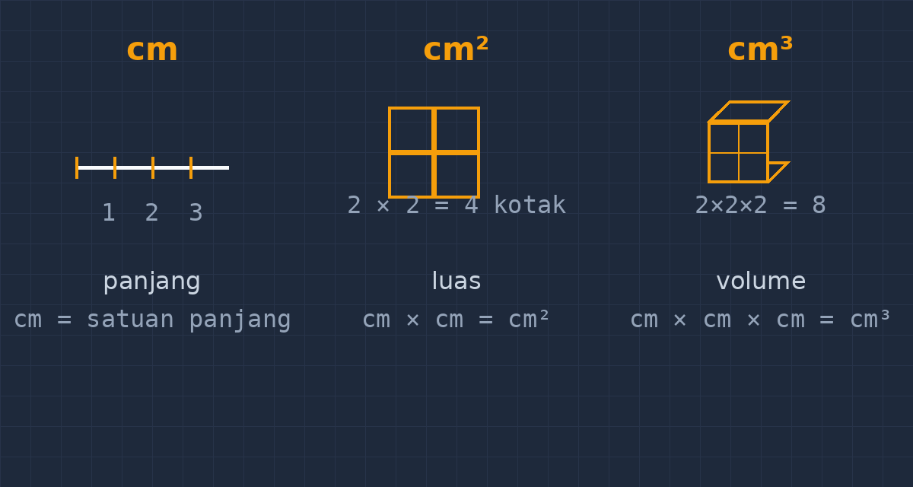

Ada satu hal yang saya lewatkan bertahun-tahun di kelas: satuan. Bukan cara menghitungnya — anak-anak saya cukup lancar menghitung luas dan volume. Yang lewat justru tulisan kecil di belakang angka. Di lembar jawaban, luas persegi panjang berukuran $8$ cm $\times$ $5$ cm ditulis "$40$ cm" saja, begitu saja, tanpa pangkat. Dan selama bertahun-tahun saya hanya memberi tanda centang kecil, terkadang mencoret satuan lalu menulis yang benar, tanpa pernah benar-benar berhenti menanyakan: apakah mereka menganggap satuan itu penting?

<!--more-->

## Titik ketika saya sadar

Perubahan sikap saya datang dari ulangan bangun ruang. Satu soal menanyakan volume balok dengan ukuran dalam sentimeter, dan jawaban yang saya baca di sekitar sepertiga lembar adalah angka yang benar — hasil kali ukurannya tepat — tetapi satuan yang tertulis "cm". Bukan $\text{cm}^3$. Saya koreksi satu per satu dengan pena merah, menulis di pinggir kertas, "satuan volume: cm kubik." Keesokan harinya, saat saya sampaikan hal yang sama di depan kelas, seorang siswa mengangkat tangan dan bertanya dengan wajah benar-benar tidak paham:

"Pak, toh angkanya sudah benar. Satuannya kan cuma tulisan tambahan?"

Saya terdiam. Karena dari sudut pandang dia, memang begitu. Angka adalah yang dihitung, yang dinilai, yang ditanyakan di soal. Satuan hanyalah embel-embel di belakangnya, seperti tanda baca yang boleh salah asal kalimatnya jelas. Dan jika saya pikir-pikir, buku catatan mereka memang mengisyaratkan itu: saya sendiri sering menulis rumus luas sebagai "$p \times l$" dan volume sebagai "$p \times l \times t$" tanpa pernah menuliskan satuan di sebelahnya. Rumus-rumus itu saya ajarkan sebagai mesin penghitung angka, bukan sebagai pernyataan tentang besaran.

## Pangkat pada satuan bukan hiasan

Malam itu saya merombak cara saya menjelaskan satuan. Inti masalahnya, saya pikir, bukan bahwa siswa malas menulis pangkat — tetapi bahwa mereka tidak pernah melihat makna di balik pangkat itu. Kenapa luas pakai $\text{cm}^2$ dan volume pakai $\text{cm}^3$? Kalau jawabannya hanya "memang begitu ketentuannya," maka wajar saja satuan itu dianggap hiasan.

Jadi pertemuan berikutnya, saya membawa sesuatu yang sederhana: persegi kertas berukuran $1$ cm $\times$ $1$ cm, selembar papan paku, dan kubus-kubus kecil dari potongan gabus. Saya mulai dari pertanyaan yang tampak terlalu mudah untuk kelas delapan: "Satu sentimeter itu apa?"

Mereka menjawab panjang. Bagus. Lalu saya tanya, "kalau luas, satuannya apa?" dan jawaban mereka seragam: sentimeter persegi. "Nah," kata saya, "sekarang tunjukkan ke saya, sentimeter persegi itu bentuknya seperti apa?" Di situlah jeda aneh muncul. Beberapa bisa menggambarkan persegi kecil, tetapi banyak yang ragu — dan yang lebih menarik, saat saya tanya kenapa namanya persegi, jawabannya macam-macam, tetapi jarang yang langsung menghubungkan: karena itu persegi yang sisinya satu sentimeter, dan satuannya sebenarnya "sentimeter kali sentimeter", $\text{cm} \times \text{cm} = \text{cm}^2$.

Pangkat dua pada satuan, dengan kata lain, adalah jejak dari proses perkaliannya sendiri. Ketika kita menghitung luas persegi panjang $8$ cm $\times$ $5$ cm, kita sebenarnya mengalikan $8 \times 5$ dan juga cm $\times$ cm. Hasilnya $40$ dan satuannya $\text{cm}^2$ — keduanya lahir dari perkalian yang sama. Begitu juga dengan volume: $\text{cm} \times \text{cm} \times \text{cm} = \text{cm}^3$, dan kubus satuan itulah wujud nyatanya, bukan sekadar definisi di buku.

*Panjang adalah tumpukan garis, luas adalah tumpukan persegi, volume adalah tumpukan kubus — pangkat pada satuan mengikuti banyaknya arah pengukuran.*

## Dari menjelaskan ke menghitung ulang

Setelah konsep itu jalan, saya mengubah latihannya. Dulu saya memberi soal "hitung luas bangun berikut," sekarang saya tambah satu langkah kecil yang ternyata berdampak besar: siswa harus menuliskan satuan di setiap langkah, bukan hanya di jawaban akhir. Jadi penulisan yang saya harap bukan "$40$ cm" melainkan $8\ \text{cm} \times 5\ \text{cm} = 40\ \text{cm}^2$.

Efek sampingnya menarik. Pertama, miskonsepsi yang selama ini tersembunyi jadi kelihatan. Ada siswa yang menulis $8\ \text{cm}^2 \times 5\ \text{cm}^2 = 40\ \text{cm}^4$ — dan itu justru kesempatan emas, karena dari $\text{cm}^4$ yang janggal itu kita bisa bicara: satuan juga ikut dihitung, dan $\text{cm}^2 \times \text{cm}^2$ memang menjadi $\text{cm}^4$, tetapi inilah kenapa kita mengalikan $\text{cm} \times \text{cm}$ saja, karena yang kita ukur adalah panjang dua sisi, bukan luas dua sisi. Kedua, soal konversi yang biasanya jadi mimpi buruk jadi lebih masuk akal. Kalau $1\ \text{m} = 100\ \text{cm}$, maka $1\ \text{m}^2 = 100\ \text{cm} \times 100\ \text{cm} = 10\,000\ \text{cm}^2$ — dan siswa yang paham satuan ikut berkali tidak perlu lagi menghafal tangga "naik dua tinggi kali seribu, turun dua tinggi bagi seribu" dengan mata sayu. Tangga tangannya sendiri.

Ketiga — dan ini yang paling saya syukuri — pertanyaan "Pak, kenapa satuannya begitu?" berkurang, digantikan pertanyaan yang lebih sehat: "Pak, ini luas atau volume sih?" Karena sekarang mereka tahu bahwa menentukan satuannya sama dengan menentukan sedang mengukur apa. Satuan bukan lagi embel-embel, melainkan bagian dari jawaban yang mengatakan "besaran ini adalah luas" atau "besaran ini adalah volume."

## Yang saya cermin dari kebiasaan saya sendiri

Jujur, sebagian dari masalah ini berasal dari saya. Bertahun-tahun saya menulis papan tulis dengan satuan yang sembarangan: kadang lengkap, kadang dilepas "biar cepat," kadang "$m^2$" ditulis pakai angka kecil yang bahkan tidak jelas pangkatnya. Siswa meniru apa yang mereka lihat setiap hari, dan yang mereka lihat adalah guru yang menganggap satuan opsional. Sejak itu saya memaksa diri menuliskan satuan di setiap langkah pengerjaan di papan, meskipun terasa bertele-tele. Papan tulis saya sekarang lebih "ramai," tetapi lembar jawaban siswa ikut ramai dengan satuan yang benar. Perubahan kecil yang murah.

## Penutup: yang kecil di belakang angka

Kalau direnungkan, miskonsepsi satuan ini cocok dengan pola yang hampir selalu saya temui dalam mengajar: hal-hal yang saya anggap sepele karena sudah terlalu akrab, justru sering menjadi sumber kebingungan yang paling dalam bagi siswa. Pangkat dua dan pangkat tiga pada satuan itu kecil, dua karakter yang mudah dilewatkan di ujung angka. Tetapi di dalamnya tersimpan seluruh cerita tentang apa artinya mengukur panjang, luas, dan volume — tiga besaran yang berbeda dunia, meskipun angkanya bisa sama-sama "40."

Jadi kalau Bapak/Ibu guru juga menemukan "40 cm" di jawaban soal luas, mungkin jangan berhenti di mencoret dan menulis yang benar. Bawa ke kelas satu kertas persegi kecil, satu kubus gabus, dan satu pertanyaan: "satuan ini bentuknya seperti apa?" Ketika siswa bisa memegang satuannya, mereka berhenti melewatannya.
