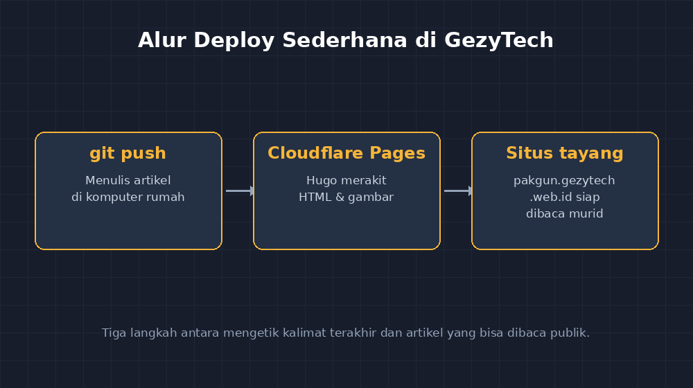

Malam itu saya baru saja menyelesaikan artikel tentang garis bilangan. Jam menunjukkan hampir sebelas, mata sudah berat, dan sisa tenaga saya hanya cukup untuk satu hal: mengetik dua perintah pendek di terminal. `git add`, `git commit`, lalu `git push`. Setelah itu saya tutup laptop dan tidur.

Pagi harinya, sebelum berangkat ke sekolah, saya buka pakun.gezytech.web.id dari ponsel di dalam mobil. Artikelnya sudah ada di sana. Lengkap dengan gambar, format, dan tautan berkas yang saya lampirkan. Padahal saya tidak menyentuh panel hosting apa pun, tidak mengunggah satu file pun secara manual, tidak menekan tombol "publish" di mana pun. Yang terjadi antara laptop saya di kamar dan situs yang bisa dibaca publik adalah sebuah alur yang berjalan sendiri — dan cerita malam itu yang ingin saya tulis kali ini.

<!--more-->

## Dulu: satu artikel, sepuluh langkah

Sebelum ada alur otomatis, mempublikasikan tulisan itu rasanya seperti upacara. Saya menulis artikel, lalu membuka aplikasi FTP, mengunggah berkas satu per satu, memperbaiki tautan yang rusak, mengunggah ulang gambar yang terlewat, dan sesekali lupa bahwa satu gambar bernama `featured.png` saya ganti menjadi `featured-2.png` tanpa memperbarui tautannya. Hasilnya: tautan gambar rusak dan artikel tayang tanpa ilustrasi.

Aplikasi-aplikasi GezyTech lain juga mengalami hal serupa. Setiap kali saya memperbaiki satu bug kecil di aplikasi kuis misalnya, saya harus mengingat-ingat langkah deployment versi lama, mencari catatan lama tentang perintah mana yang harus dijalankan di server, dan berdoa supaya tidak lupa satu langkah. Ada satu momen di mana saya mengunggah versi lama ke atas versi baru karena salah urutan — sebuah bug yang sudah diperbaiki malam sebelumnya muncul kembali di pagi hari, dan saya membutuhkan waktu setengah jam untuk menyadari apa yang terjadi.

Masalahnya bukan bahwa saya malas. Masalahnya adalah bahwa **langkah manual adalah langkah yang bisa terlewat**. Dan guru seperti saya punya banyak hal lain yang bisa mengalihkan perhatian: koreksi, jurnal mengajar, rapat, siswa yang datang ke meja dengan soal yang tidak bisa dia kerjakan.

## Menyadari bahwa "publish" seharusnya bukan pekerjaan

Konsep yang akhirnya mengubah cara saya bekerja sebenarnya sederhana: *continuous deployment*, atau CI/CD. Namanya terdengar seperti sesuatu yang hanya dipakai tim teknologi besar di perusahaan dengan lusinan insinyur. Tapi esensinya cuma satu kalimat: **begitu saya selesai menulis dan mengirim (push) pekerjaan saya ke repositori, sistem otomatis merakit dan menayangkannya.**

Untuk blog, alurnya seperti ini:

*Tiga langkah antara mengetik kalimat terakhir dan artikel yang bisa dibaca publik.*

- Saya menulis artikel sebagai berkas teks biasa (Markdown) di komputer rumah, lengkap dengan gambar di folder yang sama.
- Saya menjalankan `git push` — semua berkas terkirim ke repositori GitHub.
- Cloudflare Pages mendeteksi adanya perubahan, menjalankan Hugo untuk merakit semua berkas menjadi situs web utuh, lalu menayangkannya di pakgun.gezytech.web.id.

Tidak ada langkah yang bisa saya lupakan, karena tidak ada langkah yang perlu saya ingat. Satu-satunya kewajiban saya adalah menulis. Selebihnya adalah urusan mesin.

Untuk aplikasi-aplikasi GezyTech yang berjalan di VPS, prinsipnya sama, hanya sedikit lebih manual di ujungnya: setelah push, saya menjalankan satu skrip kecil di server yang menarik versi terbaru (`git pull`), memasang dependensi jika ada yang berubah, dan me-restart layanannya. Satu perintah, bukan sepuluh. Skrip itu tidak pintar — dia hanya menjalankan langkah yang dulu saya jalankan dengan tangan, tapi selalu dengan urutan yang sama dan tidak pernah lupa.

## Kenapa ini penting untuk guru, bukan cuma untuk programmer

Ada satu kesalahpahaman yang sering saya dengar dari rekan guru: bahwa urusan "deployment" dan "CI/CD" adalah urusan orang IT, bukan urusan guru yang membuat media pembelajaran. Saya paham asalnya, tapi saya tidak setuju.

Guru adalah profesi yang paling rentan terhadap **keterbatasan waktu dan energi**. Setiap menit yang saya habiskan untuk mengunggah file secara manual, memperbaiki tautan yang rusak, atau mencari catatan lama tentang perintah deployment, adalah menit yang tidak saya habiskan untuk hal yang jauh lebih penting: menulis soal yang lebih baik, memikirkan cara menjelaskan konsep yang sulit, atau sekadar beristirahat agar besok bisa mengajar dengan kepala yang jernih.

Alur otomatis seperti ini tidak membuat saya menjadi programmer yang lebih hebat. Dia membuat saya menjadi guru yang bisa menulis dan membangun aplikasi tanpa harus menjadi seorang ahli infrastruktur dulu. Dia menghilangkan satu kategori kesalahan sepenuhnya: **kesalahan prosedur**, yaitu kesalahan yang muncul bukan karena kita tidak paham, tapi karena kita lupa satu langkah di antara dua puluh langkah lainnya.

Ada juga manfaat yang tidak saya duga sebelumnya: **ritme menulis menjadi lebih ringan**. Dulu, karena proses publikasi terasa berat, saya cenderung menunda. Artikel tinggal setengah jadi selama berminggu-minggu. Sekarang, karena "menyelesaikan" artikel hanya berarti satu perintah push, saya lebih sering benar-benar menyelesaikannya. Rasa beratnya hilang. Yang tersisa hanya pekerjaan yang menyenangkan: menulis sendiri.

## Bukan tanpa jebakan

Supaya tulisan ini jujur, saya juga harus cerita bahwa alur otomatis punya jebakannya sendiri.

Pertama, **kesalahan tetap bisa terjadi, hanya bergeser tempatnya**. Kalau ada satu baris yang salah di frontmatter artikel — misalnya tanda kutip yang hilang di judul, atau format tanggal yang keliru — build bisa gagal dan artikel tidak tayang. Bedanya, sekarang saya tahu persis di mana mencari masalahnya: bukan di langkah unggah yang saya lewatkan, tapi di berkas yang baru saja saya ubah. Ini jauh lebih mudah didiagnosis.

Kedua, **menundaan build terasa seperti misteri**. Ada kalanya saya push jam sepuluh malam, dan situs baru diperbarui sebelas lebih sedikit. Untuk orang yang tidak terbiasa, ini bisa membuat panik: "apakah push saya gagal?" Jawabannya biasanya biasa saja: layanan pihak ketiga sedang antre. Yang perlu saya latih hanyalah kesabaran lima sampai sepuluh menit sebelum menyimpulkan ada yang rusak.

Ketiga, dan ini yang paling penting: **otomatisasi tidak menggantikan tanggung jawab atas isi**. Kalau saya menulis artikel yang buruk, alur otomatis akan menayangkan artikel yang buruk dengan sangat efisien. Mesin mempercepat distribusi, bukan kualitas. Kualitas tetap pekerjaan manusia — dalam hal ini, pekerjaan saya sebagai guru yang harus mempertimbangkan apa yang layak dibaca murid dan rekan guru.

## Penutup: waktu yang kembali ke tempatnya

Saya tidak akan pernah menjadi orang yang paling paham cara kerja Cloudflare Pages secara dalam. Tapi saya tidak perlu. Yang saya butuhkan hanya pemahaman cukup untuk membangun alur yang jujur: tulis, push, tayang. Selebihnya, saya percayakan.

Yang paling saya syukuri bukanlah teknologinya, tapi apa yang dia kembalikan ke saya: **waktu dan ketenangan**. Malam itu, setelah push artikel tentang garis bilangan, saya benar-benar tidur. Tidak ada pikiran "sudahkah saya mengunggah gambar itu?" yang berputar di kepala. Pagi harinya, artikel sudah menunggu di internet, rapi, siap dibaca.

Bagi rekan guru yang sedang membangun apa pun — blog, aplikasi kuis, bank soal digital — saya sarankan satu hal: begitu Anda menyadari bahwa Anda melakukan langkah yang sama berulang kali setiap kali mempublikasikan sesuatu, berhenti sejenak dan tanyakan pada diri sendiri, "bisakah langkah ini dijalankan oleh mesin?" Sering kali jawabannya ya, dan cara mengaturnya jauh lebih sederhana dari yang kita bayangkan.

Saya tidak sedang menjual alat atau layanan apa pun di sini. Saya hanya mau berbagi bahwa hal yang dulu membuat saya capek malam-malam sekarang sudah tidak lagi. Dan waktu yang dibebaskan itu, kalau dipakai dengan benar, kembali ke tempat yang paling butuh: ke kelas, ke murid, dan ke istirahat yang seharusnya kita dapat.
