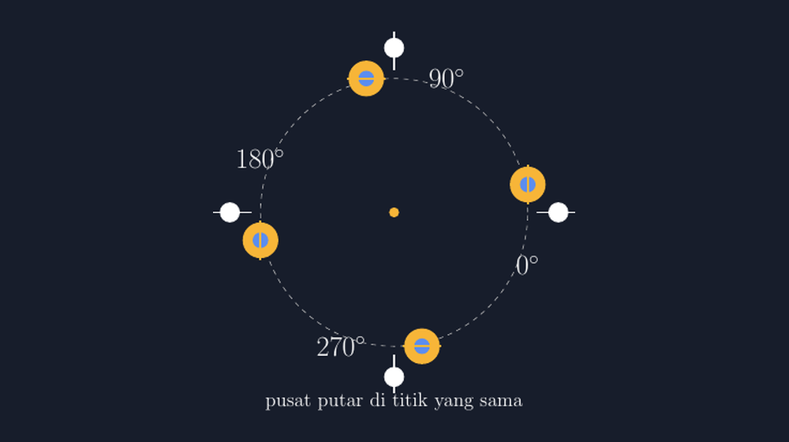
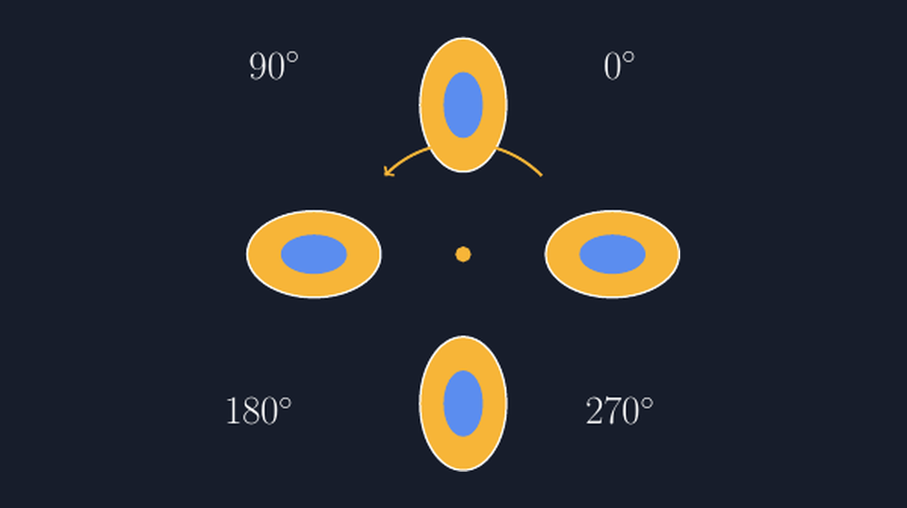

Jumat lalu, di kelas VIII-B, saya menempelkan gambar ornamen batik di papan tulis. Pilihan saya jatuh pada motif kawung — lingkaran-lingkaran kecil yang berkelompok empat-empat, tersusun rapi seperti kipas yang bersalaman. Pertanyaan saya sederhana: "Ornamen ini, kalau saya putar, ada posisi yang bikin dia kelihatan sama seperti semula?"

Tangan pertama yang naik menjawab "simetri lipat, Pak." Ada yang menyebut "simetri pada," ada juga yang bilang "refleksi." Tidak ada satu pun yang menyebut kata *putar*. Padahal motif kawung justru contoh klasik simetri putar: kalau dia diputar 180° sekitar titik pusatnya, dia kembali ke wajah yang sama — tanpa perlu dilipat sama sekali.

## Dua simetri yang sering tertukar

Miskonsepsi ini saya temui hampir setiap tahun. Siswa menguasai simetri lipat dengan sangat baik — mereka fasih melipat kertas, menggambar garis lipat, dan menemukan pasangan yang mencerminkan. Masalahnya, begitu istilah "simetri" saja muncul, otak mereka langsung mengarah ke lipatan. Simetri putar diperlakukan seperti saudara jauh yang jarang disinggahi: ada, tapi tidak dikenali wajahnya.

Padahal keduanya beda watak. Simetri lipat butuh sebuah **garis** — bayangan cermin. Simetri putar butuh sebuah **titik** — poros engsel. Kalau anak hanya punya satu kategori di kepala, semua simetri pasti mendarat di garis lipat. Itulah sebabnya di kelas itu saya memutuskan untuk tidak lagi menjelaskan dengan kata-kata dulu, tapi membangun gambar yang buktinya bisa dilihat mata.

## Membuktikan dengan memutar, bukan menghafal

Cara paling jujur untuk membuktikan simetri putar adalah benar-benar memutar objeknya. Di kelas, ini bisa dilakukan dengan transparansi atau kertas karton yang ditindih dan dijepit di satu titik dengan pecut/split. Anak memutar karton atasnya, dan kita bersama-sama mengamati: pada sudut berapa wajah gambar kembali menutupi gambar di bawah?

Untuk bahan ajar digital, saya membuat gambarnya dengan TikZ. Ide sederhananya: gambar satu ornamen asimetris (supaya tidak menipu — kalau ornamennya simetris lipat penuh, bukti putarnya jadi kabur), lalu gambar salinannya yang sudah diputar 180°, 90°, dan 45° di sekeliling titik pusat yang sama. Siswa bisa langsung membandingkan: salinan mana yang tumpang tindih sempurna dengan aslinya, mana yang tidak.

Inti kodenya hanya memanfaatkan opsi `rotate` pada scope:

```latex
\begin{scope}[rotate=180]
  \ornamenDiTitik{0,0}
\end{scope}
```

Dengan mendefinisikan ornamen sebagai `pic` sekali saja, setiap salinan yang diputar akan otomatis konsisten — bentuknya persis sama, hanya orientasinya yang berubah. Inilah kelebihan TikZ dibanding gambar buatan tangan di papan: putaran 180° benar-benar 180°, bukan kira-kira yang tergantung kadar sabar kita menggambar.



Dari gambar di atas, siswa dengan cepat melihat polanya: putaran 45° menghasilkan gambar yang tampak "miring asal," putaran 90° juga belum kembali ke wajah semula, tapi putaran 180° membuat salinan dan aslinya berimpit. Titik pusat itulah yang kita sebut **titik pusat simetri putar**, dan 180° adalah **sudut simetri** terkecilnya untuk ornamen ini.

## Ornamen yang lebih deras: simetri putar orde empat

Motif kawung lebih deras dari contoh sederhana di atas. Kalau diputar 90° saja, dia sudah kembali tampil sama. Kita sebut dia punya simetri putar **orde 4** — dalam satu putaran penuh (360°), wajah yang sama muncul 4 kali: pada 90°, 180°, 270°, dan tentu saja 360°.

Hubungan antara orde dan sudutnya enak dibahas dengan satu baris hitungan:

$$\text{sudut simetri terkecil} = \frac{360^\circ}{\text{orde}}$$

Untuk kawung: $360^\circ : 4 = 90^\circ$. Untuk ornamen segi enam seperti motif gawang: $360^\circ : 6 = 60^\circ$. Rumus ini tidak perlu dihafal — ia keluar sendiri begitu siswa sudah melihat sendiri wajah yang muncul berulang. Justru karena mereka menghitung dari gambar, rumus itu terasa seperti kesimpulan, bukan perintah.



Saat gambar kawung di atas saya perlihatkan, ada anak di bangku belakang yang berkomentar, "Berarti kalau saya putar sebesar 45°, dia tidak sama, Pak?" — dan langsung menjawab dirinya sendiri, "Iya, soalnya 45° itu belum sampai 90°." Anak itu sebelumnya termasuk yang paling senyap di kelas. Saya mencatat momen ini di jurnal mengajar saya malam itu juga: gambar yang jujur memang mengundang pertanyaan yang tidak diundang.

## Jebakan yang perlu saya waspadai

Ada dua jebakan yang sejak hari itu saya antisipasi sebelum mengajar materi ini lagi.

**Jebakan pertama: bentuk yang simetris lipat penuh.** Kalau contoh yang saya pakai simetris terhadap garis lipat *dan* titik putar sekaligus, siswa tidak akan bisa membedakan mana peran garis dan mana peran titik. Karena itu contoh pertama saya sengaja asimetris terhadap lipatan, tapi simetris terhadap putaran 180°. Satu sifat, satu bukti — jangan dicampur dulu.

**Jebakan kedua: memutar gambar vs memutar kertas.** Sebagian siswa memahami "diputar" sebagai perputaran lembar kerja mereka (seperti memiringkan buku), bukan perputaran objek di sekitar titik. Ini sering tidak tampak di jawaban tulis, tapi kelihatan jelas saat mereka mencoba menggambar sendiri salinan yang diputar — hasilnya digeser, bukan diputar. TikZ membantu di sini: karena salinan digambar dengan `rotate` di sekitar koordinat pusat yang eksplisit, saya bisa menunjukkan bahwa yang berubah hanya orientasi, sedangkan pusatnya tidak bergeser.

## Kapan simetri putar berguna di luar buku

Supaya materi ini tidak berhenti sebagai hafalan istilah, saya mengajak siswa mencari simetri putar di sekitar mereka. Hasilnya menarik: kipas angin tiga bilang (orde 3), baling-baling empat bilang (orde 4), roda gigi (orde sesuai jumlah gigi), huruf S dan N yang kalau diputar 180° tetap terbaca S dan N, logo sekolah, hingga tutup botol bergerigi. Seorang siswa bahkan menyebut buah jambu yang dipotong melintang — dan kita berdebat sebentar apakah bijinya cukup teratur untuk dihitung ordenya.

Yang saya suka dari pencarian ini: siswa mulai sadar bahwa simetri putar adalah sifat *berulang*, bukan sifat sekali jadi. Sesuatu yang punya simetri putar orde 4 berarti wajahnya "janjian" muncul empat kali dalam satu putaran. Bahasa sederhana seperti ini yang akhirnya mereka tulis di rangkuman — dan jauh lebih hidup daripada definisi buku yang kaku.

## Penutup: putar dulu, baru kasih nama

Kembali ke pertanyaan siswa yang menjawab "simetri lipat" di awal pembelajaran: mereka tidak salah total — motif kawung memang juga punya simetri lipat. Yang kurang adalah peta konsepnya: simetri itu keluarga besar, dan putar adalah salah satu anggotanya yang butuh titik, bukan garis.

Kesimpulan dari pengalaman kelas ini bagi saya sederhana: istilah "simetri putar" sebaiknya diberikan *setelah* siswa melihat sendiri gambar yang kembali sama setelah diputar. Urutan terbalik — nama dulu, bukti belakangan — membuat istilah itu hinggap di garis lipat yang lebih familiar. Dengan gambar yang bisa diputar di depan mata, urutannya terbalik dengan sendirinya: mata dulu, nama belakangan.

Berkas TikZ lengkap untuk kedua gambar di artikel ini bisa diunduh dan dikompilasi langsung. Semoga bermanfaat untuk Bapak/Ibu guru yang ingin menyiapkan bahan ajar simetri putar tanpa harus menggambar manual.

> 📎 **Berkas TikZ lengkap:** [simetri-putar.tex](tex/simetri-putar.tex) — siap kompilasi (butuh paket `tikz`).
