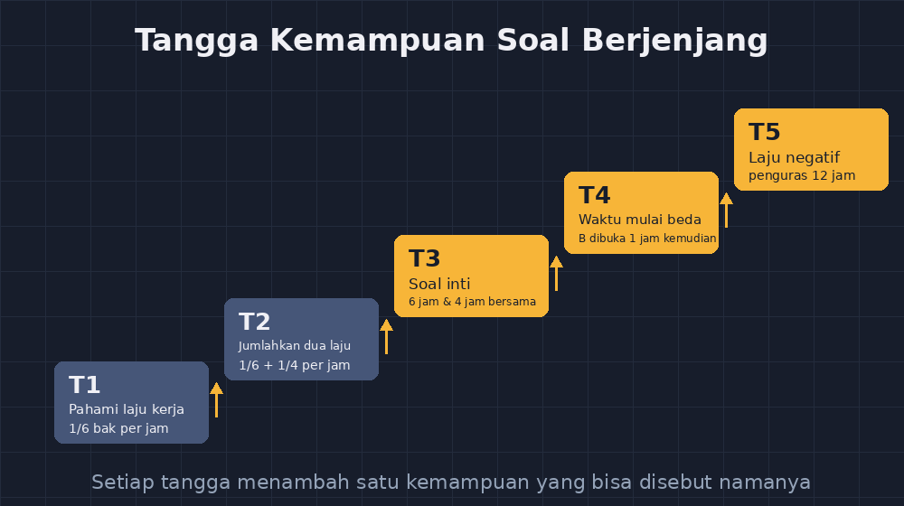

Rabu lalu saya duduk di meja kerja dengan satu tugas yang sama seperti setiap tahun: menyiapkan latihan soal berjenjang untuk bab sistem persamaan linear dua variabel. Kelas VIII-B saya tahun ini isinya campuran yang khas — ada anak yang bisa menyelesaikan soal olimpiade kelas IX tanpa banyak bimbingan, dan ada juga yang masih ragu memindahkan suku ke ruas lain. Satu set soal seragam untuk kelas seperti itu selalu berakhir dua hal: yang cepat menganggur karena soalnya terlalu mudah, yang tertinggal menyerah karena soalnya terlalu sulit.

Masalahnya, menyusun soal berjenjang itu melelahkan. Bukan menyusun lima soal yang sulitnya bertingkat sekadar perasaan — tapi lima soal yang benar-benar naik satu tangga, masing-masing menuntut satu kemampuan baru yang bisa saya sebut dengan jelas.

<!--more-->

## Kenapa "berjenjang" itu gampang dikata, susah dikerjakan

Di makalah dan pelatihan, soal berjenjang selalu digambarkan rapi: tingkat satu pemanasan, tingkat dua penerapan, tingkat tiga penalaran, dan seterusnya. Kenyataannya di meja kerja saya jauh lebih berantakan. Pertanyaan yang selalu menghantui bukan "berapa tingkat yang saya buat", tapi:

> Apakah tingkat 2 ini benar-benar lebih mudah dari tingkat 3 — atau cuma terlihat lebih mudah karena angkanya lebih kecil?

Banyak soal yang saya dulu sebut "sedang" ternyata menyembunyikan lompatan yang besar. Contoh dari set lama saya: soal tingkat 2 minta menentukan nilai $x$ dari $2x + 3 = 11$, dan soal tingkat 3 minta menentukan $x$ dari $2(x - 4) = 10$. Dilihat sepintas naik level. Tapi kalau dicek, lompatannya ganda: siswa harus membuka kurung *dan* memindahkan suku sekaligus. Anak yang belum mantap pada salah satunya langsung jatuh di soal yang katanya "sedang".

Jadi sebelum bicara AI, saya harus jujur dulu: kesulitan utamanya bukan soal kemampuan menulis soal, tapi soal menganalisis apa persisnya yang dituntut tiap soal. Dan di sinilah AI masuk — bukan sebagai penulis soal, tapi sebagai partner analisis.

## Urutan kerja baru saya: satu soal jadi pondasi, AI jadi pemeta

Cara kerja saya sekarang begini. Saya tidak lagi minta AI "buatkan soal berjenjang tentang SPLDV" — hasilnya selalu generik, campur aduk antar topik, dan tingkat kesulitannya tebak-tebakan. Sebaliknya, saya yang menulis **satu soal inti** dengan kualitas yang saya percaya, lalu membawa soal itu ke AI dengan permintaan yang spesifik:

> "Ini soal saya: [soal]. Analisis kemampuan apa saja yang dituntut untuk menyelesaikannya, urut dari yang paling dasar. Lalu rancang bagaimana soal-soal lebih mudah bisa dibuat dengan mengurangi satu kemampuan pada satu waktu — tanpa mengubah konteks soalnya."

Contoh nyata dari sesi Rabu lalu. Soal inti yang saya tulis:

> Sebuah bak mandi diisi oleh keran A dalam 6 jam dan keran B dalam 4 jam. Jika kedua keran dibuka bersamaan, berapa lama waktu yang dibutuhkan untuk mengisi bak penuh?

AI memetakan tuntutannya: (1) memahami bahwa kerja bersama = jumlah laju kerja, bukan jumlah waktu; (2) mengubah "6 jam" menjadi laju $\frac{1}{6}$ bak per jam; (3) menjumlahkan pecahan dengan penyebut berbeda; (4) membalik laju menjadi waktu. Empat kemampuan, dan sekarang saya bisa lihat dengan jelas di mana siswa biasanya tersandung — biasanya di (1), miskonsepsi klasik "6 + 4 = 10 jam" yang entah sudah berapa kali saya temui.

Dari pemetaan itu, soal berjenjangnya nyaris menyusun dirinya sendiri:

- **Tingkat 1:** keran A mengisi $\frac{1}{6}$ bak per jam. Berapa bagian bak terisi setelah 2 jam? (hanya kemampuan 2)
- **Tingkat 2:** keran A mengisi $\frac{1}{6}$, keran B mengisi $\frac{1}{4}$ per jam. Berapa bagian terisi setelah 1 jam keduanya terbuka? (kemampuan 2 + 3)
- **Tingkat 3:** soal inti saya, lengkap. (semua kemampuan)
- **Tingkat 4:** keran A 6 jam, keran B 4 jam, tapi keran B baru dibuka setelah keran A berjalan 1 jam. (semua kemampuan + perencanaan waktu)
- **Tingkat 5:** keran penguras bisa mengosongkan bak dalam 12 jam. Semua keran terbuka bersamaan; bak terisi penuh atau tidak? (semua kemampuan + konsep laju negatif)

Yang membuat saya puas: setiap lompatan antar tingkat sekarang bisa saya pertanggungjawabkan. Tingkat 4 bukan "lebih sulit" secara kosakata — ia menuntut kemampuan baru yang pasti, yaitu menahan diri untuk tidak langsung menjumlahkan laju sebelum waktu kerjanya disamakan.

*Setiap tangga mengurangi atau menambah satu kemampuan — bukan sekadar mengganti angka.*

## AI yang saya minta jujur soal kelemahan soal saya

Bagian lain yang menurut saya paling berharga: saya mulai minta AI menjadi "siswa sulit" untuk soal-soal saya, seperti yang sudah pernah saya tulis di blog ini untuk menguji soal sebelum dicetak. Tapi untuk soal berjenjang, perannya sedikit berbeda — ia jadi pemeriksa ketergantungan.

Saya kirimkan lima soal tingkat saya dan minta AI menjawab satu pertanyaan: "Tingkat mana yang bisa dikerjakan siswa dengan hafalan pola saja, tanpa memahami konsep?" Hasilnya menampar juga. Soal tingkat 2 saya ternyata bisa dikerjakan dengan "kalau dua keran 6 dan 4 jam, jawabannya selalu 2,4 jam" — rumus cepat yang beredar di kalangan anak dan merusak seluruh jenjang. Ditemukan sebelum dicetak, saya ganti angkanya menjadi 5 dan 3 jam supaya hafalan tidak berguna.

Ini yang tidak bisa saya lakukan sendiri dalam waktu wajar. Mata guru yang lelah setelah mengajar enam jam cenderung buta terhadap pola yang berulang di soal buatannya sendiri. AI tidak lelah, dan kebudak-budakan itu justru berguna di sini.

## Batas yang tetap saya pegang

Meski begitu, ada garis yang tidak saya lewati. AI tidak pernah menentukan konteks soal — itu wilayah saya, karena konteks yang baik harus dikenal anak-anak saya: sawah, pasar, jadwal sekolah, bukan objek yang cuma ada di buku impor. AI juga tidak pernah menulis kunci jawaban akhir tanpa saya verifikasi sendiri; ada beberapa kali ia keliru dalam soal cerita dengan kondisi tersembunyi, dan satu soal salah di set latihan itu cukup untuk meruntuhkan kepercayaan anak terhadap seluruh set.

Dan yang paling penting: pemetaan kemampuan dari AI selalu saya uji ulang dengan kepala saya sendiri. AI bisa salah menilai mana yang "paling dasar" — kadang ia menganggap operasi pecahan lebih mudah daripada konsep laju, padahal di kelas saya kebalikannya. Urutan tangganya akhirnya tetap tanggung jawab saya, karena yang menghadapi anak-anak di kelas adalah saya, bukan mesinnya.

## Penutup: waktu yang kembali ke tempat lebih berguna

Malam Rabu itu saya menyelesaikan set soal berjenjang dalam waktu sekitar separuh dari biasanya. Bukan karena AI yang mengerjakan — karena AI memotong bagian yang paling menyita waktu: membedah dan menguji ulang. Bagian yang paling manusiawi dari pekerjaan ini, yaitu memilih konteks, mengenal anak, dan memutuskan mana yang layak naik tangga, tetap di tangan saya.

Kalau Bapak/Ibu guru pernah menunda membuat soal berjenjang karena terasa berat, mungkin coba urutan yang sama: tulis satu soal inti yang benar-benar bagus, minta AI memetakan tuntutan kemampuannya, lalu bangun tangganya dari peta itu. Sering kali kita terjebak mencoba membuat lima soal sekaligus; padahal cukup satu soal yang baik — sisanya adalah rekayasa yang bisa dibantu.
