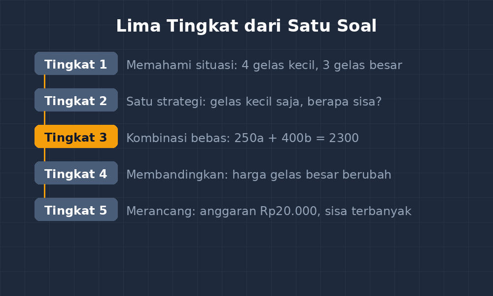

Setiap kali saya membagikan lembar latihan, ada dua kelompok yang selesai di waktu yang sangat berbeda. Ada murid yang sepuluh menit setelah lembar dibagikan sudah membalik kertas, menghadap depan, dan mulai membuat urusan dengan teman sebangkunya. Ada juga yang di menit kedua puluh masih menatap soal nomor satu, pensilnya terkatup di tangan, belum menulis apa pun.

Dulu jawaban saya sederhana: yang cepat, kasih soal tambahan; yang lambat, dikurangi jumlahnya. Ternyata kedua-duanya punya masalah yang sama. Soal tambahan untuk anak yang cepat sering cuma "lebih banyak", bukan "lebih dalam". Sedangkan anak yang lambat, dengan soal yang dikurangi, tetap tidak pernah sampai ke puncaknya — ia hanya mendapat tangga yang lebih pendek, dengan puncak yang sama tingginya.

<!--more-->

## Satu Soal, Lima Wajah

*Satu soal yang sama, dipecah menjadi lima tangga: dari memahami situasi sampai merancang dengan kendala anggaran.*

Perubahan kecil yang saya coba musim ini: satu soal cerita yang sama, tapi saya tuliskan dalam lima tingkat. Ide itu sebenarnya lahir dari kebiasaan lama saya waktu menulis kisi-kisi — soal selalu saya susun dari mudah ke sukar. Hanya saja dulu pemisahan itu berada di antara nomor soal, bukan di antara anak. Semua anak menerima tangga yang sama, meski kaki mereka tidak sama panjang.

Soal dasarnya begini. Di kantin sekolah, gelas es teh berukuran 250 ml dijual Rp2.000, dan gelas besar 400 ml dijual Rp3.000. Rina membeli es teh sejumlah 2.300 ml untuk dijadikan minuman saat kerja bakti kelas. Berapa rupiah uang yang harus dibayar Rina?

Dari soal tunggal itu, saya susun lima jenjang:

**Tingkat 1 — memahami situasi.** Saya masih kasih angka yang sudah rapi: Rina membeli 4 gelas kecil dan 3 gelas besar. Tugasnya hanya satu: tuliskan kalimat matematika yang mewakili pembelian itu, hitung total ml dan total rupiah. Tidak ada pencarian kombinasi. Anak yang kemarin belum menulis apa pun di lembar soal, hari ini bisa mulai dari sini tanpa merasa diberi soal "anak kecil".

**Tingkat 2 — satu strategi jelas.** Rina membeli gelas kecil saja sampai jumlahnya paling dekat dengan 2.300 ml. Berapa gelas yang dibeli dan berapa sisa ml yang kurang? Di sini anak berlatih pembagian dengan sisa — $2300 \div 250 = 9$ sisa $50$ — dan yang penting bukan hasilnya, tetapi keputusan bahwa "sisa" itu berarti gelas terakhir tidak penuh.

**Tingkat 3 — soal asli.** Kombinasi bebas: berapa cara Rina mendapat tepat 2.300 ml, dan mana yang paling murah? Persamaan $250a + 400b = 2300$ muncul sendiri dari tangan anak, bukan dari papan tulis saya. Bagi kelas VIII, ini pintu masuk SPLDV yang jauh lebih jujur daripada soal "jumlah dua bilangan adalah 23, selisihnya 3".

**Tingkat 4 — membandingkan.** Kalau gelas besar diubah harganya menjadi Rp3.200, apakah pilihan termurah berubah? Anak harus mengulang perhitungan biaya untuk setiap kombinasi yang valid, dan menyadari bahwa struktur soal tetap, hanya angkanya yang bekerja ulang.

**Tingkat 5 — merancang.** Rina hanya punya Rp20.000 dan ingin tepat 2.300 ml. Bolehkah? Kalau boleh, kombinasi mana yang membuat uang sisa paling banyak? Di tingkat ini anak yang cepat — yang biasanya sudah menyelesaikan lembar dalam sepuluh menit — mendapat pekerjaan yang benar-benar menggigit: menyaring kombinasi, menghitung biaya, membandingkan, lalu memberi alasan.

## Yang Terjadi di Kelas

Pertama kali saya pakai, saya bagi kelima tingkat sekaligus di satu lembar, dengan instruksi: "Mulai dari tingkat yang menurutmu pas. Kalau selesai dan masih ada waktu, naik satu tingkat."

Yang mengejutkan saya bukan anak yang cepat — mereka memang melahap tingkat 3 sampai 5 dengan antusias, karena akhirnya ada soal yang tidak selesai dalam satu baris hitungan. Yang mengejutkan adalah anak-anak yang biasanya diam. Beberapa dari mereka memilih mulai di tingkat 2, bukan tingkat 1 — dan memilih itu sendiri sudah sebuah pernyataan: *saya tahu di mana saya berdiri.* Anak lain berhenti di tingkat 3 dan tidak naik, tapi tingkat 3 itu ia selesaikan sampai tuntas, dengan penjelasan tertulis di sampingnya, sesuatu yang dulu jarang saya dapat dari soal-soal campuran biasa.

Ada juga kejadian yang tidak tercantum di rencana pembelajaran mana pun. Dua anak yang berbeda tingkat kebetulan duduk bersebelahan. Yang satu mentok di tingkat 2, yang lain sudah di tingkat 4. Yang di tingkat 4 tiba-tiba menggeser lembarannya dan berkata, "Ini caraku di tingkat 3. Kamu coba baca, beda nggak sama punyamu?" Saya yang di depan kelas cuma pura-pura sibuk menulis di jurnal saya. Diskusi antarteman itu lebih bernas daripada penjelasan saya yang kelima kalinya.

## Yang Saya Pelajari dari Lima Tangga Itu

Pertama, membedakan soal bukan berarti merendahkan anak. Anak yang mengerjakan tingkat 1 tidak pernah tahu bahwa tingkat 5 ada di lembar yang sama — dan kalau ia tahu, itu justru peta: ada jalan di depannya, dan jalan itu kelihatan. Dulu, dengan soal seragam, anak yang tertinggal cuma melihat satu kegagalan yang panjang. Sekarang ia melihat tangga yang terpotong rapi, dan setiap anakantasinya berhenti di anak tangga yang bisa ia daki hari itu.

Kedua, menulis lima tingkat itu kerja yang jujur. Saya tidak bisa asal menaikkan angka. Naik tingkat harus karena struktur berubah: dari menghitung, mencari kombinasi, membandingkan, sampai merancang dengan kendala. Kalau tingkat 2 cuma "soal tingkat 1 tapi angkanya lebih besar", itu bukan jenjang, itu cuma pena yang lebih tebal.

Ketiga, dan ini yang paling sering saya lupakan: tingkat tertinggi bukan hadiah untuk anak terpintar, tapi ruang untuk semua. Ada anak yang biasanya berhenti di tingkat 2, tapi entah kenapa hari itu penasaran dengan soal "Rina hanya punya Rp20.000". Ia mencoba, salah, mencoba lagi, dan akhirnya menjawab dengan satu kalimat sederhana yang benar. Tidak ada nilai tambah untuknya hari itu. Tapi saya melihat wajahnya waktu menyerahkan lembar — dan itu tidak bisa digantikan angka apa pun.

Kalau Bapak/Ibu mau mencoba, saya sarankan mulai dari satu soal saja. Jangan langsung lima soal masing-masing lima tingkat — itu resep kelelahan. Satu soal, lima tangga, sekali seminggu. Dari situ kita belajar membaca kelas dengan cara yang berbeda: bukan "siapa selesai duluan", melainkan "siapa berdiri di anak tangga mana". Dan dari peta itu, percakapan dengan setiap anak jadi punya alamat yang jelas.
