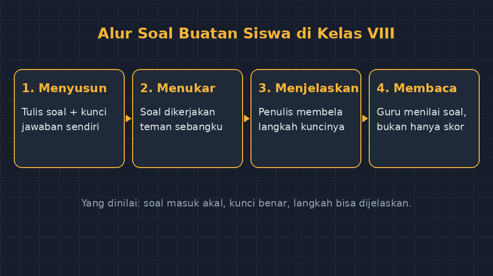

Ada satu kebiasaan lama di kelas saya yang saya tinggalkan tanpa sadar: ulangan selalu saya tulis, siswa selalu mengerjakan. Posisi itu sudah begitu melekat sampai tidak pernah saya pertanyakan. Guru menyusun soal, siswa menjawab. Titik. Seperti guru yang mengatur kelas dan siswa yang mengatur tasnya.

Minggu lalu, setelah menuntaskan materi barisan dan deret di kelas VIII, saya mencoba membalik posisinya. Bukan ulangan besar — hanya lima soal, sepuluh menit, yang biasa saya sebut ulangan pendek. Bedanya satu: penulisnya bukan saya. Setiap siswa menulis satu soal untuk teman sebangkunya, lengkap dengan kunci jawaban dan langkah penyelesaian yang mereka anggap benar.

Saya tidak menyangka sesederhana itu bisa begitu mengguncang kelas.

<!--more-->

## "Ini lebih susah dari mengerjakan, Bu"

Ketentuan saya sederhana. Soalnya harus tentang barisan aritmetika atau geometri. Harus ada angka yang masuk akal — bukan seperti barisan yang suku pertamanya jutaan dan rasionya nol koma tiga. Harus bisa diselesaikan temannya dalam waktu yang wajar, jadi mereka diminta menyelesaikan soal buatan sendiri dulu sebelum menukarnya. Kalau soalnya tidak bisa diselesaikan si penulis sendiri, itu sinyal pertama bahwa ada yang belum paham.

Fase yang paling saya nikmati justru fase menyusun soalnya. Anak-anak yang biasa diam saat saya memberi soal, hari itu ramai dengan pertanyaan yang berbeda arahnya. Bukan "Bu, nomor dua gimana?" tapi "Bu, kalau rasionya negatif boleh?" dan "Nanti yang ditanya suku ke berapa itu harus ada tulisannya ya?"

Mereka mempertanyakan struktur soal. Hal yang biasanya hanya saya yang menyentuhnya.

Seorang siswa, Rifa, awalnya menulis "Tentukan suku ke-100 dari barisan 2, 4, 8, 16, ...". Saya lempar balik: "Coba kamu jawab dulu." Ia berhitung, muka berkerut, lalu sadar sendiri bahwa barisannya bukan aritmetika dan $a_{100}$-nya tidak akan pernah ia temukan dengan rumus yang baru dipelajari. Ia ganti soalnya jadi aritmetika, dengan rasio 3 dan suku pertama 5, dan menuliskan kuncinya dengan hati-hati. Yang saya perhatikan: ia memeriksa kuncinya dua kali. Dua kali. Kepada jawaban saya di papan, tidak pernah begitu telitinya.

## Apa yang Terlihat dari Bangku Saya

*Empat langkah kecil yang berulang setiap kali ulangan pendek ditulis oleh siswa.*

Menjawab soal dan membuat soal ternyata meminta kemampuan yang berbeda. Ketika menjawab, siswa boleh hanya mengikuti arah yang sudah disediakan. Ketika membuat, mereka harus paham sampai ke tulangnya: mana yang datanya, mana yang yang ditanya, mana langkah yang legal dan mana yang jebakan.

Dari tumpukan soal itu, saya membaca sesuatu yang lima ulangan pendek sebelumnya tidak pernah saya lihat jelas:

Siswa yang membuat soal terlalu mudah — misalnya langsung menanyakan suku kedua setelah memberi suku pertama dan rasio — biasanya memang masih belum berani melepas tanggannya dari rumus paling dasar. Siswa yang berani menaruh rasio negatif atau menanyakan suku ke-n dalam bentuk variabel, itu sinyal pemahaman yang sudah melampaui contekan papan. Dan siswa yang kunci jawabannya salah padahal soalnya bagus — itu penanda paling berharga. Mereka paham bentuk soalnya, tapi belum paham jalannya.

Ada satu soal yang membuat saya tertawa di meja koreksi: "Barisan 3, 6, 12, 24, ... Termasuk barisan apa? Hitunglah suku ke-10-nya." Penulisnya, anak yang biasanya tertinggal jauh di ulangan biasa, ternyata pilih-pilih soal yang ia rasa "aman" karena mirip contoh di buku. Dari soal itu saya tahu persis di mana ia berdiri: ia hafal pola, tapi belum yakin dengan namanya. Di ulangan saya, jawabannya mungkin benar dan saya berpuas diri. Di soal buatannya, ketidakpastian itu terbaca.

## Jebakan yang Saya Temui Sendiri

Tidak semua berjalan mulus. Ada tiga hal yang kalau saya ulangi, akan saya beda perlakuannya.

Pertama, waktu. Sepuluh menit yang saya janjikan berubah jadi hampir setengah jam karena menyusun soal memakan waktu lebih lama dari mengerjakan. Untuk pertama kali, itu wajar — tapi kalau mau jadi kebiasaan, harus ada jatah waktunya yang jujur, bukan sisa waktu yang kebetulan ada.

Kedua, soal yang "menyerah". Ada siswa yang menyerahkan soal tanpa kunci, dengan alasan "soalnya terlalu susah, Bu, jadi gak aku kerjain dulu". Itu bukan soal — itu imbauan. Saya jadikan momen diskusi kecil: kalau penulisnya sendiri tidak sanggup, siapa yang sanggup? Wajib dikerjakan sendiri dulu. Aturan itu ternyata berfungsi dua kali: sebagai penyaring kualitas soal dan sebagai alat diagnosis diri.

Ketiga, kecemburuan peringkat. Beberapa siswa mengeluh soal temannya lebih gampang dari soal mereka. Saya balas dengan pertanyaan: "Kalau kamu yang dapat soal itu, nilainya pasti 100. Tapi apa kamu jadi paham lebih banyak?" Hening sebentar, lalu mereka mengerti sendiri bahwa yang dinilai hari itu bukan skor — tapi kualitas soal yang mereka tulis.

## Penilaian yang Ikut Berubah

Karena penulisnya siswa, cara saya menilai juga tidak bisa lagi seperti biasa. Skor jawaban temannya jadi bagian kecil; yang besar justru soalnya sendiri. Saya menilai tiga hal: apakah soalnya masuk akal secara matematis, apakah kuncinya benar, dan apakah penulisnya bisa menjelaskan kenapa langkah penyelesaiannya seperti itu.

Hal ketiga itulah yang paling saya sayangi. Siswa yang bisa menjelaskan kunci jawabannya sendiri — lantaran ia yang menulisnya — mempraktikkan sesuatu yang di ulangan biasa hampir tidak pernah saya minta: mempertanggungjawabkan langkah, bukan sekadar menemukan angka. Ketika saya tanya ke Rifa kenapa ia memilih rasio 3, ia menjawab "biar jawabannya gak gampang ditebak temanku, Bu, aku takut dia tinggal lihat polanya." Kalimat itu — tentang membuat soal yang adil tapi menantang — itu pekerjaan yang biasanya saya lakukan diam-diam di meja guru.

## Kenapa Ini Terasa Berat Padahal Seharusnya Ringan

Sejujurnya, ada rasa gundah kecil yang tidak pernah saya duga muncul dari kegiatan sederhana ini. Membaca tumpukan soal itu, saya sadar banyak hal yang selama ini saya anggap "kemampuan menyusun soal" ternyata bukan bakat istimewa guru — hanya pengalaman yang belum pernah diberi kesempatan kepada siswa. Anak-anak itu bisa. Mereka hanya tidak pernah diminta.

Ada juga kekhawatiran yang wajar: apakah soal buatan siswa cukup baik untuk mengejar target materi? Jujur saja — tidak semua soal itu "bagus", dan waktu yang terpakai lebih lama dari ulangan biasa. Tapi target materi itu alat ukur, bukan tujuan. Yang saya kejar di kelas VIII minggu itu bukan barisan aritmetika semata, tapi anak-anak yang berani memandang matematika dari sisi meja guru, walau hanya sepuluh menit.

Dan kalau Anda bertanya apakah saya akan mengulanginya — saya sudah menandai tanggal di jurnal digital saya untuk materi berikutnya. Kali ini untuk sistem persamaan linear. Saya penasaran apa bentuk "kunci jawaban salah tapi yakin" versi dua variabel.

Mungkin memang sudah saatnya lembarn ulangan itu sesekali ditulis oleh tangan yang selama ini hanya mengisinya.
