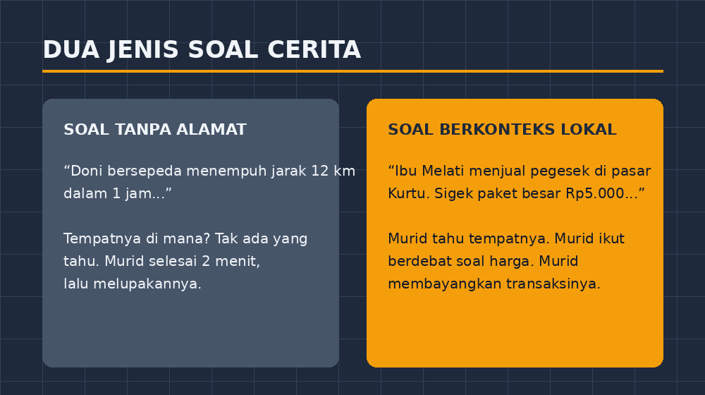
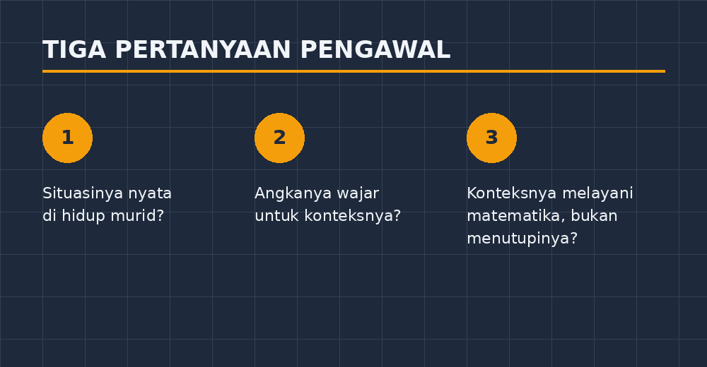

Minggu lalu, di kelas VII-C, terjadi hal yang jarang terjadi: kelas saya berdebat. Bukan debat soal jawaban — itu sering. Mereka berdebat tentang *soalnya sendiri*. Krisna, yang biasanya duduk di bangku paling belakang sambil pura-pura sibuk, tiba-tiba berdiri dan berkata, "Pak, ini mah bukan tiga ribuan. Sigek paket pegesek di Kurtu sekarang lima ribuan, kalau yang kecil tiga ribu."

Saya membiarkan debat itu berjalan dua menit penuh sebelum saya turun tangan. Dan selama dua menit itu, saya melihat sesuatu yang dulu tidak pernah saya lihat di kelas ini: tujuh delapan murid ikut bicara, merujuk pengalaman mereka sendiri, tentang sebuah soal aritmetika sosial.

<!--more-->

## Soal yang tidak pernah dipersoalkan

Coba bandingkan dengan soal yang selama bertahun-tahun saya berikan. Soal dari buku paket, bunyinya kira-kira begini:

> Doni bersepeda menempuh jarak 12 km dalam waktu 1 jam. Berapa jarak yang ditempuh Doni jika ia bersepeda selama 2,5 jam dengan kecepatan yang sama?

Soal ini baik-baik saja secara teknis. Angkanya rapi, tingkat kesulitannya pas untuk latihan awal. Tapi ada satu masalah yang dulu tidak pernah saya sadari: tidak ada satu pun murid saya yang pernah mempersoalkannya. Mereka selesai dalam dua menit, tidak ada yang berdebat, tidak ada yang menghafalnya pun sehari kemudian. Soal itu lewat begitu saja, seperti angin.

Kenapa? Karena soal itu tidak punya *tempat*. Doni bisa bersepeda di mana saja — di Jerman, di buku cetakan Malaysia, di impian penyusun soal. Ia tidak bersepeda di Lampung Tengah. Ia tidak melewati sawah di Punggur, tidak berhenti di warung dekat jalan lintas, tidak kena hujan lalu berlindung di bangunan gereja tua di sisi jalan yang setiap hari dilintas murid-murid saya. Doni adalah penumpang tanpa alamat. Begitu juga si Bu Rina yang selalu membeli 3 kg gula, dan Pak Ahmad yang menabung dengan bunga majemuk.

Soal cerita tanpa tempat, menurut pengalaman saya, sebenarnya bukan soal cerita. Ia hanya soal hitung yang dihiasi kalimat.

## Percobaan kecil yang mengejutkan

Awal semester ini saya melakukan eksperimen sederhana. Di kelas VII-C, materi aritmetika sosial, saya menulis soal dengan konteks yang mereka kenal:

> Ibu Melati menjual pegesek di pasar Kurtu. Sigek paket besar harganya Rp5.000,00 dan sigek paket kecil Rp3.000,00. Pagi itu Ibu Melati menjual 12 paket besar dan 17 paket kecil. Selisih uang penjualan paket besar dan paket kecil pagi itu adalah ...

Pegesek, untuk yang tidak tahu, adalah kudapan lontong yang dipecah dan digoreng — makanan yang sudah akrab di lidah anak-anak Lampung. Pasar Kurtu pun dekat, beberapa kilometer dari sekolah, tempat yang lebih dari separuh murid saya pernah singgah bareng ibunya.

Hasilnya dua arah, dan keduanya menarik.

Arah pertama: keterlibatan.

*Gambar 1. Soal tanpa tempat lewat begitu saja; soal berkonteks lokal membuat kelas bereaksi.*

Krisna memperdebatkan harga seperti yang saya ceritakan di atas. Seorang siswi menghitung dengan cara yang tidak saya ajarkan, memecah 17 jadi 15 dan 2 "karena gampang dikali tiga". Bahkan murid yang biasanya pasrah pada soal cerita ikut menoleh karena — begini katanya — "enak, Pak, soalnya nyata".

Arah kedua: kesulitan yang justru muncul. Dan ini bagian yang membuat saya berpikir lebih lama dari yang saya duga. Ketika konteks asing, murid sering *menyerah lebih cepat* — mereka tidak mengerti situasinya, lalu asal pasang operasi. Ketika konteksnya lokal dan nyata, murid justru berhenti memikirkan operasi yang tepat. Ibu Melati jual apa, harga berapa, selisih dari apa — semua itu harus benar-benar *dipahami* dulu sebelum dihitung. Konteks lokal tidak mempermudah soal; ia membuat soal jujur. Murid tidak bisa lagi menebak operasi dari kata kunci ("kata *selisih* berarti dikurang, Pak"). Mereka harus membayangkan transaksinya.

## Bukan sekadar mengganti nama

Di titik ini ada jebakan yang perlu diakui jujur: mengganti "Bu Rina" jadi "Ibu Melati" dan "nasi goreng" jadi "pegesek" tidak otomatis membuat soal jadi bermakna. Saya pernah melakukannya — mengganti nama saja, lalu puas diri. Murid-murid mungkin tersenyum melihat nama pasar yang mereka kenal, tapi kalau situasi soalnya tetap tidak masuk akal (siapa pula yang membeli 45 pensil sekaligus?), konteks lokal itu hanya hiasan baru.

Jadi kini saya memakai beberapa pertanyaan pengawal saat menyusun soal:

*Gambar 2. Tiga saringan sederhana sebelum soal lokal saya bawa ke kelas.*

Pertama, *apakah situasi ini benar-benar dialami atau bisa dibayangkan murid saya?* Transaksi di warung, jual beli hasil kebun, jarak antar desa, jadwal angkutan ke Lampung Selatan — ya. Menghitung bunga bank dari deposito ratusan juta — tidak, kecuali saya sisipkan penjelasan singkat.

Kedua, *apakah angkanya realistis untuk konteks itu?* Harga pegesek Rp5.000 itu penting. Kalau saya tulis Rp75.000, murid tahu itu salah, dan yang ikut hancur justru rasa percaya mereka pada soal. Ini berbeda dengan angka yang sengaja dibulatkan untuk memudahkan hitungan — itu boleh, asal tidak melawan kewajaran.

Ketiga, *apakah konteksnya melayani matematika, atau malah menutupinya?* Kadang saya terlalu bersemangat mendeskripsikan suasana pasar hingga soalnya jadi tiga paragraf dan yang dipertanyakan murid malah, "Pak, pegeseknya enak nggak?" Kalimat naratif boleh, tapi matematika di dalamnya harus tetap terlihat.

## Melembutkan jarak antara matematika dan hidup

Ada satu momen lain yang ingin saya catat, karena ia menunjukkan dampak yang tidak terukur oleh nilai ulangan. Setelah rangkaian soal aritmetika sosial itu, seorang murid datang ke meja saya di jam istirahat. Ia bertanya hal yang sederhana tapi terasa besar: "Pak, kalo jualan di pasar, untungnya dihitung begini juga ya?"

Saya menjawab ya, lebih atau kurang, dan kami mengobrol sebentar tentang pembulatan harga, kembalian, dan dagangan yang tidak laku. Di ujung obrolan dia berkata, "Berarti pelajaran ini buat hidup, ya, Pak."

Kalimat itu, bagi saya, adalah tujuan sebenarnya. Bukan karena "matematika ada di sekitar kita" sebagai slogan yang sudah terlalu sering dibacakan, tapi karena ada satu murid yang benar-benar merasakan bahwa alat yang sedang ia pegang itu berguna di pasar yang ia sendiri kunjungi minggu depan.

Sebaliknya, saya jadi berpikir: berapa banyak murid yang selama bertahun-tahun berkesimpulan sebaliknya — bahwa matematika adalah dunia paralel yang hanya hidup di buku paket? Doni yang bersepeda tanpa alamat itu, setiap tahun, diam-diam mengajarkan murid-murid saya bahwa matematika bukan urusan mereka.

## Yang masih saya rapikan

Kejujuran menuntut saya menutup dengan catatan yang belum tuntas. Menyusun soal berkonteks lokal itu lebih melelahkan daripada membuka halaman buku paket. Saya harus mencocokkan harga sungguhan, menimbang ulang angka, kadang bertanya ke istri saya yang lebih sering ke pasar. Koleksi soal seperti ini butuh waktu bertahun-tahun untuk terkumpul, dan selama ini koleksi saya masih setengah jalan.

Tapi arahnya sudah jelas bagi saya. Laju kecepatan Doni tetap saya pakai untuk soal latihan rutin — tidak semua soal harus menjadi karya sastra. Tapi untuk soal yang ditujukan pada pemahaman, untuk mengecek apakah murid benar-benar mengerti atau hanya mengenali kata kunci, saya kini menulis soal dengan tempat yang punya nama. Pasar Kurtu. Jalan lintas Punggur. Gunung Pesawaran yang terlihat samar ke arah barat. Tempat-tempat kecil yang, ternyata, mampu membuat matematika turun dari papan tulis dan berdiri di tengah kelas.

Dan kelas yang berdebat soal harga pegesek, menurut saya, adalah kelas yang sedang belajar lebih dalam daripada kelas yang diam menyalin rumus.
