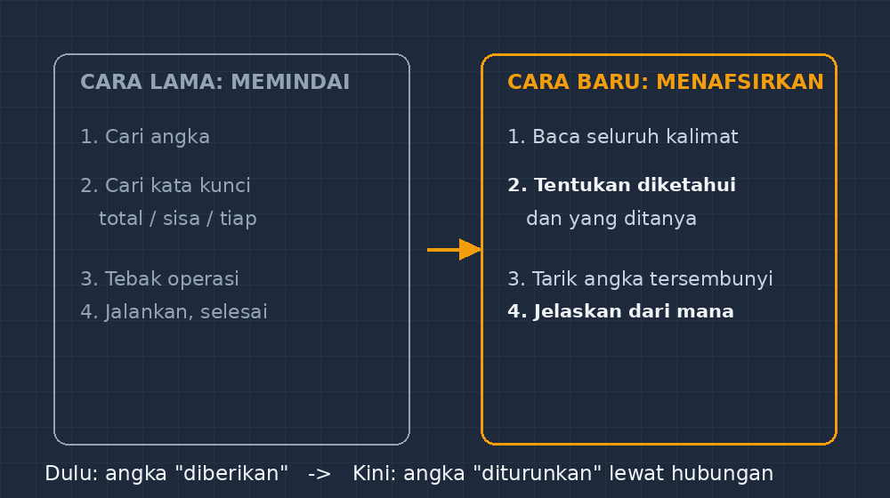

Ada satu momen yang tidak akan saya lupakan dari kelas VII-B tahun lalu. Saya baru saja membagikan lembar soal cerita tentang harga beras dan uang saku. Sebelum lembar itu benar-benar sampai ke meja terakhir, sudah ada suara dari barisan depan: "Bu, ini rumusnya persen atau diskon?" Padahal mereka belum membaca satu kalimat pun.

Saya diam sejenak, lalu sadar sesuatu yang agak memalukan bagi saya sendiri: soal-soal cerita yang selama ini saya buat ternyata punya pola yang terlalu sopan. Angka selalu muncul di kalimat tertentu, pertanyaannya selalu di akhir, dan operasi yang diminta hampir selalu bisa ditebak dari kata kunci. "Total" berarti jumlah, "sisa" berarti kurang, "tiap" berarti kali atau bagi. Siswa saya bukan membaca soal — mereka memindai soal, mencari angka, menebak operasi, berhenti.

Maka mulai semester itu, saya mengubah satu hal sederhana di lembar soal saya: angkanya tidak selalu saya tunjukkan secara langsung.

## Soal yang Tidak Langsung Menyerahkan Angka

Bentuk paling ringan dari perubahan ini adalah soal yang menyimpan angkanya di dalam kalimat yang harus ditafsirkan. Dulu saya menulis: "Sebuah segitiga memiliki panjang alas 12 cm dan tinggi 8 cm. Hitunglah luasnya." Sekarang versi yang lebih sering saya pakai begini:

> Sebuah persegi panjang memiliki panjang yang tiga kali lebarnya. Jika kelilingnya 48 cm, berapa luasnya?

Tidak ada satu pun ukuran yang diberikan langsung. Siswa harus membuat jalan sendiri: misalkan lebar $l$, panjang $3l$, lalu keliling $2(l + 3l) = 48$, sehingga $l = 6$ cm dan luasnya $6 \times 18 = 108 \text{ cm}^2$. Angka-angkanya bukan diberikan, tapi diturunkan. Perbedaannya terdengar kecil, tapi di kelas rasanya besar.

Waktu itu saya sengaja memilih kelas yang biasanya paling cepat berhitung. Saya pikir soal seperti ini akan mereka lewati dalam dua menit. Ternyata tidak. Beker, anak yang nilainya biasanya paling atas, mendekat ke meja saya dan bertanya pelan: "Bu, angkanya mana?" Saya jawab, "Ada, tapi kamu harus minta dia keluar." Dia tertegun — lalu itu justru pertanyaan yang paling banyak diajukan anak-anak di hari itu, dan bertahan sampai jam pelajaran berikutnya.

## Kenapa Siswa Terbiasa Memindai, Bukan Membaca

Kalau diperhatikan, ini bukan kesalahan siswa. Mereka beradaptasi dengan pola soal yang mereka temui bertahun-tahun. Dari SD sampai SMP, mayoritas soal cerita yang mereka kenal memang menyodorkan angka di kalimat kedua atau ketiga, lalu menutup dengan pertanyaan yang hampir selalu satu langkah. Sistem saraf belajar mereka terlatih untuk satu strategi: temukan angka, temukan kata kunci, jalankan operasi, selesai.

Masalahnya muncul ketika soal tidak lagi mengikuti pola itu — yang dalam penilaian nasional sekarang persis jadi arahnya. Soal bertipe literasi numerasi tidak menyodorkan angka di atas nampan. Angka bisa tersembunyi di kalimat bantu, bisa berupa hubungan ("separuh dari", "tiga lebih banyak"), bahkan bisa memang tidak diperlukan sama sekali sebagai jebakan cerdas. Siswa yang terbiasa memindai akan merasa soalnya "aneh" atau "tidak lengkap". Padahal yang tidak lengkap sebenarnya strateginya.

Saya pernah mencoba soal pemanasan sederhana: "Ibu membeli 3 kg gula. Setengahnya dipakai untuk membuat kue, sisanya disimpan. Berapa kilogram gula yang disimpan?" Soal klasik, semua siswa bisa. Lalu saya ubah jadi: "Ibu membeli beberapa kilogram gula. Setengahnya dipakai membuat kue, dan sisanya, sebanyak 1,5 kg, disimpan. Berapa kilogram gula yang dibeli Ibu?" Angka yang diketahui bukan lagi yang besar, tapi sisanya — dan yang ditanya justru yang awal. Hampir seperlima kelas menjawab 3 kg atau 1,5 kg. Mereka terbiasa mengoperasikan angka yang ada, bukan membalik hubungan antara angka-angka itu.

## Perubahan Kecil di Meja Guru, Bukan di Lembar Siswa

Yang menarik, perubahan ini ternyata lebih banyak menuntut saya daripada siswa. Menyusun soal cerita yang angkanya disembunyikan dengan jujur itu tidak mudah. Gampang sekali jatuh ke dua jurang: soal jadi tidak adil (terlalu banyak kata yang tidak berfungsi) atau jadi cuma soal rutin yang dibungkus kalimat panjang — panjang di huruf, kosong di pikir.

Beberapa kebiasaan kecil yang sekarang saya pegang saat menyusun soal:

Pertama, setiap kalimat harus punya pekerjaan. Kalimat yang tidak memberi informasi, tidak memberi konteks, dan tidak mengecoh dengan sengaja, sebaiknya dihapus. Soal literasi bukan soal yang dibuat lebih panjang, tapi soal yang kalimatnya lebih bertanggung jawab.

Kedua, saya memisahkan dua pertanyaan: "apa yang diketahui?" dan "apa yang ditanya?" — dan sesekali menukar posisinya. Memberi hasil, menanyakan asalnya. Memberi hubungan, menanyakan salah satu ujungnya. Ini melatih siswa membalik arah berpikir, bukan hanya mengalir maju.

Ketiga, dan ini yang paling sering saya lupakan dulu: biarkan siswa menjelaskan angkanya dari mana. Tidak cukup jawaban benar; saya menagih satu kalimat penjelasan. Dari kalimat itu saya bisa melihat siapa yang benar-benar membaca dan siapa yang kebetulan menebak benar.

*Gambar: pergeseran cara membaca soal — dari memindai angka dan kata kunci menuju menafsirkan hubungan antar informasi.*

## Hasil yang Tidak Instan, Tapi Terlihat

Saya tidak akan mengklaim keajaiban. Nilai kelas tidak langsung melesat, dan memang bukan itu sasarannya. Tapi ada perubahan kecil yang justru lebih saya hargai: pertanyaan di kelas berubah. Dulu yang terdengar "Bu, pakai rumus apa?" — sekarang kadang terdengar "Bu, satu lima koma lima ini itu sisa atau total, ya?" Pertanyaan kedua adalah pertanyaan pembaca. Siswa itu sedang menimbang informasi, bukan mencari tombol.

Ada juga efek samping yang tidak saya duga: soal seperti ini memaksa saya mengajar jujur. Ketika angka tidak lagi bisa ditebak dari kata kunci, siswa yang belum paham konsep tidak bisa menyembunyikan kebingungannya di balik prosedur. Itu membuat diagnosis saya di kelas lebih akurat. Siswa yang bingung bukan karena lupa rumus, tapi karena belum membangun hubungan antara kuantitas — dan itu masalah yang jauh lebih penting untuk dibereskan daripada sekadar mengulang rumus luas.

Sekarang, kalau saya menyusun paket soal, hampir selalu ada satu-dua soal yang angkanya "harus dimintai tolong keluar" — seperti kata saya ke Beker dulu. Kadang siswa protes karena soalnya "gak langsung jelas". Saya jawab dengan senyum: "Di kehidupan nyata juga begitu. Tagihan listrik tidak menyebut 'rumusnya' dan resep kue tidak menyebut 'operasinya'." Mereka terdiam, lalu mengerjakan.

Dan mungkin itu intinya. Membaca soal seharusnya persis seperti membaca dunia: informasinya tersebar, sebagian harus disimpulkan, sebagian harus ditimbang. Tugas kita bukan membuat soal selalu sopan kepada siswa, tapi membuat siswa berani pada soal yang tidak langsung menunjuk angka.

