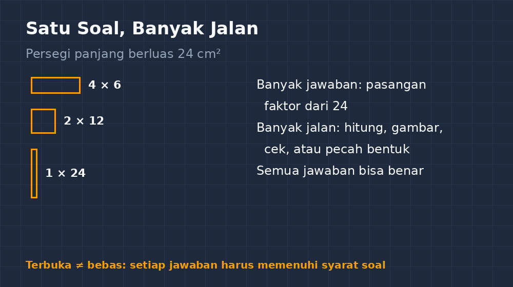

Ada satu keyakinan yang saya bawa sejak masa kuliah: soal matematika yang baik adalah soal yang punya jawaban pasti. Satu kunci, satu langkah yang benar, satu angka yang harus muncul di akhir. Keyakinan itu terbawa puluhan soal yang saya tulis di ujian setiap semester. Kunci jawaban saya rapi — lima soal pilihan ganda, lima soal uraian, setiap soal punya jawaban yang bisa saya coret-coret di kertas pengawas dan titipkan di rapor.

Lalu di suatu kelas VIII, setelah materi bangun datar, saya sengaja mencoba sesuatu yang berbeda. Bukan karena ide itu datang dari buku metode, tapi karena saya kehabisan bahan. Sisa waktu bel lima menit, dan saya iseng menulis satu soal di papan: *Gambarlah persegi panjang yang luasnya 24 cm², panjang sisinya bilangan bulat. Ada berapa gambar yang bisa kalian buat?*

<!--more-->

## Lima Menit yang Berubah Jadi Dua Puluh

Rencananya cuma pengisi waktu. Tapi kelas itu tiba-tiba hidup. Anak-anak yang biasanya pasif mulai saling menyapa: "Kamu dapat berapa?" Ada yang dengan cepat menulis 6 × 4, ada yang menyodorkan 2 × 12, dan satu anak di baris belakang — yang biasanya paling pendiam — angkat tangan paling dulu: "Pak, 1 × 24 boleh, Pak? Persegi panjang yang sisi satunya satu sentimeter, jadinya seperti garis tipis panjang."

Saya terdiam sebentar. Pertanyaan itu, sebenarnya, adalah pertanyaan matematika yang bagus. Persegi panjang seperti apa pun itu, definisinya tetap terpenuhi: empat sisi, sisi berhadapan sama panjang, empat sudut siku-siku. Jawabannya "ya, boleh" — dan justru dari jawaban itu kelas jadi berdebat apakah bentuk yang seperti garis itu masih layak disebut persegi panjang.

Bel berbunyi, dan untuk pertama kalinya dalam semester itu, ada siswa yang komplain karena pelajaran matematika harus berhenti.

## Apa Itu Soal Terbuka

Malamnya saya cari-cari dan baru sadar: apa yang saya lakukan iseng itu punya nama. Disebut *soal terbuka* atau *open-ended problem* — soal yang sengaja dirancang supaya punya lebih dari satu jawaban benar, atau lebih dari satu jalan menuju satu jawaban. Berbeda dengan soal biasa yang menutup di satu angka, soal terbuka justru membuka pintu.

Perbedaannya mudah dilihat dari soal yang sama. Soal tertutup: "Sebuah persegi panjang memiliki panjang 8 cm dan lebar 3 cm. Hitunglah luasnya." Soal terbuka: "Buatlah persegi panjang dengan luas 24 cm²." Yang pertama menguji apakah siswa hafal rumus. Yang kedua menguji apakah siswa *mengerti* apa itu luas — karena untuk memenuhi syarat 24, mereka harus benar-benar memikirkan pasangan bilangan yang hasil kalinya 24, termasuk pasangan non-bulat kalau kita izinkan.

Sifat terbuka ini bisa hadir dari beberapa arah. Ada soal yang jawabannya memang banyak (seperti contoh persegi panjang tadi). Ada yang jawabannya satu tapi jalannya banyak — misalnya mencari luas trapesium, yang bisa dipandang sebagai gabungan dua segitiga, atau persegi panjang dikurangi dua segitiga siku-siku, atau persamaan rumus $\frac{(a+b) \cdot t}{2}$ yang siapa tahu sudah hafal. Ada juga yang sengaja memberi informasi kurang, supaya siswa justru bertanya: "Pak, yang dikasih lebar atau keliling dulu?"

## Yang Muncul di Kelas: Hal yang Sama-Sama Saya Belajar

Setelah itu, saya mulai menyisipkan satu soal terbuka di setiap pertemuan. Tidak setiap soal, tidak setiap jam. Satu saja, biasanya di akhir. Efeknya perlahan tapi terasa:

Pertama, siswa yang selalu ditolong anak pintar akhirnya punya panggung. Di soal tertutup, yang tercepat menemukan 48 biasanya menang dan sisanya meniru. Di soal terbuka, kecepatan tidak menjamin kepemilikan jawaban — karena jawaban banyak, setiap anak bisa membawa satu. Anak yang biasanya menunggu, tiba-tiba bangga karena 2 × 12-nya tidak ada yang keburu menulis.

Kedua, miskonsepsi jadi kelihatan. Di soal tertutup, miskonsepsi tersembunyi di balik angka salah — saya hanya tahu "ini salah". Di soal terbuka, miskonsepsi bicara: siswa yang menggambar persegi panjang berluas 24 tapi sisi-sisinya 5 dan 5 (itu persegi, bukan persegi panjang — tapi lihat, dia paham bahwa $5 \times 5 = 24$... eh, $25$, dan justru kesalahan kecilnya kelihatan karena langkahnya terlihat). Ada juga yang menghitung 4 + 6 = 24, campur aduk antara penjumlahan dan perkalian. Semua ini di soal tertutup akan jadi sekali coret merah; di soal terbuka, jadi bahan diskusi.

Ketiga — dan ini yang paling tidak saya duga — saya belajar soal matematika yang tidak saya tahu. Ada siswa yang menulis 24 = 3 × 8 dan bilang, "Pak, kalau saya buat panjangnya 8 dan lebar 3, itu sama saja kan dengan yang 3 dan 8?" Pertanyaan bagus soal sifat komutatif perkalian, yang biasanya saya jelaskan dengan $3 \times 4 = 4 \times 3$. Kali ini dia yang menemukannya sendiri.

## Tapi Tidak Seindah Itu

Tulisan ini akan berbohong kalau saya bilang semuanya berjalan mulus. Ada beberapa hal yang bikin saya sempat ingin kembali ke soal tertutup yang "aman".

Waktu jadi masalah paling besar. Soal terbuka butuh diskusi, dan diskusi butuh waktu. Lima menit rencana bisa jadi dua puluh menit kenyataan, dan jadwal bab yang sudah rapat jadi mundur. Saya pernah menghabiskan satu jam pelajaran penuh hanya untuk membahas berbagai cara menggambar persegi panjang berluas 24 — dan itu belum masuk ke contoh non-bulat seperti $6{,}4 \times 3{,}75$ yang seseorang sampaikan di kelas lain.

Penilaian juga jadi rumit. Kalau jawabannya banyak, mana yang nilainya penuh? Akhirnya saya berhenti menilai berdasarkan "benar atau salah", dan pindah ke rubrik sederhana: apakah jawaban memenuhi syarat soal, apakah siswa bisa menjelaskan kenapa, dan apakah dia menemukan lebih dari satu jawaban. Tiga poin, dicentang cepat di kertas, tidak bikin saya kewalahan.

Lalu ada keluhan dari siswa yang sudah nyaman dengan kepastian: "Pak, jawabannya yang mana sebenarnya?" Beberapa anak justru merasa tidak nyaman karena tidak ada yang bisa ditiru. Ini bagian yang harus dilatih pelan-pelan — bahwa matematika bukan soal mencocokkan kunci, tapi soal meyakinkan diri sendiri bahwa jawaban kita masuk akal.

## Kunci Jawaban yang Saya Tulis Jadi Beda

Kalau dulu kunci jawaban saya berisi satu angka per soal, sekarang kertas kunci saya terlihat lebih ramai. Untuk soal terbuka, yang saya tulis bukan "jawaban", tapi "daftar kemungkinan jawaban" plus "kemungkinan miskonsepsi yang mungkin muncul". Dari satu soal persegi panjang berluas 24 cm², daftarnya: 1×24, 2×12, 3×8, 4×6, 6×4, 8×3, 12×2, 24×1 — dan di kolom catatan saya tulis: "kemungkinan ada yang jawab persegi 5×5, tanyakan apakah itu masih persegi panjang."

Ada satu hal yang saya sadari belakangan: soal terbuka ini sebenarnya bukan barang baru. Di soal ujian nasional zaman dulu pun sudah ada. Yang berubah mungkin bukan soalnya, tapi keberanian saya untuk memberi waktu di kelas — keberanian untuk tidak buru-buru menutup pertanyaan dengan satu angka.

Sekarang, kalau sisa waktu bel tinggal lima menit lagi, saya tidak lagi panik mencari pengisi. Cukup satu soal kecil yang jawabannya banyak. Bel bisa berbunyi, tapi pertanyaan di kepala anak-anak biasanya masih jalan pulang ke rumah — dan bagi saya, itu lebih berharga daripada satu lembar latihan yang selesai.

Kalau Bapak/Ibu mau coba, mulai saja dari soal paling sederhana: ganti satu soal latihan biasa menjadi "buatlah..." atau "ada berapa cara...". Tidak perlu soal yang megah. Persegi panjang berluas 24 cm² sudah cukup untuk membuka kelas yang selama ini tertutup.
