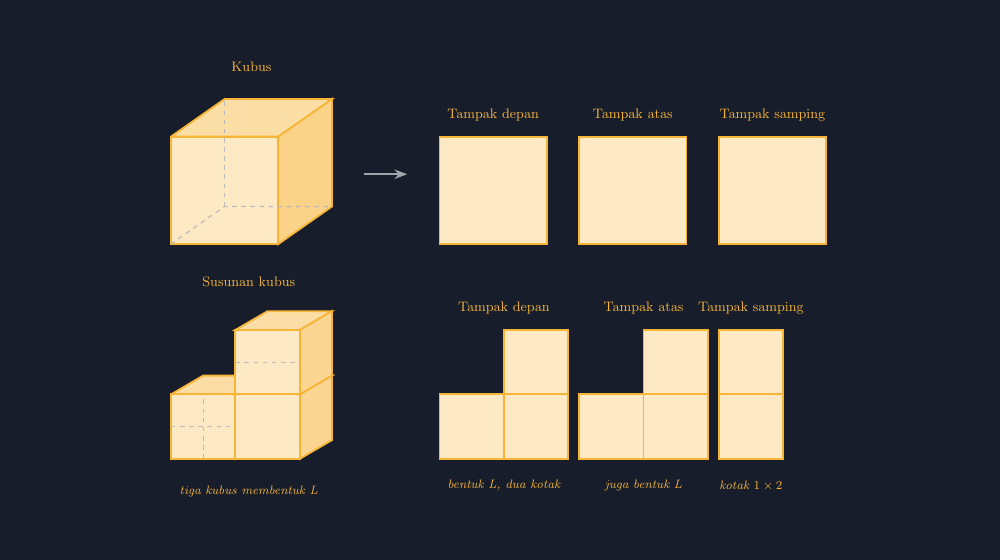
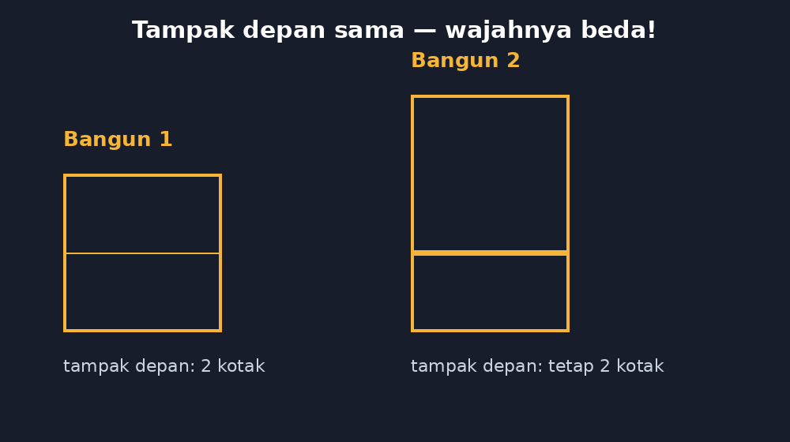

Kelas VIII saya tahun lalu sempat ribut karena satu pertanyaan yang tidak saya duga. Kami sedang membahas bangun ruang, dan saya menunjukkan sebuah kubus kayu dari lemari alat. "Kalau Bapak berdiri di depan kubus ini, bentuk apa yang Bapak lihat?" Kubusnya saya pegang tegak di meja, wajah saya membelakangi papan tulis. Jawaban yang saya harapkan sederhana: persegi. Yang datang malah serempak: "Persegi, Pak!" — diikuti suara Ardi di bangku belakang, "Tapi kenapa yang Pak lihat di papan tulis kayak limas?"

Ternyata yang Ardi maksud adalah bayangan kubus di papan tulis, yang memang lonjong karena sudut lampu. Dari situ saja saya sudah belajar satu hal: soal "tampak" ini lebih licin daripada kelihatannya. Soal tampak depan-atas-samping di buku paket selalu tampil rapi, dengan gambar yang sudah pas di kertas. Padahal di kelas nyata, "tampak" adalah soal tentang posisi pengamat — dan posisi pengamat adalah hal yang paling sering diperdebatkan anak-anak.

<!--more-->

## Tampak adalah soal tentang posisi, bukan tentang bentuk

Sebelum masuk ke gambar, saya selalu memaksa diri saya sendiri untuk mengingat: materi "tampak bangun ruang" (di beberapa buku disebut *proyeksi* atau *visualisasi ruang*) bukan materi tentang rumus. Tidak ada satu rumus pun. Yang diuji adalah kemampuan membayangkan diri berpindah tempat — sesuatu yang untuk sebagian anak mudah, dan untuk sebagian lainnya benar-benar butuh benda yang bisa dipegang.

Makanya saya punya satu kotak kubus kayu kecil di kelas, sisanya dari alat peraga yang sudah lama tidak dipakai guru sebelum saya. Satu set berisi dua puluh tujuh kubus satuan. Dari kotak itu, latihan paling sederhana saya seperti ini: susun tiga kubus — dua di alas, satu di atas kanan — lalu minta siswa menggambar bentuknya dari arah depan, atas, dan samping.


*Kubus tunggal menghasilkan tiga tampak persegi yang identik, tetapi susunan tiga kubus membentuk huruf L menghasilkan tiga tampak yang berbeda.*

Bagian yang menarik justru di sini. Susunan kubus tunggal, tiga tampaknya semua persegi sama besar — tidak ada yang menantang. Tetapi begitu kubusnya disusun membentuk L, tiga tampaknya langsung berbeda: dari depan tampak L yang sama, dari atas tampak L juga (hanya berputar), dan dari samping tampak persegi panjang $1 \times 2$. Anak-anak yang tadi malas-malasan mendadak bangun dan ingin maju memeriksa kubusnya sendiri.

## Jebakan klasik: tampak depan yang sama, wajah yang beda

Ada satu jebakan yang hampir setiap tahun menelan korban, dan justru karena itu saya suka memakainya sebagai bahan diskusi. Perhatikan dua bangun ini:


*Dua bangun berbeda yang tampak depannya persis sama — justru di sinilah anak belajar bahwa satu tampak tidak cukup untuk menentukan bangun.*

Dua bangun itu punya tampak depan yang sama persis: dua kotak berdampingan. Tetapi bangun pertama hanya dua kubus berjajar, sedangkan bangun kedua punya kubus tambahan di atas. Kalau soalnya hanya memberi tampak depan, jawabannya tidak tunggal. Di sinilah diskusi kelas saya biasanya memanas: "Berarti soalnya salah, Pak?" Bukan salah — justru itulah gunanya tiga tampak. Satu tampak memberi petunjuk sebagian; tiga tampak hampir selalu cukup untuk mengunci bentuk bangunnya.

Pertanyaan lanjutan yang saya suka lempar: berapa kubus minimal yang menyusun bangun dengan tampak depan seperti itu? Berapa maksimal? Anak-anak mulai bermain dengan asumsi kubus yang "tersembunyi" di belakang — dan tanpa sadar mereka sedang berlatih penalaran ruang yang jauh lebih dalam daripada sekadar menghafal istilah.

## Menyanggah miskonsepsi yang paling sering saya temui

Kalau disarikan dari tumpukan kertas kerja siswa, ada dua miskonsepsi yang paling sering muncul.

Pertama, anak menggambar **tampak atas** seolah mereka melihat bangun dari depan-atasmiring — jadi yang keluar adalah gambar 3D yang dimiringkan, bukan pandangan lurus dari atas. Kalau kubusnya tinggal satu, mereka menggambar "kotak dengan tutup terbuka" alih-alih persegi polos. Obatnya sepele tapi harus fisik: siswa benar-benar diturunkan dari kursi, menjungkat, dan melihat susunan kubus tepat dari atas kepala. Setelah pengalaman mata itu, gambar yang salah biasanya memperbaiki dirinya sendiri.

Kedua, pada tampak samping, anak bingung **samping kiri atau samping kanan** — dan hasilnya bisa cermin satu sama lain. Untuk susunan yang simetris ini tidak masalah, tetapi begitu susunannya asimetris, jawaban dua anak bisa sama-sama "benar" menurut masing-masing. Sekarang saya memilih berjujur di depan kelas: soal standar biasanya memakai tampak samping kanan, dan kalau soal memakai yang kiri, itu akan ditulis. Jujur pada konvensi lebih baik daripada membuat anak menebak-nebak niat pembuat soal.

## Menggambar tampak dengan TikZ: jujur pada pengamat

Karena blog ini sudah sering saya pakai untuk menyimpan koleksi gambar ajar, tentu saja materi ini juga saya buatkan versi TikZ-nya. Ada satu prinsip yang saya pegang ketika menggambar soal tampak dengan TikZ: **gambar harus jujur pada posisi pengamat**. Kalau saya menggambar kubus 3D dengan proyeksi kabinet (sisi atas dan samping bergeser sebesar offset tetap, misalnya $(1.2, 0.7)$), maka susunan kubus dalam gambar yang sama harus memakai offset yang persis sama — jangan satu kubus kemiringannya begitu, kubus sebelahnya kemiringan lain. Mata siswa akan menangkap ketidakkonsistenan itu bahkan kalau mereka tidak bisa menyebut namanya.

Potongan inti dari berkas lengkap yang saya sertakan kira-kira begini:

```latex
% satu kubus: muka depan persegi, tutup dan sisi kanan
% digeser dengan offset (dx,dy) yang tetap
\def\dx{1.2} \def\dy{0.7}
\draw[fill=aksen!45] (0,2.4) -- (\dx,3.1) -- (2.4+\dx,3.1) -- (2.4,2.4) -- cycle; % tutup
\draw[fill=aksen!55] (2.4,0) -- (2.4+\dx,\dy) -- (2.4+\dx,2.4+\dy) -- (2.4,2.4) -- cycle; % sisi kanan
\draw[fill=aksen!30] (0,0) rectangle (2.4,2.4); % muka depan
```

Tiga kubus susunan L tinggal mengulang pola yang sama pada posisi $(2.4, 0)$ dan $(2.4, 2.4)$ — dan karena offsetnya sama, kubus-kubus itu otomatis terlihat tersambung seperti benda nyata, bukan tiga kotak yang kebetulan digambar berdekatan. Sisi yang terhalang saya gambar dengan garis putus-putus, bukan dihapus: anak perlu melihat bahwa kubus itu "utuh", hanya tidak tampak dari arah pengamat. Justru garis putus-putus itulah yang memperkuat konsep tampak — yang tidak terlihat bukan berarti tidak ada.

Tampak depan-atas-sampingnya sendiri sangat sederhana: tiga `rectangle` polos berjajar, masing-masing dengan labelnya. Kesederhanaan itu bukan kekurangan. Justru kontras antara gambar 3D yang "berat" dan tampak 2D yang "ramping" itulah yang membuat siswa paham bahwa tampak adalah proyeksi — informasi yang sengaja dibuang agar pandangan jadi datar.

## Penutup: soal yang mengajari anak mengubah titik pandang

Kalau saya boleh jujur, materi tampak ini termasuk favorit saya justru karena tidak ada rumusnya. Nilai akhirnya bukan ditentukan siapa yang paling cepat menghitung, melainkan siapa yang paling mau berpindah tempat — secara harfiah, dengan kaki, mengitari susunan kubus di meja. Ada anak-anak tertentu yang selama ini selalu kalah cepat di soal hitungan, tetapi di materi ini justru jadi yang pertama menjawab. Saya selalu menyisihkan waktu untuk menunjuk mereka di momen itu.

Dan mungkin itu pelajaran terbesar dari materi yang tampak sepele ini: matematika kadang meminta kita melihat sesuatu dari sudut yang bukan sudut kita. Kubus yang tadi saya pegang di depan kelas itu tidak pernah berubah bentuk. Yang berubah hanya tempat saya berdiri.

> 📎 **Berkas TikZ lengkap:** [tampak-depan-atas-samping-tikz.tex](tex/tampak-depan-atas-samping-tikz.tex) — siap kompilasi (butuh paket `tikz`).
