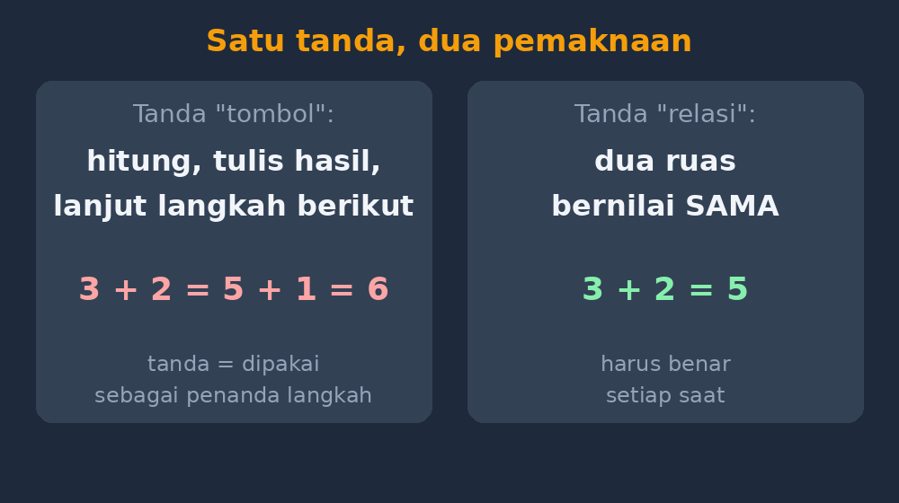
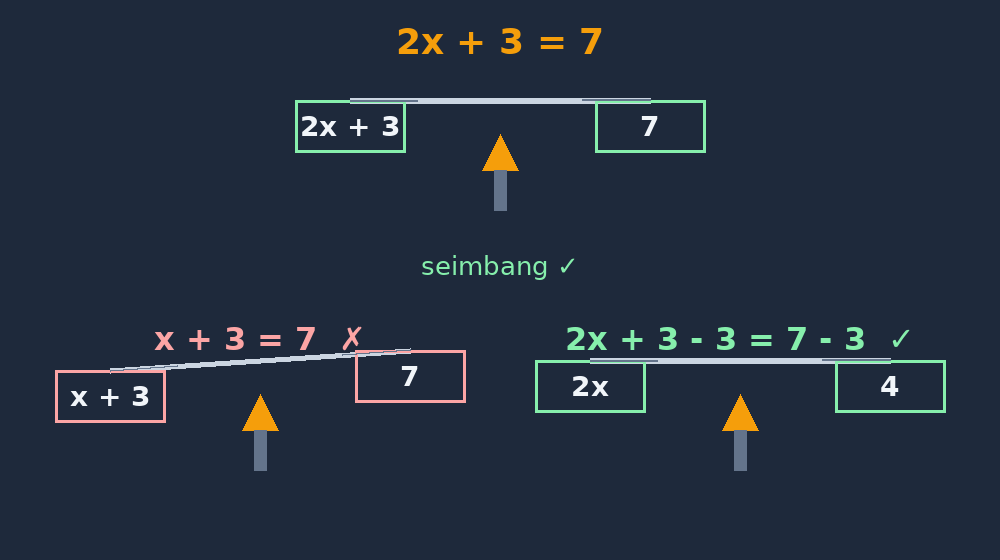

Ada satu tanda yang paling sering ditulis siswa saya sepanjang tahun ajaran, tapi mungkin paling jarang kita pikirkan maknanya: tanda sama dengan. Dua garis pendek, sederhana, nampaknya tidak ada yang perlu dijelaskan. Sama artinya sama, toh.

Tahun lalu saya berubah pikiran. Pemicunya sederhana: saya meminta siswa kelas 7 menyederhanakan $3x + 5 - x + 2$. Satu anak menjawab $3x + 5 - x + 2 = 2x + 7 = 10x$. Ketika saya tanya di papan, "Dari mana $10x$-nya?", dia menjawab dengan mantap, "Dikalikan, Pak. 2 kali 7." Buat dia, tanda sama dengan itu bukan pernyataan bahwa dua hal bernilai sama — dia lebih mirip tombol "proses selanjutnya", seperti tombol sama dengan di kalkulator.

<!--more-->

## Sama dengan itu semacam apa, sih?

Malamnya saya buka jurnal mengajar saya di [teach.gezytech.web.id](https://teach.gezytech.web.id) dan menulis kejadian itu. Begitu ditulis, saya sadar polanya sudah lama ada. Coba perhatikan beberapa tulisan siswa yang lazim kita temui:

$$3 + 2 = 5 + 1 = 6$$

Bagi kita, itu rantai yang salah: $3+2$ sama dengan $5$, bukan sama dengan $5+1$. Tapi bagi banyak siswa, baris itu "terasa benar" karena setiap tanda = dipakai sebagai penanda langkah: hitung ini, hasilnya ini, lanjut hitung, hasilnya lagi. Tanda sama dengan dipakai sebagai **tanda operasi**, bukan **tanda relasi**.

Penelitian di pendidikan matematika menyebut dua makna ini *relational* dan *operational*. Siswa yang memaknainya secara operasional tidak akan kesulitan di $3+2=5$. Masalah baru muncul ketika bentuknya berubah, misalnya:

$$\square + 4 = 9 + 3$$

Di kelas saya, tidak sedikit yang mengisi kotak itu dengan $14$. Logikanya runtut menurut makna operasional: bagian kiri dihitung dulu, $9+3$=... lalu... eh, tapi kotaknya di depan. Yang dipakai ketika menjawab soal seperti ini adalah pemahaman relasional: kotak dan $12$ harus **bernilai sama**. Kalau kotak itu dipikirkan sebagai "hasil dari hitungan sebelumnya", jawabannya kacau.

Ini pula akar dari kegagalan klasik di aljabar: menyederhanakan $2x + 3 = 7$ menjadi $x = 10$ atau $x = 7 - 2x + 3$. Siswa yang makna sama dengan-nya operasional akan melihat persamaan sebagai "soal yang harus menghasilkan angka", bukan sebagai pernyataan keseimbangan dua ruas.

*Gambar 1. Satu tanda, dua pemaknaan: sebagai tombol "hitung langkah berikutnya" dan sebagai pernyataan bahwa dua ruas bernilai sama.*

## Dari mana miskonsepsi ini datang?

Saya curiga siswa kita tidak "salah belajar", melainkan belajar dengan sangat logis dari apa yang mereka lihat. Perhatikan bagaimana hitungan biasa diajarkan di SD:

$$25 + 17 = 42$$
$$42 - 8 = 34$$

Setiap baris berbentuk *angka - operasi - angka*. Pola kiri-dihitung-lalu-ditulis-kanan diulang ribuan kali selama enam tahun. Tidak pernah ada soal berbentuk $5 = \square + 2$ yang serius, dan hampir tidak pernah ada pernyataan seperti $6 = 6$ yang diperlakukan sebagai sesuatu yang berarti. Maka ketika siswa menulis $3+2=5+1=6$, dia sebenarnya menerapkan dengan setia kebiasaan yang kita tanamkan sendiri.

Ada juga peran kalkulator dan tombol = di HP: menekan tombol itu berarti "tunjukkan hasilnya". Makna tombol, bukan makna relasi. Wajar kalau tanda itu lalu dipahami sebagai perintah, bukan pernyataan.

## Apa yang saya coba di kelas

Miskonsepsi seperti ini tidak hilang dengan satu kali ceramah "ingat, sama dengan artinya sama nilai". Saya butuh kebiasaan baru, dan ini tiga hal yang saya jalankan sepanjang semester lalu.

**Pertama, soal keseimbangan sejak awal.** Sebelum masuk aljabar, saya biasakan soal seperti $\square + 4 = 12$ dan $9 - \square = 4$, lalu memaksa diskusi: *mengapa* angka itu harus di situ. Bukan soal kejar-kejaran jawaban, tapi soal pancingan argumen. Siswa yang terbiasa membaca kalimat matematika sebagai kalimat utuh — bukan sebagai resep langkah — akan lebih siap saat bentuknya berubah jadi $x + 4 = 12$.

**Kedua, melarang rantai yang tidak benar.** Saya berhenti menoleransi tulisan seperti $3x+5-x+2 = 2x+7 = 10x$. Bukan karena judes, tapi karena kita sepakat aturan kelas: *satu tanda sama dengan hanya boleh menghubungkan dua hal yang benar-benar bernilai sama*. Kalau ingin menulis langkah-langkah, tulis ke bawah, satu langkah satu baris:

$$3x + 5 - x + 2 = 2x + 7$$

$2x + 7$ sudah selesai disederhanakan — tidak ada kelanjutannya. Aturan sepele ini terasa kaku di awal, tapi dia memaksa siswa memeriksa setiap tanda = yang dia tulis: apakah kiri dan kanan benar-benar senilai? Justru kebiasaan memeriksa ini yang kelak menyelamatkan mereka saat bekerja dengan persamaan.

**Ketiga, timbangan.** Metafora timbangan dua piringan untuk persamaan memang sudah lama dipakai, tapi saya sadar kekuatannya justru bukan pada gambar timbangannya, melainkan pada pertanyaan yang dibangkitkannya: *apa yang boleh dilakukan asalkan kedua piringan tetap seimbang?* Ketika siswa menambahkan sesuatu hanya ke satu ruas, saya tidak langsung menegur dengan "rumusnya salah", tapi bertanya, "timbangannya masih seimbang nggak?" Pertanyaan itu memindahkan fokus dari menghafal prosedur ke menjaga relasi.

*Gambar 2. Persamaan sebagai timbangan: $2x + 3 = 7$ seimbang; mengurangi kedua ruas dengan 3 menjaga keseimbangan, mengurangi hanya satu ruas merusaknya.*

## Hasilnya (yang jujur saja belum sempurna)

Apakah semua ini menghilangkan miskonsepsi? Tidak. Masih ada siswa yang di ulangan menulis rantai sama dengan yang salah. Tapi ada dua perubahan yang saya catat di jurnal dan membuat saya yakin arah ini benar.

Pertama, jumlah siswa yang bisa menjawab soal bentuk $\square + 4 = 9 + 3$ dengan benar naik cukup terasa dibanding kelas tahun sebelumnya. Kedua — dan ini yang lebih saya hargai — mulai ada siswa yang *mengoreksi temannya* dengan bahasa relasi: "Kok dua ruasnya beda nilai?" Bukan "salah rumus", tapi "ruasnya tidak senilai". Ketika siswa mulai memakai makna relasi secara sukarela dalam percakapan sehari-hari kelas, itu tanda pemahamannya sedang dibangun, bukan sekadar dihafal.

## Penutup: satu tanda, satu pelajaran besar untuk saya

Ada rasa lucu sekaligus merendah soal ini. Bertahun-tahun saya mengajar dengan anggapan bahwa tanda sama dengan adalah hal paling tidak perlu dijelaskan. Ternyata justru di tanda yang paling "jelas" itulah pemahaman siswa sering retak, dan retaknya tidak terlihat sampai mereka bertemu aljabar — saat sudah terlambat untuk menambal dengan cepat.

Kalau ada satu hal yang ingin saya sampaikan ke rekan guru, mungkin ini: mari kita waspada terhadap hal-hal yang *terasa terlalu jelas untuk dijelaskan*. Sering justru di situ miskonsepsi paling awal ditanam, oleh kebiasaan yang tidak pernah kita pertanyakan. Satu tanda sama dengan mengajari saya bahwa mengajar bukan hanya menjelaskan yang sulit, tapi juga memeriksa ulang yang kelihatannya sudah selesai sejak lama.
