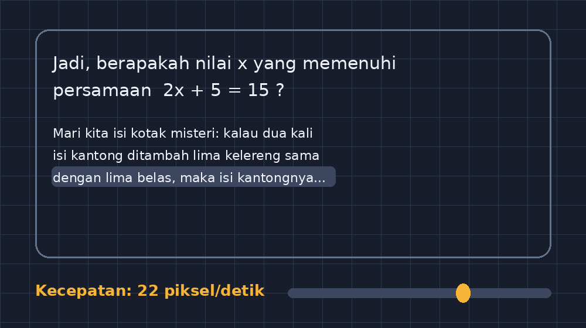

Ada satu momen yang membuat saya akhirnya serius membuat GezyPrompter: saya sedang merekam video penjelasan untuk kelas VIII tentang relasi dan fungsi. Kamera nyala, mikrofon siap, dan saya mulai berbicara. Lima menit kemudian saya menonton rekamannya dan menemukan hal yang memalukan sekaligus mencerahkan — saya berbicara seperti orang yang kehabisan bensin di tengah jalan. Ada kalimat yang terhenti karena saya lupa urutan penjelasan. Ada bagian yang terlalu cepat, ada bagian yang menggantung. Padahal tulisannya sudah saya siapkan, tinggal dibacakan dengan natural.

Masalahnya sederhana: membaca sambil bicara natural itu sulit kalau teksnya ada di kertas yang harus dibalik, atau di layar monitor yang posisinya tidak sejajar dengan kamera. Mata saya bolak-balik, dan bolak-balik itu terdengar di suara. Dari situlah ide prompter yang bisa dibuka di browser, dipasang tepat di bawah (atau di belakang) kamera, dengan teks yang bergerak pelan dan kecepatan yang bisa saya atur, muncul di kepala. Beberapa minggu kemudian, aplikasinya jadi dan sekarang jadi salah satu alat yang paling sering saya buka.

<!--more-->

## Prompter Itu Bukan Alat Selebritas Saja

Ketika saya cerita ke rekan guru bahwa saya membuat prompter, reaksinya biasanya tertawa dulu. "Ibu Pak Guru kok pakai alat pembaca berita?" Padahal kalau dipikir, guru justru profesi yang setiap hari melakukan "siaran langsung" berjam-jam tanpa jeda iklan. Bedanya, siaran kami tidak bisa diulang take-nya. Kalau presenter TV kelelep di tengah kalimat, mereka ulang. Kalau saya kelelep di tengah penjelasan tentang sifat operasi hitung aljabar, yang kelelep ada empat puluh anak di depan saya.

Prompter tidak menggantikan pemahaman saya terhadap materi — justru sebaliknya, menulis teks untuk prompter memaksa saya memahami materi lebih dalam. Karena teks yang akan dibaca pelan-pelan itu tidak bisa berisi basa-basi. Setiap kalimat harus punya alasan untuk ada. Ada analogi yang bagus untuk menghitung: kalau satu kalimat penjelasan memakan sekitar sepuluh detik bicara santai, maka penjelasan lima menit hanya cukup untuk sekitar tiga puluh kalimat yang benar-benar berbobot. Angka itu membuat saya jimat menulis.

## Apa Saja yang Saya Butuhkan, Sebenarnya

Sebelum menulis kode, saya daftar dulu kebutuhan nyata, bukan fitur impian:

Pertama, teks harus bisa digulir otomatis dengan kecepatan yang bisa diatur saat tampilan berjalan. Saat latihan pertama saya menemukan kecepatan yang enak, lalu saat rekaman sesungguhnya saya ingin memperlambat sedikit di bagian rumus — kontrol kecepatan harus ada di jangkauan tangan.

Kedua, teks harus besar dan jelas. Saya membaca dari jarak sekitar satu meter dari layar, sambil sesekali melirik kamera. Font kecil artinya mata kerja dua kali.

Ketiga, arah teks bisa dicerminkan. Ini detail yang sering dilupakan: kalau saya memakai setup telepon dengan aplikasi kamera yang menyediakan mode mirror, teks prompter juga ikut tercermin di layar dan jadi campur aduk. Tombol cermin menyelamatkan banyak rekaman saya.

Keempat, murni jalan di browser. Saya tidak ingin alat yang membutuhkan instalasi khusus setiap kali saya mengganti laptop atau memakai komputer sekolah. Semua aplikasi GezyTech saya buat dengan filosofi yang sama: buka URL, langsung pakai.

## Tantangan yang Tidak Terduga: Kecepatan Bicara

Bagian tersulit dari aplikasi ini ternyata bukan teknisnya, melainkan menemukan definisi "kecepatan yang manusiawi". Kalau saya set 40 piksel per detik, teks berjalan seperti orang buru-buru naik bus. Kalau 10 piksel per detik, mata saya berhenti lebih dulu daripada teksnya.

Solusi sederhana yang saya pakai: kecepatan default saya set berdasarkan percobaan membaca nyata. Saya buka aplikasi, baca satu paragraf dari materi persamaan garis lurus, dan catat di detik ke berapa baris terakhir mencapai posisi yang nyaman untuk dibaca. Dari sana saya hitung mundur. Yang menarik, kecepatan nyaman untuk membaca teks penjelasan ternyata lebih lambat dari kecepatan bicara normal saya — karena saat membaca, saya juga sesekali berhenti untuk memberi penekanan, atau menambahkan contoh spontan yang tidak ada di teks.

Pengalaman ini mengajari saya sesuatu tentang pembelajaran juga: jeda itu bukan waktu yang hilang. Justru di jeda itulah siswa mencerna. Prompter yang terlalu rapat malah membuat bicara saya terburu-buru, dan bicara yang terburu-buru membuat siswa tidak sempat berpikir. Jadi dalam perkembangan berikutnya, saya lebih sering menulis paragraf pendek dengan banyak titik, dan memperlambat kecepatan di bagian-bagian yang punya rumus atau notasi matematika.

## Kaitannya dengan Aplikasi GezyTech Lainnya

GezyPrompter terasa seperti kepingan yang hilang dari ekosistem kecil saya. GezySlide saya pakai untuk menampilkan slide saat mengajar tatap muka. GezyCBT untuk ujian. GezyMaterials untuk menyimpan berkas materi di satu alamat yang mudah dibagikan. Tapi kalau saya ingin membuat video penjelasan — misalnya untuk kelas yang harus belajar dari rumah karena kegiatan sekolah, atau untuk siswa yang absen — saya tidak punya alat untuk membantu saya bicara dengan rapi di depan kamera. Prompter menutup celah itu.

Sekarang alur kerjanya jadi begini: saya tulis naskah penjelasan singkat, buka GezyPrompter, atur kecepatan, tempatkan perangkat di belakang kamera, lalu rekam. Satu video lima menit biasanya selesai dalam dua sampai tiga take, bukan sepuluh. Waktu yang saya hemat itu saya pakai untuk hal yang lebih penting — menyiapkan soal, atau sekadar istirahat dengan secangkir kopi.

## Yang Saya Pelajari dari Membangunnya

Ada pelajaran teknis yang menarik untuk dibagikan ke rekan guru yang iseng ingin membuat aplikasi sendiri. Inti dari prompter sebenarnya sangat sederhana: teks digulir dengan `requestAnimationFrame`, kecepatannya dikendalikan variabel, dan ukuran font bisa diubah dengan slider. Tapi detail kecil yang membuatnya terasa enak dipakai itu banyak. Misalnya: tombol jeda harus gampang dijangkau, karena saya selalu butuh berhenti di tengah. Kontrol kecepatan harus tidak mengubah posisi teks saat digeser — kalau tidak, teks melompat dan saya kehilangan tempat. Ada juga trik memberi ruang kosong besar di awal dan akhir teks, supaya baris pertama bisa mulai dari posisi nyaman untuk mata, bukan menempel di tepi atas layar.

Kalau dihitung dengan sedikit matematika (ya, selalu ada matematika), pergerakan teks itu barisan aritmetika: tiap detik, posisi teks bertambah tetap sebesar $v$ piksel, sehingga setelah $t$ detik posisinya adalah

$$y(t) = y_0 + v \cdot t$$

Sederhana, tapi kesederhanaan itulah yang membuatnya andal. Tidak perlu animasi yang rumit; yang dibutuhkan adalah pergerakan yang konsisten dan bisa diprediksi. Sama seperti mengajar: siswa tidak butuh metode yang mencengangkan setiap hari, mereka butuh hal yang bisa diandalkan setiap hari.

## Penutup: Alat Kecil, Kebiasaan Baru

GezyPrompter tidak pernah saya niatkan jadi aplikasi besar. Ia alat kecil untuk masalah kecil. Tapi justru dari alat kecil seperti ini saya belajar banyak — tentang kecepatan bicara, tentang pentingnya jeda, tentang bagaimana sebuah teknologi seharusnya menyesuaikan diri pada kebiasaan manusia, bukan sebaliknya.

Kalau Bapak/Ibu guru ada yang penasaran dan ingin mencoba, aplikasinya bisa diakses dari halaman utama GezyTech. Dan kalau Bapak/Ibu sempat membuat video pembelajaran sendiri — walau hanya dengan ponsel dan satu naskah sederhana — saya sarankan mulai dari menulis naskahnya dulu. Proses menulis itu sendiri sudah setengah dari persiapan mengajar yang baik. Sisanya, biarkan teks yang berjalan pelan membantu suara kita tetap tenang.
