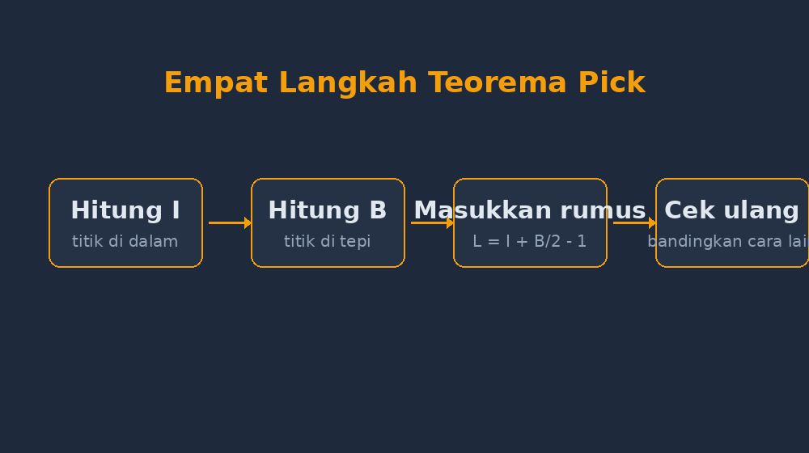
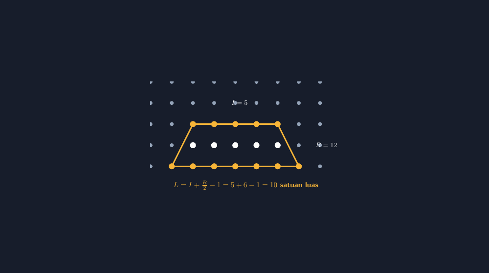

Ada satu materi di kelas VII yang setiap tahun membuat saya dihadapkan pada keanehan yang sama: siswa tahu rumus luas persegi, luas segitiga, luas trapesium — semua hafal. Tapi begitu saya taruh di papan tulis sebuah poligon miring yang tidak berbentuk apa-apa, semacam poligon lima sisi yang sengaja saya gambar ganjil, kelasnya hening. Rumus yang mereka hafal tidak ada yang cocok. Dan di titik hening itulah pelajaran yang paling saya suka biasanya dimulai.

Tahun ini hening itu saya isi dengan sesuatu yang berbeda. Bukan dengan langsung memberi rumus, tapi dengan papan paku.

## Papan paku yang sudah lama menunggu

Papan paku di kelas saya sebenarnya bukan alat baru. Kardus dibungkus kain flanel, paku-paku kecil tertancap berjajar membentuk grid, sekumpulan karet gelang yang warnanya sudah mulai pudar karena dipakai kelas-kelas sebelumnya. Pernah saya pakai untuk pecahan, pernah juga untuk keliling-luas. Tapi untuk materi kali ini papan itu bekerja dengan cara yang paling jujur.

Saya minta dua siswa maju. Tugasnya sederhana: taruh karet gelang di papan, bentuk bebas, asal setiap sudutnya jatuh tepi di salah satu paku. Sengaja saya beri aturan itu — sudut harus di paku — karena di sanalah seluruh ide ini berdiri.

Yang mereka bentuk kurang lebih seperti segi lima yang miring ke kiri. Lalu saya lempar pertanyaannya: berapa luas bentuk itu?

Mereka mencoba memotong-motongnya di udara. Ada yang menyarankan dibagi jadi segitiga, ada yang menyarankan dibalok-balok. Semua jalan itu benar, tapi melelahkan, dan setiap bentuk baru berarti memotong lagi dari nol. Di sinilah saya tulis satu kalimat di papan yang membuat suasana kelas berubah:

$$L = I + \frac{B}{2} - 1$$

## Dua huruf yang bisa dihitung dengan mata

Saya jelaskan pelan-pelan. $B$ adalah banyak titik paku yang berada tepat di garis tepi poligon — semua paku yang menyentuh karet gelang. $I$ adalah banyak titik paku yang berada di dalam, paku-paku yang tidak tersentuh karet tapi ada di wilayah bentuk kita. Teorema ini dinamai dari Georg Pick, matematikawan yang menerbitkannya tahun 1899 — jauh sebelum ada kuis interaktif, jauh sebelum ada kelas digital, cukup dengan kertas berpetak dan ketekunan.

Yang membuat saya berdecak setiap kali mengajarkan rumus ini bukan rumusnya, tapi sifatnya: dia tidak peduli bentuk poligonnya. Lima sisi, tujuh sisi, bentuk seperti sisir, bentuk seperti tangga — tidak penting. Yang dihitung hanya dua hal, dan dua hal itu bisa dihitung dengan mata, dengan menunjuk.

Kami coba di bentuk yang tadi siswa buat. Anak-anak berhitung sambil menunjuk satu per satu: satu, dua, tiga ... di tepi ada sepuluh, jadi $B=10$. Di dalam, dua paku, $I=2$. Masukkan:

$$L = 2 + \frac{10}{2} - 1 = 6$$

Enam kotak satuan. Lalu untuk membuktikan bahwa angka itu bukan sulap, kami potong-motong bentuk yang sama secara manual — segitiga di kiri, trapesium di kanan — dan jumlahkan hasil potongan-potongan itu. Enam juga. Kelas yang tadi hening jadi riuh karena merasa menemukan sesuatu.


*Empat langkah yang akhirnya kami jadikan kebiasaan kerja: hitung $I$, hitung $B$, masukkan rumus, lalu cek dengan cara lain.*

## Sepeda kedua: menggambar ulang dengan TikZ

Malam harinya, saya melakukan kebiasaan yang sudah menjadi bagian dari hidup saya mengajar sekarang: menggambar ulang apa yang terjadi di kelas dengan TikZ, supaya besok-besok soalnya punya gambar yang presisi, bukan sketsa papan tulis yang hilang saat penghapus lewat.

Menggambar ilustrasi teorema Pick di TikZ ternyata menyenangkan karena TikZ memang bekerja di dunia titik dan koordinat — persis dunia tempat teorema ini hidup. Inti gambarnya hanya dua perulangan: satu untuk grid titik-titik, satu untuk penanda titik tepi dan titik dalam:

```latex
\foreach \x in {0,...,8}
  \foreach \y in {0,...,4}
    \fill[dot] (\x,\y) circle (2.6pt);

\draw[acc, line width=1.8pt]
  (1,0) -- (7,0) -- (6,2) -- (2,2) -- cycle;

\foreach \p in {(1,0),(2,0),(3,0),(4,0),(5,0),(6,0),(7,0),
                (2,2),(3,2),(4,2),(5,2),(6,2)}
  \fill[acc] \p circle (4pt);

\foreach \p in {(2,1),(3,1),(4,1),(5,1),(6,1)}
  \fill[white] \p circle (4pt);
```

Trapesium di atas sengaja saya pilih untuk versi final soal, bukan segi lima yang tadi di kelas, karena angkanya lebih ramah: $B=12$, $I=5$, sehingga

$$L = 5 + \frac{12}{2} - 1 = 5 + 6 - 1 = 10$$


*Trapesium di grid papan paku: dua belas titik tepi (kuning), lima titik dalam (putih), luas sepuluh satuan. Bisa diperiksa dengan rumus trapesium: $\frac{(5+4)\times 2}{2} = 10$.*

Saya senang sekali ada pemeriksaan silang itu. Luas trapesium memang bisa dihitung dengan rumus biasa, dan kalau teorema Pick memberi angka yang sama, keduanya saling menopang. Di kelas, momen dua cara berbeda menunjuk angka yang sama itu selalu jadi puncak — anak-anak tidak percaya rumus karena saya bilang begitu; mereka percaya karena dua jalan berbeda berpapasan di titik yang sama.

## Hati-hati di dua tempat

Tentu tidak semua mulus, dan justru dua kegagalan kecil di kelas menjadi bagian terbaik dari pelajaran ini.

Pertama, tentang titik yang berada di sisi miring. Ketika kami menghitung $B$ untuk bentuk yang sisi-sisinya miring, ada siswa yang menghitung semua titik yang "dekat dengan tepi" sebagai titik tepi. Kami perbaiki bersama dengan perjanjian yang tegas sejak awal: titik tepi hanya titik yang benar-benar dilewati garis. Kalau garis miring dari paku $(2,2)$ ke paku $(5,3)$ hanya melalui dua paku itu, maka titik tengah yang dekat garis tapi tidak dilewati tetap dihitung sesuai posisinya — bisa jadi di dalam, bisa di luar, tapi bukan di tepi. Perjanjian kecil ini sebenarnya sedang mengajarkan sesuatu yang lebih besar: dalam matematika, definisi bukan formalitas, dia yang menentukan hasil hitung.

Kedua, tentang poligon berlubang. Ada siswa yang iseng membentuk karet gelang seperti donat — poligon di dalam poligon. Saya jelaskan jujur bahwa rumus yang kami pakai hari ini untuk poligon sederhana, tanpa lubang; untuk donat, ada perpanjangan ceritanya sendiri. Saya tidak menutup pintunya: "kalau ada yang penasaran, coba cari, besok kita bahas." Dan besoknya memang ada yang datang membawa catatan tentang rumus yang disesuaikan untuk poligon berlubang. Satu siswa, satu obsesi kecil, satu bab bonus yang tidak ada di rencana pelajaran saya.

## Kenapa rumus ini penting untuk dipahami, bukan dihafal

Kalau ditanya manfaat praktisnya, teorema Pick memang bukan tamu tetap di ujian. Tapi saya sudah lama berhenti menilai materi hanya dari kemunculannya di lembar soal. Yang dilatih teorema ini justru tiga hal yang berpengaruh ke mana-mana.

Menghitung dengan definisi yang disepakati bersama. Memeriksa satu hasil dengan jalan kedua. Dan menghargai bahwa sebuah rumus yang terlihat ajaib sebenarnya punya alasan keberadaannya — bahwa $-\!1$ di ujung rumus itu bukan hiasan, tapi bagian dari perjanjian tentang bagaimana tepi dihitung. Bagi siswa yang nanti bertemu perhitungan area di geografi, di desain, di pemrograman game, rasa ini akan kembali: luas bukan sesuatu yang diukur selalu dengan alat yang sama; luas adalah sesuatu yang bisa dibangun ulang dari benda-benda sederhana, misalnya dari titik-titik.

Malam itu juga saya selesaikan berkas TikZ-nya, lengkap dengan prefambul dan kompilasi yang bisa dijalankan siapa pun. Seperti biasa, berkasnya saya sertakan di bawah. Kalau Bapak/Ibu punya papan paku di kelas — atau bahkan cukup kertas berpetak dan pensil warna — pelajaran ini hampir tidak butuh persiapan. Cukup satu bentuk ganjil, satu pertanyaan "berapa luasnya?", dan satu kelas yang diberi izin untuk menghitung dengan menunjuk.

Di kelas saya, hening sebelum rumus ternyata bukan jeda kosong. Dia cuma menunggu paku pertama ditegaskan.

> 📎 **Berkas TikZ lengkap:** [teorema-pick-luas-papan-paku.tex](tex/teorema-pick-luas-papan-paku.tex) — siap kompilasi (butuh paket `tikz`).
