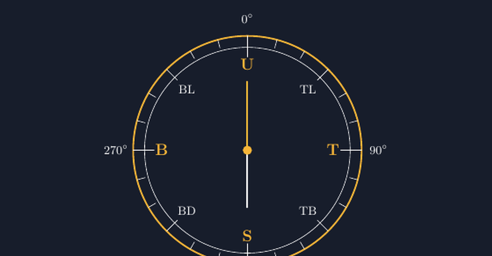

Ketika saya mengajarkan denah dan skala di kelas VII, ada satu benda kecil yang hampir selalu lolos dari perhatian: kompas di pojok peta. Di buku paket, setiap denah sekolah atau denah lingkungan pasti menggambar panah bertanda "U" di sudut atasnya — dan hampir semua siswa memperlakukannya seperti ornamen, seperti logo percetakan buku. Mereka menghitung jarak rumah ke sekolah dengan rajin, tapi ketika saya tanya, "pintu gerbang menghadap ke mana?", jawabannya kacau. Ada yang bilang timur, ada yang bilang barat, dan satu anak menjawab dengan sangat percaya diri, "yang penting di depan, Pak."

<!--more-->

Setelah beberapa tahun mengajari denah dengan cara yang terburu-buru itu, akhirnya saya mengubah pendekatan: sebelum bicara skala, kami bicara arah dulu. Dan karena kebiasaan saya belakangan ini adalah membuat bahan ajar dengan TikZ, saya pun mencoba menggambar rosa angin yang layak — bukan panah kecil asal yang sering tidak jelas ujungnya menghadap ke mana.

## Kenapa kompas di buku sering diabaikan

Saya pikir masalahnya bukan siswa tidak mampu, melainkan kompasnya sendiri memang tidak diajak bicara. Kompas di buku biasanya digambar kecil, tanpa derajat, kadang hanya berupa huruf "U" dengan panah setipis benang. Tidak ada lingkaran, tidak ada pembagian arah tenggara-barat-laut, tidak ada kaitan dengan derajat yang justru sudah mereka pelajari di materi sudut. Anak-anak melihatnya sebagai gambar penyelan, bukan sebagai alat baca.

Padahal rosa angin itu, kalau dibaca selayaknya, adalah sebidang pengetahuan yang cukup kaya: ada empat arah kardinal (utara, timur, selatan, barat), empat arah antara (timur laut, tenggara, barat daya, barat laut), dan ada pula pembagian derajat yang menghubungkan arah dengan sudut. Ketika saya akhirnya menggambar kompas besar di papan tulis dan menuliskan $0^\circ$ di utara, $90^\circ$ di timur, siswa kelas VII yang sedang belajar sudut langsung terbangun. "Berarti arah tenggara itu $135^\circ$, Pak?" — dan pertanyaan seperti itu adalah pertanyaan yang ingin saya dengar lebih sering di kelas.

## Menggambar rosa angin yang jujur

Gambar berikut yang akhirnya saya pakai di kelas dan di lembar kerja:



*Delapan arah mata angin, dengan garis skala kecil setiap $15^\circ$. Huruf kuning menandai arah kardinal.*

Bagian yang paling saya perhatikan saat menyusunnya di TikZ adalah pembagian tanda (tick) pada lingkaran. Kalau semua tick dibuat sama panjang, mata siswa tidak bisa membedakan arah kardinal dengan arah antara. Maka tick-nya saya buat bertingkat: paling panjang tepat di utara-timur-selatan-barat, sedang di tenggara dan kawan-kawannya, pendek di setiap kelipatan $15^\circ$. TikZ punya cara menuliskannya yang cukup rapi:

```latex
\foreach \a in {0,15,...,345}{
  \pgfmathsetmacro{\len}{mod(\a,90)==0 ? 0.55 :
                          (mod(\a,45)==0 ? 0.4 : 0.22)}
  \draw[white!70] (\a:3) -- (\a:3-\len);
}
```

Kuncinya ada di `mod(\a,90)==0`: derajat yang habis dibagi 90 adalah arah kardinal, jadi tick-nya paling panjang. Derajat yang habis dibagi 45 adalah arah antara, tick-nya sedang. Sisanya cukup pendek. Satu `foreach`, tiga panjang berbeda, dan kompas langsung terbaca tanpa penjelasan tambahan.

Untuk label arah, saya pakai lingkaran radius 2.25 di dalam kompas radius 3:

```latex
\foreach \a/\t in {90/U, 270/S, 0/T, 180/B}{
  \node[aksen, font=\bfseries\large] at (\a:2.25) {\t};
}
\foreach \a/\t in {45/TL, 135/BL, 225/BD, 315/TB}{
  \node[white!80, font=\small] at (\a:2.25) {\t};
}
```

Perhatikan bahwa utara saya letakkan di sudut $90^\circ$ TikZ, bukan $0^\circ$. Di sistem koordinat TikZ, $0^\circ$ menghadap ke timur dan berputar berlawanan arah jarum jam. Kompass dunia nyata justru memulai dari utara dan berputar searah jarum jam: utara $0^\circ$, timur $90^\circ$, selatan $180^\circ$, barat $270^\circ$. Selisih orientasi ini adalah perangkap yang hampir saya alami sendiri — versi pertama gambar saya salah menaruh derajat, dan kalau tidak dicek ulang, lembar kerja itu akan mengajarkan arah yang terbalik.

Maka aturan yang saya pegang: sudut TikZ dan sudut kompas dibiarkan berbeda, tapi konversinya harus eksplisit. Arah kompas $\theta$ di TikZ ditulis $(90-\theta)$, sehingga $90-\theta = 90$ memberi utara di atas gambar. Derajat yang saya tulis di lingkar luar ($0^\circ$ di utara, $90^\circ$ di timur, $270^\circ$ di barat) adalah derajat kompas, bukan derajat TikZ — dan saya tulis itu di caption gambar supaya siswa tidak bingung ketika mereka sendiri mulai mencoba di GeoGebra.

## Dari kompas ke denah yang benar-benar dihitung

Gambar kompas sendirian tidak menyelesaikan masalah. Yang mengubah kelas saya adalah meletakkannya di tengah aktivitas denah sekolah. Saya cetak denah sekolah kami sendiri — lengkap dengan kompas TikZ yang sama — lalu siswa diminta menuliskan arah dari satu titik ke titik lain. Dari kelas VII-A ke laboratorium, itu ke arah mana? Dari gerbang ke ruang guru, beloknya timur laut atau barat laut? Anak-anak berkeliling menoleh ke jendela, mencocokkan arah matahari pagi dengan gambar kompas di meja mereka.

Ada satu momen yang tidak akan saya lupa. Seorang siswa yang biasanya paling pendiam mendatangi meja saya dan bertanya, "Pak, kalau denahnya diputar $90^\circ$, kompasnya juga ikut diputar ya? Berarti utaranya pindah ke samping kanan?" Saya hampir menjawab cepat, tapi saya tahan, dan saya balik bertanya: "Menurutmu, utara itu punya siapa — punya denah atau punya dunia?" Dia berpikir sejenak, lalu menjawab sendiri: "Punya dunia, Pak. Berarti kompasnya tetap, denahnya yang berputar." Itu adalah pemahaman denah yang paling dalam yang pernah saya saksikan di kelas itu, dan ia muncul bukan dari rumus, tapi dari kompas yang digambar cukup besar untuk diperdebatkan.

Kaitan dengan skala juga jadi lebih jujur. Ketika siswa menghitung jarak gedung A ke gedung B pada denah bersekalai 1:500, mereka sekarang tahu juga arahnya: 60 meter ke arah tenggara, misalnya. Jarak dan arah berjalan berpasangan — persis seperti vektor yang nanti akan mereka temui di kelas yang lebih tinggi, walau saya tidak menyebut kata "vektor" sedetik pun di depan kelas VII.

## Yang saya pelajari dari satu gambar kecil

Rosa angin ini bukan gambar yang rumit. Total baris TikZ-nya tidak sampai tiga puluh. Tapi proses membuatnya mengingatkan saya pada satu hal yang berulang terus dalam pengalaman saya menggambar bahan ajar: gambar yang jujur mengikuti konvensi yang benar itu tidak bisa saya improvisasi di papan tulis. Konversi sudut TikZ ke derajat kompas, panjang tick yang bertingkat, letak label yang tidak bertabrakan dengan jarum — semuanya harus dipikirkan sebelum dudu di kelas. Kalau saya gambar langsung di papan, kemungkinan besar derajatnya akan saya tulis di tempat yang salah, dan siswa akan menyalin kesalahan itu ke lembar kerja mereka dengan sangat rapi.

TikZ, dalam hal ini, berperan seperti rekan kerja yang keras kepala: ia tidak akan menggambar utara di tempat yang saya maksud kalau koordinatnya saya salah tulis. Ia memaksa saya memastikan dulu di kepala: utara itu di mana sebenarnya, dan $135^\circ$ itu arah mana sebenarnya. Dan setiap kali saya terpaksa memikirkan hal-hal kecil seperti itu sebelum mengajar, kelas di hari berikutnya selalu jadi lebih tenang — karena bahan ajarnya tidak menipu saya sendiri.

Bapak/Ibu guru yang juga sering membuat denah untuk soal atau lembar kerja, mungkin bisa mencoba rosa angin kecil ini. Tidak perlu besar; cukup lingkaran, delapan label, dan beberapa tick. Yang penting ia terbaca — karena kompas yang tidak terbaca sama saja dengan tidak ada.

> 📎 **Berkas TikZ lengkap:** [tikz-arah-mata-angin.tex](tex/tikz-arah-mata-angin.tex) — siap kompilasi (butuh paket `tikz`).
