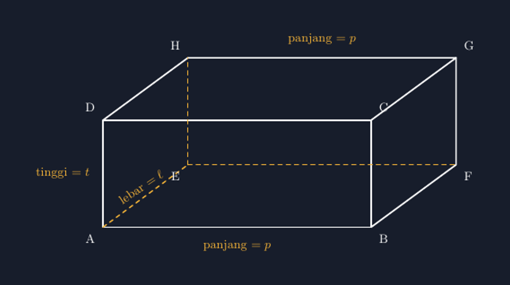

Kelas VIII semester genap biasanya saya buka dengan pertanyaan sederhana: "Balok apa yang paling sering kalian pegang?" Jawabannya beragam — kotak pensil, kulkas, buku paket, kardus bekas mie instan yang saya bawa dari rumah sebagai props. Balok memang bangun yang paling "dikenal" di antara semua bangun ruang. Justru karena itu, saya pernah terkejut saat ulangan: banyak siswa yang menggambar balok dengan hanya tujuh titik sudut. Satu titik di belakang hilang begitu saja, dan tak seorang pun merasa ada yang aneh.


*Balok dengan kedelapan titik sudut lengkap. Rusuk tersembunyi digambar putus-putus — bukan dihilangkan.*

## Titik yang Hilang di Kertas Siswa

Miskonsepsi ini menarik. Kalau ditanya "balok punya berapa titik sudut?", hampir semua siswa menjawab delapan dengan percaya diri. Tapi saat menggambar, tangan mereka hanya menuliskan tujuh huruf. Titik yang "menghilang" biasanya titik yang tersembunyi di belakang — karena tidak terlihat, jadi dianggap tidak ada.

Padahal justru di situlah letak kekayaan pembelajarannya. Ketika saya meminta siswa menandai titik kedelapan itu dengan garis putus-putus, mereka belajar membedakan dua hal yang sering dicampuradukkan: *yang terlihat* dan *yang ada*. Rusuk belakang tetap ada meskipun terhalang sisi depan. Matematika tidak berhenti di apa yang bisa dilihat mata.

## Keputusan yang Sama di TikZ

Ketika saya mulai menggambar balok di TikZ untuk soal-soal ulangan, saya menyadari bahwa masalahnya identik. Kode TikZ tidak akan memaafkan titik yang lupa saya definisikan. Kalau balok punya delapan titik sudut, maka saya wajib menulis delapan koordinat — dan tiga rusuk yang tersembunyi harus saya putuskan nasibnya: digambar putus-putus, atau dibiarkan hilang?

Pola dasarnya seperti ini:

```latex
\coordinate (A) at (0,0);
\coordinate (B) at (6,0);
\coordinate (C) at (6,2.4);
\coordinate (D) at (0,2.4);
\coordinate (E) at (1.9,1.4);   % titik belakang-bawah
\coordinate (F) at (7.9,1.4);
\coordinate (G) at (7.9,3.8);
\coordinate (H) at (1.9,3.8);
```

Empat titik depan (A, B, C, D) membentuk persegi panjang di bidang datar. Empat titik belakang (E, F, G, H) diperoleh dengan menggeser titik depan ke arah yang sama sejauh yang sama — di kode saya, geser 1.9 ke kanan dan 1.4 ke atas. Perhatikan bahwa $F = B + (1.9, 1.4)$, dan begitu juga pasangan-pasangan lainnya. Konsistensi pergeseran inilah yang membuat proyeksi gambar terasa "benar" di mata, meskipun sebenarnya kita sedang berbohong sedikit: kertas adalah bidang dua dimensi, dan balok adalah benda tiga dimensi.

Rusuk yang terlihat digambar dengan garis penuh, rusuk yang tersembunyi dengan putus-putus:

```latex
\draw[white] (A)--(B)--(C)--(D)--cycle;
\draw[white] (B)--(F)--(G)--(C);
\draw[white] (D)--(H)--(G);
\draw[acc,dashed] (A)--(E);
\draw[acc,dashed] (E)--(F);
\draw[acc,dashed] (E)--(H);
```

Tiga rusuk putus-putus itu semuanya bermula dari titik E — titik yang "hilang" di kertas siswa saya tahun lalu. Kalau saya tunjukkan kode ini di kelas, titik E tidak lagi misterius: ia adalah pusat dari tiga rusuk yang tidak boleh dilupakan.

## Kesalahan yang Saya Buat Sendiri

Agar jujur: versi pertama balok saya memiliki masalah serius. Saya menggambar titik E dengan koordinat yang terlalu dekat ke tengah, sehingga label $\ell$ (lebar) yang saya taruh di rusuk AE bertabrakan dengan label titik E sendiri. Di layar kecil ponsel siswa — tempat banyak dari mereka membuka materi saya — keduanya menjadi satu gumpalan hitam yang tidak bisa dibedakan.

Pelajarannya: menggambar balok bukan hanya soal geometri, tapi juga soal *layout*. Titik belakang yang digeser terlalu sedikit membuat gambar tampak seperti persegi panjang dengan coretan; digeser terlalu banyak membuat balok terlihat seperti memanjang ke samping dengan sudut aneh. Saya akhirnya menetapkan nilai yang nyaman untuk balok dengan panjang $p = 6$: pergeseran belakang sekitar sepertiga dari lebar, dan sepertiga dari tinggi, lalu dilihat ulang di layar kecil sebelum dicetak.

Ada juga soal label dimensi. Pada balok, ada tiga dimensi — panjang, lebar, tinggi — dan masing-masing muncul dua kali (rusuk sejajar). Saya memilih meletakkan label panjang di rusuk bawah depan dan atas belakang, tinggi di rusuk kiri depan, dan lebar di rusuk miring bawah kiri. Rusuk miring itu penuh jebakan: labelnya harus dirotasi mengikuti kemiringan rusuk, kalau tidak, teksnya akan "terbaring" di tempat yang tidak beralasan.

## Dari Gambar ke Rumus

Manfaat terbesar dari balok yang digambar jujur ini muncul saat pelajaran volume dan luas permukaan. Dengan gambar yang memiliki kedelapan titik lengkap dan rusuk tersembunyi yang tetap digambar, saya bisa menunjuk dengan jelas: sisi depan adalah persegi panjang $p \times t$, sisi bawah adalah $p \times \ell$, dan sisi kanan adalah $\ell \times t$. Luas permukaan menjadi

$$L = 2(pt + p\ell + \ell t)$$

dan siswa bisa *melihat* dari mana angka 2 itu datang: karena setiap sisi punya kembarannya di seberang. Di kelas yang dulu, rumus ini dihafal sebagai formula mati. Di kelas yang sekarang, dengan gambar yang setia pada struktur bangunnya, siswa bisa menelusuri pasangan sisi satu per satu dengan jarinya.

Begitu pula diagonal ruang. Ketika materi lanjut ke diagonal sisi dan diagonal ruang, garis putus-putus AE menjadi jembatan: diagonal ruang AG melewati "dalam" balok, dan keberadaan titik E yang digambar putus-putus membuat arah "dalam" itu terasa nyata, bukan sekadar kata di soal.

## Menutup Rangkaian Bangun Ruang

Bersama prisma segitiga, limas, kerucut, silinder, dan bola yang sudah pernah saya bahas, balok menyelesaikan keluarga bangun ruang yang paling sering muncul di soal SMP. Dan dari semuanya, justru balok yang paling sering dianggap "terlalu mudah untuk digambar serius". Pengalaman saya berkata sebaliknya: bangun yang paling dikenal adalah bangun yang paling rentan digambar asal-asalan, karena tak ada yang curiga.

Sejak balok masuk koleksi TikZ saya, titik-titik sudut di soal ulangan tidak pernah kurang lagi. Delapan titik, dua belas rusuk — semuanya ada, termasuk yang tersembunyi.

> 📎 **Berkas TikZ lengkap:** [tikz-balok.tex](tex/tikz-balok.tex) — siap kompilasi (butuh paket `tikz`).
