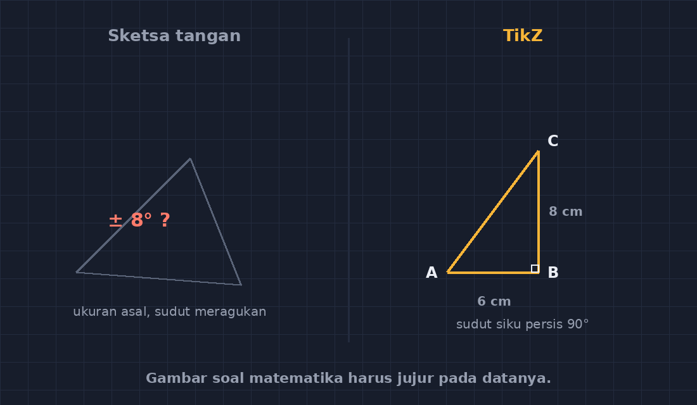
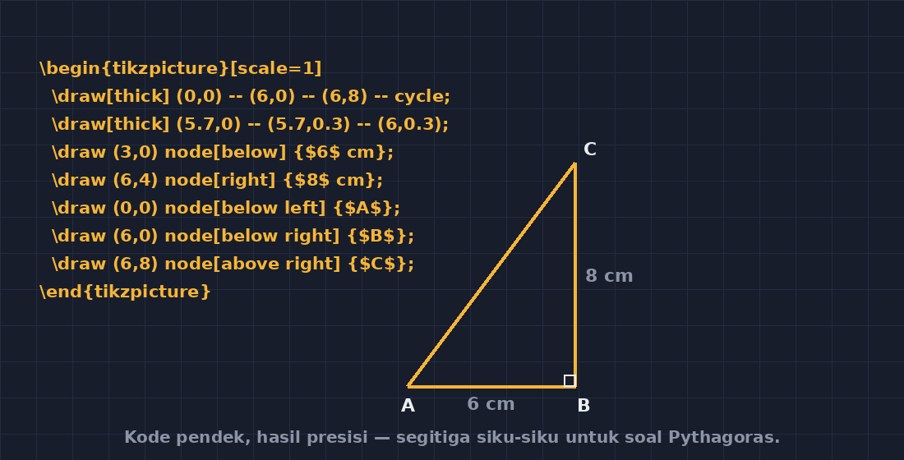
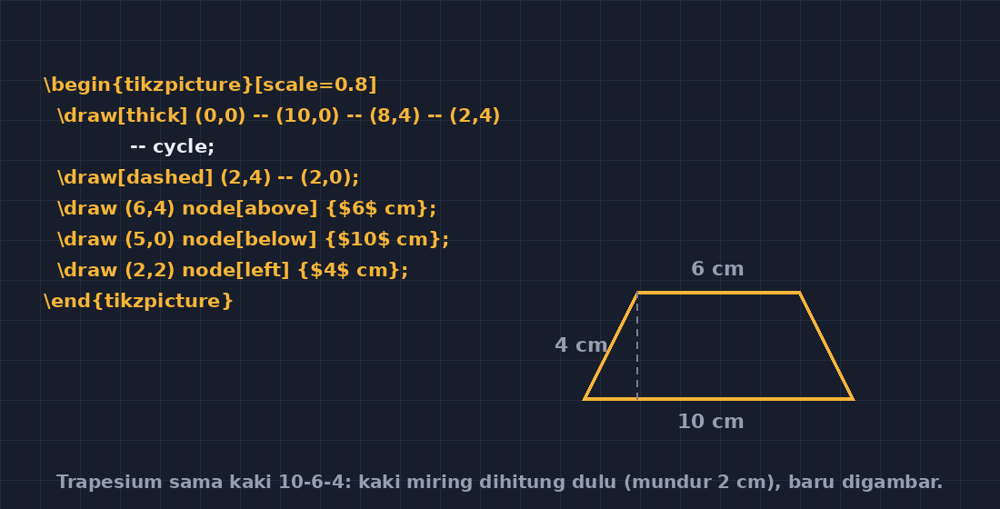
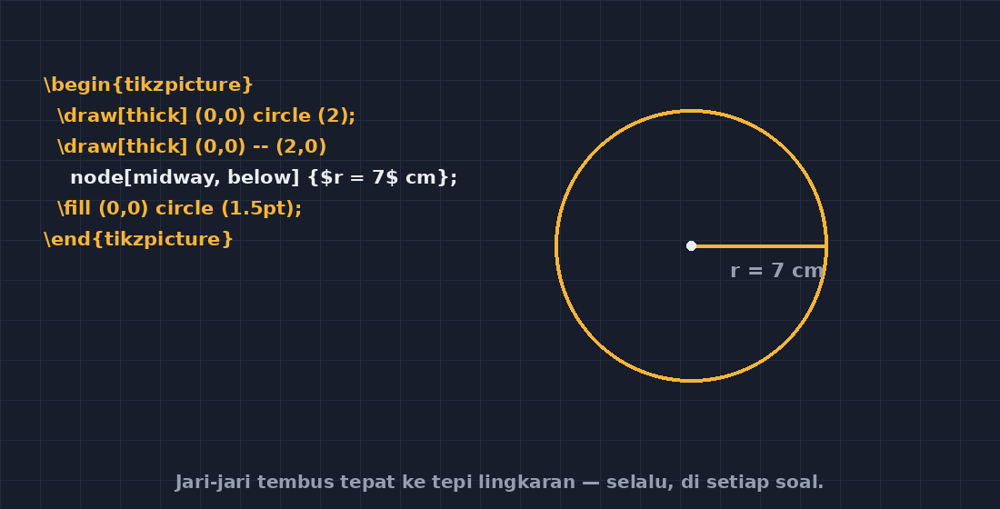

Beberapa minggu lalu saya menulis tentang membuat bidang koordinat dengan TikZ. Rupanya tulisan itu "menular" — dua rekan guru di sekolah ikut mencoba, dan yang paling sering ditanyakan ke saya bukan soal sumbu koordinat, melainkan: "Kalau gambar bangun datar untuk soal geometri, bagaimana? Soal luas trapesium, teorema Pythagoras, itu kan harus ada gambarnya."

<!--more-->

Pertanyaan itu menyentuh luka lama saya. Dulu, ketika menyusun soal ulangan harian, bagian paling menyita waktu justru bukan merumuskan soalnya — melainkan menggambar penunjangnya. Saya sketsa di kertas, foto dengan HP, tempel di dokumen. Hasilnya miring, ukurannya tidak karuan, dan yang paling memalukan: kadang gambarnya bertentangan dengan data soal. Ada satu momen yang saya tidak mudah lupakan, ketika seorang siswa berdiri dan bertanya, "Pak, di gambar sisi yang enam kok kelihatan lebih pendek dari yang lima?" Saya hanya bisa tertawa gugup dan bilang, "Gambar itu tidak berskala, ya." Semua siswa mendengung, *tidak berskala*, seperti jimat penangkal pertanyaan susulan.

Padahal jujur saja, itu pembenaran penyelamat. Gambar soal matematika yang menyimpang dari datanya justru melatih siswa membaca gambar secara keliru.

## Prinsip yang saya pegang sekarang: gambar harus jujur



*Kiri: sketsa asal yang sudut dan sisinya meragukan. Kanan: gambar TikZ yang mengikuti data soal.*

Sejak pindah ke TikZ, saya menetapkan satu prinsip: **gambar soal digambar dari datanya, bukan dari perasaan**. Kalau soal menyebut trapesium dengan sisi sejajar $8$ cm dan $5$ cm serta tinggi $4$ cm, maka di TikZ saya menghitung dulu koordinat titik-titiknya, baru menggambar. Perhitungannya sederhana — tinggal memecah trapesium menjadi persegi panjang dan segitiga siku-siku:

$$x = \sqrt{(8-5)^2 - 4^2}\ \text{cm}...$$

Tunggu, itu malah tidak punya solusi real. Justru begini: kemaluan seperti inilah yang membuat prosesnya berharga. Ketika saya menyusun data soal, TikZ memaksa saya menghitung dulu apakah data itu *mungkin ada*. Trapesium dengan data tak konsisten tidak akan tergambar rapi — dan kalau saya tetap memaksakan, hasilnya meliuk seperti tanda tangan di ATM. Dulu, soal-soal saya kadang menyimpan data geometri yang mustahil, dan tidak ada yang sadar. Sekarang, gambar jadi semacam uji konsisten otomatis: kalau susah digambar, cek ulang soalnya.

## Segitiga untuk soal Pythagoras

Mulai dari yang paling sering: segitiga siku-siku. Misal soal berisi segitiga dengan sisi alas $6$ cm dan tinggi $8$ cm. Satu unit TikZ saya buat sama dengan satu sentimeter, jadi koordinatnya langsung terbaca:

```latex
\begin{tikzpicture}[scale=1]
  \draw[thick] (0,0) -- (6,0) -- (6,8) -- cycle;
  \draw[thick] (5.7,0) -- (5.7,0.3) -- (6,0.3); % siku di C
  \draw (3,0) node[below] {$6$ cm};
  \draw (6,4) node[right] {$8$ cm};
  \draw (0,0) node[below left] {$A$};
  \draw (6,0) node[below right] {$B$};
  \draw (6,8) node[above right] {$C$};
\end{tikzpicture}
```



*Perintahnya empat baris, hasilnya segitiga dengan sudut siku yang benar-benar siku.*

Bagian yang paling saya sukai adalah tanda siku itu. Di kertas, saya menggambar kotak kecil di sudut dan selalu tidak persis. Di TikZ, tiga koordinat kecil — `(5.7,0) -- (5.7,0.3) -- (6,0.3)` — dan sudut siku ditandai sempurna, setiap kali, di setiap soal.

## Trapesium: di sinilah saya belajar menghitung dulu

Trapesium adalah "bos level" pertama saya. Bentuknya miring-miring, dan kalau asal memasang koordinat, hasilnya jelek. Cara yang saya pakai: hitung dulu letak kaki miringnya. Misal trapesium sama kaki dengan sisi sejajar $10$ cm dan $6$ cm serta tinggi $4$ cm. Selisih sisi sejajar adalah $4$ cm, dibagi dua karena kedua sisi miring simetris, jadi titik miringnya mundur $2$ cm:

```latex
\begin{tikzpicture}[scale=0.8]
  \draw[thick] (0,0) -- (10,0) -- (8,4) -- (2,4) -- cycle;
  \draw[dashed] (2,4) -- (2,0);
  \draw (6,4) node[above] {$6\ \text{cm}$};
  \draw (5,0) node[below] {$10\ \text{cm}$};
  \draw (2,2) node[left] {$4\ \text{cm}$};
\end{tikzpicture}
```



*Trapesium 10-6-4 dengan garis tinggi putus-putus — jembatan berpikir menuju rumus luas.*

Perhatikan garis putus-putusnya. Itu bukan hiasan — itu jembatan berpikir untuk siswa yang akan memecah trapesium menjadi persegi panjang dan dua segitiga siku-siku. Gambar soal yang baik diam-diam menggiring strategi penyelesaian, dan itu bisa saya rancang sengaja di TikZ. Ini yang tidak bisa saya lakukan dengan foto sketsa.

## Lingkaran dan label yang rapi

Untuk lingkaran, TikZ menyediakan cara yang nyaris memalukan kemudahannya:

```latex
\begin{tikzpicture}
  \draw[thick] (0,0) circle (2);
  \draw[thick] (0,0) -- (2,0) node[midway, below] {$r = 7$ cm};
  \fill (0,0) circle (1.5pt);
\end{tikzpicture}
```



*Tiga baris kode, satu lingkaran dengan jari-jari yang persis.*

Dulu masalah terbesar saya dengan lingkaran di Word adalah jari-jari yang tidak tembus ke tepi lingkaran. Sudah saya perbesar, sudah saya geser, tetap melenceng sedikit — dan "sedikit" itu cukup untuk membuat sebagian siswa menghitung dari ujung garis yang salah.

## Yang berubah di kelas

Menariknya, efek dari gambar soal yang jujur ini terasa di kelas. Waktu membahas pembahasan, saya jarang lagi mendengar perdebatan "kok gambarnya begini, Pak?" Siswa belajar membaca data dari gambar karena gambar memang bisa dipercaya. Dan ada bonus yang tidak saya duga: beberapa siswa penasaran dengan cara saya membuat soal. Ada yang lihat dokumen LaTeX saya dan bertanya, "Pak, tulisannya kok seperti kode?" Dari situ terbuka pembicaraan kecil tentang arti "membuat alat" — bahwa guru pun pernah jadi pemula, mencoba, gagal, lalu bisa.

Kalau Bapak/Ibu ingin memulai, saran saya jangan langsung trapesium. Mulai dari segitiga siku-siku, karena koordinatnya paling mudah dipikirkan, lalu naik bertahap. Yang penting bukan kecepatan, tapi kebiasaan baru itu: **hitung dulu, gambar kemudian**. Gambar soal kita akhirnya berdiri di sisi kebenaran yang sama dengan soalnya — dan siswa pun berhenti mendengungkan *tidak berskala* sebagai jimat.

Dulu saya pikir menggambar soal itu pekerjaan sampingan yang bisa asal-asal. Ternyata setiap gambar adalah bagian dari argumen matematika itu sendiri. Dan sebagaimana biasanya di tulisan saya soal TikZ, kali ini pun saya pulang dengan satu kesimpulan: alat yang tepat tidak hanya mempercepat pekerjaan, ia memperbaiki cara kita berpikir.


---

> 📎 **Berkas TikZ lengkap:** [bangun-datar.tex](tex/bangun-datar.tex) — dokumen siap kompilasi (butuh paket `tikz`). Silakan ganti angka-angkanya untuk dokumen Anda sendiri.
