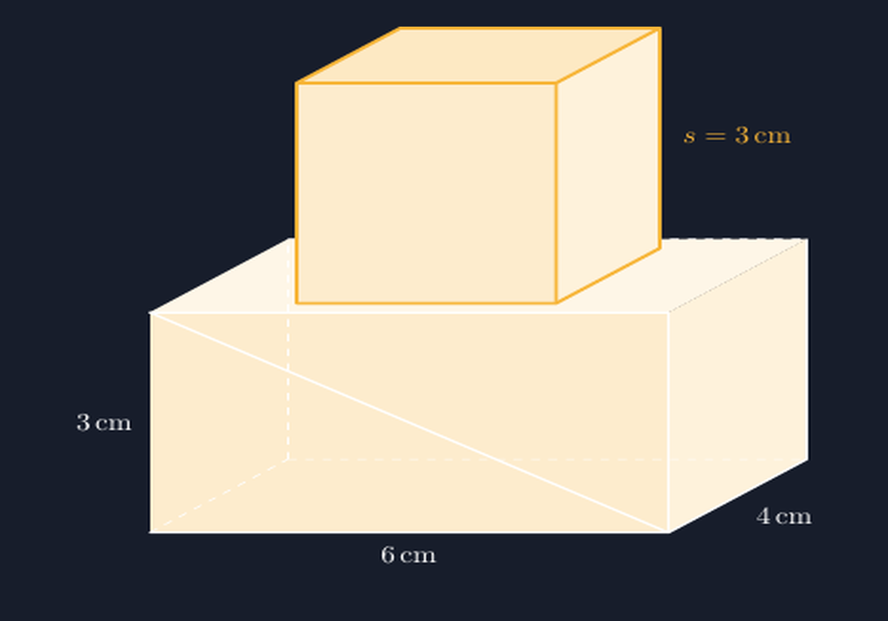

Ada satu momen yang hampir selalu terulang setiap kali saya mengajar volume bangun ruang gabungan. Saya gambar di papan tulis sebuah balok, lalu di atasnya saya tempel sebuah kubus. Kata "tempel" memang sengaja saya pilih, karena hasil gambarnya memang terlihat seperti ditempel: kubusnya melayang, rusuknya tidak pas, dan sisi alas kubus tidak benar-benar menempel pada alas atas balok. Siswa tetap paham maksud saya, tentu saja. Tapi ada bagian dari diri saya yang tidak nyaman setiap kali melihat gambar sendiri yang tidak jujur pada bentuknya.

<!--more-->

## Soal yang Biasanya Datang lebih Dulu

Di kelas VIII, bangun ruang gabungan biasanya muncul dalam soal seperti ini: sebuah balok berukuran $6\text{ cm} \times 4\text{ cm} \times 3\text{ cm}$, di atasnya diletakkan kubus dengan panjang rusuk $3\text{ cm}$. Hitunglah volume gabungan kedua bangun itu.

Kalau hanya ditanya volume, sebenarnya soal ini sederhana. Volume balok ditambah volume kubus, selesai:

$$V = V_{\text{balok}} + V_{\text{kubus}} = (6 \times 4 \times 3) + (3^3) = 72 + 27 = 99\text{ cm}^3$$

Tapi justru di titik "selesai" itulah masalahnya mulai. Karena yang latihannya hanya berhenti di rumus, siswa sering tidak benar-benar melihat bangunnya. Tanyakan saja: kubus itu menempel di bagian mana dari balok? Berapa sisi yang tertutup? Kalau ditanya luas permukaan gabungan, kenapa ada sisi yang tidak dihitung? Di sinilah gambar berperan. Dan seperti tulisan-tulisan saya sebelumnya tentang TikZ, prinsip yang saya pegang tetap sama: gambarnya harus jujur. Kalau rusuknya tiga sentimeter, maka di gambar harus tiga unit, bukan dua setengah atau empat.

## Menggambar yang Menempel sungguhan

Kunci menggambar bangun ruang gabungan dengan TikZ sebenarnya bukan pada rumus rumit, melainkan pada satu kesepakatan sederhana: kedua bangun harus memakai proyeksi yang sama. Saya pakai proyeksi miring yang sudah sering saya pakai untuk gambar balok dan kubus terpisah, kira-kira seperti ini:

```latex
% proyeksi: x' = x + 0.4z, y' = y + 0.25z
```

Dengan kesepakatan itu, setiap titik tiga dimensi $(x, y, z)$ punya alamat tetap di kertas dua dimensi. Balok dengan panjang 6, lebar 4, dan tinggi 3 digambar dari titik-titik yang dihitung dengan rumus yang sama. Kubusnya pun begitu. Dan karena kubus duduk di atas balok, maka alas kubusnya cukup diletakkan pada ketinggian $y = 3$, persis di permukaan atas balok. Tidak perlu menebak-nebak posisi, tidak ada kubus melayang.

Bagian yang paling sering bikin hasil gambar terlihat "palsu" sebenarnya adalah rusuk yang tersembunyi. Pada balok, rusuk-belakang-bawah tidak terlihat dari arah pandang kita, jadi saya gambar putus-putus. Tapi begitu ada kubus di atasnya, ada juga bagian alas atas balok yang tertutup kubus. Di situlah urutan menggambar jadi penting: alas atas balok digambar dulu, kubus ditimpa setelahnya, sehingga secara alami kubus menutupi bagian balok yang memang harus tertutup.

Saya tidak akan menyalin seluruh kode di sini supaya tulisan ini tidak berubah jadi tutorial kopas. Versi lengkapnya, yang bisa langsung dikompilasi, saya sertakan di akhir tulisan ini. Yang penting untuk dilihat adalah hasilnya: label $6\text{ cm}$ ada di bawah rusuk yang panjangnya memang enam unit, label $s = 3\text{ cm}$ ada di rusuk kubus yang memang tiga unit. Gambar itu bisa dipegang pertanggungjawabannya.


*Balok $6 \times 4 \times 3$ cm dengan kubus bersisi 3 cm di atasnya — digambar dengan satu proyeksi yang sama untuk kedua bangun.*

## Gambar yang Membuka Pertanyaan

Hal yang saya suka dari punya gambar yang benar: siswa mulai bertanya hal-hal yang tidak muncul dari soal tertulis. Baru-baru ini, setelah menatap gambar seperti di atas cukup lama, seorang siswa bertanya, "Pak, kalau kubusnya ditaruh di pojok balok, volumenya berubah tidak?"

Pertanyaan itu emas. Volumenya tentu tidak berubah, dan siswa itu sendiri yang menyimpulkannya setelah berdebat sebentar dengan temannya. Tapi pertanyaan itu hanya muncul karena ada gambar yang bisa ditatap. Dari soal tertulis, kubus "di atas balok" itu abstrak; dari gambar, dia benda yang bisa dipindah-pindahkan di kepala.

Pertanyaan lanjutannya biasanya soal luas permukaan. Di sinilah saya membiarkan siswa menemukan sendiri bahwa sisi alas kubus dan bagian alas atas balok yang tertutup kubus tidak dihitung, karena memang tidak menjadi permukaan luar. Untuk kasus kubus di atas balok seperti ini, luas permukaan gabungannya:

$$L = L_{\text{balok}} + L_{\text{kubus}} - 2 \times (3 \times 3) = 108 + 54 - 18 = 144\text{ cm}^2$$

Faktor dua itu, sisi yang tertutup di kedua bangun, jauh lebih mudah diyakini siswa kalau mereka bisa melihat sisi mana yang hilang. Dari rumus yang dihafal, dia berubah jadi kesimpulan yang ditemukan.

## Jujur ke Arah Mana Pun Gambar Dilihat

Ada bonus lain dari menggambar dengan proyeksi konsisten: saya bisa memakai gambar yang sama untuk menunjukkan bangun dari "sisi yang tidak terlihat". Cukup ubah urutan menggambar sisi-sisinya, dan siswa melihat bahwa rusuk putus-putus tadi sebenarnya rusuk yang sama dengan yang tegas di gambar lain. Untuk siswa yang masih kesulitan membayangkan bangun tiga dimensi di kepala, pergantian sudut pandang seperti ini sering jadi titik balik.

Saya sadar gambar TikZ seperti ini tidak akan pernah menggantikan benda konkret. Kalau ada kardus dan dadu besar di kelas, itu tetap juaranya. Tapi benda konkret itu tidak selalu tersedia, dan di lembar soal, di slide, di buku latihan yang saya cetak, gambar adalah perwakilan satu-satunya dari bangun itu. Kalau perwakilannya melayang dan dimensinya bohong, maka siswa belajar dari gambar yang bohong.

Makanya saya terus membangun koleksi gambar-gambar ini, satu per satu, pelan-pelan. Kubus di atas balok hari ini, mungkin limas terpancung minggu depan. Bukan karena teknologinya hebat, tapi karena janji sederhananya: gambar yang tidak pernah menipu siswa yang sedang belajar melihat.

> 📎 **Berkas TikZ lengkap:** [tikz-bangun-ruang-gabungan.tex](tex/tikz-bangun-ruang-gabungan.tex) — siap kompilasi (butuh paket `tikz`).