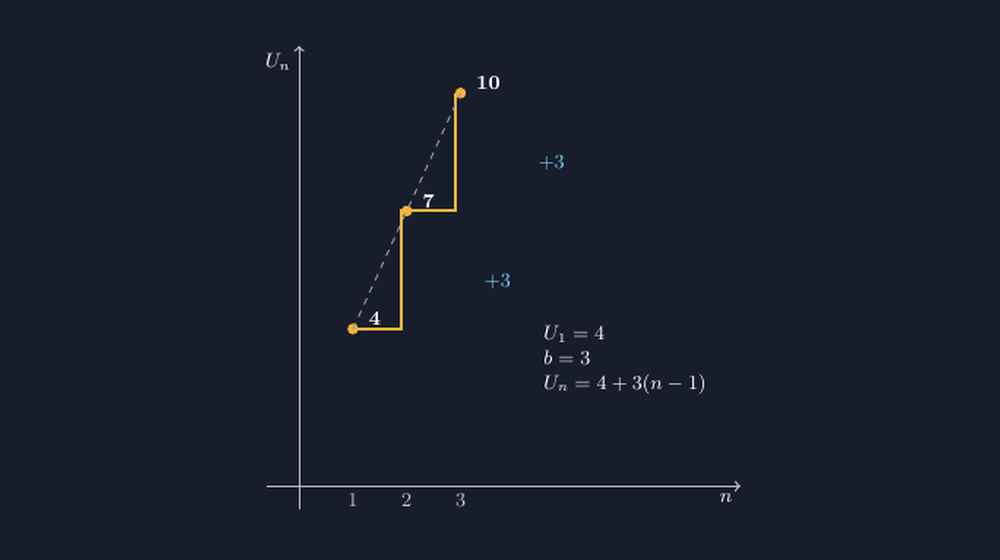

Ada satu momen di kelas VIII yang tidak pernah saya lupakan. Kami sedang membahas barisan bilangan, dan saya menulis di papan tulis: 4, 7, 10, 13, 16, dan seterusnya. Lalu saya bertanya, "Ada yang menyadari polanya?"

Seorang siswa menjawab, "Selalu tambah tiga, Pak."

Betul. Tapi ketika saya minta dia menjelaskan ke temannya, jawabannya berhenti di situ. "Tambah tiga" itu terdengar seperti mantra, bukan pengertian. Ketika saya ubah soalnya menjadi 5, 9, 13, dia masih bisa, tapi ketika saya minta dia menebak suku kesepuluh tanpa menulis satu per satu, dia bingung dari mana harus memulai perhitungannya.

Di situlah saya sadar: kata "pola" bagi siswa sering kali baru berhenti di tingkat pengamatan. Mereka melihat perbedaan yang sama, tapi mereka belum *melihat* perbedaan itu sebagai sesuatu yang punya bentuk. Karena itu di pertemuan berikutnya, saya menggambar tangga titik di papan tulis — dan minggu ini, versi rapinya saya buat dengan TikZ.

<!--more-->

## Kenapa "tangga", bukan sekadar deretan angka

Coba bandingkan dua cara menyajikan barisan $4, 7, 10, 13, \dots$. Cara pertama: deretan angka di satu baris, seperti yang saya tulis di papan. Cara kedua: titik-titik yang diposisikan pada bidang koordinat, dengan sumbu mendatar menyatakan nomor suku $n$ dan sumbu tegak menyatakan nilai suku $U_n$.

Pada cara kedua, siswa tidak hanya membaca angka — mereka melihat *gerak*. Titik pertama berdiri di ketinggian 4. Titik kedua naik tiga satuan. Titik ketiga naik tiga satuan lagi. Setiap langkah naik punya ketinggian yang sama, persis seperti anak tangga yang dibuat oleh tukang yang teliti.


*Gambar 1. Tangga titik barisan $4, 7, 10, \dots$: setiap anak tangga naik tetap sebesar $b = 3$, dari suku pertama $U_1 = 4$.*

Gambar seperti ini yang saya pasang di lembar kerja siswa. Efeknya menarik: siswa yang tadinya bilang "tambah tiga" mulai berkata, "Jadi naiknya selalu sama tingginya, Pak?" Perbedaan kata — dari "tambah" menjadi "naik sama tinggi" — terdengar kecil, tapi bagi saya itu tanda bahwa mereka sudah berpindah dari menghafal pola menjadi melihat pola.

Dan dari gambar tangga itu pula, rumus umum tidak lagi muncul dari langit. Siswa bisa melihat sendiri: suku pertama ada di ketinggian 4, lalu untuk sampai ke suku ke-$n$ kita harus menaiki tangga sebanyak $n-1$ kali, masing-masing setinggi 3. Jadi ketinggiannya:

$$U_n = 4 + 3(n-1)$$

Ketika rumus lahir dari gambar yang mereka lihat sendiri, rumus itu tidak lagi terasa seperti jawaban yang diturunkan dari atas. Ia jadi kesimpulan yang mereka temukan.

## Menuliskannya dalam TikZ

Bagi saya, menggambar tangga titik dengan tangan di papan selalu menyisakan masalah klasik: jarak antar titik tidak pernah benar-benar sama, dan siswa yang jeli akan menangkap ketidakjujuran itu. "Pak, yang ini naiknya kok kelihatan lebih tinggi?" Padahal secara konsep keduanya sama-sama naik tiga. Di papan tulis, saya hanya bisa menjawab "anggap saja sama, ya." Jawaban seperti itu melemahkan justru konsep yang sedang diajarkan.

Dengan TikZ, ketidakjujuran itu hilang. Koordinat setiap titik saya tulis eksplisit, dan jarak antar anak tangga dihitung komputer, bukan perkiraan tangan saya. Berikut inti kode tangga pada barisan $4, 7, 10$:

```latex
\draw[aksen,line width=1.4pt]
  (1,4) -- (1.9,4) -- (1.9,7) -- (2.9,7) -- (2.9,10);
\foreach \x/\y/\l in {1/4/4, 2/7/7, 3/10/10}{
  \filldraw[aksen] (\x,\y) circle (2.2pt);
  \node[anchor=west] at (\x+0.15,\y+0.25){\l};
}
```

Ada dua hal yang sengaja saya rancang di kode ini. Pertama, garis tangga dibuat sebagai satu lintasan putus-putus horizontal-vertikal yang bersambung — bukan tiga segmen terpisah. Siswa melihat bahwa tangga itu *satu perjalanan*, bukan tiga lompatan yang tidak berhubungan. Kedua, label angka di sisi setiap titik diletakkan sedikit ke kanan-atas dari titiknya, bukan tepat di atasnya, supaya tidak menutupi garis naik.

Untuk menegaskan pola kenaikannya, saya tambahkan garis bantu putus-putus dari titik pertama ke titik ketiga:

```latex
\draw[dashed] (1,4) -- (3,10);
\foreach \x/\y in {2/5.2, 3/8.2}{
  \node[biru] at (\x,\y) {$+3$};
}
```

Garis putus-putus itu punya fungsi pedagogis yang halus. Kalau barisan aritmetika dilukiskan sebagai titik-titik di bidang, titik-titik itu sebenarnya berbaris rapi pada satu garis lurus — itulah ciri khas kelurusan yang nanti, di kelas IX atau X, akan mereka kenal sebagai "grafik fungsi linear". Melihat garis putus-putus yang melalui ketiga titik adalah benih pemahaman itu: bahwa pola yang bertambah tetap selalu berujung pada garis lurus.

Yang juga penting: pada kode di atas, kenaikan $+3$ saya tulis sebagai label terpisah di samping masing-masing anak tangga, bukan sebagai satu keterangan umum di pojok gambar. Saya ingin siswa memeriksa sendiri, "apakah benar dua-duanya bertuliskan +3?" — dan menemukan jawabannya di tempat kejadian, bukan di catatan kaki.

## Dari gambar ke makna

Pengalaman beberapa kali memakai tangga titik ini mengajarkan saya satu hal soal media: gambar yang baik bukan yang paling indah, tapi yang paling *jujur pada konsep*. Tangga titik yang digambar asal — anak tangganya kadang tinggi kadang rendah — justru mengajarkan miskonsepsi. Padahal esensi barisan aritmetika justru ada pada kata "tetap": bedanya tetap, naiknya tetap.

Sekarang kalau ada siswa yang bertanya kenapa rumusnya $U_n = a + (n-1)b$, saya tidak langsung menjawabnya. Saya minta dia melihat tangga di gambar: dari mana titik pertama berdiri ($a$), berapa kali dia harus naik untuk sampai ke suku ke-$n$ ($n-1$ kali), dan setinggi apa setiap naikan ($b$). Rumus itu tinggal dibaca dari gambar.

Ada kepuasan tersendiri ketika yang tadinya mantra "tambah tiga" berubah menjadi kalimat, "Oh, jadi naiknya $(n-1)$ kali, ya, Pak, karena yang pertama belum naik." Kalimat seperti itu tidak bisa saya beli dengan menjelaskan lebih lama di papan tulis. Ia muncul ketika siswa diberi gambar yang benar — dan diberi waktu untuk memandanginya cukup lama.

Bagi rekan-rekan guru yang ingin mencoba, berkas TikZ lengkapnya saya sertakan di bawah. Ubah saja nilai suku pertama dan bedanya sesuai barisan yang sedang dibahas di kelas, lalu biarkan tangganya naik dengan jujur — sama tinggi di setiap langkah.

> 📎 **Berkas TikZ lengkap:** [tangga-barisan-aritmetika.tex](tex/tangga-barisan-aritmetika.tex) — siap kompilasi (butuh paket `tikz`).
