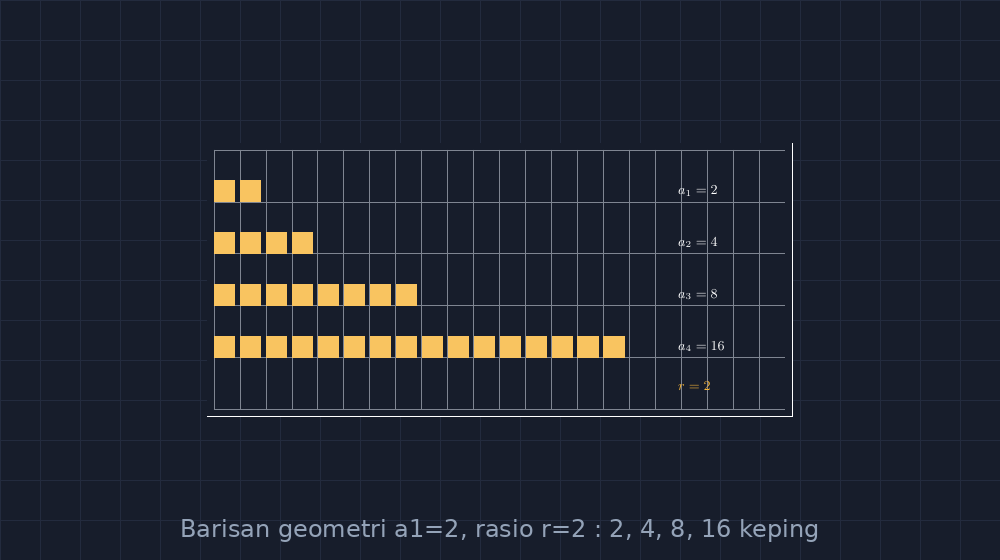

Bab barisan dan deret di kelas sembilan selalu punya momen yang sama setiap tahun: siswa dengan cepat hafal cara kerja barisan aritmetika — "tambah terus, bedanya sama" — lalu begitu berganti ke barisan geometri, ada jeda panjang sebelum kelas mengerti. Bukan karena konsepnya lebih sulit, tapi karena perubahan dari "ditambah" ke "dikali" itu terasa abstrak kalau hanya ditulis di papan. Dua, empat, delapan, enam belas — ya, lalu? Angka itu tidak bicara. Belum ada gambar yang membuatnya bicara.

<!--more-->

## Kepingan Kertas yang Berlipat

Percobaan pertama saya tahun lalu sederhana banget: kertas HVS dan gunting. "Ambil satu keping kertas. Sekarang anggap tiap langkah, setiap keping terbelah menjadi dua." Baris pertama: satu keping. Baris kedua: dua keping. Ketiga: empat. Anak-anak menghitung sambil tersenyum, dan yang menarik, beberapa langsung meneriakkan "delapan!" untuk baris keempat sebelum saya sempat bertanya. Itulah momen yang saya cari — saat polanya *terlihat* sebelum rumusnya ditulis.

Masalahnya, kepingan kertas di papan tulis tidak bisa digambar dengan rapi. Sekali saya mencoba sketsa manual, ukuran kotak-kotaknya tidak konsisten: baris kedua kotaknya lebih kecil dari baris pertama, baris ketiga malah menyempit karena papan tinggal sedikit. Anak yang jeli langsung protes, "Pak, kok kotaknya mengecil padahal bilangnya jadi dua?" Protes seperti itu justru peluang emas — karena pertanyaannya benar — tapi juga menampar: gambar yang tidak jujur pada ukuran justru merusak konsep yang sedang diajarkan.

Seperti tulisan-tulisan saya sebelumnya tentang tangga barisan aritmetika, akhirnya saya pindahkan gambar-gambar ini ke TikZ. Kalau aritmetika adalah tangga yang naik sama tinggi tiap anak tangga, geometri adalah tangga yang anak tangganya melompat makin jauh. Dan perbedaan itu harus kelihatan di gambar, bukan cuma di rumus.

## Menggambar yang Terlipat Dua

Ide dasarnya: setiap baris barisan digambarkan sebagai sekelompok persegi sama ukuran. Barisan $a_n = a_1 \cdot r^{n-1}$ dengan $a_1 = 2$ dan $r = 2$ menjadi barisan kepingan: 2, 4, 8, 16. Setiap persegi punya lebar tetap — tidak boleh menyusut — supaya yang berubah hanya *banyaknya* keping, bukan ukurannya.

Kuncinya, pakai loop `\foreach` supaya jumlah keping mengikuti nilai barisan langsung dari perhitungan:

```latex
\foreach \n/\jmlh in {1/2, 2/4, 3/8, 4/16} {
  \foreach \k in {1,...,\jmlh}
    \fill[aksen!80] ({(\k-1)*0.6}, -\n*1.2) rectangle ++(0.5,0.5);
  \node[teks] at (9.5, -\n*1.2+0.25) {$a_{\n} = \jmlh$};
}
```

Dua hal yang menurut saya wajib dijaga di sini. Pertama, **jarak antarbaris tetap**, meskipun jumlah kepingnya berlipat — biar tidak terjadi lagi kasus papan yang "kehabisan tempat" dan gambar berakhir miring. Kedua, **label $a_n$ berada di posisi yang sama untuk semua baris**, sehingga mata siswa bisa bergerak vertikal membandingkan angka tanpa terganggu gesekan posisi.

Setelah selesai menuliskannya, begitu melihat hasilnya, saya langsung teringat kejadian di kelas. Salah seorang murid saya, hafalannya lumayan tapi suka asal jawab, tiba-tiba bertanya, "Pak, kalau rasionya tiga gimana? Kotaknya pecah dong?" Pertanyaan bagus. Dan menjawabnya pun sekarang lebih mudah karena gambarnya tinggal diganti: $a_1 = 2$, $r = 3$, maka 2, 6, 18, 54 — jumlah kotaknya memang tidak lagi "rapi" secara visual, tapi itulah justru bagian pentingnya: barisan geometri tidak selalu berlipat dua, dan gambar tidak boleh menipu dengan selalu menampilkan yang gampang digambar.



Gambar di atas adalah versi yang saya pakai di kelas: empat baris, kepingan bertambah dua kali lipat, label rasio di sisi. Yang saya sukai dari tampilan ini, siswa bisa *menghitung* keping satu per satu untuk baris awal, lalu pada baris keempat mereka menyerah menghitung dan mulai menebak polanya. Menyerah menghitung adalah pintu masuk menuju rumus $a_n = a_1 \cdot r^{n-1}$ — rumus itu lahir dari kebutuhan, bukan dari hafalan.

## Ketika Rasio Kecil dari Satu

Ada satu variasi yang menurut saya sering dilewatkan di buku: $0 < r < 1$. Barisan yang justru menyusut: 16, 8, 4, 2, 1. Di papan tulis, barisan seperti ini terasa "aneh" — siswa terbiasa dengan angka yang membesar, lalu tiba-tiba ada barisan yang melompat ke arah nol.

Dengan gambar, arah pertumbuhan itu kelihatan jelas: keping yang tadinya menumpuk justru lama-lama berkurang. Saya sering mengaitkannya dengan pengalaman nyata: sepotong cokelat yang terus dipecah dua, sampai suatu saat potongannya sekecil remah. "Nanti habis nggak, Pak?" tanya salah satu murid perempuan di kelas saya tahun lalu. Dan di situ saya bisa menjawab dengan tenang: secara matematika, barisannya tak pernah nol — $16 \cdot \left(\tfrac{1}{2}\right)^{n-1}$ selalu lebih besar dari nol — tapi secara fisik, cokelatnya habis. Batas antara model matematika dan dunia nyata itu sendiri sudah merupakan pelajaran berharga.

Untuk menggambarkannya di TikZ, cukup membalik urutan: baris pertama paling panjang, keping berkurang setengah di tiap baris. Loop yang sama tetap bekerja, karena jumlah keping tinggal disubstitusi. Ini salah satu kelebihan yang saya rasakan sejak pindah ke TikZ: mengubah skenario tidak berarti menggambar ulang dari nol.

## Dari Gambar ke Rumus, Bukan Sebaliknya

Rutinitas saya di kelas sekarang: gambar dulu, hitung bersama, baru rumus. Urutan ini terasa mundur dibanding cara saya dulu — yang menulis rumus di paling atas papan, lalu contoh soal di bawahnya — tapi justru urutan yang "mundur" inilah yang membuat rumus akhirnya punya makna.

Ada satu penilaian kecil yang saya lakukan lewat jurnal mengajar digital saya: siswa yang belajar barisan geometri lewat gambar kepingan ini, ketika bertemu soal cerita tentang bunga tabungan yang berbunga 2% per bulan, lebih cepat mengaitkan bahwa yang bekerja adalah *pengali*, bukan *selisih*. Mereka tidak bingung ketika soal berbunyi "tabungan Setiap tahun dikalikan 1,02" — karena di kepala mereka, kepingan itu memang pernah berlipat. Barisan geometri bukan lagi sekadar bab di buku; ia menjadi bentuk dari pengalaman melipat dan berlipat.

Begitulah cara saya bekerja belakangan ini: setiap konsep yang terasa "dingin" di buku, saya coba beri wujud yang jujur — jujur pada ukuran, jujur pada jumlah, jujur pada arah pertumbuhannya. TikZ bukan alat dekorasi untuk mempercantik lembar kerja; ia adalah cara saya menjaga kejujuran gambar supaya konsepnya sampai. Dan untuk barisan geometri, kepingan yang berlipat dua itu ternyata cukup untuk membuat kelas sembilan berteriak "delapan!" sebelum saya selesai bertanya.

> 📎 **Berkas TikZ lengkap:** [tikz-barisan-geometri.tex](tex/tikz-barisan-geometri.tex) — siap kompilasi (butuh paket `tikz`).
