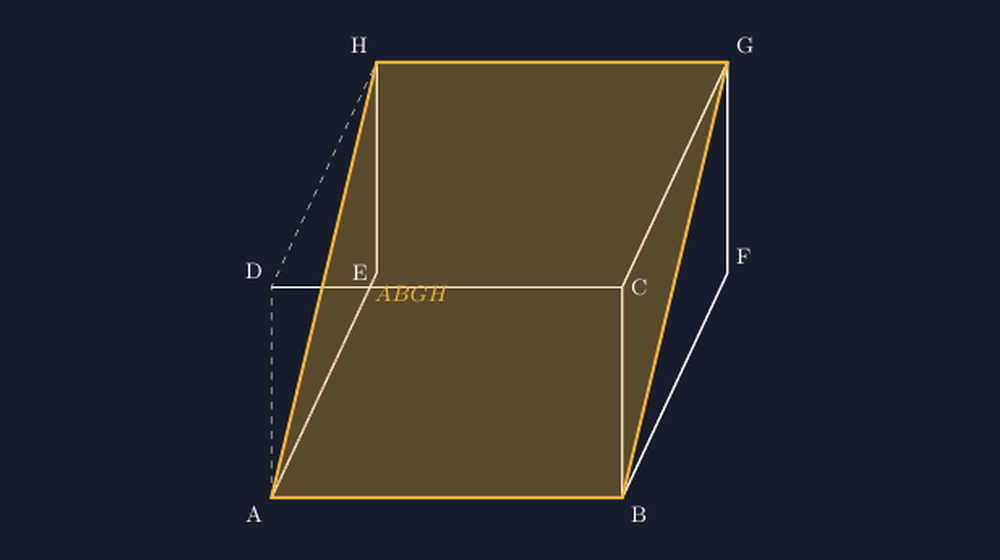
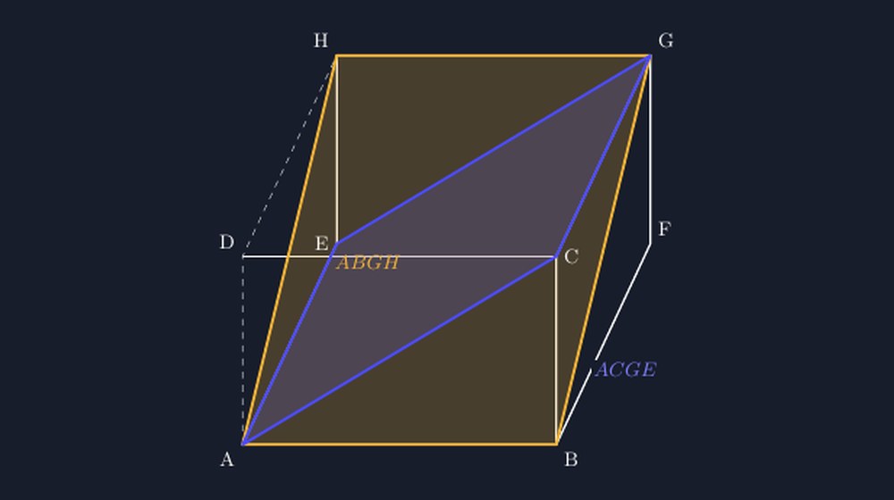

Dulu, waktu masih mengajar di kelas lain, saya pernah menemukan soal latihan yang bunyinya begini: "Tentukan luas bidang diagonal sebuah balok berukuran $8\\text{ cm} \\times 6\\text{ cm} \\times 4\\text{ cm}$." Hampir seluruh kelas menjawab dengan cara yang sama: mencari diagonal sisi alas, lalu dikali lebar. Jawabannya seragam, rapi, dan semuanya salah besar. Yang tidak mereka sadari, soal itu justru tidak jelas — bidang diagonal balok ada dua jenis, dan keduanya punya luas berbeda.

Pengalaman itu yang membuat saya mulai serius menggambar bidang diagonal dengan benar di TikZ. Kalau soalnya saja bisa tidak jelas, maka gambar pendukungnya wajib jujur.

<!--more-->

## Dua Bidang yang Sering Dicampur

Dalam balok $ABCD.EFGH$, ada dua jenis bidang diagonal yang sering muncul di soal:

1. **Bidang diagonal yang memotong sisi tegak**, misalnya $ABGH$ — melewati rusuk alas $AB$ dan rusuk atas $GH$ yang sejajar dengannya. Luasnya adalah diagonal alas dikali tinggi balok:

$$L_1 = d_{\text{alas}} \\times t = \\sqrt{p^2 + l^2} \\cdot t$$

2. **Bidang diagonal yang melewati dua rusuk alas yang berpotongan**, misalnya $ACFH$ — melewati diagonal alas $AC$ dan tinggi balok. Bentuknya juga persegi panjang dengan lebar $\\sqrt{p^2 + l^2}$ dan panjang $t$.

Tunggu — keduanya ternyata identik secara ukuran! Diagonal alas yang sama dikali tinggi yang sama. Justru di sinilah letak kekayaannya: siswa yang menghitung "diagonal alas dikali lebar" itu sebenarnya sudah setengah benar. Yang keliru adalah faktor pengalinya. Seharusnya tinggi balok, bukan lebar — karena bidang diagonal itu "berdiri" dari alas ke atap, bukan menyamping.

Kesalahan itu tidak akan terlihat kalau siswa tidak pernah digambar bidangnya. Mereka menghitung simbol tanpa pernah melihat bentuknya di ruang. Di situlah gambar TikZ jadi penting: bukan sekadar hiasan soal, tapi alat berpikir.

## Menggambar Bidang Diagonal ABGH

Mari mulai dari yang paling murni: bidang diagonal yang "berdiri" memotong balok dari rusuk alas ke rusuk atas yang sejajar. Untuk balok dengan panjang $p$, lebar $l$, tinggi $t$, saya definisikan kedelapan titiknya dulu — kebiasaan yang sudah saya ceritakan di artikel sebelumnya tentang balok:

```latex
\\begin{tikzpicture}[
  scale=0.9,
  line join=round,
  visible/.style={thick},
  hidden/.style={thin, dashed}
]
  \\def\\p{5} \\def\\l{3} \\def\\t{3.2}
  \\def\\dx{1.4} \\def\\dy{1.0}

  \\coordinate (A) at (0,0);
  \\coordinate (B) at (\\p,0);
  \\coordinate (C) at (\\p,\\l);
  \\coordinate (D) at (0,\\l);
  \\coordinate (E) at (\\dx,\\t);
  \\coordinate (F) at (\\p+\\dx,\\t);
  \\coordinate (G) at (\\p+\\dx,\\l+\\t);
  \\coordinate (H) at (\\dx,\\l+\\t);

  % rusuk terlihat
  \\draw[visible] (A) -- (B) -- (F) -- (G) -- (H) -- (E) -- cycle;
  \\draw[visible] (B) -- (C) -- (G);
  \\draw[visible] (D) -- (C);

  % rusuk tersembunyi
  \\draw[hidden] (A) -- (D) -- (H);
  \\draw[hidden] (A) -- (E);

  % bidang diagonal ABGH
  \\fill[blue!20, opacity=0.7] (A) -- (B) -- (G) -- (H) -- cycle;
  \\draw[blue!60!black, thick] (A) -- (B) -- (G) -- (H) -- cycle;

  \\foreach \\pt in {A,B,C,D,E,F,G,H}
    \\node[above right, font=\\small] at (\\pt) {\\pt};
\\end{tikzpicture}
```

Perhatikan pola proyeksi kakinya: $E,F,G,H$ adalah $A,B,C,D$ yang digeser $(\\dx, \\dy)$. Diagonal bidangnya sendiri digambar sebagai poligon empat titik — $(A)$--$(B)$--$(G)$--$(H)$ — lalu diisi warna semi transparan supaya rusuk di belakangnya masih terbaca. Urutan titik harus melingkar, kalau tidak, hasil fill-nya kusut dan justru mengelabui siswa.


*Bidang diagonal $ABGH$ yang "berdiri": melewati rusuk alas $AB$, diagonal sisi tegak $AG$ dan $BH$, lalu rusuk atas $GH$. Warna biru semi transparan membuat rusuk belakang tetap terbaca di bawahnya.*

Kesalahan yang sering saya temui saat pertama kali mencoba: menggambar bidangnya dengan dua garis diagonal saja ($AG$ dan $BH$), tanpa menutup poligonnya. Secara visual masih terlihat "seperti bidang miring", tapi siswa jadi bingung apakah yang dimaksud garis diagonal atau bidang. Sekarang saya selalu menutup poligonnya dan mengisinya — jelas, tidak ambigu.

## Membandingkan Dua Bidang Diagonal Sekaligus

Gambar yang lebih mengajak berpikir adalah ketika dua bidang diagonal digambar bersamaan — supaya siswa bisa melihat sendiri kenapa keduanya sama luasnya. Ambil bidang $ABGH$ yang tadi, dan bandingkan dengan bidang $ACGE$ yang melewati diagonal alas $AC$:


*Dua bidang diagonal sekaligus: $ABGH$ (kuning) "berdiri" memotong balok dari rusuk ke rusuk sejajarnya, sedangkan $ACGE$ (biru) melewati diagonal alas. Diagonal alasnya sama, tingginya sama — luasnya pasti sama.*

Kuncinya di diagonal alas: $AC = \\sqrt{p^2 + l^2}$, dan itu sama dengan $BD$. Kedua bidang sama-sama memakai diagonal alas yang sama panjang sebagai satu sisinya, dan sama-sama menjulang setinggi $t$. Maka:

$$L = \\sqrt{p^2 + l^2} \\cdot t$$

Sekarang soal di awal artikel bisa saya perbaiki. Kalau saya tetap mau menanyakan "luas bidang diagonal", maka saya wajib menyebutkan bidangnya: "Tentukan luas bidang diagonal $ABGH$." Satu kalimat tambahan yang membuat soal jadi bisa dijawab dengan benar.

## Menutup Bidang di TikZ tanpa Mengelabui Mata

Ada satu detail teknis yang membuat perbedaan besar antara gambar yang jujur dan gambar yang mengelabui: **urutan titik saat mengisi poligon**. Kalau saya menulis `\\fill (A) -- (B) -- (H) -- (G) -- cycle;` — titik-titiknya tidak melingkar — hasilnya bukan persegi panjang yang rapi tapi dua segitiga yang saling menindih. Bentuknya masih "terlihat benar" sekilas, tapi rusuk tengahnya jadi hilang dan siswa bisa mengira bahwa itu satu bidang yang berbeda orientasinya.

Jadi kebiasaan saya sekarang: sebelum `\\fill`, saya selalu menuliskan titik-titik bidang dengan urutan melingkar, lalu mengeceknya dengan membacanya seperti "menyusuri tepi" bidang: $A$ ke $B$ (rusuk alas), $B$ ke $G$ (diagonal sisi tegak), $G$ ke $H$ (rusuk atas), $H$ ke $A$ (diagonal sisi tegak lagi). Empat sisi, kembali ke titik awal, tidak ada yang melompat.

Aturan yang sama berlaku saat mengisi warna. Kalau bidangnya menutupi rusuk yang perlu terbaca, saya pakai `opacity=0.7` atau lebih rendah supaya rusuk di bawahnya masih terlihat samar. Prinsipnya sederhana: gambar boleh menyembunyikan sesuatu yang memang terhalang, tapi tidak boleh menghilangkan sesuatu yang ada.

## Penutup: Satu Kalimat yang Membuat Soal Jadi Jelas

Bidang diagonal balok bukan materi yang sulit, tapi ia adalah contoh bagus tentang betapa rapuhnya soal matematika kalau tidak disertai gambar yang jujur. Satu soal yang saya temukan di buku latihan dulu bisa membuat satu kelas salah semua — bukan karena siswanya tidak bisa, tapi karena soalnya tidak menyebutkan bidang mana yang dimaksud.

Sekarang, setiap kali saya membuat soal tentang bidang diagonal, saya selalu menuliskan nama bidangnya secara eksplisit: $ABGH$, atau $ACGE$, atau yang lainnya. Dan setiap kali itu terjadi, gambar TikZ yang menemani soalnya juga harus menunjukkan bidang itu secara utuh — dengan poligon tertutup, warna semi transparan, dan urutan titik yang melingkar.

Begitu juga dengan siswa. Kalau mereka sudah terbiasa melihat bidang diagonal yang digambar dengan benar, mereka tidak akan mudah tergelincir ke jawaban "diagonal alas dikali lebar" — karena di kepala mereka, bidang itu sudah punya bentuk, bukan sekadar rumus.

> 📎 **Berkas TikZ lengkap:** [tikz-bidang-diagonal-balok.tex](tex/tikz-bidang-diagonal-balok.tex) — siap kompilasi (butuh paket `tikz`).