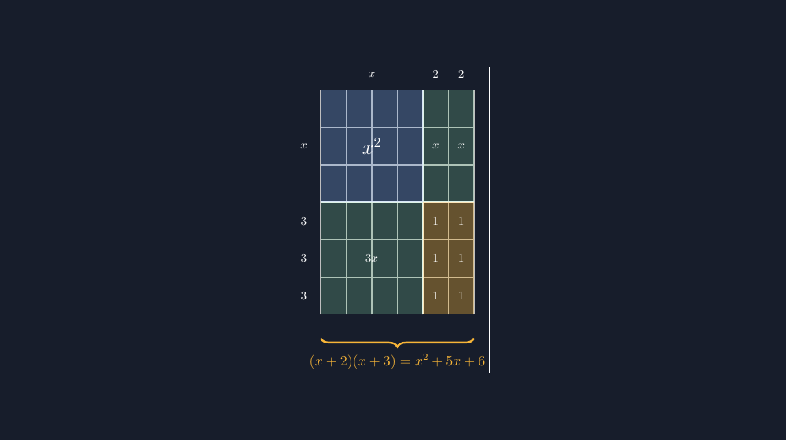

Saya masih ingat pertanyaan seorang siswa tahun lalu saat bab perkalian bentuk aljabar. Saya baru saja menggambar persegi panjang di papan tulis, membaginya menjadi beberapa bagian, lalu menulis $(x+2)(x+3) = x^2 + 5x + 6$ di bawahnya dengan nada bangga. Dia mengangkat tangan dan bertanya, "Pak, kok kotak yang tulisannya $x^2$ sama kotak yang tulisannya $x$ kelihatannya sama besar?" Dan memang demikian. Papan tulis saya tidak punya penggaris yang cukup sabar, jadi kotak $x^2$ yang seharusnya jauh lebih besar hanya jadi kira-kira sama dengan kotak satuan di sebelahnya.

<!--more-->

## Ketika Gambar Membantotkan Matematika

Model blok luas — kadang disebut *algebra tiles* atau model persegi panjang — adalah salah satu cara paling klasik untuk menjelaskan mengapa $(x+2)(x+3)$ hasilnya $x^2 + 5x + 6$. Logikanya sederhana: mengalikan dua panjang berarti mencari luas, dan luas persegi panjang bisa dihitung per potongan. Persegi panjang dengan lebar $(x+2)$ dan tinggi $(x+3)$, jika dipotong-potong, menghasilkan satu persegi besar berluas $x^2$, tiga persegi panjang berluas $x$ (dari kolom $2$) — maaf, mari saya tulis dengan benar: satu persegi panjang lebar $x$ tinggi $3$ berluas $3x$, dua persegi panjang berluas $x$ masing-masing, dan enam kotak satuan.

Nah, di kalimat penjelasan seperti itulah gambar menjadi penting. Kalau kotak $x^2$ digambar sama besar dengan kotak satuan, siswa yang jeli akan bingung — dan siswa yang tidak jeli akan diam-diam menyerah pada gambar dan hanya menghafal prosedurnya. Padahal justru kekuatan model ini ada pada *proporsi*: mata harus bisa melihat bahwa $x^2$ itu besar, bahwa enam kotak satuan itu kecil-kecil, dan bahwa jumlahnya tetap konsisten.

Sejak pengalaman itu, saya jadi reseptif pada setiap gambar soal yang kotaknya tidak setia pada ukurannya. Dan seperti tulisan-tulisan saya sebelumnya tentang timbangan persamaan linear, garis bilangan, sampai jaring-jaring bangun ruang, jawabannya kembali sama: percayakan pada TikZ.

## Ide Dasarnya: Persegi Panjang yang Dipotong

Ide gambar yang saya pakai sekarang begini. Saya buat persegi panjang besar, lalu membaginya dengan dua garis: satu garis vertikal yang memisahkan kolom lebar $x$ dari dua kolom satuan, dan satu garis horizontal yang memisahkan baris tinggi $x$ dari tiga baris satuan. Hasilnya empat wilayah:

$$
\underbrace{(x+2)}_{\text{lebar}} \times \underbrace{(x+3)}_{\text{tinggi}}
$$

Wilayah kiri atas berukuran $x \times x$ — itulah $x^2$. Wilayah kanan atas berukuran $2 \times x$ — dua kotak berisi $x$. Wilayah kiri bawah berukuran $x \times 3$ — itulah $3x$. Dan wilayah kanan bawah berukuran $2 \times 3$ — enam kotak satuan. Berbekal $\text{luas} = \text{lebar} \times \text{tinggi}$, siswa tidak perlu menghafal apa pun: mereka tinggal membaca petak demi petak.

Bagian yang paling sering salah digambar justru di sini: lebar bagian "2" itu terdiri dari dua kolom terpisah, dan tinggi bagian "3" itu tiga baris terpisah. Kalau kolom dan barisnya tidak digambar per satuan, siswa sulit melihat mengapa hasilnya $2 \times 3 = 6$ kotak, bukan angka ajaib.

## Kode TikZ: Ukuran yang Setia

Ini kode inti yang saya pakai. Perhatikan bahwa satu unit satuan saya gambar $0{,}75$ cm, dan kolom $x$ saya gambar $3$ cm — jadi secara visual, $x$ memang jauh lebih besar dari satu kotak satuan. Lebar total kanvas gambar hanya sekitar $5{,}3$ cm, tetapi proporsinya yang penting.

```latex
\begin{tikzpicture}[line width=1.2pt, scale=1.0]
  % label kolom (atas)
  \node[white] at (1.5,4.85) {$x$};
  \node[white] at (3.375,4.85) {$2$};
  \node[white] at (4.125,4.85) {$2$};
  % label baris (kiri)
  \node[white] at (-0.5,2.75) {$x$};
  \node[white] at (-0.5,0.55)  {$3$};
  \node[white] at (-0.5,-0.55) {$3$};
  \node[white] at (-0.5,-1.65) {$3$};
  % grid: kolom satuan 0.75cm, baris satuan 1.1cm, kolom x 3cm
  \draw[gray!50] (0,-2.2) grid[xstep=0.75cm,ystep=1.1cm] (4.5,4.4);
  \draw[white, line width=1.4pt] (3,-2.2) -- (3,4.4);
  \draw[white, line width=1.4pt] (0,1.1) -- (4.5,1.1);
  % sel x^2
  \fill[blu, opacity=0.30] (0,1.1) rectangle (3,4.4);
  \node[white, font=\LARGE] at (1.5,2.75) {$x^2$};
  % dua sel x (kolom satuan, baris x)
  \fill[grn, opacity=0.25] (3,1.1) rectangle (4.5,4.4);
  \node[white] at (3.375,2.75) {$x$};
  \node[white] at (4.125,2.75) {$x$};
  % sel 3x (kolom x, baris satuan)
  \fill[grn, opacity=0.25] (0,-2.2) rectangle (3,1.1);
  \node[white] at (1.5,-0.55) {$3x$};
  % enam kotak satuan
  \fill[acc, opacity=0.35] (3,-2.2) rectangle (4.5,1.1);
  \node[white] at (3.375,0.55) {$1$};
  \node[white] at (4.125,0.55) {$1$};
  \node[white] at (3.375,-0.55) {$1$};
  \node[white] at (4.125,-0.55) {$1$};
  \node[white] at (3.375,-1.65) {$1$};
  \node[white] at (4.125,-1.65) {$1$};
  % kurung hasil
  \draw[acc, line width=1.6pt, decorate,
        decoration={brace, amplitude=7pt, mirror}]
    (0,-2.9) -- (4.5,-2.9)
    node[midway, below=9pt, acc, font=\large]
    {$ (x+2)(x+3) = x^2 + 5x + 6 $};
\end{tikzpicture}
```

Sedikit catatan teknis: tiga warna `blu`, `grn`, dan `acc` saya definisikan di preamble dengan `\definecolor`, dan `decoration={brace,...}` di akhir butuh `\usetikzlibrary{decorations.pathreplacing}` — sering kali inilah penyebab kode TikZ dari internet gagal dikompilasi, bukan karena salah logika.



*Gambar: persegi panjang $(x+2) \times (x+3)$ yang dipotong menjadi empat wilayah — perhatikan bahwa enam kotak satuan di kanan bawah memang berjajar rapi dua kolom kali tiga baris.*

## Di Kelas: Menghitung Petak, Bukan Menghafal

Cara saya memakai gambar ini di kelas sederhana. Saya tampilkan dulu versi kosong — hanya persegi panjang dengan label $x$, $2$, $x$, dan $3$ di tepinya, tanpa isi. Lalu saya minta siswa menebak apa isi setiap wilayah. Grup depan biasanya cepat menemukan $x^2$ dan kotak-kotak satuan. Yang sering jadi perdebatan adalah sel $3x$: sebagian menulis $3 \cdot x$, sebagian menulis $x \cdot 3$, dan perdebatan itu justru bagus karena akhirnya mereka sendiri yang menyimpulkan bahwa keduanya sama.

Baru setelah semua wilayah terisi, saya tarik kesimpulan: jumlahkan semua petak, dan itulah bentuk tersederhananya. Dengan demikian, $x^2 + x + x + 3x + 1 + 1 + 1 + 1 + 1 + 1$ bisa siswa rapatkan sendiri menjadi $x^2 + 5x + 6$. Tidak ada langkah yang mereka terima begitu saja — semuanya bisa ditunjuk di gambar.

Siswa yang lebih maju biasanya langsung mencoba variasi: kalau yang dikalikan $(x+4)$, berapa kotak satuan yang muncul? Kalau $(2x+1)(x+3)$, bagaimana bentuk petaknya? Di sinilah model blok luas terasa hidup — siswa mulai merumuskan sendiri bahwa banyak kotak satuan adalah hasil kali dua bilangan konstanta, dan banyak sel $x$ adalah penjumlahan silang. Mereka menemukan pola yang kelak kita sebut kala $(b)(c)$ dan $(a)(c) + (b)(d)$ tanpa saya perlu menyebut istilahnya lebih dulu.

## Catatan Kecil tentang Jujur pada Proporsi

Saya sadar gambar seperti ini tetap punya batas. Kalau $x$-nya bernilai $2$ saja, kolom $x$ yang saya gambar $3$ cm sudah tidak proporsional terhadap kotak satuan $0{,}75$ cm. Jadi model ini bukan gambar realitas, melainkan *skema* — dan penting saya katakan itu ke siswa: gambar membantu berpikir, bukan menggantikan hitungan. Untuk nilai $x$ tertentu, siswa tetap perlu memverifikasi dengan substitusi, dan justru di situ mereka melihat kenapa aljabar lebih andal daripada gambar.

Tapi untuk tujuan membangun intuisi — mengapa $(x+2)(x+3)$ menghasilkan tiga macam suku — gambar yang proporsinya jujur jauh lebih berarti daripada gambar yang indah tapi bohong. Dan sekali lagi, TikZ membuat versi jujur itu bisa saya simpan sebagai berkas yang sama persis dipakai tahun depan, tanpa menggambar ulang di papan.

> 📎 **Berkas TikZ lengkap:** [tikz-blok-aljabar.tex](tex/tikz-blok-aljabar.tex) — siap kompilasi (butuh paket `tikz`).