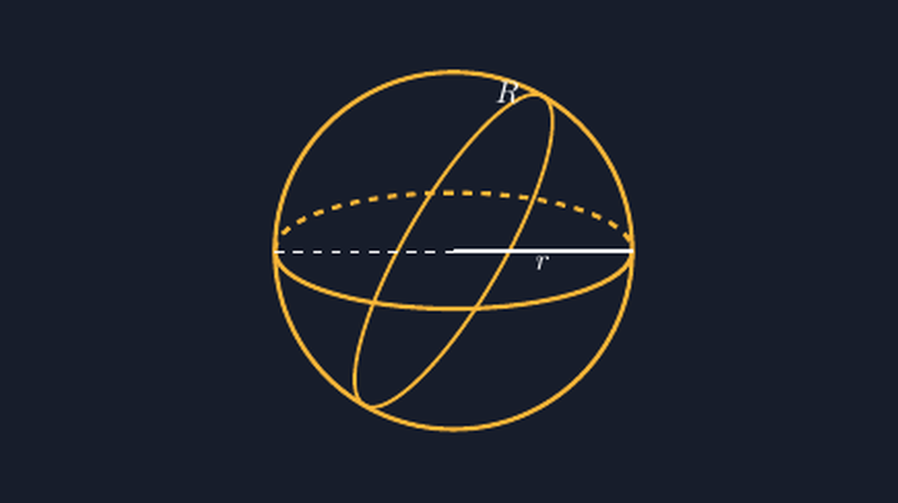

Kalau Bapak/Ibu mengikuti tulisan saya di blog ini, mungkin sudah mengenal kegemaran baru saya: menggambar ulang soal-soal geometri dengan TikZ. Kerucut dan silinder sudah lewat beberapa minggu lalu. Tapi ada satu bangun ruang yang sengaja saya tunda, karena saya tahu dia akan jadi yang paling merepotkan: **bola**.

Bukan tanpa alasan. Soal bola di buku SMP biasanya cuma butuh satu angka, jari-jari. "Sebuah bola berjari-jari 21 cm, hitunglah volumenya." Murid tinggal menghitung $V = \frac{4}{3}\pi r^3$, selesai dalam dua baris. Gambar yang menyertainya pun cuma lingkaran biasa — dan di situlah letak masalahnya. Lingkaran datar itu secara teknis benar, tapi secara geometri ia bukan bola. Bola itu tiga dimensi, dan murid kelas delapan yang baru belajar membedakan luas lingkaran dengan volume bola pantas mendapat gambar yang jujur.

<!--more-->

## Bola yang hanya berupa lingkaran

Coba perhatikan soal-soal yang beredar. Hampir semua menggambar bola sebagai lingkaran dengan satu garis jari-jari miring, seperti ini: lingkaran, titik pusat, garis ke tepi, label $r$. Kalau soalnya hanya soal hitung, itu cukup. Tapi ketika saya mengajarkan perbedaan "menghitung seluruh permukaan bola" dengan "menghitung luas lingkaran", murid-murid saya justru bingung oleh gambar yang sama persis untuk dua benda yang berbeda.

Anak-anak tidak salah. Gambar yang salah sasarannya, saya.

Bola yang baik setidaknya menunjukkan dua hal: bahwa ia punya "perut" yang membulat ke semua arah, dan bahwa di dalamnya ada irisan-irisan lingkaran. Irisan yang paling penting bagi murid SMP adalah **lingkaran besar** — irisan bola oleh bidang yang melalui pusatnya. Dari sanalah nanti mereka akan bertemu konsep keliling bola, dan di jenjang lebih tinggi, lingkaran besarnya bola bumi: garis khatulistiwa dan meridian.

Jadi target saya jelas: menggambar bola dengan lingkaran besar yang terlihat, bukan sekadar lingkaran dengan garis jari-jari.



*Bola dengan dua irisan: ekuator (elips horizontal) dan lingkaran besar yang miring melalui pusat. Bagian sisi belakang digambar putus-putus — di situlah kejujuran gambar diuji.*

## Masalahnya: lingkaran yang "menempel" di bola

Di TikZ, menggambar bola itu satu baris:

```latex
\draw (0,0) circle (2);
```

Selesai. Yang sulit justru setelahnya: bagaimana menggambar lingkaran besarnya? Irisan bidang tegak yang melalui pusat bola itu, dilihat dari depan, bentuknya garis lurus. Tapi begitu bidangnya dimiringkan, irisannya tampak sebagai **elips** yang tepat menyentuh tepi bola di dua titik berlawanan.

Di sinilah saya sempat tersesat. Percobaan pertama saya, saya mencoba "memutar" lingkaran besar dengan koordinat kutub TikZ, menghitung titik-titiknya satu per satu. Hasilnya memalukan: busurnya keluar dari bola, menjulur di luar tepi seperti kunang-kunang yang lepas. Gambar yang saya maksud untuk mengajarkan kejujuran geometri justru berbohong di depan murid.

Pelajaran yang sama seperti waktu menghadapi kerucut: jangan memaksakan perhitungan manual kalau TikZ sudah punya alatnya. Untuk silinder, saya memakai `ellipse`. Untuk lingkaran besar yang miring, kuncinya sama — elips yang **dirotasi**:

```latex
\begin{scope}[rotate=60]
  \draw (0,0) ellipse (2 and 0.55);
\end{scope}
```

Elips itu punya sumbu mayornya sama dengan jari-jari bola ($2$), jadi ujung-ujungnya pasti menyentuh tepi bola. Sumbu minornya ($0.55$) menentukan seberapa "terbuka" bidang irisannya terhadap mata kita. Begitu dirotasi 60 derajat, dia berubah menjadi lingkaran besar yang miring menembus pusat — dan yang paling penting, dia **tidak pernah keluar dari bola**, karena ujung terjauhnya selalu persis di tepi.

Perhatikan juga angka di gambar saya: bidang yang hampir tegak lurus mata kita tampak sebagai elips yang kurus dan panjang; bidang yang sejajar mata kita tampak hampir bulat penuh. Aturan umumnya: kalau bidang irisan membentuk sudut $\theta$ terhadap arah pandang, elipsnya punya perbandingan sumbu kira-kira $\cos\theta$. Angka $0.55$ itu tidak saya pilih asal — kira-kira $\cos 57^\circ$. Jadi gambar ini bukan dekorasi; ada matematika di balik proporsinya.

## Garis putus-putus yang menentukan segalanya

Bagian yang membuat gambar bola terasa "berisi" adalah ekuator. Sama seperti silinder, ekuator bola digambar sebagai elips horizontal — tapi di bola, setengah belakangnya harus **putus-putus**, karena tertutup badan bola:

```latex
\draw (-2,0) arc[start angle=180, end angle=360, x radius=2, y radius=0.65];
\draw[dashed] (-2,0) arc[start angle=180, end angle=0, x radius=2, y radius=0.65];
```

Busur pertama, dari sudut 180 ke 360, adalah sisi depan: solid. Busur kedua, dari 180 ke 0, sisi belakang: putus-putus. Kombinasi kecil ini yang membuat mata pembaca tahu mana yang depan mana yang belakang. Tanpa itu, gambar bola tinggal tumpukan lingkaran acak.

Dan satu detail lagi yang saya pelajari dari kesalahan sendiri: pada lingkaran besar yang miring, jangan ikut menggambar bagian belakangnya putus-putus kalau gambar jadi terlalu ramai. Dua irisan sekaligus — ekuator dan lingkaran besar — sudah cukup menceritakan bentuk bola. Menambahkan irisan ketiga membuat gambar seperti gulungan benang yang kusut. Kadang kejujuran gambar bukan soal menambah, tapi berhenti di waktu yang tepat.

## Di kelas: bola yang akhirnya bisa "dilihat"

Gambar jadi ini saya pakai pertama kali di kelas delapan, saat membahas gabungan bangun ruang. Soalnya klasik: bola menempel di dalam tabung yang pas, atau bola bersinggungan dengan kerucut. Selama ini soal-soal seperti itu saya lewati dengan gambar dua lingkaran berdempetan yang tidak menjelaskan apa-apa.

Ketika saya tampilkan gambar bola dengan lingkaran besarnya yang miring, ada reaksi kecil yang saya ingat sampai sekarang. Seorang murid bertanya, "Pak, garis miring itu apaan? Kayak sabuk yang kelewat tinggi." Saya bilang betul, itu lingkaran di permukaan bola, sama seperti ekuator di bumi, hanya saja dimiringkan. Dan dari satu pertanyaan itu, diskusi bergerak sendiri ke arah yang saya harapkan: berapa banyak lingkaran besar yang bisa dibuat di satu bola? (Tak terhingga, dan semua terbesar — anak-anak sempat tidak percaya.)

Pertanyaan-pertanyaan seperti itu tidak akan muncul dari soal yang cuma menampilkan lingkaran dan angka $r$. Gambar yang jujur mengundang pertanyaan; gambar yang asal tidak.

## Berkas lengkapnya

Seperti biasa, berkas TikZ-nya saya simpan utuh dan siap kompilasi. Kode di badan artikel ini hanya potongan; berkas lengkapnya punya `standalone`, warna latar gelap, dan aksen kuning yang sama dengan tulisan-tulisan TikZ saya sebelumnya, jadi kalau Bapak/Ibu kumpulkan semuanya, seri gambarnya rapi satu keluarga.

> 📎 **Berkas TikZ lengkap:** [bola.tex](tex/bola.tex) — siap kompilasi (butuh paket `tikz`).

Kalau dilihat dari jauh, rangkaian bangun sisi lengkung di blog ini kini sudah lengkap: kerucut, silinder, dan bola. Tiga bangun yang paling sering membuat murid SMP bertanya "Pak, gambarnya mana?" — dan tiga bangun yang paling sering membuat guru menyerah pada gambar asal. Berkat TikZ, penyerahan itu tidak perlu terjadi. Tinggal satu hal yang belum saya bereskan: bola yang dipotong setengah untuk soal gabungan. Itu, mungkin, untuk tulisan berikutnya.
