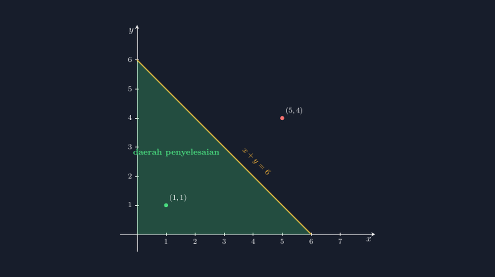

Materi pertidaksamaan linear dua variabel selalu saya mulai dengan gambar. Sebelum siswa menyentuh kata "program linear" yang menakutkan di buku, mereka harus dulu bisa membaca satu hal sederhana: mana daerah yang memenuhi, mana yang tidak. Tahun lalu saya menggambar latihannya di aplikasi gambar biasa — segitiga hijau di bawah garis, sebagian kecil bidang diarsir, kelar. Tapi di kelas, seorang siswa menunjuk gambar saya dan bertanya, "Pak, titik $(5,4)$ itu kok dipilih untuk jadi contoh yang tidak memenuhi? Emang Bapak hitung dulu, atau Bapak taruh di situ saja?"

Pertanyaan itu menusuk. Karena jujur saja, saya memang menaruhnya "di situ saja" — di tempat yang kelihatan cukup jauh dari daerah hijau. Untung titik itu benar-benar tidak memenuhi $x+y \le 6$, jadi kebohongan kecil saya tidak ketahuan. Tapi kalau besok saya kurang beruntung, titik uji yang saya taruh asal bisa justru berada di daerah penyelesaian, dan satu kelas penuh akan mencatat konsep yang salah dengan percaya diri.


*Daerah penyelesaian $x+y \le 6$ pada kuadran pertama — posisi titik uji $(1,1)$ dan $(5,4)$ dihitung, bukan ditebak.*

<!--more-->

## Daerah penyelesaian itu tidak boleh kira-kira

Berbeda dengan persamaan linear yang penyelesaiannya "cuma" sebuah garis, pertidaksamaan linear dua variabel penyelesaiannya adalah **separuh bidang**. Setiap titik di salah satu sisi garis batas memenuhi pertidaksamaan; setiap titik di sisi lainnya menolaknya. Karena itu menggambar daerah penyelesaian punya tiga syarat kejujuran yang tidak bisa ditawar:

Pertama, garis batasnya harus persis. Untuk $x+y=6$, garis itu wajib melewati $(0,6)$ dan $(6,0)$ — bukan kira-kira dekat situ. Kedua, arsirannya harus berada di sisi yang benar. Untuk tanda $\le$ dengan garis padat, daerah yang berisi titik asal $(0,0)$ — sebab $0+0=6$ adalah pernyataan benar — itulah yang diterima. Ketiga, titik uji yang kita pilih untuk demonstrasi harus benar-benar dipilih setelah dihitung, bukan ditaruh manis di gambar.

Tiga syarat yang ketiganya mustahil saya penuhi dengan menggambar tangan. TikZ menyelesaikannya dengan cara yang paling saya sukai: komputasi. Saya menyebut koordinat sudut-sudutnya, menghitung sendiri titik ujinya, dan menggambar titik uji di koordinat yang sudah saya periksa dengan hitungan biasa: $(1,1)$ memberi $1+1=2 \le 6$, benar; $(5,4)$ memberi $5+4=9 > 6$, salah. Gambar dan hitungan akhirnya bercerita sama.

## Bagaimana gambarnya dibuat

Inti kodenya sebenarnya pendek. Yang penting adalah tiga lapis yang digambar berurutan: bidang arsir dulu, garis batasnya di atas, titik uji paling akhir supaya tidak tertutup.

```latex
% Garis batas x + y = 6
\draw[aksen, very thick] (0,6) -- (6,0);

% Daerah penyelesaian x + y <= 6 dengan x >= 0, y >= 0
\fill[hijau, opacity=0.25] (0,0) -- (6,0) -- (0,6) -- cycle;

% Titik uji
\fill[hijau] (1,1) circle (2.2pt) node[above right] {$(1,1)$};
\fill[merah] (5,4) circle (2.2pt) node[above right] {$(5,4)$};
```

Perhatikan satu keputusan kecil yang punya dampak pedagogis besar: saya sengaja **membatasi daerah penyelesaian pada kuadran pertama** — segitiga dengan sudut di $(0,0)$, $(6,0)$, dan $(0,6)$ — bukan menggambar separuh bidang penuh yang menjalar ke kiri-atas tanpa batas. Dalam matematika murni, daerah penyelesaian $x+y\le6$ memang tak terbatas. Tapi di konteks soal kontekstual (uang, bahan, waktu — semua tidak mungkin negatif), syarat $x\ge0$ dan $y\ge0$ selalu menyertai. Kalau saya menggambar bidang tak terbatas, siswa akan bertanya kenapa di soal cerita tiba-tiba ada segitiga. Kalau saya langsung menggambar segitiga tanpa menjelaskan, siswa akan mengira daerah penyelesaian pertidaksamaan linear *selalu* berbentuk segitiga. Kedua kesalahan itu sama berbahayanya, dan keduanya lahir dari gambar — bukan dari rumus.

Ini juga alasan kenapa saya menaruh **dua** titik uji, bukan satu. Satu titik hijau saja bisa membuat siswa berpikir "titik uji itu selalu diterima". Pasangan $(1,1)$ yang diterima dan $(5,4)$ yang ditolak — masing-masing dengan perhitungan singkat yang saya tulis di papan — menunjukkan bahwa titik uji adalah alat pemeriksa, bukan hiasan gambar.

## Kesalahan klasik yang bisa dicegah gambar

Setelah beberapa kali mengajar materi ini, saya mulai mencatat pola kesalahan yang berulang, dan hampir semuanya bisa diarahkan lewat gambar yang benar.

Kesalahan pertama: **mencampur adukkan tanda**. Siswa yang hafal "lebih kecil artinya arsir bawah" akan salah total kalau garisnya miring ke bawah seperti $y \ge -2x+4$ — di kasus itu daerahnya justru di atas. Aturan "bawah/atas" adalah jalan pintas yang retak; aturan titik uji tidak pernah menipu. Gambar TikZ yang menyertakan titik uji memaksa kita mengajarkan cara yang benar sejak awal.

Kesalahan kedua: **garis putus-putus versus padat**. Tanda $<$ dan $>$ memakai garis putus-putus karena titik-titik di garis batas tidak termasuk penyelesaian. Siswa sering mengabaikan perbedaan ini — sampai soalnya bertanya "apakah $(6,0)$ merupakan penyelesaian?" Pada $x+y<6$, jawabannya tidak, dan garis putus-putus di gambar adalah pengingat visualnya. Di kode, bedanya cuma `dashed` pada garis batas — tapi maknanya besar.

Kesalahan ketiga yang paling sering saya temui di ulangan: siswa menggambar garis batas dengan benar, lalu **mengarsir sisi yang salah** karena menganggap tanda mengarah ke arah "sisi yang kelihatan lebih besar di gambar". Padahal yang menentukan bukan penampakan, melainkan hasil substitusi titik uji. Karena itu dalam latihan saya, langkah terakhir menggambar selalu bukan "arsir", melainkan "uji, baru arsir".

## Dari gambar tunggal ke gambar berdampingan

Gambar tunggal di atas bagus untuk pengenalan. Tapi untuk latihan, saya sering membuat dua gambar berdampingan: kiri untuk $x+y\le6$ dan kanan untuk $x+y\ge6$, dengan garis batas yang sama persis. Siswa bisa melihat dua daerah itu sebagai dua kembaran yang berbagi satu garis — satu mengambil sisi kiri-bawah, satu mengambil sisi kanan-atas. Dari sini, konsep bahwa dua pertidaksamaan berlawanan membagi bidang menjadi dua terasa langsung, tanpa perlu saya ceramah panjang.

Dan bila materi lanjut ke sistem pertidaksamaan — irisan dua daerah dengan dua arsiran berbeda yang bertumpuk — TikZ justru makin bersinar: dua `\fill` dengan warna berbeda dan `opacity` rendah akan menghasilkan daerah irisan yang terlihat jelas sebagai percampuran warna. Siswa melihat dengan mata mereka bahwa "memenuhi kedua syarat" itu artinya berada di daerah yang keduanya menutupinya.

## Penutup: gambar yang tidak pernah menjerat penulisnya

Ada satu halasan kecil yang saya nikmati dari kebiasaan membuat media dengan TikZ: ketika tahun depan saya mengajar materi ini lagi, saya tinggal membuka berkas lama. Tidak ada gambar yang perlu digambar ulang, tidak ada risiko mengulangi kesalahan taruh-titik-asal seperti yang hampir terjadi waktu itu. Gambar yang jujur tahun lalu tetap jujur tahun ini.

Dan setiap kali saya menunjukkan gambar seperti di atas, saya selalu mengingatkan siswa: garis kuning itu bukan hiasan, warna hijau itu bukan selera. Masing-masing lahir dari perhitungan — dan kalian semua bisa memeriksanya dengan hitungan kalian sendiri. Kalau media yang kita pakai mengajak siswa memeriksa, bukan sekadar percaya, kita sudah menang setengah pertarungan.

> 📎 **Berkas TikZ lengkap:** [tikz-daerah-penyelesaian-ptldv.tex](tex/tikz-daerah-penyelesaian-ptldv.tex) — siap kompilasi (butuh paket `tikz`).
