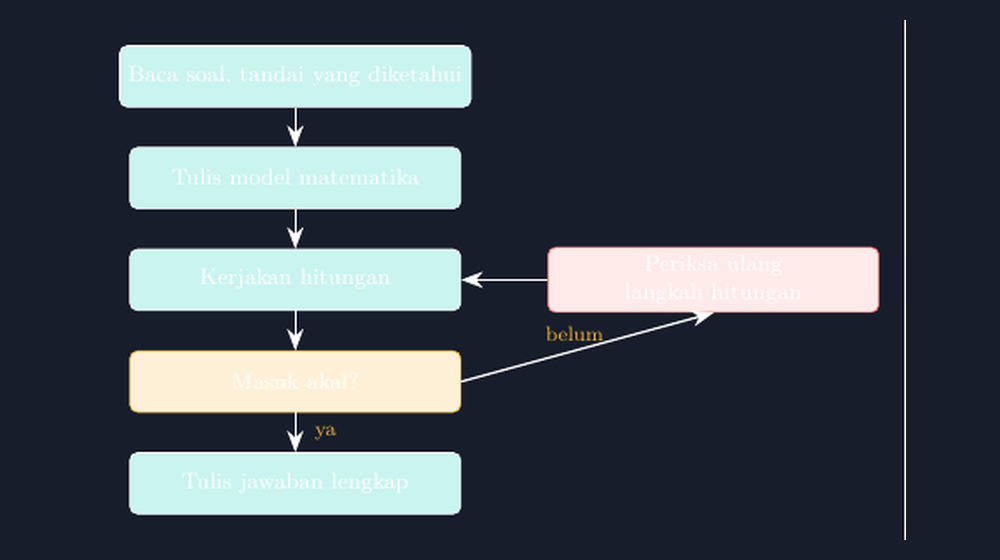

Ada satu pemandangan yang setiap tahun saya temui di kelas dan setiap tahun juga membuat saya geleng-gelap: siswa yang menulis satu angka besar dan tebal di baris paling bawah, tanpa satu pun langkah di atasnya. Saya tanya, "Cara hitungnya mana?" Jawabannya lirih, "Di kepala, Pak." Kadang angkanya benar. Sama seringnya, angkanya salah — dan ketika salah, saya tidak tahu harus memperbaiki dari mana. Kayak dokter dapat pasien pingsan tanpa kartu riwayat: tahu ada yang tidak beres, tapi tidak tahu di organ mana.

<!--more-->

Pekan lalu kejadiannya berulang di kelas VII, saat soal kerjanya cuma sekadar: sebatang kue dibeli Rp12.000, laku separuhnya, sisanya dikurangi dua potong, tinggal berapa? Anak yang saya duduki lama mengerjakan dan sampai pada jawaban yang justru lebih besar dari harga sebatang kue. Ketika saya minta dia menjelaskan, dia bingung sendiri langkah mana yang dia lakukan lebih dulu. Di titik itu saya sadar masalahnya bukan hitungan — masalahnya dia tidak punya peta langkah sama sekali. Semua proses itu hidup di kepalanya, sesak, tanpa urutan yang bisa diperiksa.

Malamnya, di jurnal digital saya, saya menulis satu keputusan: pekan depan kelas akan punya diagram alur penyelesaian soal, digambar cukup besar untuk dibaca dari bangku belakang. Dan seperti pekan-pekan sebelumnya, alat gambar saya tetap yang sama: TikZ.

## Empat Langkah, Bukan Empat Rumus

Diagram yang saya rancang sengaja sederhana, karena kalau terlalu ramai siswa tidak akan membacanya setelah minggu pertama. Ada empat kotak berurutan dan satu simpul keputusan:


*Diagram alur penyelesaian soal yang saya tempel di dinding kelas — gambar hasil TikZ, satu file yang sama dengan yang saya cetak.*

Baca soal dan tandai yang diketahui. Tulis model matematika. Kerjakan hitungan. Lalu, dan ini kotak yang paling sering dilompati siswa: masuk akal tidak? Kalau belum, kembali memeriksa langkah hitungan. Kalau sudah, tulis jawaban lengkap — lengkap artinya dengan satuannya, bukan angka telanjang.

Kotak kedua, "tulis model matematika", adalah jantung diagram ini. Dari soal kue tadi, modelnya sederhana: $12.000 : 2 - 2 \times 2.000$. Tapi menuliskannya di kertas memaksa siswa memutuskan urutan: bagian yang dilakukan dulu itu mana? Di sinilah saya bisa menyelipkan pembicaraan tentang urutan operasi tanpa terdengar seperti menghafal aturan. Model yang tertulis salah biasanya langsung ketahuan oleh siswa sendiri begitu dia membacanya ulang — sesuatu yang tidak pernah terjadi kalau semua proses itu tetap di kepala.

## Kotak yang Paling Sering Dilompati

Kotak "masuk akal?" saya beri warna berbeda di gambar — kuning, biar mencolok. Dan memang perlu mencolok, karena di situlah letak perbedaan paling nyata antara pekerjaan yang jujur dan pekerjaan yang sekadar selesai.

Contoh favorit saya dari pekan itu: soal luas taman berbentuk persegi panjang, panjang 15 m dan lebar 8 m, ditanyakan luasnya. Seorang siswa menjawab 46. Angka itu lahir dari $(15 + 8) \times 2$ — dia menghitung keliling. Di kelas lama, jawaban seperti ini coret merah dan selesai. Dengan diagram alur, saya cuma perlu satu pertanyaan: "Sudah lewat kotak kuning?" Dia kembali ke kertasnya, membaca modelnya sendiri, dan dalam beberapa detik dia bilang pelan, "Oh, ini keliling, Pak. Taman yang diukur pagar kok." Salah yang ditemukan sendiri itu jauh lebih melekat daripada salah yang dikoreksi orang lain — dan diagram itu memberi mereka alat untuk menemukannya sendiri.

Yang menarik, kotak "belum — periksa ulang" di diagram saya gambar dengan garis yang kembali ke atas. Beberapa siswa sempat bertanya kenapa panahnya bolak-balik. Saya jawab: karena di matematika, mundur untuk memeriksa bukan tanda gagal; itu bagian dari jalan. Siswa yang terbiasa menganggap koreksi sebagai hukuman perlu mendengar kalimat itu, dan gambar yang menunjukkan panah kembali sebagai jalur resmi ternyata menyampaikannya lebih baik daripada nasihat lisan saya.

## Potongan Kodenya

Bagian inti dari gambar itu sesederhana ini:

```latex
\begin{tikzpicture}[
  node distance=0.55cm and 0.5cm,
  kotak/.style={rectangle, rounded corners=3pt, draw=white,
    fill=tealsoft!25, minimum width=4.6cm, align=center},
  keputusan/.style={kotak, draw=accent, fill=accent!20},
  panah/.style={-{Stealth[length=3mm]}, draw=white, thick}
]
  \node[kotak] (baca)   {Baca soal, tandai yang diketahui};
  \node[kotak, below=of baca]   (model)  {Tulis model matematika};
  \node[kotak, below=of model]  (hitung) {Kerjakan hitungan};
  \node[keputusan, below=of hitung] (cek) {Masuk akal?};
  \node[kotak, below=of cek]    (tulis)  {Tulis jawaban lengkap};

  \draw[panah] (baca) -- (model);
  \draw[panah] (model) -- (hitung);
  \draw[panah] (hitung) -- (cek);
  \draw[panah] (cek) -- node[right] {ya} (tulis);
  \draw[panah] (cek.east) -- node[above] {belum} (ulang.south);
\end{tikzpicture}
```

Yang saya suka dari TikZ di sini bukan hasil visualnya saja, tapi fakta bahwa posisi setiap kotak ditentukan oleh hubungan, bukan koordinat kaku: `below=of baca`, bukan "di titik (0,-3)". Artinya kalau besok saya ingin menambah satu langkah — misalnya kotak "gambar sketsa dulu" untuk soal geometri — saya tinggal selipkan satu node dan seluruh diagram menata ulang dirinya. Tidak ada tata letak yang rusak, tidak ada panah yang harus dipindah tangan.

## Perubahan yang Muncul perlahan

Saya tidak akan mengklaim diagram ini mengubah segalanya dalam satu pekan. Tiga minggu setelah menempelnya, yang saya lihat: siswa-siswa yang tadinya hanya menulis jawaban akhir mulai menulis minimal dua baris sebelum angka mereka. Ada yang bahkan menggambar kotak kecil sendiri di kertas — versi kasarnya diagram alur itu — dan mencentang tiap kotaknya. Kertas pekerjaan mereka menjadi lebih panjang, tapi jauh lebih bisa didiagnosis. Ketika mereka salah, sekarang saya bisa melihat di kotak mana mereka tersandung: soalnya yang belum dibaca tuntas, modelnya yang keliru, atau hitungannya yang lolos dari pemeriksaan masuk akal.

Beberapa rekan guru bertanya, apakah siswa tidak akan bosan dengan langkah yang sama di setiap soal. Pengalaman saya justru sebaliknya: justru karena langkahnya selalu sama, siswa bisa mencurahkan seluruh energinya ke bagian yang berubah — soalnya sendiri. Rutinitas di kerangka justru memberi ruang bagi pemikiran di isinya.

Dan jujur saja, diagram itu juga mengoreksi saya. Dulu, ketika koreksi tumpukan pekerjaan, saya cenderung langsung mengejar kebenaran jawaban akhir. Sekarang mata saya otomatis membaca baris-baris sebelum angka terakhir. Guru yang diajari gambar yang dia buat sendiri — itu mungkin bonus yang tidak pernah saya rencanakan.

Kalau Bapak/Ibu ingin mencoba, berkas `.tex` lengkapnya saya sertakan di bawah. Silakan ganti kata-kata di kotaknya sesuai bahasa kelas Bapak/Ibu — yang penting kotak kuningnya jangan dihilangkan.

> 📎 **Berkas TikZ lengkap:** [tikz-diagram-alur-penyelesaian.tex](tex/tikz-diagram-alur-penyelesaian.tex) — siap kompilasi (butuh paket `tikz`).
