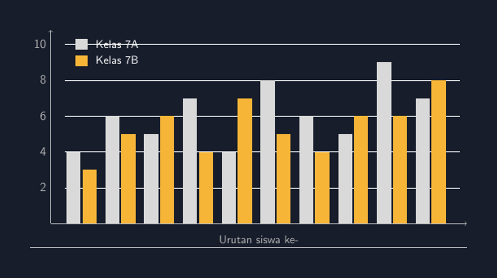

Minggu lalu saya mengoreksi tugas statistika kelas VIII. Salah satu butir soal meminta siswa membandingkan nilai ulangan harian dua kelas yang saya ajarkan, 7A dan 7B, lalu menyimpulkan kelas mana yang lebih stabil. Jawaban yang muncul di lembar jawaban mengejutkan saya: lebih dari separuh kelas menyimpulkan dari grafik yang salah. Bukan salah hitung—salah *membaca*. Mereka membuat diagram batang, tapi batang 7A dan batang 7B diletakkan sembarangan: ada yang bertumpuk, ada yang berjarak tidak konsisten, ada yang tidak diberi tanda warna sehingga tidak jelas mana batang milik kelas yang mana.

Dari grafik yang berantakan itu, mereka lalu menarik kesimpulan yang meyakinkan. Padahal datanya sama persis. Saat itu saya sadar, masalahnya bukan di kemampuan menghitung, tapi di kemampuan *menyusun* perbandingan. Dan justru kemampuan menyusun inilah yang biasanya saya lewatkan begitu saja di kelas.

<!--more-->

## Perbandingan yang Tidak Boleh Ditebak

Diagram batang tunggal sudah sering kita ajarkan, dan kebanyakan siswa cukup lancar. Tapi diagram batang *berganda*—dua set data dalam satu grafik—adalah jenis soal yang berbeda. Di sini ada dua pertanyaan yang harus dijawab sekaligus sebelum menggambar: apa yang dibandingkan, dan *bagaimana* perbandingan itu ditampilkan.

Kalau siswa tidak sadar ada dua pertanyaan, hasilnya seperti lembar-lembar yang saya koreksi minggu lalu. Mereka menganggap urusan menggambar itu formalitas. Padahal dalam diagram batang berganda, susunan batang adalah *pernyataan*. Batang yang sejajar pasangan-pasangannya mengatakan: "dua kelas ini sedang dibandingkan siswa per siswa" (atau kelompok per kelompok, tergantung datanya). Batang yang berjarak acak tidak mengatakan apa-apa—dan justru itu yang berbahaya, karena pembaca grafik akan mengisi kekosongan makna itu dengan tebakan.

## Data yang Saya Pakai

Untuk bahan ajar, saya pakai data sederhana: nilai ulangan harian 10 siswa pertama di 7A dan 7B. Skala 0–10, supaya fokus tetap pada cara menggambar, bukan pada angka besar yang bikin sumbu repot. Datanya begini:

$$\text{7A: } 4, 6, 5, 7, 4, 8, 6, 5, 9, 7$$
$$\text{7B: } 3, 5, 6, 4, 7, 5, 4, 6, 6, 8$$

Rata-rata 7A adalah $6{,}1$ dan 7B adalah $5{,}4$. Dari sini, diagram batang berganda bisa langsung "bercerita": batang 7A sering lebih tinggi, tapi tidak selalu—di siswa ke-3, ke-5, dan ke-10, 7B malah unggul. Perbandingan per pasangan ini justru yang paling menarik untuk didiskusikan di kelas, karena mendorong siswa bicara tentang data, bukan hanya membaca satu batang.


*Diagram batang berganda nilai 10 siswa pertama 7A (putih) dan 7B (kuning). Pasangan batang sejajar memudahkan perbandingan per siswa.*

## Menggambarnya dengan TikZ

Seperti biasa, saya menggambar di TikZ supaya hasilnya presisi dan bisa saya pakai ulang di lembar soal. Ide dasarnya sederhana: setiap siswa mendapat satu *posisi* di sumbu horizontal, dan di posisi itu kita gambar dua persegi panjang—batang 7A di kiri, batang 7B di kanan, saling menempel. Lebar batang dan jaraknya harus konsisten, karena di situlah letak kejujuran grafiknya.

```latex
\foreach \i in {0,...,9} {
  \pgfmathsetmacro{\na}{{\A}[\i]/2}
  \pgfmathsetmacro{\nb}{{\B}[\i]/2}
  \pgfmathsetmacro{\x}{\i*1.1}
  \fill[white!85!black] (\x+0.05,0) rectangle (\x+0.45,\na);
  \fill[aksen]          (\x+0.50,0) rectangle (\x+0.90,\nb);
}
```

Beberapa hal yang saya perhatikan saat menyusun kode ini, dan yang juga layak dibahas dengan siswa:

Pertama, **pembagian dua** di `\na` dan `\nb`. Karena sumbu tegak saya buat 0–10 tapi tinggi maksimal kanvas cuma 5 satuan, nilai dibagi dua saat digambar. Ini detail teknis, tapi justru sering membingungkan siswa: kalau di kode tertulis `\na = nilai/2` sementara di sumbu tertulis 10, mereka bertanya kenapa batangnya "tidak sesuai". Saya justru memanfaatkan momen ini untuk bicara tentang *skala*—bahwa grafik boleh dikecilkan, asalkan sumbunya jujur.

Kedua, **jarak antar pasangan**. Saya pakai `\i*1.1` dan lebar batang total 0,85, jadi antar pasangan ada sedikit celah, tapi dua batang dalam satu pasangan menempel. Perbedaan kecil ini yang membuat mata pembaca langsung mengelompokkan batang sebagai pasangan. Kalau keempat batang di sekitarnya berjarak sama, pengelompokan ini hilang.

Ketiga, **legenda**. Ini bagian yang paling sering saya kelirukan sendiri di percobaan pertama: saya menaruh legend di kanan atas, dan ternyata batang ke-9 yang tinggi menutupi tulisannya. Saya harus memindahkannya ke kiri atas, tempat batang masih pendek. Pelajaran kecil tapi nyata—di TikZ tidak ada yang otomatis menghindari tabrakan, jadi kita yang harus melihat gambar hasil render dan memperbaikinya.

## Yang Terjadi di Kelas

Ketika saya tampilkan diagram hasil TikZ ini di kelas, diskusinya berubah arah dibanding biasanya. Kalau dulu saya cuma minta siswa "bacakan grafik ini", kali ini saya tanya: *apa yang membuat grafik ini mudah dibaca, dan apa yang akan hilang kalau pasangan batangnya kita acak posisinya?*

Jawaban siswa bervariasi, dan di situlah kekayaannya. Ada yang bilang "kan kelihatan langsung mana yang menang". Ada yang lebih tajam: "kalau diacak, sepertinya masih bisa dibaca, tapi capek, Bu, harus ingat warna terus". Yang terakhir ini yang paling saya suka, karena menyentuh inti masalahnya: grafik yang baik *menghemat kerja pembaca*. Warna dan susunan batang bukan hiasan, tapi sistem yang membantu mata memproses perbandingan dengan cepat.

Saya tutup sesi itu dengan tugas kecil: mereka harus menemukan satu pasangan siswa (misal siswa ke-6) di mana 7B menang, dan menjelaskan kenapa kesimpulan "7A selalu lebih baik" itu salah. Semua berhasil menemukannya—dan ini, jujur saja, jauh lebih meyakinkan daripada penjelasan saya di papan tentang "cara membaca diagram".

## Kenapa Saya Tetap Pakai TikZ

Bisa saja saya buat grafik seperti ini di aplikasi spreadsheet dalam dua menit. Tapi TikZ punya kelebihan yang untuk kebutuhan saya tidak tergantikan: setiap keputusan visual ada di kode dan bisa dijelaskan. Saat siswa bertanya "kenapa batangnya menempel?", saya bisa buka kode dan tunjukkan baris yang bertanggung jawab. Grafik jadi bukan benda jadi yang turun dari langit, tapi hasil keputusan-keputusan yang bisa dibaca ulang.

Kalau Bapak/Ibu ingin mencoba, berkas lengkapnya saya sertakan di bawah—tinggal kompilasi dan ganti data `\A` dan `\B` dengan data kelas Anda sendiri. Ada satu catatan praktis: pastikan panjang kedua daftar data sama, kalau tidak, `\foreach` akan diam-diam memotong dan batang terakhir hilang tanpa pesan galat. Saya kena ini sekali dan sempat bingung kenapa siswa ke-10 tidak muncul. Klasik.

> 📎 **Berkas TikZ lengkap:** [tikz-diagram-batang-berganda.tex](tex/tikz-diagram-batang-berganda.tex) — siap kompilasi (butuh paket `tikz`).

## Penutup

Diagram batang berganda kelihatan sepele, tapi ia mengajarkan sesuatu yang lebih besar dari statistika: bahwa *cara menampilkan data adalah bagian dari argumen*. Dua kelas yang dibandingkan dengan batang yang berantakan menghasilkan kesimpulan yang berantakan juga. Dan dalam waktu pengembangan bahan ajar, TikZ memberi saya kendali penuh atas cara data itu bercerita—dengan jujur pada skala, jujur pada jarak, dan jujur pada warna.

Semoga bermanfaat untuk kelas Bapak/Ibu. Kalau ada variasi lain—misalnya diagram batang berganda untuk data berkelompok atau soal kontekstual—saya senang sekali mencicipi ide dari pengalaman kelas Anda.
